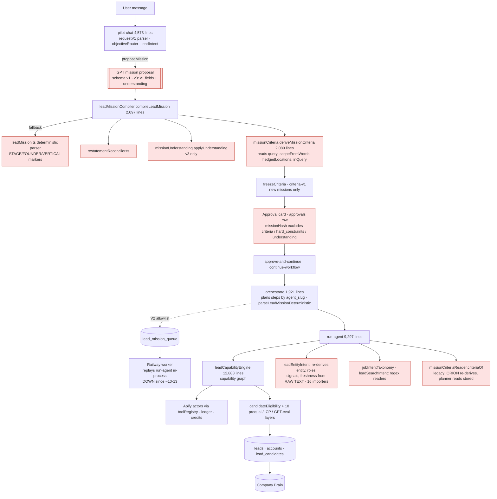
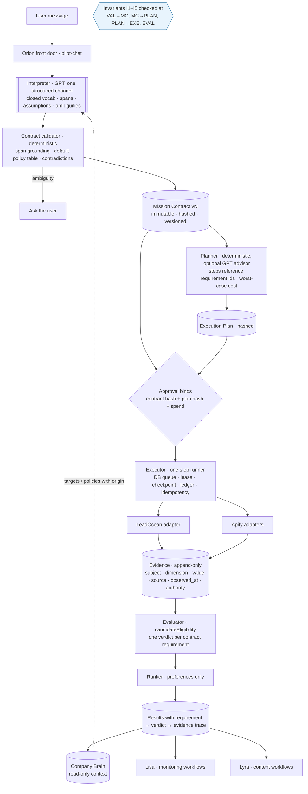

# Agentory: root-level architecture review and redesign strategy

**Date:** 2026-11-05.
**Basis:** `launch/hardening` @ `0a213b7` (#243 merged and verified on GitHub), production function list (read-only), TEST data (read-only), live studies 41990176436 and run #24.
**Scope:** planning only. Nothing here was implemented, deployed or spent.

Conventions:
- **Fact** = verified in code or data, with a citation.
- **Hypothesis** = inferred, with the evidence that would confirm it.
- File paths are under `supabase/functions/` unless stated.

---

## 1. Executive summary

**The problem, simply.** Agentory has no single, authoritative record of what the user asked for. One request is written down several times, in several formats, by several pieces of code:
- the model writes it **twice in the same answer**;
- three deterministic readers re-read the user's sentence later;
- the approval the user clicks does not lock the requirements themselves.

Every place that re-states the meaning is a place where it can drift. Each drift was fixed locally, so the same kind of bug keeps coming back in a new spelling. That is why each new mission seems to expose a new special case.

The model is mostly right. In run #24 the model returned 163 answers: its reading was correct in 161, it asked one unnecessary question, and it misread one. 54 of the 58 failures came from our code reconciling two descriptions of the same meaning.

**The recommendation.**
1. Make one **Mission Contract** the single source of truth:
   - the model fills in one structured reading (no second free-form channel);
   - deterministic code validates it;
   - the user approves **that exact contract** (its hash);
   - every later step reads only the contract.
2. Phase out the parallel readers behind it, one at a time, while the old path keeps running (Strangler Fig).
3. Consolidate the two-plus discovery engines into one later, once the contract has made them comparable.

**What not to do.**
- Do not rewrite the frontend, Supabase, the providers, the budget and ledger system, the evidence/qualification core, Company Brain, or the queue worker. These are the strongest parts of the system.
- Do not adopt microservices, Temporal, event sourcing or a multi-agent framework. None addresses the actual defect.

**What this buys.** It removes whole bug classes, not just instances:
- the "restatement" class (the 54 compiler failures);
- "the planner and the verifier read different requirements";
- "approved one thing, ran another".

It does not make the model infallible. Model mistakes stay possible, but they become **visible, measured and gated** rather than silently compiled.

**Two findings outside the code** need attention first:
- **The production lead worker has been down since about Oct 13.** Health alerts have failed on every run since Oct 19 and nobody acted on them.
- **Production runs functions deployed from mixed sources**, including local machine paths.

These are cheaper and more urgent than any redesign.

---

## 2. The current architecture, traced from code

### 2.1 Production lifecycle (what runs for customers today)

Red nodes are places where **meaning can be created, changed or re-derived**.

**The TEST-only parallel stack.** `lead-pipeline` (strategy_plan / strategy_run; LeadOcean, concurrent discovery, signed plan hash) and `provider-discovery` / `provider-connections` are **not deployed to production** (production function list, 2026-11-05). The newest discovery work therefore lives in an engine customers do not use.

### 2.2 Inventory: where intent is interpreted, changed or defaulted

| What | Where (fact) | Effect |
|---|---|---|
| GPT reading, two channels at once | `_shared/gptMissionSchema.ts:239`: v3 = every v1 field (free `hard_constraints[{field,operator,value}]`, `company_types`, `geographies`, `preferred_signals`, `required_signal_terms`, `signal_recency_days`, `employee_range`) **+** `understanding`. Strict mode makes all fields required. | The model must describe the same meaning twice, every call. |
| Deterministic fallback interpreter | `_shared/leadMission.ts:685` ("The FALLBACK interpreter"), keyword marker lists; `parseLeadMissionDeterministic` used by `orchestrate`. | A third reading of the sentence. |
| Restatement reconciliation | `_shared/restatementReconciler.ts` (S1); `missionCriteria.ts:605,655,680` (`restatesHiringSignal`, `restatesFundingWindow`, `restatesEmployeeBound`); `missionUnderstanding.ts:311,332,351` (#243). | **Seven functions for one bug class**, each closing one spelling. |
| Criteria derivation reading raw text | `missionCriteria.ts`: `scopeFromWords(query)`, `hedgedLocations(query, …)`, `inQuery(v)` decide hard vs. target. | Meaning partly re-derived from the sentence, not from the reading. |
| Defaults | Compiler (30-day hiring window, disclosed), v3 instruction (`missionUnderstanding.ts:142`), criteria (HQ for "US companies"), Brain merge (`leadPipeline/brainContext.ts`). | Four places; mostly consistent today, but there is no single policy table. |
| Freeze | `missionCriteriaReader.ts`: `criteria-v1`, `CRITERIA_SOURCE_FIELDS` fingerprint. **New missions only.** | Good mechanism, partial coverage. |
| Approval identity | `leadMission.ts:669` `missionHash` covers query, type, entity, output, count, `company_profile`, signals, decision-makers, capabilities. **Not** `hard_constraints`, `criteria`, `understanding`. The approval is an `approvals` **row id** (`approve-and-continue/index.ts`). | Two missions with different hard requirements can share an approval hash. |
| Runtime re-derivation | `missionCriteriaReader.ts` header: legacy missions: *"ORION re-derives at run time, the planner read the stored copy"*. S0 found 17 + 11 legacy missions where the planner dropped geography or hard signals that ORION enforced (`missionCriteriaReader.ts` header; `mission-reliability-baseline.md`). | The planner and the verifier can enforce different requirements. |
| Execution-time interpreters | `_shared/leadEntityIntent.ts` (*"authoritative … compiled from the ORIGINAL user instruction … Deterministic-first"*; decides target entity, roles, geographies, signals, `hiring_signal_required`, `job_search_spec`, freshness, count; 16 importers incl. `sourcingConstraints`, `evidenceContract`, `qualificationPersistence`, `candidateEnvelope`). Also `leadSearchIntent.ts` (56 regex lines), `jobIntentTaxonomy.ts` (51), `leadIntent.ts`, `leadIntentModel.ts`. | Execution and qualification can act on a different reading than the approved one. |
| Raw-text readers | **50 files** read `original_user_query` / `originalUserQuery`, in chat, compiler, criteria, engine, run-agent and orchestrate. | The approved contract is not the only input to execution. |
| Intent / requirement types | **213** exported types named *Mission / Requirement / Criteri / Spec / Icp / Proposal / Understanding / Intent / Constraint* in `_shared`. At least 8 are parallel representations of "what the user wants" (`LeadMissionV1` + `MissionCriterion[]`, `GptMissionProposal` / `ProposedUnderstanding`, `DiscoverySpec`, `DiscoveryRequirements`, `CompiledIcp`, `AgentoryMission` / `LeadSourcingMission`, `LeadEntityIntent` / `LeadSearchIntent` / `SeparatedIntent`, `LeadStrategyMission` / `AdaptiveMission`). | No single contract. |

### 2.3 Execution, evidence, budgets: what is already good (facts)

- **Shared qualification core:** `candidateEligibility.ts` (881 lines, no regex) is used by run-agent, the engine, the lead-pipeline and provider-discovery's `sharedQualification.ts`. Evidence carries source, `observed_at` and an authority rule (`authorityForEvidence`, R7). An absent posting leaves a company **pending**, never rejected. This is the right model.
- **Spend safety:**
  - `executionLedger.ts`, `credits_reserve`, `provider_usage_ledger` (reserve → settle; uncertain counted in full; idempotency keys);
  - Apify `maxTotalChargeUsd` per run;
  - the canary budget (B0–B6);
  - signed plan tokens in the lead-pipeline (`planToken.ts`: workspace, walk, plan hash, 24 h expiry).
- **Durable execution without new infrastructure:** `lead_mission_queue` + claim / lease / heartbeat (`leadMissionWorkerCore.ts`, `worker/main.ts`), checkpoints, `invokeInBackground` with `waitUntil`.
- **Test assets:** 983 test files, the Replay Lab (280 production canaries), mission-semantics and verdict-replay baselines, the 55-phrasing corpus, two live studies with whole answers recorded (run #24).

### 2.4 Agents (fact, and a challenge to an assumption)

- ORION, ATLAS, LISA and LYRA are **product personas** (`src/components/landing/agentSystem.tsx`), not backend boundaries. The backend mentions ORION in 2 files and ATLAS in 12, mostly in comments; LISA and LYRA appear nowhere.
- Backend "agents" are rows keyed by slug (`pilot`, `scout`, `aria`, `penn`, `hawk`, `scribe`, `signals_monitor`), executed by **one** generic step runner (`run-agent`) from plans written by `orchestrate`.
- So there is no agent-to-agent communication problem to solve. The real architecture is **a workflow engine with capabilities**. The design should name it that way and keep the personas as presentation and permission scopes.

---

## 3. Root-cause analysis (ranked)

| # | Severity | Root cause | Evidence | Hypothesis tested |
|---|---|---|---|---|
| RC1 | **Critical** | **Two-channel model output.** v3 makes the model emit the free-form v1 fields *and* the structured understanding, and the compiler reconciles them. | `gptMissionSchema.ts:239`; run #24: 54 of 58 failures = correct understanding + a restated legacy field (`docs/benchmarks/live-paraphrase/2026-11-05-run24.md`); 7 restatement functions; the S1 doc promised *"Contract v3 removes free field names entirely"*, and the shipped schema did not. | "Multiple competing representations", "legacy and modern schemas coexisting": **confirmed.** |
| RC2 | **Critical** | **Approval does not bind meaning.** | `missionHash` excludes `hard_constraints`, `criteria`, `understanding` (`leadMission.ts:669`); approval by row id; freeze only for new missions; legacy re-derived at run time. | "Execution reinterpreting approved requirements": **confirmed for legacy missions; possible for new ones** through RC3. |
| RC3 | **High** | **Downstream re-interpretation of raw text.** | 50 raw-text readers; `leadEntityIntent` (16 execution importers), `leadSearchIntent`, `jobIntentTaxonomy`, `leadMission` fallback, `scopeFromWords`. | "Duplicated interpretation logic": **confirmed.** |
| RC4 | **High** | **The understanding is incomplete as a contract.** It covers roles, places, industries and signals only. | `UNDERSTANDING_SCHEMA` (`missionUnderstanding.ts`): no size, count, output entity, decision makers, funding stage/amount, company-type exclusions, windows (separate `signal_windows`). | Why RC1 could not simply be deleted: **confirmed.** |
| RC5 | **High** | **Several discovery engines.** | run-agent + `leadCapabilityEngine` (production), the V2 worker (same code, longer deadline), `lead-pipeline` (TEST only: LeadOcean, concurrent, signed plans), `provider-discovery` (older, flag-off). | "Excessive complexity": **confirmed**; the capability investment is split. |
| RC6 | Medium | **God modules.** | `leadCapabilityEngine.ts` 12,888 lines (48 incident references in comments); `run-agent/index.ts` 9,297; 469 shared modules (~192K lines). | Debuggability cost: **confirmed by size**; impact on defects is a hypothesis. |
| RC7 | Medium | **Operational drift.** | Production functions deployed from `/Users/…/agentory-pr54-deploy`, `/tmp/user_fn…` and CI (production function list); 22 held migrations; Railway worker down ~3 weeks with every ops-health run failing since 10-19 (`ops-health.yml` runs). | "Weak contracts between services": partly; mostly **release discipline.** |
| RC8 | Medium | **Gates measure compile correctness, not outcomes.** | The studies score the compiled summary; no gate measures "were the returned companies right?" against labelled truth on live data. | "Missing end-to-end semantic verification": **confirmed.** |
| — | Low | Inconsistent defaults | Four places define defaults; no contradiction found today. | **Partially confirmed:** a latent risk, not a current defect. |
| — | Low | Over-abstraction | The problem is **duplication**, more than abstraction. | **Mostly not confirmed.** |

**Self-critique.** #243 (my own) is the 7th restatement handler. It works and is tested (run #24 replay 161/165), but it treats RC1's symptom. It should be **deleted** once RC1 is removed (roadmap P10).

---

## 4. Answers to the design questions

### A. Is the compiler fundamentally well-designed?

**Its deterministic validation is good.** Span grounding (`spanInRequest`), the closed vocabulary (`requirementVocabulary.ts`), provenance, freeze and fingerprint, the actor/URL guard, and the window clamps are all worth keeping.

**Its semantic core is not.** It is a *reconciler of competing descriptions*. Every new spelling of a restatement is a new bug, so patching converges slowly and never terminates.

**Recommendation:** **replace the semantic core** (its *input*), keep the validators and the criteria derivation helpers. Concretely, the compiler takes **one** structured reading (the Mission Contract proposal) and derives criteria from it deterministically. It never merges a second channel.

This is a refactor of the compiler's input contract, not a rewrite. Most of `missionCriteria.ts` derivation (dimensions, windows, audience rules, Brain targets) survives as the contract → criteria step.

### B. One canonical Mission Contract?

**Yes, with two companion contracts.** One contract is not enough, because *what the user wants* and *how we will get it* change at different rates and are approved for different reasons.

1. **Mission Contract** (versioned, immutable once approved, hashed): *what* and *why*.
   - **Required:**
     - `objective`, `deliverable` (entity, count);
     - `requirements[]`, each with: `id`, `dimension` (closed enum), `operator`, `value` (typed per dimension), `polarity` (require / exclude), `necessity` (hard / preferred), `scope` (HQ / presence…), `window`, `source_span` (user text), `origin` (`user` | `brain_policy` | `default_policy:<id>`), `evidence_required` (which evidence kinds can prove it).
   - **Recorded:**
     - `assumptions[]` (every default applied, with its policy id, shown to the user);
     - `ambiguities[]` (unresolved, which blocks approval);
     - `unsupported[]` (stated but not representable, disclosed, never silently enforced).
   - **Authority:**
     - `authorized_actions` (discover / verify / enrich / outreach: none by default);
     - `spend_ceiling` per provider;
     - `completion` (target count, stop rules).
   - **Provenance:** model id, contract version, Brain snapshot hash.
2. **Execution Plan** (versioned, references Mission Contract requirement ids): steps, providers, item ceilings, worst-case cost. Each step lists the `requirement_ids` it gathers evidence for. Hash-bound by the approval (as the lead-pipeline already does).
3. **Evidence / Verdict record** (append-only): typed claims (subject identity, dimension, value, source, observed_at, authority) and, per candidate × requirement, `proven | disproven | unknown` with the citing evidence ids.

The approval binds `hash(MissionContract) + hash(ExecutionPlan) + spend_ceiling`. A legitimate change after approval (a widened window, a dropped requirement) creates a **new contract version** with a diff, and requires re-approval when it touches a hard requirement or the spend.

### C. How natural-language understanding should work

1. **One structured output, closed vocabulary.** The schema has *only* the contract proposal; no free `field` strings. Strict mode guarantees shape, never meaning.
2. **Grounding:** every requirement quotes a `source_span` that must occur in the request (the existing typo-tolerant `spanInRequest`). A requirement without a span can only come from a recorded default policy or Brain policy.
3. **Explicit default policy table** (one module): "unstated window → 30 days (hiring) / 180 days (funding)"; "bare US → HQ"; "growth words → headcount_growth". The model is told the table (as #242 began). The validator applies it and records each application in `assumptions`.
4. **Ambiguity policy:** only questions whose answer changes which companies qualify and that the table does not settle. Measured as a rate (run #24: 1/165).
5. **Semantic validation (deterministic):** contradictions (require X and exclude X), impossible combinations, an unmappable dimension → refuse or ask. Never "repair" by guessing.
6. **Metamorphic checks in CI:** equivalent phrasings must compile to the same contract; contrast pairs must differ (the corpus already has these).
7. **Valid JSON ≠ correct understanding.** Correctness is measured only against labelled expectations and, ultimately, outcomes (§7).

### D. Preserving meaning through execution

These invariants are enforced in code at each boundary, not by convention:

- **I1 (single source):** after approval, no component reads `original_user_query` to decide a requirement. Enforced by a lint/test that forbids raw-text access outside the interpreter module.
- **I2 (no silent strengthening or weakening):** `requirementIds(plan coverage) ⊆ requirementIds(contract)`. Every *hard* contract requirement is covered by at least one step, or explicitly marked `unprovable_today`, disclosed at approval. The evaluator emits one verdict per hard requirement per candidate.
- **I3 (approval binding):** execution refuses if `hash(contract)` ≠ the approved hash. This exists for the lead-pipeline (`planToken.ts`) and must be extended to the chat path.
- **I4 (traceability):** a qualified company's record lists `requirement_id → verdict → evidence_ids`. `candidateEligibility` already produces `checks`; it needs requirement ids instead of free labels.
- **I5 (change control):** any contract change produces a new version, an auditable diff, and re-approval if it is hard or spend-relevant.

### E. Agent architecture

- **Keep:** one workflow engine (plans of capability steps), executed by one step runner with the queue / lease / checkpoint worker, and the existing approval gates.
- **Change:** the personas map to **capability groups and permission scopes**, not processes:

| Persona | Responsibility |
|---|---|
| Orion | Front door: chat, interpretation into the Mission Contract, briefings. Owns `pilot-chat` and plan creation. |
| Atlas | The discovery → verification → qualification workflow. Owns the plan executor for lead missions. |
| Lisa | Monitoring workflows (`run-monitoring-*`, radar). |
| Lyra | Content workflows. |

- **Communication** happens through persisted artifacts (Mission Contract, Execution Plan, Evidence, Results) with typed contracts. Agents do not call agents directly.
- **Company Brain** is read-only context at interpretation time (targets unless a Brain *policy* is explicitly hard, recorded as `origin: brain_policy`). It is write-once-append for findings after execution. The current behaviour (`brainContext.ts`: "the user's words outrank it") is right; keep it.
- **Verdict:** the current orchestration is not over-agented. It is **over-engined** (RC5) and **over-interpreted** (RC3).

### F. Discovery and verification

The five concerns separate cleanly, and the code already half-does this:

| Concern | Owner | Rule |
|---|---|---|
| 1 Discover candidates | Provider adapters (LeadOcean, Apify job / posts search) | Discovery output is a **candidate**, never evidence of a requirement. |
| 2 Verify identity | Company record (Apify company details) by domain / LinkedIn | Evidence is admitted only for the matched identity (exists: `evidenceRefused`). |
| 3 Verify signals | Dated sources (job postings, funding records) | `authorityForEvidence` decides which source can prove which dimension (exists, R7). |
| 4 Evaluate requirements | `candidateEligibility` (deterministic) | One verdict per contract requirement; unknown ≠ false. |
| 5 Rank eligible | Preferences only | Can never change eligibility (exists). |

**Challenge to the intended design ("LeadOcean discovers, Apify verifies").** Provider roles should follow **evidence capability per requirement**, not be fixed.
- LeadOcean has **no hiring data** (`docs/PROVIDER_CAPABILITIES.md`). For a hiring mission it can only propose candidates that stay *pending*, and the offline comparison shows Apify job search discovering *by* the signal.
- For firmographic missions LeadOcean-first is right.

The lead-pipeline planner (`strategy.ts`) already chooses by capability. That is the pattern to keep, and the routing recommendation is in `docs/benchmarks/provider-comparison/routing-recommendation.md`. Live provider evidence is still pending.

---

## 5. Patterns considered (adopt / reject)

Sources are the canonical public references, cited from knowledge and not re-fetched in this session. Verify any detail before relying on it.

| Pattern | Problem it solves here | Verdict | Cost |
|---|---|---|---|
| **Compiler IR** (front end → typed IR → passes; e.g. the LLVM / Cranelift design) | One typed intermediate representation (the Mission Contract) between NL and execution. Passes (validate, default, derive criteria, plan) never re-read source text. | **Adopt.** It is RC1/RC3's direct cure. | Low: types plus moving existing logic. |
| **Design by contract / invariants at boundaries** (Meyer) | I1–I5 as executable checks. | **Adopt.** | Low. |
| **Structured outputs + closed vocabulary** (OpenAI structured outputs, strict JSON schema) | Shape guaranteed; meaning still checked by span grounding and labelled evals. | **Adopt** (partly in place). | Low. |
| **Bounded contexts (DDD, light)** | Interpretation · Execution · Evidence & Qualification · Brain, each owning its types; communication by contracts. | **Adopt lightly** (module ownership, not services). | Low. |
| **Explicit state machine** for mission lifecycle (draft → needs_clarification → awaiting_approval → approved → running → partial / complete / failed / cancelled; contract versions) | Removes implicit status juggling across `task_plans`, approvals and the queue. | **Adopt** (partly exists in the queue / terminal helpers). | Medium. |
| **Durable execution** (Temporal-style) | Long-running, resumable steps. | **Keep the existing DB queue + lease + checkpoint.** Reject Temporal: new infrastructure for a problem already solved adequately. Fix the worker's operations instead. | — |
| **Idempotency keys** (Stripe-style) | Paid-call safety. | **Keep** (exists in ledgers). | — |
| **Event sourcing** | Full history and rebuildable state. | **Reject as architecture.** Adopt only **append-only records** for contract versions, approvals and evidence (audit), which Postgres tables already support. | — |
| **Workflow / agent frameworks** (LangGraph, CrewAI, etc.) | Multi-agent orchestration. | **Reject.** Agentory's flows are deterministic workflows with LLM calls at known points. Anthropic's "Building effective agents" (2024) recommends exactly this: workflows over autonomous agents unless open-ended. | — |
| **OpenTelemetry-style tracing** | Follow one mission across chat → orchestrate → run-agent → worker → providers. | **Adopt minimally:** a `mission_id` / `contract_hash` / `plan_id` correlation id in every log and ledger row (mostly exists). No collector until needed. | Low. |
| **Consumer-driven contract tests** (Pact idea, in-repo) | The interpreter, compiler, planner and evaluator each test the contract they consume. | **Adopt in-repo** (no Pact broker). | Low. |
| **Strangler Fig** (Fowler) | Replace the semantic core while the v1 path keeps serving. | **Adopt.** It is the migration strategy. | Medium (dual paths for a while). |
| **Shadow mode / dark launch** | Run v4 compilation beside v1/v3 on real traffic, compare, never act. | **Adopt.** The Replay Lab and `contract-shadow.ts` exist. | Low. |
| **Metamorphic + property-based testing** (Chen et al.; QuickCheck / Hypothesis-style) | Equivalent phrasings → same contract; compiler invariants over generated contracts. | **Adopt.** | Low–medium. |
| **Human-in-the-loop approval bound to a hash** | Approve exactly what runs. | **Adopt for the chat path** (exists in the lead-pipeline). | Low. |
| **Microservices** | — | **Reject.** Edge functions plus one worker is enough; splitting adds failure modes. | — |

---

## 6. Options

### Option A: Stabilize

- Finish v3 as is: keep the two-channel schema and the reconcilers.
- Extend the freeze to legacy missions.
- Bind `missionHash` to criteria.
- Fix operations.

### Option B: Replace the interpretation and compilation core

- Mission Contract v4 (single channel, complete dimensions, spans, default-policy table).
- Deterministic contract → criteria.
- Approval binds the contract hash.
- Invariants I1–I5.
- Strangle the downstream interpreters.
- Keep both execution engines for now.

### Option C: Broad redesign

Option B plus one execution engine, a persona → capability remap, a lifecycle state machine and a new orchestration layer, all at once.

| | A Stabilize | **B Core** | C Broad |
|---|---|---|---|
| Reliability | Low–medium (bug class persists) | **High** (removes RC1–RC4) | High |
| Maintainability | Low (7+ reconcilers grow) | **Good** | Best eventually |
| Implementation complexity | Low | Medium | High |
| Migration risk | Low | **Medium** (shadow mode, per workspace) | High |
| Development time | 1–2 weeks | **5–8 weeks** in small PRs | 3–5 months |
| Operating cost | Same | Same (one model call; maybe fewer tokens with one channel) | Same to slightly lower |
| Scalability (new mission types) | Poor | **Good** (new dimension = enum + derivation + evidence rule) | Good |
| Debuggability | Poor | **Good** (one artifact explains a run) | Good |
| Flexibility for future agents | Poor | **Good** (agents consume contracts) | Good |
| Regression risk | Low now, high over time | **Medium, gated by replay and shadow** | High |

**Choice: a phased hybrid, "B now, C later and only where measured".**
- Option B removes the confirmed root causes at moderate risk, using assets that already exist (Replay Lab, shadow tooling, signed plans, freeze).
- C's extra parts (engine consolidation, state machine) are worthwhile, but only after the contract makes the engines comparable. Doing them first would mean redesigning on top of the ambiguity that causes the defects.
- A alone is the path that produced 7 reconcilers.

---

## 7. Proposed architecture

What changes compared with today:
- one interpreter, and one artifact downstream reads (no raw-text readers after approval);
- approval binds meaning;
- one evaluator keyed by requirement id;
- provider adapters are plain tools behind the executor.

---

## 8. Architecture Decision Record (ADR-001)

- **Status:** proposed (needs owner approval).
- **Context:** §2–§3. RC1–RC4 cause meaning drift; the restatement class has been fixed seven times.
- **Decision:**
  - introduce the **Mission Contract v4** as the single authoritative representation of intent, with companion Execution Plan and Evidence contracts;
  - the interpreter emits only the contract proposal;
  - deterministic code validates it and derives criteria;
  - approval binds both hashes;
  - downstream components read only the contract;
  - migrate with Strangler Fig and shadow mode;
  - keep production v1 untouched until v4 passes its gates;
  - consolidate execution engines afterwards.
- **Alternatives rejected:**
  - A (accepts the bug class);
  - C now (too much risk and change at once);
  - agent frameworks, microservices, Temporal, event sourcing (do not address the root causes, and add operating cost).
- **Consequences:**
  - a 5–8 week program of small PRs;
  - a period with two interpretation paths (v1 / v3 legacy and v4) behind flags;
  - stored missions are frozen (Option A migration, already planned) and keep their hashes.
  - Benefit: whole bug classes removed (§10), one debuggable artifact per mission.
- **Migration:** §9. v4 is computed in shadow next to v3 on TEST traffic and the studies, then becomes authoritative per workspace. Legacy missions keep `missionHash` and are never reinterpreted.

---

## 9. Roadmap (small, independently reviewable PRs)

Each phase leaves production unchanged until its gate passes. Effort is engineering days for one experienced engineer.

| PR | Objective | Changes | Effort | Depends | Tests / acceptance | Rollback | Unchanged |
|---|---|---|---|---|---|---|---|
| **P0a** Ops | Restore the production worker; make alerts actionable | Owner in Railway; route ops-health failures to a paging channel; dedupe alerts | 0.5–1 | owner | ops-health green 24 h | n/a | code |
| **P0b** Release provenance | All production functions from CI-pinned releases | Extend `deploy-held-back-functions.yml` to every production function; record SHA per function | 2 | P0a | production `x-agentory-build` = a release SHA for every function | redeploy previous | behaviour |
| **P1** Contract types | Mission Contract v4 + Plan + Evidence types, JSON schema, pure validator | New `missionContract/` module; no wiring | 3 | — | schema tests; validator property tests (spans, contradictions, defaults) | delete module | everything |
| **P2** Default-policy table | One module for every default; instruction text generated from it | Move defaults from the compiler / instruction / criteria into the table; equivalence test that outputs are unchanged for v1/v3 | 2 | P1 | corpus v1/v3 unchanged; mission-semantics 0 diffs | revert | v1/v3 outputs |
| **P3** v4 interpreter schema | Single channel, complete dimensions, spans | `gptMissionSchemaFor("v4")`: contract proposal only; no free `hard_constraints` | 3 | P1, P2 | schema tests; offline replay of run #24 understandings mapped to v4 | flag off | v1/v3 |
| **P4** Contract → criteria | Deterministic derivation from the contract only | Adapter reusing `missionCriteria` helpers; never reads query text except through spans | 4–5 | P3 | corpus v4 55/55; metamorphic and contrast suites; equivalence with v3 on the 161 run-#24 passes | flag off | v1 |
| **P5** Shadow | Compute v4 beside v3 on TEST and in studies; diff report | `contract-shadow.ts` extended; no behaviour change | 2 | P4 | diff report; every diff classified | n/a | behaviour |
| **P6** Approval binding | Approval binds the contract + plan hash on the chat path | Additive `contract_hash` on approvals / task_plans; verification in run-agent for v4 missions only | 3 | P4 | refuse on hash mismatch (tests); legacy missions untouched | flag off | legacy hashes |
| **P7** Invariants I1–I5 | Boundary checks | Planner coverage check; evaluator per-requirement verdicts; lint forbidding raw-text reads outside the interpreter | 4 | P4 | negative tests per invariant | log-only mode first | v1 |
| **P8** Strangle interpreters | `leadEntityIntent`, `leadSearchIntent`, `jobIntentTaxonomy` read the contract when present | One PR per module; legacy path for legacy missions | 6–8 | P7 | per-module shadow diffs = 0 on the corpus and replay | per-module flag | legacy missions |
| **P9** Independent live study + outcome eval | Measure v4 on held-out phrasings and labelled outcomes | New held-out phrasing set; labelled company truth set; study stage reused | 2 + owner $ | P5 | gates G2–G3 (§10) | n/a | — |
| **P10** Delete reconcilers | Remove `restatementReconciler`, the `restates*` functions, the deterministic fallback for v4 | Only after v4 is authoritative everywhere and stored missions are frozen | 2 | P9, migration | all suites green | revert | frozen missions |
| **P11** (later, C) Engine consolidation | lead-pipeline planner as the planning core; run-agent executes plan steps | Several PRs; measured by outcome evals | 3–4 wks | P9 | outcome parity or better | per-workspace flag | providers, ledger |

**Total for B (P0–P10):** about 35–45 engineering days, in roughly 15 PRs.

**Production migration** (existing plan, `docs/architecture/mission-rollout-plan.md`):
- freeze stored missions (Option A; `rollback.sql` now exact);
- owner decisions on Z08 and R2;
- production keeps v1 until v4 passes G2–G4;
- then per-workspace enablement.

---

## 10. Reliability strategy and release gates

### 10.1 What we measure, kept separate

| Measure | Question | Source |
|---|---|---|
| M1 Observed-response accuracy | Does the compiler handle answers we have seen? | Replay of recorded answers (run #24: 161/165), **not independent** |
| M2 Independent interpretation accuracy | Does the system read **new** phrasings right? | Live study on a held-out set never used for fixes |
| M3 Mission execution success | Did the run complete within budget with a valid plan? | TEST runs, ledger |
| M4 Provider data quality | Are provider records correct? | Spot-checked identity / signal evidence |
| M5 Outcome quality | Were the **returned companies** right? (precision of "qualified", recall where measurable) | Labelled truth set on live TEST runs |

A run that compiles correctly but returns wrong companies **fails M5**, and M5 gates release.

### 10.2 Test layers

| Layer | What |
|---|---|
| Unit | Validators, derivation, evaluator rules |
| Schema / contract | Each consumer tests the contract it reads (interpreter → validator → planner → evaluator) |
| Semantic regression | Corpus (55 → grow from every live failure), mission-semantics, verdict replay |
| Metamorphic | Equivalent phrasings → identical contract; contrast pairs → different (exists in the corpus) |
| Property-based | For generated contracts: I2 coverage, no hard requirement without a span, origin or policy, derivation idempotent |
| Replay | Every recorded live answer (studies) and the production canaries (Replay Lab) |
| Provider mocks | Recorded responses (provider-comparison fixtures); failure injection (timeouts, 402/429, partial runs) |
| Budget / retry | Ledger invariants (exist), worst-case refusal, no retry on uncertain charges |
| Migration compatibility | Frozen missions round-trip; legacy hashes unchanged; `rollback.sql` byte-exact (fixed in #239) |
| E2E | Contract → plan → recorded providers → verdicts → results trace (exists in the lead-pipeline benchmark; extend to the chat path) |
| Controlled live | Owner-authorized studies and comparisons with hard caps (exist) |
| Production monitoring | Per-mission correlation id; clarification rate; unknown-verdict rate; spend vs. ceiling; worker health with paging |

### 10.3 Release gates for production v4

| Gate | Criterion | Note |
|---|---|---|
| G1 | Corpus 100 % (labelled), metamorphic ≥ 98 %, 0 collapsed contrasts, mission-semantics: 0 unapproved diffs | offline, every PR |
| G2 | **Independent** live study on ≥ 165 held-out phrasings: **lower 95 % bound ≥ 90 %**, i.e. **≥ 157/165**, or ≥ 281/300 | Wilson bound; run #24 replay (161) would pass but is not independent |
| G3 | Outcome: on a labelled live TEST set, **0 false "qualified"** in ≥ 50 qualified companies, unknown-verdict rate reported | the "wrong companies" gate |
| G4 | Budget / safety invariants 100 %; no spend above ceiling in all TEST runs | exists |
| G5 | Production canary per workspace with rollback | exists (canary stages) |

---

## 11. How this prevents endless bug fixing

| Bug class | Today | After B | How |
|---|---|---|---|
| Restated requirement compiled twice (54 in run #24) | Fixed per spelling (7 handlers) | **Impossible** | Single channel: there is no second description to reconcile |
| Planner and verifier enforce different requirements | Possible for legacy missions | **Impossible for v4** | Everything reads the contract (I1) |
| Approved one thing, ran another | Possible (hash excludes criteria) | **Impossible for v4** | Approval binds the contract hash (I3) |
| Requirement silently strengthened / weakened in execution | Possible (raw-text readers) | **Impossible for v4** | I1 lint + I2 coverage |
| Unknown field name reaches execution as unanswerable | Patched per name | **Impossible** | No free field names; closed enum |
| Default applied differently in two places | Latent | **Impossible** | One policy table, recorded as assumptions |
| Model misreads meaning (M20, M23) | Silent | **Detected earlier** | Span grounding, assumptions shown at approval, metamorphic tests, held-out studies |
| Model asks unnecessary questions | Measured since #241 | **Detected and measured** | Clarification rate metric |
| Provider returns wrong or stale data | Partly handled | **Detected** | Identity matching, authority rules, outcome evals |
| Truncated model output | Silent failure (1–2 %) | **Detected / retried** | One bounded retry (owner cost decision) |
| Genuine ambiguity, novel request types, provider outages | — | **Unavoidable** | Handled by asking, disclosing `unsupported`, and partial results with honest pending status |

**The rule that stops the accretion:** a new mission type adds
1. a dimension enum value;
2. its derivation;
3. its evidence rule;
4. a corpus case.

It never adds a special case in an interpreter. When a fix needs a special case, the contract is missing a concept, and the contract is what changes.

---

## 12. Technical debt assessment

| Item | Kind | Risk | Plan |
|---|---|---|---|
| Two-channel v3 schema (`gptMissionSchema.ts`) | Design flaw | High | Replace with v4 (P3) |
| 7 restatement handlers | Symptom patches | Medium | Delete after P10 |
| `leadMission.ts` deterministic fallback interpreter | Legacy | Medium | v4: an ambiguity or refusal instead of a fallback reading; keep for v1 only |
| `leadEntityIntent` / `leadSearchIntent` / `jobIntentTaxonomy` / `leadIntent(Model)` | Duplicate interpreters | High | Strangle (P8) |
| `missionHash` without criteria | Weak binding | High | `contract_hash` (P6); legacy unchanged |
| 213 intent-ish types | Representation sprawl | Medium | Converge on 3 contracts; delete as consumers migrate |
| `leadCapabilityEngine.ts` 12.9K, `run-agent` 9.3K | God modules | Medium | Split along the contract boundaries during P8/P11, not as a separate rewrite |
| `lead-pipeline` vs. production engine | Parallel engines | Medium | P11 |
| `provider-discovery` (flag-off, older) | Probably dead in production | Low | Confirm unused, then remove |
| 22 held migrations, mixed-provenance production deploys | Environment drift | High (operational) | P0b; a migration ledger per environment |
| Railway worker outage, alert fatigue | Operations | High | P0a |
| **Keep as is:** frontend, Supabase schema, provider adapters, ledgers and credits, `candidateEligibility` + authority rules, Company Brain, Replay Lab and test suites, queue worker, signed plan tokens, canary stages | Assets | — | Preserve |

---

## 13. Open decisions for the owner

1. **Approve ADR-001** (Option B now, C later), or choose A.
2. **Default-policy table contents:** confirm each settled reading. Examples:
   - unstated hiring window = 30 days; unstated funding window = 180 days?
   - bare "US" = headquarters;
   - growth words = headcount growth.
3. **Truncated output:** one bounded retry, at most about $0.006 per affected request, in production too?
4. **Held-out study and outcome truth set:** budget for G2 and G3. About $0.21 per 165-phrasing study. The outcome set needs a few hours of human labelling of real companies.
5. **Persona mapping:** confirm Orion / Atlas / Lisa / Lyra as capability groups and permission scopes, not separate services.
6. **Production priorities:** Railway worker restoration and CI-only production deploys before any v4 work.
7. **Stored-mission migration:** Option A freeze, plus the decisions on Z08 and R2 (unchanged from `mission-rollout-plan.md`).
8. **LeadOcean commercial terms**, to start M4 / M5 measurement with real providers.

---

## 14. Final recommendation

> *If you were the CTO of Agentory for the next three years, what architecture would you choose, what would you change first, and what would you deliberately leave alone?*

**Architecture.** A **contract-centred workflow system**:
- One typed Mission Contract per request: the model fills it, deterministic code validates it, the user approves its hash.
- One planner that turns it into a costed plan.
- One durable executor (the Postgres queue + lease worker we have) that calls providers as plain tools.
- An append-only evidence record.
- One deterministic evaluator that answers "proven, disproven or unknown" for each requirement.

The personas are how customers see the capabilities, not separate programs. LLMs appear only where language must be read or written:
- interpretation;
- extracting evidence from documents, with citations;
- writing briefings and content.

They never decide whether a requirement is met.

**Change first, in this order:**
1. Restore the production worker and make alerts reach a human.
2. Deploy production only from CI-pinned releases.
3. Introduce the Mission Contract with a single-channel interpreter, in shadow mode.
4. Bind approval to the contract hash.
5. Add the boundary invariants.
6. Then retire the parallel interpreters one by one.

**Measure** with held-out live studies and an outcome truth set. Compile-correctness alone is never the gate.

**Leave alone, deliberately:**
- the frontend and the Supabase platform;
- the provider adapters;
- the spend ledgers, credit reservations and canary gates;
- `candidateEligibility` and its evidence-authority rules;
- Company Brain as context;
- the queue worker;
- the Replay Lab and semantic baselines;
- the signed plan tokens.

**Also do not adopt:**
- microservices;
- Temporal;
- event sourcing;
- an agent framework.

None of these fixes the actual defect, and every one adds something to operate.
