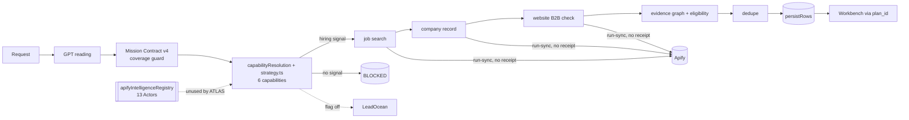
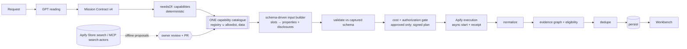

# ATLAS review and Apify AI integration design — 2026-11-20

This review is read-only, apart from an offline prototype. Nothing here was deployed or migrated, no paid call was made, and no LeadOcean records were consumed.

- **Code state:** `launch/hardening` @ `0e43db92`. TEST `lead-pipeline` v45 (build `b1f556cd`) and `provider-connections` v29.
- **Prototype:** [`prototypes/atlas-actor-selection/`](../../prototypes/atlas-actor-selection/README.md).
- **Simulator fix:** one simulator-only change in [`scripts/dev/atlas-sim/harness.ts`](../../scripts/dev/atlas-sim/harness.ts) (see §1.3).

Status words, used strictly:

| Word | Meaning |
|---|---|
| **Implemented** | The code exists. |
| **Simulated** | It passes the ATLAS simulator or unit tests with mocked providers. |
| **On TEST** | It is deployed to `tlvnfrxzjhsjgdofwehb`. |
| **Live-verified** | It ran against a real provider with the result inspected. |
| **Production-ready** | None of ATLAS's discovery path qualifies today. |

---

## 0. Answer first

ATLAS's design is sound:
- one Mission Contract;
- capability-aware planning;
- a signed approval bound to the plan hash and its ceilings;
- an evidence engine that refuses to promote claims;
- idempotent persistence;
- `plan_id` attribution into the Workbench.

**What fails is coverage, not architecture.** ATLAS can discover companies only through LinkedIn job postings. So four of the six request types in this review are blocked or silently narrowed, and the one real pilot never ran.

**The fix is small.** Unify the two Actor catalogues that already exist, add one approved firmographic discovery Actor, and make inputs schema-driven. Then read real charges back with the receipt code the legacy engine already has.

**Apify AI itself is not embeddable.** It is a chat inside the Apify Console. What Agentory should adopt is the backend it shares with the Apify MCP server, namely Store search and Actor schemas. Use it offline, to propose catalogue entries for human review, never to choose and run Actors at request time.

---

## 1. Current ATLAS status

### 1.1 Pipeline, request to Workbench

| # | Stage | Code | What it does | Status | Tests | Known limits |
|---|---|---|---|---|---|---|
| 1 | Interpretation | `lead-pipeline/index.ts:90` (`interpretContract` + GPT) | One structured model reading of the request | Implemented, on TEST. Live-verified for interpretation only (TEST smoke, Nov 9 pilot plan) | 225 refs | Model nondeterminism, e.g. which of two "B2B" mentions it quotes (fixed by #267) |
| 2 | Mission Contract v4 | `_shared/missionContract/{interpret,coverage,contract,compile}.ts` | Requirements with necessity and provenance; a coverage guard asks rather than weaken; hash-bound | Implemented, on TEST, live-verified (the guard caught the B2B misread live) | 8 / 4 / 11 / 5 files | "A, B, C or D" industries compile as four ANDed requirements (same class as RC02) |
| 3 | Capability resolution | `_shared/leadPipeline/capabilityResolution.ts`, `strategy.ts` (`DISCOVERY_CAPABILITIES`, `chainFor`, limitations) | Which step can prove which requirement; blocks a REQUIRED requirement no step proves | Implemented, simulated, on TEST | 15 files | **Only 6 capabilities. Discovery is job search, or LeadOcean (off).** Industry is never provable by design |
| 4 | Provider and strategy selection | `strategy.ts`, `strategyAdvisorModel.ts` | Picks `apify_only`, `leadocean_*` or `apollo_plus_apify` | Implemented, simulated | 0 for the advisor model | LeadOcean is flag-off on TEST; Apollo is 403 (`APOLLO_ACCESS_VALIDATED=false`) |
| 5 | Actor selection and allowlist | `apifyInvoker.ts` (`PIPELINE_ACTORS`, 5 Actors), `signals.ts`, `canonical.ts` | Fixed Actor per capability; allowlist with prices | Implemented, on TEST | 3 | **Disjoint from** `apifyIntelligenceRegistry.ts` (13 Store-verified records, last verified 2026-08-22, unused by ATLAS) |
| 6 | Actor input | `apifyDiscovery.ts:51-63` (job search), `businessModelCheck.ts` (crawler) | Hand-built input per Actor | Implemented, simulated | 1 | Not schema-validated. Industry and size never sent although the Actor supports `industryIds`. Role families map to a single title (§2). Crawler omits required `proxyConfiguration` |
| 7 | Plan and approval | `service.ts` (`strategy_plan`), `planToken.ts` | Signed token: plan hash, ceilings ($0.25 / 50 records), workspace, walk id | Implemented, on TEST, live-verified for planning only | 4 / 10 | No plan has been approved and run on TEST |
| 8 | Apify execution | `apifyInvoker.ts:41` (`run-sync-get-dataset-items`), `ledgeredInvoker` | Synchronous run; `maxItems`, `maxTotalChargeUsd`, memory, timeout; no retry; reserve then settle in the ledger | Implemented, simulated, on TEST. **Never live-executed by `strategy_run`** | 3 | Synchronous calls inside an edge function with a wall-clock limit. **The charge is never read back, so spend is always reported as an estimate** |
| 9 | Dataset normalization | `discoveryProviders/normalize.ts`, `adapters/apify.ts` | Provider rows become `ProviderCompany` / `ProviderPerson` | Implemented, simulated | 8 | — |
| 10 | Company verification | `canonical.ts` (company record), `businessModelCheck.ts` (≤3 first-party pages), `businessModelMatch.ts` | HQ, size band, presence; grounded B2B reading; status verified, likely, mixed, unknown or not B2B | Implemented, simulated, on TEST (flag enabled Nov 9) | 4 | Website step skipped industry missions (fixed in #266). "Homeowners" not read as consumer (fixed in #266) |
| 11 | Eligibility and scoring | `discoveryProviders/verify.ts`, `candidateEligibility.ts`, `ranking.ts` | Evidence graph; hard checks pass, fail or unknown; ranking | Implemented, simulated (58 test files) | 58 | Taxonomy labels never prove industry, which is correct but means no industry mission can ever qualify |
| 12 | Deduplication | `identity.ts` (`collapseDuplicateLeads`), `multiProvider.ts` | Domain and LinkedIn identity; aliases merged; one website read per domain (#266) | Implemented, simulated | 1 | — |
| 13 | Persistence | `persistRows.ts` (non-transactional path; the `lead_pipeline_persist_lead` RPC is **held**) | Accounts, contacts and leads, idempotent; partial-failure accounting | Implemented, simulated; RPC path not applied | 2 | No single transaction until the held migration is applied |
| 14 | Outcome | `outcome.ts`, `service.ts` (`rejectedSummary`, #264) | Honest shortfall; rejected list with reasons | Implemented, simulated | 3 | — |
| 15 | Workbench | `src/lib/strategyDiscovery.ts`, `StrategyDiscoveryPanel.tsx`, `WorkflowConfirmationCard.tsx:535`, `leads/leadPlanFilter.ts` (#258) | Plan, approve, run, results, rejected list; leads filtered by `plan_id` | Implemented, simulated (dev preview). Panel needs `VITE_STRATEGY_DISCOVERY=true` | 3 / 1 / 3 / 1 | No hosted TEST frontend. The panel mounts only inside a `pilot-chat` mission card (`pilot-chat` v11 is now on TEST, unverified for this path) |

### 1.2 What has actually run live

The TEST ledger, `lead_execution_calls` (read-only, 2026-11-20), contains 22 non-OpenAI rows in total:
- **Oct 22 and Oct 30:** a handful of `harvestapi/linkedin-job-search` and `harvestapi/linkedin-company` calls, all made by the **legacy `capability_engine_v1`**, totalling under $0.03.
- **`strategy_run` (ATLAS):** none. `provider_usage_ledger` has 0 rows.
- **`discovery-test` workspace:** 0 leads.
- **Since Nov 9:** 338 rows, all OpenAI model calls from the "ORION Pilot (fictional)" workspace.

**The real ATLAS Apify pilot did not run.** It stopped at planning on Nov 9. The model misread "must be B2B", the coverage guard asked instead, and nothing was spent on Apify. #267 fixed the misreading, but the run waits on a fresh sign-in. The Apify account (Prasidha, Starter, $9.73 of $19 used this cycle) shows **no runs** of the three pilot Actors since the Nov 9 baseline. Its 35 runs since then are of 10 other Actors and did not come from TEST.

| Pilot question | Answer |
|---|---|
| Did it run? | **No** |
| Actor inputs | Planned, not sent: `{"jobTitles":["Founding Account Executive","Account Executive"],"locations":["United States"],"postedLimit":"month","sortBy":"date","maxItems":20}` |
| Records, verification, dedupe, persistence, Workbench | None real. Simulator only: 5 needs-verification, 3 rejected, 1 alias merged |
| Estimated vs actual charge | $0.07439 worst case vs $0 actual |

### 1.3 Offline evaluation of six request types

These ran through the real ATLAS simulator, with mocked model readings, using [`review-scenarios/run.ts`](../../prototypes/atlas-actor-selection/review-scenarios/run.ts).

| # | Request | Interpreted | Provider and executor | Mandatory verifiable | Usable result today |
|---|---|---|---|---|---|
| r1 | "50 US B2B manufacturers, 20–200 employees" | Yes (B2B is a preference, as phrased) | **No.** `apify_only` needs a hiring signal; LeadOcean is off | — | **Blocked** |
| r2 | "25 US companies hiring AEs" | Yes | Job search, then company record | HQ and hiring: yes | Yes. Worst case $0.241, near the $0.25 cap, so more than about 25 companies cannot be approved |
| r3 | "Companies expanding their sales teams" | Yes (family `gtm_sales`) | Job search | Hiring: yes | **Silently narrowed** to `jobTitles:["Account Executive"]`, worldwide. The label also shows the raw ID "gtm_sales" |
| r4 | "Industrial distributors serving commercial customers" | Yes | **No** (as r1) | — | **Blocked** |
| r5 | "Founders of B2B SaaS companies" | Yes (person deliverable) | **No.** People search not approved; LeadOcean off | — | **Blocked** |
| r6 | "Promising companies, explain why" | Clarification | — | — | Correct question. The **simulator crashed** here (`ContractInvalidError`), because its interpret stand-in skipped the real function's clarification check (`index.ts:100`). **Fixed in the simulator only.** |

Also run:
- 34 ATLAS scenarios;
- 184 scenario and contract tests;
- the Lead V2 quality suite (0 known-unfixed cases);
- `check:fast`.

All pass.

### 1.4 Systemic problems, not word patches

1. **One discovery route.** Every company-first mission (r1, r4, the pilot without its hiring clause) is blocked, because the only approved discovery Actor finds companies by job postings.
2. **Two Actor catalogues that never meet.** `PIPELINE_ACTORS` / `DISCOVERY_CAPABILITIES` (ATLAS) and `APIFY_INTELLIGENCE` (legacy) diverge. The registry already knows `harvestapi/linkedin-company-search`; ATLAS cannot use it.
3. **Hand-built inputs drop what the Actor could filter.**
   - Industry and size are never sent to the job search, although it accepts `industryIds`.
   - Role families become one title instead of `functionIds`.
   - `maxItems` is budgeted once, but job search applies it **per title × location query**. The run-level cap still bounds the spend, but one title can starve another.
4. **Spend is never measured.** Synchronous runs report no charge, so `basis: estimate` is permanent. `providerReceipts.ts`, which settles a reservation from `GET /actor-runs/{id}`, exists in the legacy engine.
5. **The Workbench path depends on chat.** There's no direct "discover" entry point, and no hosted TEST frontend.

---

## 2. Apify AI capability assessment (official docs, read 2026-11-20)

| Surface | What it is (per docs) | Embeddable in Agentory? | Use for ATLAS |
|---|---|---|---|
| **Apify AI** ([docs](https://docs.apify.com/account/apify-ai)) | A beta chat in Apify Console. It searches the Store, shows input schema and pricing, runs an Actor with inputs it fills from your description after you confirm, and summarises results. No chat history, no billing access, daily token limit | **No documented API.** It's a Console UI | None directly. It shares its backend with the MCP server |
| **Apify MCP server** ([docs](https://docs.apify.com/mcp)) | `mcp.apify.com`. Tools: `search-actors`, `fetch-actor-details` (schema, README, pricing; no account needed), `call-actor` (any Store Actor except full-permission ones, `maxTotalChargeUsd` in `callOptions`), `get-dataset-items`, runs, storage. 20 requests/s per user; output-schema inference on the hosted server | Yes, as an MCP client, but `call-actor` executes **arbitrary** Actors | **Discovery only, offline.** Never `call-actor` from a request path. The safety controls must stay in our engine |
| **Agent Skills and plugins** ([docs](https://docs.apify.com/agents)) | Written procedures for coding agents (e.g. `apify-ultimate-scraper`) bundled with the MCP server for Claude Code, Cursor and others | No; development-time only | Developer use, when curating the catalogue |
| **REST API and clients** (`/v2/store`, `/v2/acts/{id}`, `/v2/acts/{id}/builds/default`, `/v2/acts/{id}/runs`, `/v2/actor-runs/{id}`, datasets) | Store search with `search`, `category`, `pricingModel`, `sortBy`; full input schema; asynchronous runs; run receipt with the charge; paginated datasets | **Yes.** ATLAS already uses `run-sync-get-dataset-items` | Keep for execution. Add Store search and schema capture (offline) and async runs with receipts |

**Uncertainty, recorded rather than assumed.** The docs say Apify AI and the MCP server share "the same Actor search and execution backend", ranked similarly to the Actor quality score. They don't document a separate "AI Actor selection" API beyond `search-actors` plus the Store API. **There is no documented API that picks the best Actor for a capability and returns validated input.** Apify AI fills inputs conversationally, inside the Console.

**Verified for the pilot Actors** (read-only, 2026-11-20):

| Actor | Price | Input that matters | Note |
|---|---|---|---|
| `harvestapi/linkedin-job-search` | $0.001/job + $0.001/start; `minimalMaxTotalChargeUsd` $0.002 | Supports `industryIds` and `functionIds` (35 codes) | `maxItems` is per title × location |
| `harvestapi/linkedin-company-search` | $0.002 short / $0.004 full per company + $0.001/start | `searchQuery`, `locations`, `industryIds`, `companySize` (8 bands), `maxItems` ≤ 1000 | The missing firmographic discovery route |
| `harvestapi/linkedin-company` | $0.004/company + $0.00005/start | — | — |
| `apify/website-content-crawler` | Free Actor; you pay compute | **`proxyConfiguration` is required**; `maxRequestRetries` defaults to 3 | Compute on Starter is **$0.20/CU** (the pipeline budgets $0.40, which is conservative) |

---

## 3. Architecture

### 3.1 Current

### 3.2 Recommended (the same pipeline, three seams changed)

What stays unchanged:
- the interpretation;
- the Mission Contract and coverage guard;
- the evidence graph and eligibility rules;
- signed approval and ceilings;
- the ledger;
- persistence and the Workbench.

There is no new interpreter, no per-Actor agent and no orchestration framework.

### 3.3 Side by side

| Area | Current | Recommended | Reuse, improve or remove |
|---|---|---|---|
| Request understanding | Mission Contract v4 | Same | Reuse |
| Provider selection | `strategy.ts` strategies × 6 capabilities | Same strategies; capabilities read from one catalogue | Improve |
| Actor discovery | Hard-coded allowlist; a separate, unused registry | One catalogue, fed by **offline** Store and MCP proposals plus review | Improve; retire the duplicate registry fields |
| Actor input | Hand-written per Actor | Slot → property map per Actor; schema validation; explicit disclosures | Improve (`apifyDiscovery.ts` input builder) |
| Execution | `run-sync`, no receipt | Async start, poll, dataset, receipt (`providerReceipts.ts`) | Reuse legacy code |
| Cost controls | `maxItems`, `maxTotalChargeUsd`, memory and timeout; signed ceilings | Same, plus per-query limit semantics and real settlement | Improve |
| Error recovery | One request, no retry, honest failure | Same policy; adopt in-flight runs (`leadAutoContinuation.ts`) | Reuse |
| Verification | Record + ≤3 pages + grounded classifier | Same, run only on survivors (already the case) | Reuse |
| Qualification | Evidence graph; taxonomy never proves industry | Same; any-of groups for industries | Improve (contract) |
| Persistence | Idempotent, non-transactional | Apply the held one-lead RPC after its preflight | Improve (needs approval) |
| Workbench | Panel inside the chat card; dev preview | A direct "Discover" entry and a hosted TEST build | Improve |
| Scalability | Synchronous edge calls; ~25 companies per $0.25 | Async worker for long walks; ceilings per mission | Reuse worker |
| Maintainability | Three engines (run-agent scout, V2 worker, lead-pipeline) | lead-pipeline as the one discovery engine; legacy keeps execution helpers | Remove the duplicate discovery paths over time |

---

## 4. Provider comparison

| | Apify REST API (today) | Apify AI | Apify MCP | LeadOcean |
|---|---|---|---|---|
| Role for ATLAS | Execution | None (Console UI) | Offline Actor discovery; developer tooling | Structured firmographic and people discovery |
| Discovery of *companies* | Via approved Actors only | Conversational | `search-actors` finds Actors, not companies | Yes (claims only; HQ wrong for about 29%, per `LEADOCEAN_FINAL_VERDICT`) |
| Spend control | `maxTotalChargeUsd`, `maxItems`, memory and timeout, per run | You confirm each run | `callOptions` per call; any Actor | Records per page; budget |
| Safety for autonomous use | High, behind our allowlist and signed plan | Not applicable | **Low** if `call-actor` is exposed | Medium (claims need verification) |
| State on TEST | 3 Actors approved; never live-run by ATLAS | — | Connector here lost its login | Flag off; v2 adapter mocked (#256) |

---

## 5. Highest-impact changes, ranked

1. **Approve one firmographic discovery Actor** (`harvestapi/linkedin-company-search`, short mode, $0.002/company) as `apify.linkedin_company_search` in the existing `DISCOVERY_CAPABILITIES`. This unblocks r1, r4 and industry pilots. Size goes through the company record, and HQ through the record.
2. **Schema-driven Actor inputs from one catalogue.** Send `industryIds`, `companySize` and `functionIds` where the Actor supports them, with reviewed vocabularies (LinkedIn industry v2 and function codes). Disclose anything that isn't filtered at source. Validate against the captured schema before signing the plan. This fixes r3's silent narrowing, the missing `proxyConfiguration`, and the per-query `maxItems`.
3. **Read real charges.** After each run, settle the ledger from `GET /actor-runs/{id}` (`providerReceipts.ts`), so outcomes report actual, not estimated, spend.
4. **Run the approved pilot**, then make the Workbench reachable without chat: a direct "Discover" entry and a hosted TEST build behind `VITE_STRATEGY_DISCOVERY`.
5. **Compile "A, B, C or D" industries as one any-of group** (same treatment as RC02's geography), and give role-family labels display names.

---

## 6. Local prototype

Location: [`prototypes/atlas-actor-selection/`](../../prototypes/atlas-actor-selection/README.md). It's offline, imported by nothing live, and has 10 tests. It shows the five-step separation: needs, candidates, input, validation, then a cost and authorization gate. Results:

| Mission | Live pipeline today | Prototype |
|---|---|---|
| Pilot | Ready (review-only); industry not sent | Same 3 Actors and same **$0.07439** worst case; job search narrowed to the 12 reviewed industry codes |
| r2 (25 × AE) | $0.241 | $0.24105 (same) |
| r3 (sales teams) | `jobTitles:["Account Executive"]` | `functionIds:["sale","bd"]`, executable, $0.021 |
| r1 / r4 (firmographic) | Blocked, no route | Route found (`linkedin-company-search`), input schema-valid, **not executable until approved** (r1 also exceeds $0.25 for 50 companies, correctly) |
| r5 (founders) | Blocked | Blocked, with two named reasons (2 catalogued Actors; no captured people schema) |
| Store proposals | — | Ranked candidates from a Store snapshot, each `executable: false` with a five-item review checklist |

---

## 7. Implementation roadmap (small PRs, each locally validated first)

| Phase | Change | Files | Reuses | Tests | Complexity | Risk | User-visible | Rollback |
|---|---|---|---|---|---|---|---|---|
| **0** Readiness | Run the approved pilot; record run IDs and receipts | none (operation) | Everything | Live result | S | Real spend ≤ $0.25 | First real companies in the Workbench | — |
| **1a** Inputs | Schema-driven job-search input: `industryIds`, `functionIds`, per-query `maxItems`, crawler `proxyConfiguration`; capture schemas under `supabase/functions/_shared/leadPipeline/actorSchemas/` | `apifyDiscovery.ts`, `businessModelCheck.ts`, `strategy.ts` (worst case) | Prototype `buildInput` / `validateInput` | Scenario fixtures, schema tests | M | Plan hash changes, so old approvals expire (intended) | Industry pilots narrowed at source; "sales teams" searches Sales | Revert the PR; TEST redeploys |
| **1b** Receipts | Settle the ledger from `GET /actor-runs/{id}` after each run | `apifyInvoker.ts`, `ledgeredInvoker` | `providerReceipts.ts` | Receipt fixtures | S | One extra free GET per run | Actual spend shown | Revert |
| **1c** Contract | Industry any-of groups; family display names | `missionContract/interpret.ts`, `roleFamilies.ts` | RC02 pattern | Quality suite | S | Contract hash change | Fewer false blockers and clarity | Revert |
| **2** Firmographic discovery | Add `apify.linkedin_company_search` to `DISCOVERY_CAPABILITIES` and `PIPELINE_ACTORS` (owner-approved), `chainFor` seed when no signal | `strategy.ts`, `apifyInvoker.ts`, `apifyDiscovery.ts`, `canonical.ts` | Company record, website check, evidence graph | New sim scenarios (r1, r4) | M | New paid Actor (approval needed); LinkedIn location ≠ HQ (record verifies) | Company-first requests work | Remove from the allowlist |
| **2b** One catalogue | `PIPELINE_ACTORS` reads `APIFY_INTELLIGENCE` records plus slot maps; an offline script proposes from Store and MCP search | `apifyIntelligenceRegistry.ts`, `scripts/dev/actor-catalog-refresh.ts` | Registry, prototype `proposeFromStore` | Registry tests | M | Drift between catalogue and schema (refresh flags it) | — | Revert |
| **3** Multi-provider | LeadOcean-first firmographics with Apify verification, behind its flag and a **separate approval**; pick by mission | `strategy.ts` (exists), `adapters/leadocean.ts` (exists) | v2 adapter (#256), checkpoints | Existing mocked suites | M | Record consumption | Larger, cheaper company lists | Flag off |
| **4** Durability | Async start, poll and adopt for long walks; reuse the worker lease and checkpoints for missions over the edge wall clock | `apifyInvoker.ts`, `worker/` | `leadAutoContinuation.ts`, `leadExecutionFinalizer.ts`, the worker | Real-worker CI lane | L | Two runtimes | Bigger missions, resumable | Keep the sync path behind a flag |

**Recommended designs for Part D (LeadOcean + Apify):** **C**, intelligent selection by mission, which `strategy.ts` already implements. Concretely:
- signal missions are **Apify-first**;
- firmographic missions go to **Apify company search** now, and **LeadOcean** once separately approved;
- **website verification** runs only on survivors, after dedupe, at most 3 pages each.

**B2B evidence strategy (Part C.8):** keep today's order:
1. filter and dedupe;
2. company record;
3. website (only for companies whose sole open gap is business model, plus never-provable industry);
4. the grounded classifier, which reads verified, likely, mixed, unknown or not B2B.

Provider claims (LeadOcean, LinkedIn industry labels) only narrow or rank results, never verify. Firecrawl stays optional: `firecrawl-scrape` isn't on TEST, and the Apify crawler already covers it.

---

## 8. Final recommendation

> *How should Agentory integrate the new Apify AI capabilities so ATLAS can understand diverse requests, intelligently select discovery tools, return high-quality companies and display results reliably in the Workbench?*

**Keep the Mission Contract as the only reading of the request.** Choose Actors **deterministically** from **one capability catalogue**, with inputs generated **from each Actor's captured schema** and validated before the plan is signed.

**Use Apify's AI-facing surfaces where they are strong.** The MCP server's `search-actors`/`fetch-actor-details` and the Store API **propose** new catalogue entries offline. A human approves each one in a reviewed PR. Execution stays in ATLAS's existing engine: allowlist, signed plan hash, `maxTotalChargeUsd`, ledger. Neither Apify AI (a Console chat with no API) nor MCP `call-actor` should ever choose and run a paid Actor at request time.

**The first improvements:**
1. Run the approved pilot.
2. Ship schema-driven inputs and real charge receipts.
3. Approve one firmographic discovery Actor.

Together those turn ATLAS from "hiring-signal searches only" into a discovery agent that handles company-first, signal-based and industry requests, with honest costs, inside the Workbench we already have.
