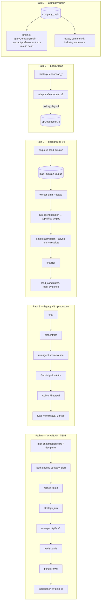
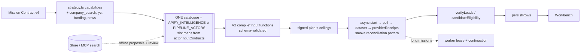

# ATLAS — complete capability, architecture and data inventory

**Date:** 2026-11-20
**Code:** `origin/launch/hardening` @ `3c63e0c2` (the #271 merge)
**Method:** source code, deployed function lists, secret *names* (never values), the TEST PostgREST schema, read-only TEST row counts, the Apify REST API (metadata and this account's run history only), and offline simulations.
**Not done:** no paid call, deploy, migration, secret change or production data read.

Status vocabulary, used strictly throughout:

| Level | Meaning |
|---|---|
| **Registered** | Declared in some catalogue. |
| **Selectable** | A planner can choose it. |
| **Approved** | On an execution allowlist. |
| **Executable** | The deployed runtime can call it with today's flags and secrets. |
| **Live-verified** | A real provider run was recorded and inspected. |

The executive summary is in [ATLAS_EXECUTIVE_SUMMARY.md](ATLAS_EXECUTIVE_SUMMARY.md).

---

## A. Executive summary

Agentory has **three lead-discovery engines**, not one:

| Engine | Entry | Where it runs | Live evidence |
|---|---|---|---|
| **V4 / ATLAS lead-pipeline** (Mission Contract v4, `strategy_plan` / `strategy_run`) | `supabase/functions/lead-pipeline` | **TEST only** (v45, build `b1f556cd`); not in production | Interpretation and planning only. `strategy_run` has **never** made a paid call (`provider_usage_ledger` = 0 rows) |
| **Legacy V1** (`orchestrate` → `run-agent` scout, Gemini `toolInputPlanner` choosing from `actorRegistry.ts`) | `orchestrate`, `run-agent`, `continue-workflow`, `unlock-founders` | **Production** (`run-agent` v275, 2026-10-13; `orchestrate` v117); not on TEST | Production history (not readable from here) |
| **Legacy V2 capability engine** (`leadCapabilityEngine.ts`, 12,819 lines; worker queue, lineage, leases, receipts) | `enqueue-lead-mission` → `lead_mission_queue` → `worker/` → `run-agent` handler | Production function `enqueue-lead-mission` v10 (worker health was 404 in the 11-07 audit). TEST via the `discovery-test-worker` GitHub Action | TEST ledger: `capability_engine_v1` job-search and company-record runs on 2026-10-22 and 10-30 (< $0.03). Code-recorded runs (e.g. company search `RidX3qBPdnjToMcqM`, 5/5 US staffing agencies) |

**The newest engine, V4, is the most principled and the least capable**:
- discovery is LinkedIn job search only;
- three approved discovery and verification Actors;
- an approved, budgeted, signed plan has never executed.

**The legacy V2 engine already has most of what V4 lacks**:
- company search with structured filters (`industryIds`, `locations`, `companySize`);
- YC, funding and news sources;
- Actor input contracts;
- asynchronous runs with provider receipts and reconciliation;
- durable workers and quota-driven continuation.

**The highest-value move is convergence, not new code.** Port V2's proven Actor adapters and execution durability under V4's contract, approval and evidence engine.

---

## 1. Version inventory (Phase 1)

### 1.1 Repository and worktrees

| Item | Value |
|---|---|
| Remote | `origin` = `github.com/kathmanducreatives-code/aiworforce-platfrom` |
| Integration tip | `origin/launch/hardening` = `3c63e0c2` (2026-11-20, #271) |
| Main checkout `agentory-v4-test` | `launch/hardening` @ `0e43db92`, **2 behind**, 6 untracked docs (preserved, not touched) |
| `agentory-devfast` | Clean. This audit is on branch `docs/atlas-complete-inventory` from `3c63e0c2` |
| `agentory-devloop` | `feat/local-dev-atlas-sim` @ `ee458984`, 53 behind, clean, contained in base |
| `agentory-mrle` | `feat/provider-capability-contracts` @ `1cc12c46`, 95 behind, one untracked audit folder (not touched) |
| Two scratch worktrees | Detached (`ee458984`, `7509dd2b`), prunable |

No worktree holds commits that aren't in `launch/hardening`.

### 1.2 ATLAS work that exists only on unmerged branches or open PRs

| PR / branch | What it adds | State |
|---|---|---|
| #237 `claude/lo-hiring-by-company` | lead-pipeline: opt-in job search *by company* for LeadOcean's employers (offline proof) | Open since 2026-11-04 |
| #238 `claude/provider-summary-ui` | Frontend provider-run summary (backend figures only) | Open |
| #198 `claude/blissful-bohr-ysarcn` | "Provider-neutral, GPT-planned discovery engine (LeadOcean …)" | Open, 2 commits |
| #196 `feat/ai-intelligence-routing` | Capability-aware mission contract v2 + Luna-first GPT-6 routing | Open |
| `claude/atlas-root-cause-review` | ATLAS root-cause review (proposal) | Branch only |
| #265 `fix/infra-test-macos-timeout` | macOS infra test fix (test-only) | Open |
| #270 `claude/agentory-audit-roadmap-64uq8n` | ORION R1.2 (pilot-chat) | Open; not ATLAS |

### 1.3 Deployed functions (read-only `supabase functions list`)

| Component | Source | TEST (`tlvnfrxzjhsjgdofwehb`) | Production (`ohsdatpvfdjdemstoiuj`) | Status |
|---|---|---|---|---|
| `lead-pipeline` (V4 ATLAS) | `supabase/functions/lead-pipeline/index.ts` | v45, build `b1f556cd` (2026-11-13), JWT on | **absent** | Deployed to TEST, not live-executed |
| `provider-connections` | `supabase/functions/provider-connections` | v29, build `b56c6570` | absent | TEST only |
| `pilot-chat` (chat entry, emits `lead_mission` cards) | `supabase/functions/pilot-chat/index.ts` | v11 (2026-11-17) | v211 (2026-11-20) | Live (ORION) |
| `daily-brief` (ORION) | — | v8 | v49 | — |
| `orchestrate`, `run-agent` (legacy V1 / V2 handler) | `supabase/functions/{orchestrate,run-agent}` | absent | v117 / v275 (2026-10-11 / 10-13) | Production legacy |
| `enqueue-lead-mission`, `resume-stalled-leads`, `continue-workflow`, `approve-and-continue` | — | absent | v10 / v51 / v54 / v38 | Production legacy |
| `unlock-founders` (decision-maker purchase) | `supabase/functions/unlock-founders` | absent | v66 | Production |
| `run-lead-action`, `run-radar-scan`, `run-monitoring-scan`, `run-monitoring-tick` | — | absent | v43 / v51 / v111 / v31 | Production |
| `firecrawl-scrape` | `supabase/functions/firecrawl-scrape` | absent | **absent** (the frontend calls it; 11-07 audit P0-5) | Broken path |
| Railway worker | `worker/main.ts` | via GitHub Action dispatch only | `/health` 404 (11-07 audit) | Uncertain |

### 1.4 Flags and secrets (names only)

| Project | Discovery-relevant secret names present |
|---|---|
| **TEST** | `AGENTORY_MISSION_CONTRACT`, `AGENTORY_MISSION_CONTRACT_V4` (=enabled), `APIFY_API_TOKEN`, `LEAD_PIPELINE_ENABLED` (=true), `LEAD_PIPELINE_WORKSPACES` (= `discovery-test` only), `LEAD_PIPELINE_BUSINESS_MODEL_CHECK` (=enabled), `OPENAI_API_KEY`, `PROVIDER_APIFY_DISCOVERY_ENABLED`, `PROVIDER_DISCOVERY_ENABLED`, `PROVIDER_DISCOVERY_WORKSPACES` |
| **Production** | `APIFY_API_TOKEN`, `FIRECRAWL_API_KEY`, `FIRECRAWL_USD_PER_CREDIT`, `EVIDENCE_ENRICHMENT`, `LEAD_CREDIT_ENFORCEMENT`, `LEAD_V2_WORKER_WORKSPACES`, `SIGNALS_V2`, `OPENAI_API_KEY`, `ANTHROPIC_API_KEY`, `LOVABLE_API_KEY` |
| **Neither** | Any LeadOcean or Apollo key; any `APIFY_ENABLE_*` opt-in; `LEAD_PIPELINE_PHONES_ENABLED`, `LEAD_PIPELINE_SIGNALS_ENABLED`, `LEAD_PIPELINE_PERSIST_TX`, `DISCOVERY_EVIDENCE_CACHE_ENABLED`, `LEAD_STRICT_REQUIREMENTS_ENABLED` |

---

## B. Complete feature catalogue (Phase 2)

There are 737 discovery-related source files on `3c63e0c2`. This catalogue groups them by capability.

Abbreviations:
- **Models:** GPT = OpenAI via `aiProvider.ts`/`gptProvider.ts`; Gemini = Lovable gateway (legacy V1 planner).
- **Classification:** OPS = fully operational and live-verified; DEP = deployed, not live-tested; DIS = implemented but disabled; DISC = implemented but disconnected; PROTO = offline prototype; LEG = legacy; DEPR = deprecated or unused; BLK = broken or blocked.

| # | Feature | Source (entry function) | Inputs → outputs | Models / providers | Tables written | Trigger / UI | Gate | Class |
|---|---|---|---|---|---|---|---|---|
| 1 | Mission interpretation v4 | `missionContract/interpret.ts` `contractFromProposal`; `lead-pipeline/index.ts:90` `interpretContract` | Request → `ContractProposalV4` → `MissionContract` (hash) | GPT | — | `strategy_plan` | `AGENTORY_MISSION_CONTRACT_V4` | DEP (live interpretation seen 11-09) |
| 2 | Coverage guard | `missionContract/coverage.ts` `coverageQuestions` | Contract vs explicit cues → questions | — | — | Plan | Always | **OPS** (caught the live B2B misread) |
| 3 | Capability resolution and strategy | `leadPipeline/capabilityResolution.ts`, `strategy.ts` `planStrategy`/`chainFor` | Contract → strategy + steps + limitations + worst case | `strategyAdvisorModel.ts` (GPT, advisory) | — | Plan | — | DEP |
| 4 | Signed approval | `leadPipeline/planToken.ts` | Plan hash, ceilings, workspace, walk → MAC token | — | — | Plan → run | Signer keyed from the service-role key (`lead-pipeline/index.ts:146`) | DEP |
| 5 | Apify job-search discovery (V4) | `apifyDiscovery.ts` `discoverHiringCompanies` | Titles, location, recency → employers | Apify `harvestapi/linkedin-job-search` | `provider_usage_ledger` (ledger) | `strategy_run` | Allowlist + ceiling | DEP, never run by V4 |
| 6 | Company record (V4) | `canonical.ts` `readCompanyRecordsCached` | LinkedIn URLs → HQ, size band, presence | Apify `harvestapi/linkedin-company` | same | run | same | DEP |
| 7 | Website B2B check (V4) | `businessModelCheck.ts` `checkBusinessModels`; `businessModelMatch.ts` | ≤3 first-party pages → verified, likely, mixed, unknown or not B2B | Apify `apify/website-content-crawler` + GPT grounded classifier | — | run | `LEAD_PIPELINE_BUSINESS_MODEL_CHECK` (on, TEST) | DEP |
| 8 | Post-signal discovery (V4) | `leadPipeline/signals.ts` | Topics → companies posting | Apify `harvestapi/linkedin-{profile,company}-posts` | — | run | `LEAD_PIPELINE_SIGNALS_ENABLED` (absent) | DIS |
| 9 | Phones (V4) | `leadPipeline/phones.ts` | People → phone candidates | LeadOcean | — | run | `LEAD_PIPELINE_PHONES_ENABLED` (absent) | DIS |
| 10 | LeadOcean people search (V4) | `discoveryProviders/adapters/leadocean.ts` (v2 adapter, #256) | ICP → people + employers (claims) | LeadOcean `api.leadocean.io` | `lead_pipeline_checkpoints` | run | No key; flag off | DIS |
| 11 | Apollo people search | `strategy.ts` `APOLLO_ACCESS_VALIDATED=false` | — | Apollo (403 on 2026-10-30) | — | — | Hard-off | BLK |
| 12 | Eligibility and evidence graph | `discoveryProviders/verify.ts` `verifyLeads`; `candidateEligibility.ts` `evaluateEligibility` | Evidence → pass, fail or unknown per hard check; eligible, pending or ineligible | — | — | run | — | DEP (simulated; 58 test files) |
| 13 | Dedupe | `leadPipeline/identity.ts` `collapseDuplicateLeads`; one website read per domain (#266) | Leads → merged leads | — | — | run | — | DEP |
| 14 | Persistence (V4) | `leadPipeline/persistRows.ts` | Rows → `accounts`, `contacts`, `lead_candidates` (`raw.agentory_pipeline`) | — | Those 3; `task_plans` (plan record) | run | `LEAD_PIPELINE_PERSIST_TX` (absent; RPC held) | DEP |
| 15 | Outcome and rejected list | `leadPipeline/outcome.ts`, `service.ts` `rejectedSummary` (#264) | Run → honest outcome + reasons | — | — | run | — | DEP |
| 16 | Strategy panel (UI) | `src/components/discovery/StrategyDiscoveryPanel.tsx`, `src/lib/strategyDiscovery.ts` | Plan, approve, run, results | — | — | Inside the `pilot-chat` mission card (`WorkflowConfirmationCard.tsx:535`) | `VITE_STRATEGY_DISCOVERY` | DISC (no hosted TEST UI; dev preview only) |
| 17 | Leads by plan (Workbench) | `src/lib/leads/leadPlanFilter.ts` (#258), `useLeadResults.ts`, `LeadSpreadsheet.tsx`, `LeadDetailDrawer.tsx` | `lead_candidates` by `plan_id` | — | reads | Workbench | — | DEP (simulated) |
| 18 | Legacy V1 scout and source tools | `run-agent/index.ts` (9,347 lines), `toolRegistry.ts`, `actorRegistry.ts`, `toolInputPlanner` | Request → Gemini picks a registry Actor and input → rows | **Gemini** + Apify / Firecrawl | `signals`, `lead_candidates`, `accounts`, … | `orchestrate` plan | Registry `enabled` + `required_env` | LEG (production) |
| 19 | Legacy V2 capability engine | `leadCapabilityEngine.ts`, `leadCapabilityGraph.ts`, `leadMissionCompiler.ts`, `companyFirstQuotaController.ts`, `leadExecutionPlan.ts` | Compiled mission → company-first stages (YC, company search, job search, funding, news) → verified companies | GPT + Apify | `lead_execution_calls`, `lead_model_calls`, `lead_evidence`, `signal_events`, `company_web_evidence`, `company_headcount_*`, `lead_candidates` | Queue → worker | `LEAD_V2_WORKER_WORKSPACES`, smoke admission | LEG (TEST worker runs Oct 22/30) |
| 20 | Smoke admission and vendor reconciliation | `smokeAdmission.ts`, RPCs `admit_discovery_smoke`, `reconcile_discovery_smoke_operation` | Per-operation reservation → vendor receipt | Apify `GET /actor-runs/{id}` | `discovery_smoke_{authorizations,operations,reconciliations}` (11 / 50 / 11 rows on TEST) | V2 | Authorization row | LEG, TEST-verified |
| 21 | Durable worker | `worker/main.ts`, `worker/leadMissionRunner.ts`, `lineageLease.ts`, `leadAutoContinuation.ts`, `leadExecutionFinalizer.ts`, `providerReceipts.ts` | Queue claim → lease → handler → finalize | — | `lead_mission_queue` (12), `lead_lineages` (9), `lead_mission_events` (36), `lead_plan_versions` (5) | Railway / GitHub Action | `LEAD_V2_WORKER_WORKSPACES` | LEG |
| 22 | Decision-maker unlock | `unlock-founders/index.ts`, `decisionMaker/*` (providerAdapter, employerVerification, ranking) | Company in results → decision-makers | Apify `harvestapi/linkedin-company-employees` | `credit_transactions`, `contacts` | Workbench "unlock" | Credits (`LEAD_CREDIT_ENFORCEMENT`) | LEG (production) |
| 23 | Company Brain research | `companyBrainResearch/{companyLinkedIn,founderLinkedIn,localProviderMode}.ts` | Company / founder URLs → profile facts | Apify `apimaestro/linkedin-{company,profile}-detail`, `curious_coder/linkedin-{company,profile}-scraper`, `harvestapi/linkedin-profile-scraper` | `company_brain_research_runs` | Onboarding | — | LEG |
| 24 | Company Brain in missions | `missionContract/brain.ts` `applyCompanyBrain`; `leadPipeline/brainContext.ts`; legacy `companyBrainSemanticFit.ts`, `brainIndustryExclusions.ts` | Brain → preferences and enforced size rule inside the approved hash | — | reads `company_brain` | Plan | Brain present | DEP (TEST forbids Brain rows) |
| 25 | Web evidence (legacy) | `webEvidenceRunner.ts`, `webEvidenceStore.ts`, `leadResearchPlaybooks.ts` | Domains → page text and claims | Firecrawl | `company_web_evidence` | V2 | `FIRECRAWL_API_KEY` (prod) | LEG |
| 26 | Signals and radar (LISA) | `run-radar-scan`, `run-monitoring-*`, `signalsV2Writer.ts`, `lisa/*` | Monitors → signal events | Apify / Firecrawl | `signal_events`, `signal_feed` | Cron / UI | `SIGNALS_V2` | LEG (production) |
| 27 | Provider-discovery (#256) | `provider-discovery/index.ts`, `discoveryProviders/orchestrator.ts` | Provider-neutral discovery | LeadOcean / Apify | `provider_usage_ledger` | — | `PROVIDER_DISCOVERY_*` | DISC (function not deployed) |
| 28 | Actor-selection prototype (#271) | `prototypes/atlas-actor-selection/` | Contract → schema-validated Actor plan | — | — | Offline | — | PROTO (two flaws, §4.3) |
| 29 | Recruiting-era scrapers and UI | `src/components/lead-scraper/*`, `icp/*`, tables `linkedin_leads`, `icp_lookalike_*`, `sp_*`, `dialer_leads`, `outreach_*` | — | — | (0 rows on TEST) | Old pages | — | DEPR |

---

## C. Apify Actor inventory (Phase 3)

**Method.** I found every `owner/name` string in the repository (53 distinct real Actor IDs) and verified each against the Apify REST API on 2026-11-20. Evidence: [`atlas-inventory/apify-actor-verification-2026-11-20.json`](atlas-inventory/apify-actor-verification-2026-11-20.json) and [`actor-declarations-2026-11-20.txt`](atlas-inventory/actor-declarations-2026-11-20.txt).

- **51 checked:** 45 exist, **6 no longer exist** (404), 0 deprecated.
- The 2 left out are fragments that aren't full Actor IDs (`curious_coder/jobs`, `curious_coder/indeed`).
- The account (Prasidha, Starter) has **61 runs in total**, covering 5 distinct Actors.

### C.1 The 11 places that declare Actors

| Registry | File | Role | Feeds execution? |
|---|---|---|---|
| `PIPELINE_ACTORS` | `leadPipeline/apifyInvoker.ts:29` | **V4 allowlist** (5 Actors) | Yes, V4 |
| `DISCOVERY_CAPABILITIES` | `leadPipeline/strategy.ts:115` | V4 capabilities (status derived from the allowlist) | Yes, V4 |
| `ACTOR_REGISTRY` | `actorRegistry.ts:64` (21 entries) | Legacy V1; Gemini `toolInputPlanner` picks from it | Yes, V1 |
| `toolRegistry.ts` | — | V1 tools (`source_with_apify`, `scrape_url`, `search_web`) | Yes, V1 |
| `actorCapabilityRegistry.ts` | — | V1B enrichment planner (proves, freshness, cost) | Yes, V1B |
| `actorInputContracts.ts`, `actorFieldRoles.ts`, `actorInputPlanner.ts`, `actorInputStrategy.ts` | — | **V2 schema-aware input compilers** | Yes, V2 |
| `HIRING_ACTOR_CATALOG` | `hiringActorCatalog.ts` (16 cards) | V2 "what can we conclude" cards ("REGISTERS nothing and ROUTES nothing") | Read-only |
| `hiringSourceCatalog.ts` | — | Semantic hiring sources | V1 opt-in |
| `APIFY_INTELLIGENCE` | `apifyIntelligenceRegistry.ts` (13 + 6 rejected) | Store-verified records (2026-08-22) | Read by V2 strategy and briefing |
| `actorIntelligence.ts`, `actorIdentity.ts` | — | Identity aliases and defects | Support |
| Prototype `CATALOG` | `prototypes/atlas-actor-selection/catalog.ts` | Unified-catalogue shape | No (offline) |

### C.2 Every Actor

Columns, all as of 2026-11-20:
- **Exists:** per the Apify API.
- **Price:** current Apify event pricing.
- **V4:** whether it's on the V4 allowlist.
- **Legacy exec:** the legacy path that can execute it.
- **Account runs:** runs on the Prasidha account.
- **Live evidence:** the strongest proof it has run for real.

| Actor | Exists | Price (now) | Purpose | Declared in | V4 | Legacy exec | Account runs | Live evidence |
|---|---|---|---|---|---|---|---|---|
| harvestapi/linkedin-job-search | ✓ | $0.001/job + $0.001 start | Hiring discovery | V4, V2, intelligence, catalog | **approved** | V2 | 10 ok | **TEST ledger 10-22/30 (V2)**; account runs |
| harvestapi/linkedin-company | ✓ | $0.004 + $0.00005 | Company record (HQ, size) | V4, V1, V2, catalog | **approved** | V1 (opt-in), V2 | 5 ok | **TEST ledger (V2)**; account runs |
| apify/website-content-crawler | ✓ | Free Actor; compute | First-party pages | V4, V1 (disabled) | **approved** | — | 0 | None (V4 never ran) |
| harvestapi/linkedin-profile-posts | ✓ | $0.002/post | Post signals | V4 allowlist, V1 (disabled) | approved, flag off | — | 0 | — |
| harvestapi/linkedin-company-posts | ✓ | $0.002/post | Post signals | V4 allowlist, V1 (disabled) | approved, flag off | — | 7 ok | Account runs |
| harvestapi/linkedin-company-search | ✓ | $0.002 short / $0.004 full + $0.001 | **Firmographic discovery** | V2 (`apify_linkedin_company_search`), intelligence, catalog, prototype | **no** | **V2** | 6 ok (latest 11-19) | Code: run `RidX3qBPdnjToMcqM`; account runs |
| harvestapi/linkedin-company-employees | ✓ | $0.003 short / $0.008 full | People at company | V1 (opt-in), V2, `unlock-founders`, V4 `founderCheck` | no | **production unlock**, V2 | 0 | Production (not readable here) |
| harvestapi/linkedin-profile-search | ✓ | $0.10/search page + $0.004/profile | People search | V1 (disabled), V4 catalogue (not approved) | no | — | 0 | — |
| harvestapi/linkedin-post-search | ✓ | $0.002/post | Post-topic discovery | V1 (disabled), V4 catalogue (not approved) | no | — | 0 | — |
| harvestapi/linkedin-profile-scraper | ✓ | $0.004 / $0.01 with email | Profile enrichment | Brain research, credits | no | Brain | 0 | — |
| curious_coder/linkedin-jobs-scraper | ✓ | $0.002/item | Hiring (V1 default) | V1 `apify_jobs` (enabled) | no | **V1 production** | 0 | Production |
| curious_coder/linkedin-jobs-search-scraper | ✓ | $0.0015 + $0.005 start | Advanced jobs | V1 (disabled) | no | — | 0 | — |
| curious_coder/indeed-scraper | ✓ | $0.0001 | Indeed | V1 (disabled) | no | — | 0 | — |
| curious_coder/linkedin-company-scraper | ✓ | Free | Brain research | Brain | no | Brain | 0 | — |
| curious_coder/linkedin-profile-scraper | ✓ | $0.004 | Brain research | Brain | no | Brain | 0 | — |
| apimaestro/linkedin-company-detail | ✓ | $0.005 | Brain research | Brain | no | Brain | 0 | — |
| apimaestro/linkedin-profile-detail | ✓ | $0.005 | Brain founder | Brain | no | Brain | 0 | — |
| atomus/linkedin-company-scraper | ✓ | $0.0035 | Funding corroboration | V2 (`fundingCorroboration.ts`), catalog | no | V2 | 0 | — |
| atomus/linkedin-profile-scraper | ✓ | $0.006 | Profile enrichment | V1 (disabled) | no | — | 0 | — |
| automation-lab/indeed-scraper | ✓ | $0.003 + $0.005 | Indeed | V1 opt-in (`APIFY_ENABLE_…` absent) | no | V1 if flagged | 0 | — |
| crawlworks/linkedin-jobs-scraper | ✓ | $0.005 | LinkedIn jobs | V1 opt-in (flag absent) | no | V1 if flagged | 0 | — |
| valig/glassdoor-jobs-scraper | ✓ | $0.0004 | Glassdoor | V1 opt-in (flag absent) | no | V1 if flagged | 0 | — |
| parsebird/yc-jobs-scraper | ✓ | $0.002 | YC jobs | V1 opt-in (flag absent) | no | V1 if flagged | 0 | — |
| bovi/greenhouse-lever-ashby-job-scraper | ✓ | $0.0015 | ATS verification | V1 opt-in (flag absent) | no | V1 if flagged | 0 | — |
| memo23/y-combinator-scraper | ✓ | $0.001 + $0.008 start | YC company discovery | V2, intelligence, catalog | no | **V2** | 0 | Code comments |
| solidcode/ycombinator-scraper | ✓ | $0.00235 | YC company discovery | V2, intelligence | no | **V2** | 0 | — |
| haketa/ycombinator-companies-scraper | ✓ | $0.0025 | YC | intelligence only | no | — | 0 | — |
| datahyena/company-funding-rounds | ✓ | **$0.07/item** | Funding discovery | V2, intelligence, catalog | no | **V2** | 0 | — |
| memo23/crunchbase-scraper | ✓ | $0.003 + $0.002 | Funding enrichment | intelligence, catalog | no | — | 0 | — |
| data_xplorer/google-news-scraper-fast | ✓ | $0.004 | News signals | V2 (`apify_google_news`), intelligence | no | V2 | 0 | — |
| builtwith/builtwith-official-technology-scraper | ✓ | $0.002 | Technology (by domain only) | intelligence, catalog | no | — | 0 | — |
| apidojo/google-search-scraper | ✓ | $0.002/query | Web search | intelligence | no | — | 0 | — |
| apify/google-search-scraper | ✓ | $0.0045/page | Web search | `toolRegistry.ts`, docs | no | — | 0 | — |
| apify/web-scraper | ✓ | Free | Custom web | V1 (disabled) | no | — | 0 | — |
| bebity/linkedin-jobs-scraper | ✓ | $0.0015/item | — | Store snapshot and tests only | no | — | **11 ok ($0.57)** | Account runs; **not in any registry** |
| enrich-crm/enrich-crm-funding | ✓ | $0.03 | — | docs and tests | no | — | 0 | — |
| misceres/indeed-scraper, solidscrape/indeed-jobs-scraper, parseforge/career-site-jobs-scraper, s-r/free-google-search-results…, prodiger/google-search-scraper, mikolabs/google-search-results-scraper, datacach/yc-companies-detail-scraper, easyapi/google-news-scraper, xtracto/google-news-scraper | ✓ | various | Evaluated alternatives | `actorIntelligence.ts` / `REJECTED_ACTORS` / docs | no | — | 0 | Rejected or evaluated only |
| **scrapemesh/google-search-results-scraper** | **✗ 404** | — | V1 `apify_google_search` | `actorRegistry.ts`, `toolRegistry.ts` | no | Disabled, and **would fail** | 0 | **Gone from Store** |
| **api-empire/post-comments-engagements-scraper-linkedin** | **✗ 404** | — | V1 `apify_linkedin_post_comments` | `actorRegistry.ts` | no | Disabled, would fail | 0 | Gone |
| crawlerbros/google-news-scraper, crawlerbros/producthunt-scraper | ✗ 404 | — | — | `REJECTED_ACTORS` | no | — | 0 | Gone (already rejected) |
| apify/indeed-scraper, memo23/apify-ycombinator-scraper | ✗ 404 | — | — | tests only | no | — | 0 | Gone |

### C.3 Integration ladder (counts)

| Level | Count | Which |
|---|---|---|
| **Registered** (any catalogue) | **51** real IDs (45 exist) | C.2 |
| **Selectable** by V4 | 3 discovery / verify (+2 post Actors behind an off flag) | job-search, company, website-crawler (+ profile-posts, company-posts) |
| **Approved** (an allowlist) | V4: **5**. V1: 21 registry entries, 9 `enabled`. Of those, 5 also need an `APIFY_ENABLE_*` flag that is absent in production, so **4 can run in production**: `apify_jobs`, `apify_linkedin_company_details`, `apify_linkedin_company_employees`, `firecrawl_scrape_url` | — |
| **Executable today** | TEST (V4): **3** (job-search, company, crawler). Production (V1, per flags): `curious_coder/linkedin-jobs-scraper`; `harvestapi/linkedin-company` and `linkedin-company-employees` (opt-in); Firecrawl. V2 via worker: company-search, YC ×2, job-search, company, funding (datahyena, atomus), news, if the worker runs | — |
| **Live-verified** (recorded evidence I could read) | **5**: job-search, company (TEST ledger + account), company-posts, company-search, bebity jobs (account runs) | — |

Are schemas current? The four pilot Actors' input schemas were captured on 2026-11-20 (`prototypes/atlas-actor-selection/snapshots/`). V4's hand-built inputs don't use `industryIds` or `functionIds`, and omit the crawler's **required** `proxyConfiguration`. V2's `actorInputContracts.ts` is schema-aware but was last field-tested in August–October; I didn't re-validate it here.

---

## 4. Apify AI, MCP and Actor selection (Phase 4)

### 4.1 Answers

| # | Question | V4 (lead-pipeline) | Legacy V1 | Legacy V2 |
|---|---|---|---|---|
| 1 | How is the Actor chosen? | **Deterministic code.** `chainFor` picks a fixed Actor per capability from `DISCOVERY_CAPABILITIES` | **AI**: Gemini `toolInputPlanner` picks a registry key (`actorRegistry.ts` header) | Deterministic stage graph (`leadCapabilityGraph.ts`) + strategy |
| 2 | AI or code? | Code (the advisor model only ranks strategies) | AI within an enabled set | Code |
| 3 | Discovers new Actors automatically? | No | No | No (registry verified by hand) |
| 4 | Inspects input schemas? | No | No | Yes, offline: contracts written from captured schemas (`actorInputContracts.ts`, `actorSchemaFixtures.ts`) |
| 5 | Builds valid inputs dynamically? | Partly (hand-built) | Model-generated, then sanitized | **Yes**, compiled per contract (`compileHarvestCompanySearchInput`, `actorInputPlanner.ts`) |
| 6 | Different Actors per mission type? | Only by signal kind (hiring → jobs; topic → posts) | Yes | Yes (YC, company search, jobs, funding, news) |
| 7 | Combines Actors? | Yes: discovery → record → website, merged by `mergeRecords` | Partly | Yes (company-first quota controller) |
| 8 | Rejects unsuitable Actors before running? | Yes (allowlist, `not_approved`, limitations block) | Registry `not_for`, opt-in | Yes (input contracts refuse unusable shapes) |
| 9 | Worst-case cost? | Yes (`worstCaseUsd`, signed ceilings) | Credit pricing | Yes (`leadInvestigationBudget.ts`, smoke quotes) |
| 10 | Reconciles actual charges? | **No** (`run-sync`; `basis: estimate`) | Partly | **Yes** (`providerReceipts.ts`, `discovery_smoke_reconciliations`, TEST 11 rows) |
| 11 | Recovers from failed runs? | Honest failure, no retry, no resume | Resume stalled (`resume-stalled-leads`) | **Yes** (adopt in-flight runs, lineage leases, continuation) |
| 12 | Prototype-only? | Unified data catalogue; slot→property map + disclosures; schema validation at plan time; Store proposals as non-executable | — | — |

**Apify AI** ([docs](https://docs.apify.com/account/apify-ai)) is a Console chat (beta) with no documented API. **The MCP server** ([docs](https://docs.apify.com/mcp)) shares its backend. `search-actors` and `fetch-actor-details` need no account, while `call-actor` runs arbitrary Actors (except full-permission ones). **The REST API** (`/v2/store`, `/v2/acts/{id}/builds/default`, `/v2/actor-runs/{id}`) is the embeddable route. None of them documents an API that picks the best Actor and fills a valid input for you.

### 4.2 Diagram: current Actor selection vs the #271 prototype

```mermaid
flowchart TB
  subgraph V1[Legacy V1 — production]
    R1[request] --> G[Gemini toolInputPlanner] --> AR[(actorRegistry 21)] --> RA[run-agent source_with_apify]
  end
  subgraph V2[Legacy V2 — worker]
    C2[compiled mission] --> SG[stage graph] --> IC[actorInputContracts<br/>schema-aware compilers] --> SA[smoke admission] --> AP2[async run + receipt]
  end
  subgraph V4[V4 ATLAS — TEST]
    MC[Mission Contract] --> CH[chainFor: fixed Actor per capability] --> HB[hand-built input] --> TOK[signed plan] --> SY[run-sync, no receipt]
  end
  subgraph P[#271 prototype — offline]
    MC2[Mission Contract] --> NE[needsOf] --> CAT[(one data catalogue)] --> SL[slot→property + disclosures] --> VAL[schema validation] --> GATE[cost + approval gate]
    STORE[(Store / MCP search)] -.proposals.-> CAT
  end
```

### 4.3 Defects found in the #271 prototype (recorded, not fixed here)

1. **Concept queries.** For unmapped industries it writes the industry into `searchQuery` (r5 → `"B2B SaaS"`). V2 learned from live runs that this Actor's `searchQuery` matches company **names**, and that a concept query returns a successful, empty, still-charged run (`leadCapabilityEngine.ts:6061-6090`). The prototype must disclose instead, and never write a concept into `searchQuery`.
2. **No needs means "executable".** A mission whose needs set is empty (funding, technology) reports `EXECUTABLE, $0` with no steps. It must block with "no capability".

Both flaws show the prototype should be absorbed into V2's existing input contracts rather than shipped beside them.

---

## 5. Lead-discovery capability matrix (Phase 5)

Columns:
- **Schema:** represented in the mission schema.
- **Interp.:** the interpreter understands it.
- **Planner:** the planner recognises the capability.
- **Source:** an approved data source exists (V4 on TEST).
- **Exec:** the engine can obtain it.
- **Verify:** qualification can verify it.
- **Save:** it can be stored.
- **View:** the user can see it.

✓ = yes; ◐ = partly, or legacy only; ✗ = no.

| Capability | Schema | Interp. | Planner | Source (V4) | Exec | Verify | Save | View | Note |
|---|---|---|---|---|---|---|---|---|---|
| Industry | ✓ | ✓ | ✓ (limitation) | ✗ | ✗ V4 / ◐ V2 company search | **never** ("a taxonomy label proves no industry") | `accounts.industry` | ✓ | Provider claim only |
| Geography / HQ | ✓ | ✓ | ✓ | ✓ company record | ✓ | ✓ HQ-flagged location | `accounts.location` | ✓ | Corroborated |
| Employee count | ✓ | ✓ | ✓ | ✓ size band | ✓ | ✓ band (record) | `accounts.employee_count` | ✓ | Band, not exact |
| Revenue | ✗ | unsupported | ✗ | ✗ | ✗ | ✗ | ✗ | ✗ | — |
| Company type | ◐ (exclusion) | ◐ | ◐ | ✗ | ✗ | ◐ | ✗ | ◐ | — |
| B2B / B2C | ✓ | ✓ (+#267) | ✓ | ✓ website | ✓ | ✓ grounded quote | `raw` | ✓ quote + URL | Corroborated |
| Technologies used | ✗ | unsupported → **HTTP 500** (§11) | ✗ | ✗ (BuiltWith catalogued, domain-in only) | ✗ | ✗ | ✗ | ✗ | Bug |
| Website / LinkedIn URL | — | — | — | ✓ | ✓ | identity | `accounts.website_url/linkedin_url` | ✓ | — |
| Founders / CEOs / owners | ✓ (person deliverable) | ✓ | ✓ | ✗ (people search not approved; LeadOcean off) | ◐ production `unlock-founders` | ◐ `decisionMaker/employerVerification.ts` | `contacts` | ◐ unlock UI | Disconnected from V4 |
| Sales / marketing leaders | ✓ | ✓ | ✓ | ✗ | ◐ | ◐ | `contacts` | ◐ | — |
| Job postings | ✓ | ✓ | ✓ | ✓ | ✓ | ✓ dated posting | `raw` | ✓ | Corroborated |
| Sales-team expansion | ✓ (family) | ✓ | ✓ | ✓ | ◐ narrowed to one title | ✓ | ✓ | ✓ | Bug (§5 of #271) |
| Funding announcements | ✓ (signal kind) | ✓ | ✗ blocked | ✗ | ◐ V2 (datahyena $0.07/item, atomus) | ◐ `fundingStageClaim.ts` | `signal_events` | ◐ | V2 only |
| Company growth (headcount) | ◐ | ◐ | ✗ | ✗ | ◐ V2 `company_headcount_*` (3 rows TEST) | ◐ | ✓ | ◐ | V2 only |
| News | ◐ | ◐ | ✗ | ✗ | ◐ V2 google-news | ◐ | `signal_events` | ◐ | V2 only |
| New locations | ◐ (qualifier) | ◐ | ✗ | ✗ | ✗ | ✗ | ✗ | ✗ | — |
| Contact info / email / phone | ✗ (V4) | — | — | LeadOcean phones (off) | ✗ | ✗ | `contacts.email/phone` | ◐ | No email provider anywhere |
| Company summaries / prioritisation / next actions | — | — | — | — | ranking (`ranking.ts`); legacy `lead_enrichments` (0 rows) | — | `lead_candidates.reason/next_action` | ✓ | Explanations = evidence lines |

---

## 6. Execution paths (Phase 6)

| Path | Entry | Auth / workspace | Spend admission | Failure behaviour | Persistence | Display |
|---|---|---|---|---|---|---|
| A V4 | `lead-pipeline` POST | JWT + member + `LEAD_PIPELINE_WORKSPACES` | Signed plan ceilings + `ledgeredInvoker` reserve and settle | 409 with outcome; no retry | `persistRows` (non-transactional) | StrategyDiscoveryPanel; leads by `plan_id` |
| B V1 | `orchestrate` | JWT + workspace | Credits (`LEAD_CREDIT_ENFORCEMENT`) | Task status; `resume-stalled-leads` | Various legacy writers | Legacy Workbench views |
| C V2 | `enqueue-lead-mission` | JWT; worker service role | **Smoke admission** (quotes, per-operation reservation, vendor reconciliation) | Lineage lease, continuation, finalizer | `lead_execution_calls`, evidence tables, `lead_candidates` | `leadWorkbenchProjection.ts` |
| D LeadOcean | strategy | as A | Record ceilings, checkpoints (`seenPersonIds`) | Signed cursors per walk | `lead_pipeline_checkpoints` | as A |
| E Brain | plan time | Read-only, own workspace | — | Conflict becomes a question | — | Assumptions on the card |

**Duplication:**
- three interpreters: the V4 contract, V2 `leadMissionCompiler.ts`, and V1 orchestrate prompts;
- three Actor selectors (§4.1);
- two spend ledgers: `provider_usage_ledger` for V4 and `lead_execution_calls` + `discovery_smoke_*` for V2;
- two evidence models: the V4 in-memory evidence graph, and V2's persisted `lead_evidence` and `company_web_evidence`.

**Disconnected:**
- `provider-discovery` (not deployed);
- `firecrawl-scrape` (not deployed; called by the frontend);
- the V4 post-signals and phones (flags off);
- the strategy panel (no hosted UI);
- the prototype.

---

## E. Database architecture (Phase 7)

**Deployed schema (TEST, PostgREST):** 139 tables and views, 39 RPCs. **Schema definitions:** most core tables are defined in **`supabase/migrations-held/20260816120000_baseline_schema.sql`**. The live schema predates the repo's migration history. Several "held" migrations exist **on TEST** (their tables are present): `provider_connections`, `lead_pipeline_checkpoints`, `discovery_smoke_admission`, `lead_mission_v2_claim`. One is **absent**: `20261108120000_lead_pipeline_one_lead_per_company` (the RPC `lead_pipeline_persist_lead` is missing). **Production schema was not inspected**; there's no read access from here.

| Table | Purpose | Ownership | Key columns | Unique | RLS (definition) | Writers | Readers / Workbench | TEST rows |
|---|---|---|---|---|---|---|---|---|
| `accounts` | Company | `workspace_id` | name, domain, website_url, linkedin_url, location, industry, employee_count, source, raw | — (identity in code) | on; 4 policies (CRUD) | `persistRows`, `qualifiedLeadPersistence.ts`, `clientBrain.ts`, provider-discovery | Workbench account view | 9 |
| `contacts` | Person | `workspace_id`, `account_id` | full_name, title, linkedin_url, email, phone, raw | — | on; 4 | `persistRows`, `memoryWriter.ts`, `attachContactAccount.ts` | Lead drawer | 0 |
| `lead_candidates` | Lead (company or person) | `workspace_id`; `plan_id`, `account_id`, `contact_id`, `signal_id`, `evidence_id` | lead_type, status, fit_score, priority, reason, next_action, **raw** (`raw.agentory_pipeline`: verdicts, evidence, plan_id) | `lead_candidates_company_scope_uniq`; `…pipeline_account_uniq` (held) | on; 4 | `persistRows`, `leadActionExecutor.ts`, `memoryWriter.ts` | `leadPlanFilter.ts`, `useLeadResults.ts` | 9 |
| `lead_results` | Legacy projection (no definition in repo migrations) | — | same columns as lead_candidates | — | — | — | Legacy | 9 |
| `lead_evidence` | Persisted evidence (V2) | `workspace_id`, lead/account/contact | evidence_kind, provider, actor_id, source_url, observed_at, verification_status, confidence, normalized_value, dedupe_key | workspace + dedupe_key | on; 4 | V2 writers | V2 projection | 0 |
| `signal_events` (+ `signal_event_evidence`) | Dated events | `workspace_id` | signal_type, occurred_at, freshness, confidence, verification_status, dedupe_key | workspace + dedupe_key | on; 4 | `lisa/persistence.ts`, signalsV2 | Signals pages, ORION | 9 |
| `company_web_evidence` | First-party page text | `workspace_id`, company_key | domain, page_intent, source_url, content_hash, source_text, fetched_at, provider_run_id | (workspace, domain, …) | on | `webEvidenceStore.ts` (V2) | — | 0 |
| `company_headcount_snapshots` / `_series` | Headcount growth | `workspace_id` | employee_count, observed_at, provider_run_id | — | on | V2 | — | 3 / 3 |
| `lead_execution_calls` | **Provider and planner call ledger (V2, V1B)** | `workspace_id`, task, plan | provider_id, actor_id, provider_run_id, dataset_id, request_input, status, counts, estimated/actual/settled cost, idempotency_key | attempt uniq | on; select | `creditAuthorization.ts`, `p2SpinePersistence.ts`, run-monitoring-scan | Ops | 379 |
| `lead_model_calls` | Model-call ledger | `workspace_id` | model, tokens, cost | — | — | aiProvider ledger | — | 357 |
| `provider_usage_ledger` | **V4 spend ledger** (reserve → settle) | `workspace_id`, mission_id | provider, idempotency_key, credits_reserved/actual, state | — | on; select | `discoveryProviders/supabaseStore.ts` | — | **0** |
| `lead_pipeline_checkpoints` | V4 LeadOcean walk checkpoint | workspace, walk | seen_person_ids, pages_bought, records_bought | — | on; select | `checkpoint.ts` | — | 0 |
| `lead_mission_queue`, `lead_lineages`, `lead_mission_events`, `lead_plan_versions` | V2 durable execution | `workspace_id` | status, lease, generation, events | — | on | worker, `lineageLease.ts` | — | 12 / 9 / 36 / 5 |
| `discovery_smoke_{authorizations,operations,reconciliations}` | V2 budget admission + **vendor reconciliation** | authorization | quotes, per-operation committed/reported micro-USD, provider_run_id; vendor_microusd | run_id, dataset_id, payload | on | `smokeAdmission.ts` RPCs | — | 11 / 50 / 11 |
| `credit_transactions`, `workspace_credit_balances` | Credits | `workspace_id` | reserve, actual, refund, idempotency | — | on; select | credits RPCs | Billing | 13 / 2 |
| `task_plans`, `tasks` | Plans and runs (V4 records its plan here) | `workspace_id` | plan, status, idempotency_key | (workspace, idempotency_key) | on | lead-pipeline, orchestrate | Workbench plan | 14 / 10 |
| `approvals` | Approvals | `workspace_id` | status, payload | — | on | approve-and-continue | Awaiting You | 1 |
| `workspace_provider_connections` | BYO provider keys (vault) | `workspace_id` | provider, vault_secret_id, key_fingerprint | — | on; select | provider-connections | Settings | 0 |
| `company_brain` (+ `company_brain_research_runs`) | Brain | `workspace_id` | profile, who_we_sell_to, … | — | on; 3 | setup-company-brain (writer RPC) | Brain page | 0 (TEST forbids) |
| `discovery_evidence_cache` | V4 evidence cache | — | — | — | — | `evidenceCache.ts` | — | **not deployed (held)** |
| Recruiting / outreach legacy (`linkedin_leads`, `icp_*`, `sp_*`, `dialer_leads`, `outreach_*`, `talent_signals`, `growth_signal_companies`, `codex_leads`) | Deprecated | mixed | — | — | — | — | Old pages | 0 |

### E.1 One company, Apify dataset → Workbench (V4)

1. **Dataset item** (job search) → `apifyDiscovery.ts` normalises the employer into `ProviderCompany` (name, LinkedIn URL, website, size band, industry label, HQ location). **Identity:** LinkedIn slug + canonical domain (`identity.ts` `canonicalDomain`).
2. **Company record** (`canonical.ts`) adds HQ-flagged location, presence and size band, with **authority** `li_record_flagged_headquarters`.
3. **Merge and dedupe:** `mergeRecords` → `verifyLeads` (evidence graph) → `collapseDuplicateLeads`. Two LinkedIn pages on one domain become one lead with `merged[]` (and one website read, #266).
4. **Website** (`businessModelCheck.ts`): ≤3 pages → grounded classifier → `businessModel {status, quote, url, fetchedAt}`.
5. **Eligibility:** `hard_checks` per requirement (pass, fail or unknown) → eligible, pending or ineligible + verdicts + `rejectedSummary`.
6. **Persistence** (`persistRows.ts`):
   - **Writes:** `accounts` (found by domain, then name), `contacts` (by LinkedIn URL) and `lead_candidates`, carrying `plan_id` and `raw.agentory_pipeline` (verdicts, evidence ids, merged aliases, business-model quote, cost basis).
   - **Existing leads** are reused (`loadExisting` → `updated`, never duplicated; `existing-company` scenario).
   - **Partial writes** are counted (`FAILED=n`), and the run reports `partial` or `failed`, never "completed" (`database-*-failure` scenarios).
7. **Cost:** `ledgeredInvoker` reserves the worst case → `provider_usage_ledger` settles with the **estimate** (run-sync reports no charge).
8. **Workbench:** `leadPlanFilter.ts` matches `lead_candidates.plan_id` OR `raw->agentory_pipeline->>plan_id` → `LeadSpreadsheet` / `LeadDetailDrawer`.

**Is everything visible?** No. The detail drawer shows only part of `raw.agentory_pipeline`; the requirement verdicts are richest in the strategy panel, not the leads table.

---

## H. Verification engine (Phase 8)

| Requirement | Verified by | "Likely" | Unknown | Rejection |
|---|---|---|---|---|
| HQ / geography | Company record HQ flag (authority rule) | — | No authority, or no record | HQ outside the place set; any-of groups (#264 RC02) |
| Business model | Grounded quote from a first-party page that states the audience | Uncontradicted, unconfirmed reading (`likely_b2b`); counts only with `accept_likely` (#259) | No readable page | Consumer quote (incl. homeowners, #266) |
| Size | Record size band | Band wider than range → post-filter | No record | Band outside range (when required) |
| Industry | **Never** (taxonomy label) | "suggests" | Always pending | Explicit contradiction from verified business model (e.g. "b2b software" vs services) |
| Hiring | Dated posting, title match (fuzzy, post-filtered) | — | — | Stale posting (window) |
| Funding | V2 `fundingStageClaim.ts` + corroboration (atomus) | — | — | — |
| Decision-maker | V2/unlock `employerVerification.ts`, current-employment checks | — | — | Former employee |
| Freshness | `window` on signals; `fetchedAt` on pages | — | — | — |
| Conflicts | `conflicts[]` per field (provider vs provider) | — | — | — |

The rules:
- **Mandatory vs preferred:** a preference never gates, only ranks.
- **Unverifiable requirements:** a REQUIRED requirement no step can prove blocks approval unless `allow_review_only` (#252).
- **Clarification:** the coverage guard (#267) handles it.
- **Evidence links in the Workbench:** quote and URL are shown in the strategy panel; the leads table shows only part.

**Where engines disagree:**
- V2 `leadGenericPrequalification.ts` / `leadCommercialPrequalification.ts` vs V4 `candidateEligibility.ts`;
- V2 persists `lead_evidence`, while V4 keeps evidence in `raw`;
- V2 treats LinkedIn industry plus prequalification as a gate in places, while V4 never verifies industry.

The preferred lightweight B2B approach is V4's: record first, ≤3 pages only for survivors, a grounded quote. It's kept.

---

## I. Workbench integration (Phase 10)

| Screen | Component | Real or demo |
|---|---|---|
| Chat entry | `pilot-chat` → `WorkflowConfirmationCard.tsx` (`lead_mission`) | Real (`pilot-chat` on TEST v11, production v211) |
| Discovery plan, approve, run, results, rejected | `StrategyDiscoveryPanel.tsx` (V4) | Real backend when `VITE_STRATEGY_DISCOVERY=true`; **no hosted TEST build**; dev mock via `LeadDiscoveryPreview` |
| Provider discovery panel | `ProviderDiscoveryPanel.tsx` (#256) | Backend not deployed |
| Leads table / drawer / evaluated companies | `LeadResultsView`, `LeadSpreadsheet`, `LeadDetailDrawer`, `EvaluatedCompaniesTable`, `RunSummaryHero` | Real (legacy V2 projection + V4 by plan) |
| Unlock decision-makers | `UnlockCell.tsx` → `unlock-founders` | Real (production) |
| Old scraper, ICP lookalike pages | `src/components/lead-scraper/*`, `icp/*` | Legacy tables, 0 rows |

Discovery can't be launched without chat. The only V4 entry point is the panel inside a chat mission card, plus the dev preview. Results are scoped by workspace (RLS + `LEAD_PIPELINE_WORKSPACES`) and by mission (`plan_id`).

**The actual journey today:**
- **Production:** chat → legacy orchestrate/run-agent → legacy results.
- **TEST:** chat (`pilot-chat`) → mission card → (if the local build has the flag) strategy panel → plan. A run hasn't happened yet.

---

## J. Reliability and costs (Phase 9)

| Situation | V4 behaviour (verified in simulator scenarios) | Legacy V2 |
|---|---|---|
| 1. Zero records | `discovery-empty` → outcome empty, nothing saved, spend = start fee | Stage fallback to the next source |
| 2. Timeout | `provider-timeout` → step failed, run `failed`/`partial`; **no retry** | Adopt in-flight run (`leadAutoContinuation.ts`) |
| 3. Malformed data | Normalizer drops unusable rows; `invalid-actor-input` refused before the call | `providerResponseContract.ts` validation |
| 4. Insufficient evidence | Lead stays `pending` (needs verification) | Same idea, prequalification |
| 5. Verification unavailable | `grounding-unavailable` → website step `failed`, leads pending | — |
| 6. Every write fails | `database-write-failure` → run `failed` (never "completed") | Finalizer |
| 7. Partial writes | `database-partial-write-failure` → `partial`, summary lists the losses | — |
| 8. Unknown actual cost | `unknown-actual-spend` → reports the worst case (#264), `basis: estimate` | Vendor reconciliation |
| 9. More records than budget | Plan exceeds ceiling → **not approvable** (e.g. 25 companies ≈ $0.241 / $0.25) | Quota controller + continuation |
| 10. Delivered twice | `duplicate-delivery` + idempotent keys → no double save | Payload / run-id unique indexes |

**Spend controls (V4):**
- signed ceilings: $0.25 Apify, 50 LeadOcean records;
- per-run `maxItems` + `maxTotalChargeUsd` for pay-per-event Actors;
- memory × timeout for the crawler;
- reserve then settle in the ledger.

**Gaps:**
- no receipt;
- `maxItems` per query is miscounted (job search);
- synchronous calls inside edge wall-clock limits;
- no cache (`DISCOVERY_EVIDENCE_CACHE_ENABLED` off; table held).

**Reuse from legacy:**
- `providerReceipts.ts`, `discovery_smoke_*` reconciliation;
- `leadAutoContinuation.ts`, `leadExecutionFinalizer.ts`, the worker lease;
- `actorInputContracts.ts` and the `compile*Input` functions;
- `companyFirstQuotaController.ts`.

---

## K. Test evidence (Phase 11)

Offline, `3c63e0c2`:

| Suite | Result |
|---|---|
| `tests/edge-functions/_shared/leadPipeline/` | **208/208** |
| `tests/lead-v2-quality/` | **74/74** (0 known-unfixed) |
| Mission contract suites | **53/53** |
| `prototypes/atlas-actor-selection/` | **10/10** |
| ATLAS scenarios | 34/34 (#271) |
| `test:pre-pr` (11-10) | All stages except the 3 macOS-only infra cases (#265) |

**Ten requests** (mocked model readings → real contract → real planner, via `prototypes/atlas-actor-selection/review-scenarios/run.ts`; prototype via `demo.ts`):

| # | Request | Interpretation | Selected capability / Actor (V4) | Executable | Prototype | Stored / shown |
|---|---|---|---|---|---|---|
| 1 | 25 US companies hiring AEs | HQ US + Hiring AE | job-search (80) → record (40), $0.241 | **Ready** | Same, $0.24105 | lead_candidates; panel + table |
| 2 | 50 US B2B manufacturers, 20–200 | HQ US, Industry mfg, size req; B2B preferred | none | **Blocked** (no discovery without hiring) | company-search (catalogued), 3 industry IDs, bands; **not executable** (approval + $0.64 > cap) | — |
| 3 | Industrial distributors | Industry | none | **Blocked** | company-search route, not approved | — |
| 4 | Founders of B2B SaaS | Person deliverable, founder | none | **Blocked** (people search not approved) | Blocked; **flaw:** concept in `searchQuery` | — |
| 5 | Expanding sales teams | Hiring family gtm_sales | job-search `["Account Executive"]` worldwide | Ready, **silently narrowed** | `functionIds:["sale","bd"]`, $0.021 | as 1 |
| 6 | Recently raised funding | Signal funding | none (V4) | **Blocked** | **Flaw:** "executable $0" | V2 only (datahyena) |
| 7 | 20 in commercial field services | Industry | none | **Blocked** | company-search, IDs 122/2247/453, not approved | — |
| 8 | Using HubSpot | Unsupported only | — | **Crashes: HTTP 500** (`freezeCriteria: the mission carries no criteria`) | **Flaw:** "executable $0" | — |
| 9 | Potential channel partners | Clarification | — | Question (correct) | Question | — |
| 10 | Promising companies + why | Clarification | — | Question (correct; simulator crash fixed in #271) | Question | — |

**Observed vs simulated:**
- **Live-observed on TEST:** interpretation, the coverage guard, smoke checks, and V2's job-search and company runs (October).
- **Everything else in V4 is simulated.**

---

## L. Technical debt

1. **Three engines, three interpreters, three Actor selectors, two ledgers, two evidence stores** (§6).
2. **Eleven Actor declaration sites**. Two entries point at Actors removed from the Store (`scrapemesh/google-search-results-scraper`, `api-empire/post-comments-engagements-scraper-linkedin`). The most-used Actor on the account (`bebity/linkedin-jobs-scraper`) is in none of them.
3. **V4 is not in production; legacy is not on TEST.** Neither environment can compare the engines on the same request.
4. **A request with only an unsupported requirement causes HTTP 500** in `lead-pipeline` (compile throws after validation passes).
5. **The core schema is only in a held baseline**; several held migrations were applied to TEST but not recorded as applied.
6. **`firecrawl-scrape` is called but not deployed**; `provider-discovery` isn't deployed.
7. **Two #271 prototype flaws** (§4.3).
8. **No hosted TEST frontend** for the V4 panel.

---

## M. Recommended architecture (convergence, no rewrite)

**Keep V4 as the spine:**
- the Mission Contract and coverage guard;
- strategy and limitations;
- the signed approval;
- the evidence graph and eligibility;
- `persistRows`;
- `plan_id` → Workbench.

**Move V2's proven parts *under* it:**

**Remove over time:**
- V1 Gemini Actor selection;
- the duplicate catalogues (fold them into one);
- the recruiting-era tables and pages;
- `toolRegistry` entries pointing at removed Actors.

---

## N. Roadmap: five highest-impact improvements

| Rank | Change | User value | Effort | Cost risk | Risk |
|---|---|---|---|---|---|
| 1 | **Company search under V4.** Add `apify.linkedin_company_search` to `DISCOVERY_CAPABILITIES` / `PIPELINE_ACTORS`, reusing V2's `compileHarvestCompanySearchInput` (structured filters, never concept queries) | Unblocks manufacturers, distributors, field services, industry pilots | M (port, not write) | $0.002/company | Needs owner approval of the Actor |
| 2 | **Receipts + async** for V4 runs: `providerReceipts.ts` after each run; async start and poll for larger missions | Real cost; no edge timeouts | S–M | — | Low |
| 3 | **Schema-validated inputs from V2 contracts.** `industryIds`/`functionIds` on job search, crawler `proxyConfiguration`, per-query `maxItems` | Fixes silent narrowing | S | — | Plan hash changes |
| 4 | **Fix the HTTP 500** for unsupported-only missions (return not-approvable) and the industry any-of compile | Honest answers | S | — | Low |
| 5 | **Run the approved pilot**, then a hosted TEST build with the panel; later a direct "Discover" entry | First real leads in the Workbench | S | ≤ $0.25 | — |

Funding, YC and news (V2 Actors) follow the same port pattern after #1. LeadOcean waits for its own approval.

---

## Final questions (Phase 13)

1. **Distinct lead-discovery capabilities built: 17.**
   - job search;
   - company search;
   - YC discovery;
   - funding;
   - news;
   - LinkedIn-post signals;
   - headcount growth;
   - LeadOcean people;
   - Apollo people;
   - people at company / decision-makers;
   - people search;
   - multi-board jobs (Indeed / Glassdoor / YC / ATS);
   - first-party website B2B;
   - Firecrawl web evidence;
   - Company Brain research;
   - technology (catalogue only);
   - radar / monitoring signals.

   Only **3** run under V4 on TEST.
2. **Registered Actors:** 51 real IDs referenced; 45 still exist.
3. **Approved:** V4 **5** (`PIPELINE_ACTORS`). V1 registry: 9 `enabled` of 21 entries, 4 runnable with production's flags. V2 executes its own set by stage.
4. **Executable by ATLAS (V4) today: 3** (job-search, company, website crawler). The two post Actors are approved but behind an off flag.
5. **Live-tested** (evidence I could read): **5** (job-search, company, company-posts, company-search, bebity jobs). Production evidence for V1 Actors exists but wasn't readable from here.
6. **Legacy only:**
   - company-search;
   - YC (memo23, solidcode);
   - funding (datahyena, atomus);
   - news (data_xplorer);
   - company-employees (unlock);
   - curious_coder jobs;
   - Brain research Actors (apimaestro, curious_coder, harvestapi profile);
   - the V1 opt-in job boards.
7. **Disconnected:**
   - company search, funding, news, YC (V2 only);
   - decision-maker unlock (not reachable from V4);
   - LeadOcean (no key);
   - post signals and phones (flags off);
   - `provider-discovery`, `firecrawl-scrape` (not deployed);
   - the strategy panel (no hosted UI).
8. **What a company record holds:**
   - identity (name, domain, website, LinkedIn);
   - HQ location, size band, industry label;
   - business-model status with quote and URL;
   - hiring postings (dated);
   - requirement verdicts with evidence ids;
   - merged aliases;
   - plan attribution and cost basis (in `accounts` + `lead_candidates.raw.agentory_pipeline`).

   V2 adds persisted `lead_evidence`, `signal_events`, `company_web_evidence` and headcount series.
9. **How it's stored and verified:** an evidence graph per requirement, with authority rules (HQ flag, first-party quote, dated posting). Provider claims rank but never verify (§H). It's persisted in `raw` (V4) or the evidence tables (V2).
10. **Founders and decision-makers:** not through V4. Yes in production through `unlock-founders` (company employees + employer verification), per company, on credits.
11. **Companies without job postings:** **not in V4.** Yes in V2 (company search with structured filters, YC, funding).
12. **Apify + LeadOcean:** designed (`leadocean_plus_apify` strategies, v2 adapter) but not runnable (no key, flag off).
13. **Website research:** yes. V4 reads ≤3 first-party pages for B2B; V2 uses Firecrawl page evidence (production key present).
14. **Recent signals:** hiring yes (dated, verified). Funding, news and headcount only in V2. V4 post signals are flag-off.
15. **Does the Workbench show everything?** No: verdict detail is mostly in the strategy panel; `lead_evidence` and `company_web_evidence` aren't surfaced for V4 leads.
16. **100-lead missions:** **not reliably in V4**: the $0.25 ceiling allows about 25 hiring companies; synchronous calls; no continuation. V2 was built for it (quota controller, worker, receipts) but its production worker health is unverified.
17. **Top bottlenecks:**
    - (1) one discovery route in V4;
    - (2) synchronous calls without receipts;
    - (3) three engines with separate catalogues and ledgers;
    - (4) no hosted UI or entry point for V4;
    - (5) environment split (V4 TEST-only, legacy production-only).
18. **Reuse from legacy:**
    - `compileHarvestCompanySearchInput` and `actorInputContracts.ts`;
    - `providerReceipts.ts` + smoke reconciliation;
    - `leadAutoContinuation.ts`, `leadExecutionFinalizer.ts`, the worker lease;
    - `companyFirstQuotaController.ts`;
    - the funding, YC and news adapters;
    - `decisionMaker/*`.
19. **Activate without substantial code:**
    - enable `LEAD_PIPELINE_SIGNALS_ENABLED` (post signals) on TEST;
    - host the V4 panel on TEST (`VITE_STRATEGY_DISCOVERY`);
    - run the approved pilot;
    - turn on the evidence cache after its held migration.

    Each needs your approval.
20. **Smallest set of changes:** improvements #1–#4 in section N:
    - port company search with V2's input compiler;
    - add receipts;
    - schema-validated job-search inputs;
    - the HTTP 500 fix.

    Then run one approved pilot each for hiring and company-first missions.
