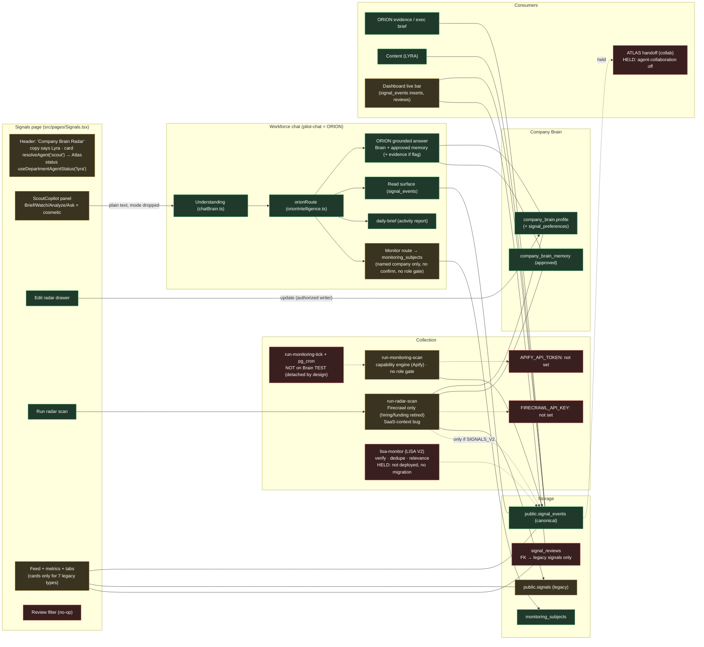

# Signals System: Functional and Integration Audit

*28 Nov 2026 · branch `claude/brain-v2-integration` · evidence commit `f78d2ac7` · Brain TEST `jekgwafobrzamoupehnn`*

Every claim here comes from reading the code on this branch or from a test that ran against it. Where only your hosted project can answer, I say so; `scripts/test-env/brain-test diagnose` collects that read-only. No product code was changed for this audit.

**Evidence used**
- `tests/edge-functions/_shared/signals/signalsAudit.test.ts`: 20 tests, all passing. They run the real pilot-chat handler with only the network faked, using your exact prompts.
- `tests/db-contract/signalsAudit.contract.test.ts`: 4 tests, all passing. They run against real Postgres with PostgREST and row-level security.
- The existing signal, radar, monitoring and LISA suites: 48 files, 600 tests, all passing.
- The LISA database-contract suite, which is part of the 483-test database lane.

All signals in the tests are fixtures marked `[TEST FIXTURE]`. Nothing was written to Northwind or to any hosted project.

---

## A. Executive summary

| Question | Answer |
|---|---|
| **Is Signals genuinely functional?** | **Not end to end on Brain TEST today.** The page renders, but nothing can collect a signal. No provider key is set (`FIRECRAWL_API_KEY`, `APIFY_API_TOKEN`). The canonical engine (LISA) isn't installed: its migration and function are held. "0 verified signals" is the correct empty state, not a measurement. |
| **Can it discover and verify new signals?** | **The code exists, but the engine that does it properly isn't deployed.** LISA collects, verifies against independent sources, deduplicates and scores relevance against the Brain. It's tested in a real database with fixtures, but it's held: `lisa-monitor`, the flag `LISA_V2_ENABLED` and migration `20261111120000`. The deployed radar is weaker, and for a software seller it currently **targets the wrong industries** (finding 4). |
| **Can it monitor existing companies?** | **Partially.** A watch can be recorded on a named company (`monitoring_subjects`), and `run-monitoring-scan` can scan it through the shared capability engine. But on Brain TEST there's no scheduler (by design), no Apify key, and the watches have safety gaps (findings 6 and 7). There is **no ICP-wide monitoring** of any kind. |
| **Is its dedicated AI agent connected?** | **No.** The Signals side panel isn't an agent. It forwards your text to the general workforce chat (ORION), drops the selected mode, and its replies appear in the floating chat, not the panel. It's labelled Atlas, while the page says Lyra. The registry's owner of signals is **LISA**. |
| **Is Company Brain integrated?** | **Partly.** Edit radar saves into the Company Brain itself, as `signal_preferences`, through the same authorized writer. The radar reads geography and approved exclusions. But it ignores company size, buyer personas, the buying signals, and evidence and qualification rules. And for a seller whose own description mentions "software", it replaces the ICP with SaaS targets. |
| **Are ORION and other agents synchronized?** | **Not with what the radar collects.** ORION, the executive brief, the read surface and content all read the canonical `signal_events` table. The deployed radar writes the legacy `signals` table, and only also writes `signal_events` when `SIGNALS_V2` is on, which is off by default. So a radar signal can appear on the Signals page and be invisible to ORION. |
| **What can I use today?** | **Strategy, not data.** ORION can recommend which buying signals matter and why, from your Company Brain: Issue A is fixed in `0defebd`, pending your redeploy. You can save radar preferences into the Brain. You can describe a monitoring plan in chat and get a written plan: Issue B, once the evidence context is on. Collecting, verifying or monitoring real signals needs a provider key and LISA installed, both behind approvals. |

---

## B. Actual architecture (as deployed on Brain TEST)



Red means absent or broken on Brain TEST. Amber means present but partial or misleading. Green means connected and tested.

---

## C. Feature status matrix

Status values: **Implemented**, **Partial**, **Disconnected**, **Held** (code exists but isn't installed), **Missing**, or **Cosmetic** (UI only).

| Capability | Frontend | Backend | Database | Company Brain | Test evidence | Status | Required fix |
|---|---|---|---|---|---|---|---|
| Strategic signal advice (Issue A) | Chat | `chatBrain.ts` prompt + `orionRoute` misfit rule (`0defebd`) | n/a | Goals, ICP, approved memory in prompt | 6 routing/e2e probes pass, both flag states | **Implemented** (pending your redeploy) | Redeploy `0defebd` |
| Historical signal summary | Chat | Read surface (`readSurface.ts`) on `signal_events` | `signal_events` | n/a | Empty state honest (probe) | **Implemented** for canonical rows; radar's legacy rows not counted | Canonical write path (P0-2) |
| ICP-wide monitoring plan (Issue B) | Chat | Only as ORION prose (evidence on); no plan object | none | n/a | Reproduced off, answered on (4 probes) | **Partial**: text only, not saved or reviewable | P1-3 monitoring plan object |
| Named-company watch | Chat "watch X" | `monitorSurface.ts` → `monitoring_subjects` | Yes, RLS: server-write only | Not used | Probes: enabled immediately, viewer allowed | **Partial + unsafe** | P0-4 confirmation + role gate |
| Monitoring execution | none | `run-monitoring-scan` via capability engine (Apify) | Writes `signal_events` | Partly (`mission` binding) | `monitoringEndToEnd` / `Runner` suites (fakes) | **Partial**: no role gate; no scheduler or key on TEST | P0-4 role gate; keys/scheduler behind approval |
| ICP-wide discovery (radar) | Run radar scan | `run-radar-scan`: Firecrawl only; hiring and funding retired; SaaS-context bug | Legacy `signals`; canonical only with `SIGNALS_V2` | Geography + exclusions yes; size, personas, triggers no; ICP replaced for software sellers | Plan probe reproduces SaaS queries | **Partial / incorrect** | P0-3 compiler fix; P0-2 canonical write |
| Canonical engine (LISA) | Page reads `signal_events` | `lisa-monitor` + `_shared/lisa/*` (collect, extract, verify, dedupe, relevance, weekly) | Held migration `20261111120000` | Real loader (relevance reasons, fingerprint) | `lisaEngine` + `lisaSignalEngine.contract` (real DB) | **Held**: not on Brain TEST | P0-1 install on Brain TEST (approval) |
| Hiring intelligence | Hiring tab/metric | Radar retired it; capability engine `jobs` adapters (Apify / LeadOcean) | `signal_events` | n/a | `jobsSignal*` suites (fakes) | **Disconnected** from Signals; no key | Route through LISA / capability engine (P1) |
| Competitor intelligence | Competitors tab | Radar (needs competitors in Brain + Firecrawl); LISA watches | Both | Competitors from Brain + approved memory | Fixtures (`funding`, `launch`) | **Held/Partial** | P0-1 |
| Market intelligence (expansion, technology, leadership) | No cards render | LISA types only | `signal_events` | Relevance vs Brain | LISA fixtures | **Held**; **invisible** on the page | P0-5 generic card |
| Verification | Badges | LISA `verify.ts` (independent sources, dates, identity, contradictions); radar `show_by_default` gate | `lisa_verification_of`, evidence table (held) | n/a | LISA contract tests | **Held** (radar's gate is weaker) | P0-1 |
| Qualification vs Brain rules | Fit chips | Radar intel profile; LISA relevance (industry, geography, exclusions) | n/a | Size, evidence requirements, qualification rules not applied | Probe + LISA test 01 | **Partial** | P1-1 |
| Ranking | Brief ordering | `deriveRadarBrief` (client); LISA relevance band; cluster relevance (`signal_cluster_relevance`) | Yes | Partly | `signalRelevance*`, `signalCluster` suites | **Partial** | P1 |
| Deduplication | n/a | `signalDedupeKey` (radar), unique `(workspace_id, dedupe_key)` on `signal_events`, LISA dedupe | Unique index | n/a | `signalQuality`, LISA contract | **Implemented** (per store; not across legacy↔canonical unless dual-written) | P0-2 |
| Recommended actions | Card actions | Radar `next_action`; LISA→ORION handoff (held) | n/a | n/a | Collab tests (held) | **Partial/Held** | P1-4 |
| Review actions | Signals page: **none**; dashboard: yes | `signalReviews.ts` (client) | **FK → legacy `signals` only** | n/a | DB probe: canonical review → `23503` | **Broken** for canonical signals | P0-6 |
| Review filter | Dropdown | `onReviewFilterChange={() => {}}` | n/a | n/a | Static probe | **Cosmetic** | P2 |
| Signal detail view | Signals page: none; dashboard drawer: yes | n/a | n/a | n/a | Code read | **Partial** | P1-5 |
| Signals → ORION | n/a | `evidence/retrieve.ts`, `executiveBriefContext.ts` read `signal_events` | `signal_events` | n/a | Probe: legacy invisible, canonical visible | **Partial** (radar data invisible) | P0-2 |
| Signals → ATLAS | n/a | `collab/orionToAtlas.ts` (research request, no contact) | Held `agent_collaboration` | `atlasView` | Collab contract tests | **Held**; ATLAS V5 not installed | After V5 (P1-6) |
| Signals → Content | Content page reads reviews | `signalContentHandoff.ts`, `contentService.ts` on `signal_events` | `signal_events` | Brand voice in LYRA view | `signalContentHandoff` suite | **Implemented** for canonical rows | P0-2 for radar rows |
| Signals → Company Brain (durable) | Memory review queue | `lisaBrainProposals.ts` (competitor proposals) → proposal queue | Proposals | Approval required | LISA contract test (proposals) | **Held** (with LISA) | P0-1 |
| Dashboard / brief / notifications | Live bar (realtime `signal_events`), brief | `daily-brief`, `executiveBriefContext` | `signal_events` | n/a | Code read | **Partial**: no notifications exist | P2 |
| Markdown in chat | `ChatView.tsx:194,204` renders `{m.content}` as plain text | n/a | n/a | n/a | Code read | **Missing**: brief Markdown shows raw | P2-1 |

---

## D. Root cause analysis

### Issue A: "which three buying signals should we prioritize and why?" produced the activity brief

Two causes, both already fixed on this branch in `0defebd` and covered by 6 probes:
1. **The understanding prompt contradicted itself.** `chatBrain.ts` said that "a question to ORION about priorities or the workspace is read". The prompt was filed as a read; a read that asks for prose about the workspace is the brief (`readSurface.ts`, `target: "brief"`); and `daily-brief` reports recorded activity, which is empty.
2. **`promoteExecutiveQuestion` turned priority wording into the brief whenever the evidence context was off** (`departmentRouting.ts:60`). It was off, because `deploy-brain-test.sh` didn't set `AGENTORY_ORION_EVIDENCE_CONTEXT`.

Probes: `Issue A (…)`, run with three different model readings in both flag states. In every case ORION answers with the strategy rules, and the approved Crypto exclusion is in its prompt.

### Issue B: "Create a monitoring plan … Do not execute it yet" got "I couldn't work out exactly what to watch"

1. With the evidence context **off**, `orionRoute` returns before its rule for "a paid objective plus an explicit do-not-execute" (`orionIntelligence.ts`, `NO_EXECUTION_RE`). The request went to the **monitor** binding.
2. `planMonitor` (`monitorSurface.ts:53`) accepts only a `company` or `person` entity **with a resolved binding or a company-name filter**. An ICP description has neither, so it returns `refusal`, and pilot-chat prints the canned sentence (`pilot-chat/index.ts:2899`).
3. **The design gap underneath:** monitoring is modelled only as one watched subject per named company. Nothing represents an ICP-wide watch or a saved, reviewable plan.

Probes: `Issue B (… evidence OFF)` reproduces the exact text with no rows created. With the evidence context on, ORION writes the plan as text, and nothing is created or bought.

### Issue C: Atlas on a page that says Lyra

The canonical registry is `src/config/agentRegistry.ts` and `supabase/functions/_shared/departments.ts`, pinned to each other by tests. It says:
- **LISA** owns signals: "Monitors competitors and markets for expansion, hiring, funding and launch signals, verifies them…".
- **Lyra** is content.
- Legacy `scout` is an alias for **Atlas** (`scout: 'atlas'`).

The Signals page predates that lineup (Workforce V2):

| Where | What it does | Result |
|---|---|---|
| `Signals.tsx:152` | Copy says "monitored by Lyra" | Wrong agent named |
| `Signals.tsx:77` | `resolveAgent('scout')` (comment still says "→ Lyra") | Card and panel show **Atlas** |
| `Signals.tsx:68` | Status from `useDepartmentAgentStatus(workspaceId, 'lyra')` | Shows the content agent's live state |
| `Signals.tsx:137`, `TodaysSignalBrief.tsx:37,69` | Toasts and empty state say Lyra, including "Lyra is monitoring your radar" | Also claims monitoring that doesn't run |
| `ScoutCopilot.tsx:103` | `sendAgentCommand(text, {action_source: 'signals_scout_copilot'})` | No agent, prompt or tools selected; the mode isn't sent; the reply lands in the general chat |

**Classification:**
- Stale identity binding on the page: the registry is right, the page isn't.
- Plus a missing dedicated agent. No LISA chat surface exists, and the execution side (`lisa-monitor`) is held.
- Not a system-prompt problem, because there is no dedicated system prompt.

Renaming Atlas to Lyra would be wrong twice: Lyra is content, and the panel isn't an agent.

### Issue D: zero verified signals

On Brain TEST this is correct, not a fault:
- the radar's only provider, Firecrawl, has no key;
- hiring and funding were retired from the radar;
- LISA isn't installed;
- the scheduler is detached by design (see section 9).

Two misleading details, though:
- "Run radar scan" ends with "Lyra added 0 new signals". The page ignores the radar's per-category `setup_needed` reasons, so you aren't told no provider is configured.
- The probe shows LISA's signal types (`expansion`, `product_launch`, `leadership_change`, `technology`, `partnership`, `acquisition`, `pricing`) **have no card**. `SignalCardRouter` returns `fallback ?? null`, and the page passes no fallback. Once LISA runs, your Northwind buying signals would be **counted but not shown**.

### Further root causes found during the audit

4. **For a software seller, the radar searches for SaaS companies instead of your ICP.**
   - `companyBrainCompiler.ts:263-283` decides "SaaS context" by running a regex (`software|platform|sales|automation|crm…`) over a text blob that includes the **seller's own** description.
   - "Scheduling software for field-service teams" matches, so the compiler adds `B2B SaaS`, `AI SaaS` and `sales software` to the target categories, plus SaaS titles and hiring triggers.
   - The radar's first queries become "B2B SaaS hiring 'Operations Manager' United States". Probe: `Brain → radar …`.
5. **Two stores and one switch.** The deployed radar writes legacy `public.signals` (`run-radar-scan/index.ts:557`). It writes canonical `signal_events` only with `SIGNALS_V2` (`:578`), which is off by default. Every intelligent consumer (ORION evidence, executive brief, read surface, content, dashboard live bar) reads only `signal_events`. Probe: a legacy row is invisible to ORION's evidence, while a canonical one is visible.
6. **Reviews reference the legacy table.** `signal_reviews.signal_id` has a foreign key to `public.signals(id)` (baseline schema, line 8044). Reviewing a canonical signal fails with `23503` (database probe). The Signals page offers no review actions at all; the dashboard does, and would fail on every LISA signal.
7. **Monitoring safety gaps.**
   - A typed "watch X" creates an **enabled** subject immediately, with no confirmation card (`monitorSurface.ts:160`, `enabled: true`).
   - **pilot-chat has no role check**, so a **viewer** can create a scheduled, paid watch through chat. The probe confirms it. The database itself refuses direct writes, so the gap is the server path.
   - `run-monitoring-scan` also checks membership but not role. `run-radar-scan` does gate on role, via `canRunPaidOperation`.
   - In production, a pg_cron job runs these subjects every 15 minutes (`20260825140000_monitoring_cron.sql`). The R1.2 containment notes record that this already spent unattended until an invalid Apify key stopped it.
8. **The page drops canonical detail.** `SignalsFeedList.tsx:50-55` passes only `signal_type`, `title`, `source_url` and `raw` to cards. Verification, event and detection dates, account, fit score and next action are on the `FeedSignal`, not inside `raw`, so canonical rows lose them on this page.
9. **Approved memory could vanish from agents.** The shared loader dropped the whole memory block when a bookkeeping read failed. This is fixed in `0defebd`.

---

## E. Completion assessment

These estimates reflect what works end to end on the current branch and could be used on Brain TEST. Code that is held, untested, or only rendered doesn't count fully.

| Area | % | Criteria behind the number |
|---|---|---|
| Signals frontend | **45%** | Page, metrics, tabs, search, filters and empty states work against real tables (canonical first, then legacy). Against: wrong agent identity throughout; review filter is a no-op; no review actions or detail view on the page; LISA types invisible; canonical detail dropped; scan result hides "setup needed". |
| Dedicated AI agent | **10%** | A panel exists and forwards text to ORION, which answers. There is no agent behind it: no mode behaviour, no dedicated tools or prompt, replies outside the panel, wrong name. |
| Signal discovery engine | **25%** | Radar: works only with a Firecrawl key; hiring and funding retired; SaaS-context bug sends it to the wrong market; writes the legacy table. LISA: well-built and tested in a real database, but held. Neither can produce a signal on Brain TEST today. |
| Named-company monitoring | **35%** | Watch recording and the scan pipeline are tested with fakes. Missing: confirmation, a role gate on chat and on the scan endpoint, a provider key, a scheduler on TEST; results go only to canonical. |
| Evidence verification | **30%** | LISA verification (independent sources, dates, identity, contradictions) is implemented and tested in a real database, but held. The deployed radar's `show_by_default` gate is a much weaker substitute. |
| Company Brain integration | **50%** | Edit radar writes into the Brain through the authorized writer; geography and approved exclusions reach the radar; LISA relevance uses the real loader. Against: size, personas, triggers, qualification and evidence rules unused; SaaS contamination for software sellers. |
| ORION integration | **55%** | Strategy advice from the Brain works (`0defebd`). Historical reads and evidence over `signal_events` work. Radar-collected rows are invisible; there's no ICP plan object; the brief's Markdown renders raw. |
| ATLAS integration | **10%** | The ORION→ATLAS research handoff is implemented and tested but held (`agent-collaboration`, `LISA_V2_ENABLED`). The ATLAS V5 pipeline doesn't read signals. Signal→account linking is LISA-only. |
| Content agent integration | **45%** | The content handoff and service read `signal_events`; brand voice applies. With no canonical signals on TEST it has nothing to use. |
| **Overall end-to-end readiness** | **~25%** | No path today goes from "configure" through "collect", "verify", "show", "review", "ORION / ATLAS / content" on Brain TEST. Strategy without data does work. |

---

## F. Prioritized implementation plan

The smallest coherent sequence: make LISA the one engine, writing the one canonical store; make the page and reviews read that store; close the safety gaps. Then add plans and integrations.

### P0: core functionality preventing actual use

| # | Task | Files | Depends on | Expected behaviour | Acceptance tests |
|---|---|---|---|---|---|
| P0-0 | Redeploy `0defebd` to Brain TEST (Issue A, the Issue B planning answer, evidence context) | `deploy-brain-test.sh` | Your approval | Strategic signal advice from the Brain; plan-only requests answered, nothing created | Retest prompts A and B; `signalsAudit.test.ts` Issue A/B |
| P0-1 | Install LISA on Brain TEST: held migration `20261111120000_lisa_signal_engine.sql`, function `lisa-monitor`, `LISA_V2_ENABLED=true`, with **fixture or "replay" mode only** (no provider key) | `install-atlas-v5.sh`-style installer for LISA; `lisa-monitor/handler.ts` | Approval; no paid provider | A manual "Run LISA" on a fixture writes verified `signal_events` (clearly marked as test data); nothing scheduled | `lisaSignalEngine.contract`; hosted: diagnostic shows `lisa_*` tables and a fixture run |
| P0-2 | One canonical store: radar writes `signal_events` (turn `SIGNALS_V2` on, or retire the radar in favour of LISA) | `run-radar-scan/index.ts`, `radarSignalToV2.ts` | P0-1 | Every collected signal is visible to the page, ORION, brief and content | Probe "legacy invisible to ORION" flips to visible; `radarSignalToV2` suite |
| P0-3 | Fix SaaS-context contamination: decide "SaaS context" from the **target** ICP, never from the seller's own description | `companyBrainCompiler.ts:263-283` | none | Northwind's radar queries target Manufacturing and Distribution | `Brain → radar` probe asserts manufacturing queries and no SaaS terms; `radarScanPlanner` / compiler suites |
| P0-4 | Monitoring safety: "watch X" produces a **confirmation card**, not an enabled row; role gate (edit) on pilot-chat's monitor route and on `run-monitoring-scan` | `pilot-chat/index.ts:2891`, `monitorSurface.ts`, `run-monitoring-scan/index.ts` | none | Viewers refused; nothing is enabled without an explicit Start | Flip the two FINDING probes; add a viewer-refusal test on `run-monitoring-scan` |
| P0-5 | Render every canonical signal: a generic card (title, company, type, source, dates, verification, relevance) as the router's fallback; pass full `FeedSignal` fields | `SignalCardRouter.tsx`, `SignalsFeedList.tsx` | none | Expansion, leadership and technology signals are visible with their evidence | Flip the "no card" probe; frontend test per LISA type |
| P0-6 | Reviews on canonical signals: add `signal_event_id` (FK to `signal_events`) to `signal_reviews`, or retarget; add review actions to the Signals page | New migration (held, Brain-owned review), `signalReviews.ts`, `SignalsFeedList.tsx` | P0-2 | Reviewing any shown signal works and survives reload | DB probe flips from `23503` to success; RLS unchanged |
| P0-7 | Identity: the page shows **LISA** (registry), status from `lisa`, copy and toasts corrected, no "is monitoring" claim unless a schedule exists | `Signals.tsx`, `TodaysSignalBrief.tsx`, `ScoutCopilot.tsx` | none | One consistent owner | Flip the identity probe |

### P1: important integration and intelligence gaps

| # | Task | Files | Expected behaviour | Acceptance |
|---|---|---|---|---|
| P1-1 | The Brain fully drives qualification: size range, personas, buying signals (`triggers`), evidence requirements, qualification rules; no generic default disqualifiers that contradict the ICP | `companyBrainCompiler.ts`, `radarScanPlanner.ts`, `lisa/relevance.ts` | Northwind's four buying signals become the watch list; contracting and logistics aren't excluded | Planner and relevance tests on Northwind |
| P1-2 | A dedicated LISA conversation: the panel sends `{agent: 'lisa', mode}`; pilot-chat answers with LISA's view (signals, watchlist, Brain) and replies in the panel | `ScoutCopilot.tsx`, `agentCommand.ts`, `pilot-chat` (department route) | Brief/Watch/Analyze/Ask change behaviour; no claims of collection that didn't happen | Handler tests per mode |
| P1-3 | A monitoring **plan** object: ICP-wide watch definitions (signals, ICP filters, cadence, budget), saved as a draft and approved before anything runs | New table (held migration), `monitorSurface.ts`, pilot-chat | "Create a monitoring plan… don't execute" saves a reviewable draft | Plan created, zero `monitoring_subjects`, zero provider calls |
| P1-4 | LISA→ORION and LISA→LYRA handoffs live (`agent-collaboration`, held) | `collab/*` | Verified signals appear as ORION recommendations and LYRA content ideas | Existing collab contract tests on Brain TEST |
| P1-5 | A signal detail drawer on the Signals page (reuse the dashboard's `SignalDetailDrawer`) | `SignalsFeedList.tsx` | Evidence, sources, dates, verification and relevance per signal | Frontend test |
| P1-6 | Signals → ATLAS, after V5 install: research proposals from verified signals, with exclusions and dedupe | `collab/orionToAtlas.ts`, ATLAS V5 | No duplicate leads; provenance kept | After V5 |
| P1-7 | Run radar scan reports "setup needed" per source instead of "added 0" | `Signals.tsx`, `useSignalFeed.ts` | You see "Firecrawl not configured" | Frontend test |

### P2: UI improvements and optional capabilities

- **P2-1:** Markdown rendering in chat bubbles (`ChatView.tsx:194,204`), so briefs aren't shown as raw `#` and `**`.
- **P2-2:** The review filter: wire it or remove it (`Signals.tsx`).
- **P2-3:** Check that the floating workforce chat doesn't cover the Signals composer at narrow widths.
- **P2-4:** Notifications for high-relevance verified signals. None exist today.

**Recommended order:** P0-0, then the code-only fixes (P0-3, P0-4, P0-5, P0-7), then P0-1, P0-2, P0-6 (installs plus a schema change, each with approval), then P1-1 to P1-3.

After the first group, the page is honest and safe. After the second, Signals is genuinely usable on Brain TEST with fixture data, with no paid provider involved.

---

## 9. Database, execution and security notes

- **Tables on Brain TEST**, from the build scripts. Present: `signals`, `signal_events`, `signal_reviews`, `monitoring_subjects` and `signal_cluster_relevance`. Absent: the LISA tables (`lisa_scan_runs`, `lisa_watch_state`, `signal_event_transitions`, plus the evidence and transition RPCs) and the collaboration tables. `diagnose` confirms this.
- **Scheduling.** `20260825140000_monitoring_cron.sql` hardcodes **production's** URL. The Brain TEST build applies every cron migration in the same transaction as `01-local-cron-detach.sql`, and fails if any job still calls a hosted project (`build-test-schema.sh:26-28, 115-116`). This is an intentional safeguard. `diagnose` lists `cron.job` for confirmation.
- **Authorization.**
  - `monitoring_subjects`, `signal_events` and evidence are server-write only (`workforce_v2_security`); the probe confirms the database refuses members.
  - `signal_reviews` lets any member write their own review row (per user).
  - The gaps are the server paths: pilot-chat's monitor route and `run-monitoring-scan` have no role check.
- **Isolation.** Cross-workspace reads of `signal_events` return nothing (database probe).
- **Intentional TEST safeguards** (not gaps): no provider keys, no scheduler, LISA and collaboration held, `SIGNALS_V2` off, delegation off.
- **Genuine gaps:** findings 4–8 above and the role gates.

## Hosted read-only check (your Mac)

Run it from `claude/brain-v2-integration`:

```bash
scripts/test-env/brain-test diagnose
```

It reports:
- which signal tables exist, and legacy vs canonical row counts per workspace;
- watches;
- the latest signal titles;
- Edit-radar preferences;
- cron jobs;
- which signal and provider settings are **set** (names only);
- deployed function versions;
- recent HTTP statuses for radar, monitoring and pilot-chat calls;
- function errors.

It never prints secret values.
