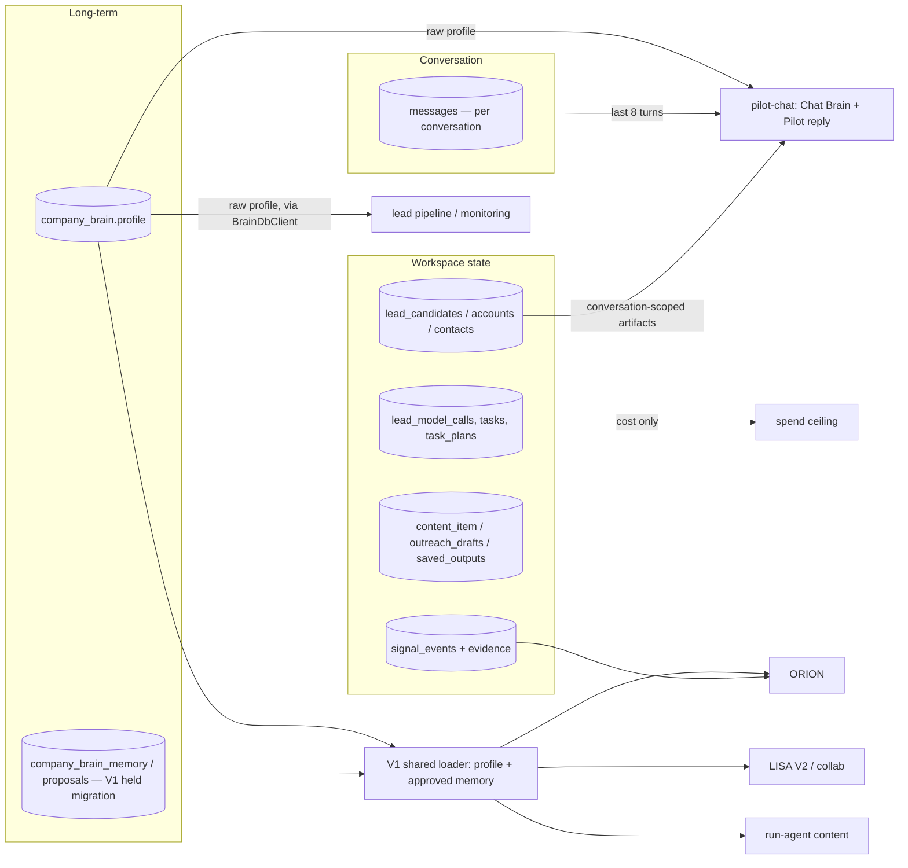

# Agentory — AI model, prompt, context and reasoning architecture audit (2026-11)

Read-only audit of commit `10451883` on `claude/agentory-audit-roadmap-64uq8n` (up to date with
`launch/hardening`). No production access, no model calls, no provider calls, nothing deployed.
Every finding marked **[verified]** is reproduced by `aiArchitectureScenarios.test.ts` in this folder
(24 tests, all passing). The tests run the repository's real routing, prompt, context and validation code
against **fake model transports and in-memory tables**.

> **What could not be verified:** which models *production* actually runs depends on environment
> variables (`ANTHROPIC_API_KEY`, `OPENAI_API_KEY`, `LOVABLE_API_KEY`, `LEAD_STRATEGIST_PROVIDER`,
> `AGENTORY_GPT_MODEL_FAMILY`, `MODEL_SPEND_*`). Production secrets and logs were not read. Everything
> below describes what the **code** does for each configuration. Code comments record production
> observations (e.g. a Haiku call on 2026-09-10; a placeholder `LOVABLE_API_KEY` on the migrated project);
> those are cited as *code-documented*, not independently confirmed.

---

## A. Complete AI model inventory

### Model clients (there are four, and they behave differently)

| Client | File | Vendor / endpoint | Model selection | Fallback |
|---|---|---|---|---|
| General AI client | `_shared/aiProvider.ts` (`generateText`, `generateJson`) | Anthropic `api.anthropic.com`; OpenAI `api.openai.com` | `TASK_MODELS[taskType]`, **hardcoded**. Every task is `claude-haiku-4-5-20251001` | Only `helper` and `tool_input_planning` may fall back to `gpt-4.1-mini`. Every other task fails with `no_provider_for_task` (no silent demotion). |
| Lead/GPT client | `_shared/gptProvider.ts` (`gptStructured`) + `gptModelRouter.ts` | OpenAI only | `routeModel(stage)`: `gpt-5.6-luna` primary, `gpt-5.6-terra` for validator repair. Family switch `AGENTORY_GPT_MODEL_FAMILY=gpt-6` → `gpt-6-luna` / `gpt-6.1-sol` | None across vendors. Legacy `gpt-4.1` / `gpt-4.1-mini` only for unrouted calls (none remain on the lead path). |
| Lead strategist | `_shared/leadStrategy/{config,factory,adapters}` | **Lovable gateway by default** (`ai.gateway.lovable.dev`); OpenAI if `LEAD_STRATEGIST_PROVIDER=openai` | `LEAD_STRATEGIST_PRIMARY_MODEL` (default `openai/gpt-5.6-luna`), escalation `openai/gpt-5.6-terra` | Primary → one escalation on invalid output → deterministic. Gated by `GPT_LEAD_STRATEGY` + workspace allow-list. |
| Images | `_shared/imageProvider.ts` | OpenAI Images | `OPENAI_IMAGE_MODEL` or default `gpt-image-1` | — |

### Every AI-powered feature

| Agent / feature | Provider | Model | Call site | Config | Purpose | Status |
|---|---|---|---|---|---|---|
| **Chat understanding** (every chat turn) | OpenAI | `gpt-5.6-luna` (repair: `terra`) | `_shared/chatBrain.ts` `understandRequest` | hardcoded router | Turns a message into a structured request (`RequestV1`) | Live path |
| Pilot conversational reply | Anthropic | Haiku 4.5 | `pilot-chat` → `converseSurface` (`pilot_chat`) | hardcoded | Grounded prose answer | Live path |
| Pilot legacy intent classifier | Anthropic (→ `gpt-4.1-mini`) | Haiku 4.5 | `pilot-chat` `classifyUserIntent` (`helper`) | hardcoded | Legacy fallback tail only | Legacy |
| Orchestration plan | Anthropic | Haiku 4.5 | `orchestrate` (`orchestration_plan`) | hardcoded | Plans multi-step work | Live path |
| Agent execution (Scribe content, Penn outreach, generic steps) | Anthropic | Haiku 4.5 | `run-agent` (`agent_execution`) | hardcoded (`preferredProvider` is ignored) | Writes the work product | Live path |
| Workbench opener | Anthropic | Haiku 4.5 | `workbench/openerModel.ts` (`agent_execution`) | hardcoded | Short opener text | Live path |
| Actor input planning | Anthropic (→ `gpt-4.1-mini`) | Haiku 4.5 | `actorInputPlanner.ts` (`helper`) | hardcoded | Apify input JSON | Live path |
| Broadening planner (legacy) | Anthropic (→ `gpt-4.1-mini`) | Haiku 4.5 | `broadeningPlannerAdapter.ts` | hardcoded | Later-round broadening | Legacy, gated |
| **ORION** executive brief wording | Anthropic (→ `gpt-4.1-mini`) | Haiku 4.5 | `daily-brief` (`helper`) | hardcoded | Optional rewording of a deterministic brief | Live path |
| Company Brain setup / analysis | Anthropic | Haiku 4.5 | `setup-company-brain` (`company_brain_analyze`, `_followups`) | hardcoded | Builds the Brain | Live path |
| Company Brain draft from website | Anthropic (→ `gpt-4.1-mini`) | Haiku 4.5 | `generate-company-brain-draft` (`helper`) | hardcoded | Draft profile | Live path |
| **ATLAS** mission compilation, actor selection, execution plan, triage, evaluation, qualification, evidence planning/extraction, opportunity reasoning, summaries | OpenAI | `gpt-5.6-luna` (planning stages escalate to `terra` on repair) | `run-agent` / `lead-pipeline` via `gptModelRouter` | hardcoded + family env | Lead discovery and qualification | Live path (needs `OPENAI_API_KEY`) |
| ATLAS pool ranking | — | none (deterministic) | `gptModelRouter` | — | Ranking | Live path |
| ATLAS lead strategist / source feedback | Lovable gateway or OpenAI | `openai/gpt-5.6-luna` | `leadStrategyOwner`, `leadStrategyFeedbackOwner` | env | Strategy, "what next" | Gated (`GPT_LEAD_STRATEGY`) |
| **LISA** monitoring (legacy) | OpenAI | `gpt-5.6-luna` | `run-monitoring-scan` → lead engine + `signalRelevanceJudge` | hardcoded | Actor selection, evaluation, relevance | Live path |
| LISA radar | — | none | `run-radar-scan` | — | Firecrawl / Apify plus deterministic scoring | Live path |
| LISA V2 / Phase 5 collaboration | — | **none** (deterministic) | `_shared/lisa/*`, `_shared/collab/*` | — | Extraction, verification, relevance, handoffs | Feature branch, disabled |
| LYRA image | OpenAI | `gpt-image-1` | `generate-content-image` | env / default | Post images | Live path |
| `linkedin-content-planner/` | Google | `gemini-2.5-flash` | separate Electron app | its own settings | — | **Not part of the product build** |
| `screening-pilot-pipeline/` | Anthropic | `claude-3-5-sonnet-20241022` | standalone script | its own env | — | **Not part of the product build** |
| `scripts/local-supabase/model-stub.ts`, `scripts/model-routing-eval/` | stub / eval | — | dev tools | — | Offline testing | Test/dev only |

### Selection and fallback, answered

- **Same model for every agent?** No. Two families split by *workflow*, not by agent:
  - **Claude Haiku 4.5** for all general work: chat replies, planning, content, ORION's wording, the Company Brain.
  - **GPT-5.6 Luna** for chat understanding and the whole lead / monitoring engine.
- **Cheaper models for classification?** Yes. Luna (`$0.20 / $1.20` per 1M in the code's price table) does high-volume triage/evaluation with `reasoning_effort: none`. Terra (`$2 / $12`) is used **only** to repair an output the validator rejected. Haiku (`$1 / $5`) does all prose.
- **Automatic fallback?** Deliberately minimal. `aiProvider` never silently swaps the model for user-facing tasks. Two utility tasks may move to `gpt-4.1-mini`. A vendor answering 402/429 is not retried in the same call. The GPT client never crosses vendors.
- **Model-specific flags:** `AGENTORY_GPT_MODEL_FAMILY`, `LEAD_STRATEGIST_PROVIDER` / `*_MODEL`, `OPENAI_IMAGE_MODEL`, `GPT_LEAD_STRATEGY`.
- **TEST vs production:** the same code. The difference is only which env vars are set; that was not inspectable here.
- **Every chat turn needs two vendors:** OpenAI (understanding) **and** Anthropic (reply). With no OpenAI key, every request answers *"I couldn't read that request just now…"*. This is honest, but there is no degraded mode. **[verified M1, M4, R1]**

---

## B. Current architecture (question → answer)

```mermaid
flowchart TD
  U[User message in Chat] --> PC[pilot-chat]
  PC --> AUTH[auth.getUser + workspace_members check]
  AUTH --> SPEND[model spend ceiling: $/workspace/day, fail-closed]
  SPEND --> WQ{deterministic workspace-question recogniser}
  WQ -- matched --> WQA[answerWorkspaceQuestion: DB snapshot, no model] --> SAVE
  WQ -- no --> CB[Chat Brain: GPT-5.6 Luna → RequestV1 JSON, schema-validated]
  CB -- unreadable --> HONEST[\"I couldn't read that\" — no work started]
  CB --> R[objectiveRouter: converse / read / research / source / monitor / compose]
  R --> B[bindRoute]
  B -->|converse| CV[Pilot reply: Haiku + converseSystemPrompt + grounded facts + 8 prior turns]
  B -->|read| RS[readSurface: DB rows, no model] --> BRIEF{prose about workspace?}
  BRIEF -->|yes| DB[daily-brief = ORION: deterministic ranking + optional Haiku wording, validated]
  B -->|source / research / monitor| LM[mission compile (Luna) → orchestrate (Haiku plan) → run-agent → lead engine (Luna stages) + Apify/Firecrawl]
  B -->|compose| CO[orchestrate → run-agent Scribe: Haiku agent_execution → content_item draft]
  CV --> SAVE[messages insert (model_used label hard-coded)]
  DB --> SAVE
  LM --> SAVE
  CO --> SAVE
  SAVE --> UI[Dashboard / Chat]
```

Key files: `supabase/functions/pilot-chat/index.ts` (4,643 lines; auth at `:1434`, membership at `:1520`, spend at `:1544`, Chat Brain at `:2173`, converse at `:2772`), `_shared/chatBrain.ts`, `_shared/objectiveRouter.ts`, `_shared/chatBrainBinding.ts`, `_shared/readSurface.ts`, `_shared/workspaceQuestions.ts`, `_shared/converseSurface.ts`, `daily-brief/index.ts`, `orchestrate/index.ts`, `run-agent/index.ts` (9,339 lines).

### The router (section 4)

- **There is no agent router.** Requests are routed by **objective** (what work is needed), never by agent. No model ever chooses an agent. The agent is implied by the route.
- **Explicit agent selection:** none in chat. Cards and actions carry metadata such as `lead_source_card` and signal ids.
- **Tool selection:** no model receives native function-calling tools. Tools come from fixed routes, or from a model choosing within a fixed vocabulary that code then validates (e.g. Luna's `discovery_actor_selection`). **[verified R1]**

### Naming (reported, not changed)

| Intended | What the code actually has |
|---|---|
| ORION = Executive | `orion` exists in the UI registry (`src/config/agentRegistry.ts`) but executes as legacy **`scribe`**, the content writer. ORION's own wording call sends `<current_role>scribe</current_role>` **and** "You are Orion". **[verified P2]** |
| ATLAS = Leads | `atlas` = legacy `aria` (scoring) + `hawk` (research). Sourcing is legacy `scout`, displayed as **Lyra**. |
| LYRA = Content | `lyra` = **"AI Signal Scout"** (legacy `scout`). Content is `scribe`, displayed as **Orion**. |
| LISA = Signals | **Does not exist in the app.** It appears only on landing pages. The in-app registry also contains **Mira** (outreach, legacy `penn`) and **Pilot**. **[verified P3]** |

Every model prompt uses the legacy team names. The master system prompt lists Pilot / Scout / Aria / Penn / Hawk / Scribe, and the converse prompt says "You are Pilot". No prompt names ORION, ATLAS, LYRA or LISA. **[verified P1, R1]**

---

## C. Context architecture



### Company Brain fields per agent (live paths)

| Context | ORION (`daily-brief`) | ATLAS (lead engine) | LYRA (content via `run-agent` Scribe) | LISA (monitoring / radar) | Chat (Pilot) |
|---|---|---|---|---|---|
| Profile: company, industry, products | ✓ (effective profile) | ✓ (raw, compiled) | ✓ (effective profile) | ✓ (raw, compiled) | ✓ (raw) |
| ICP / geography / size | ✓ | ✓ (mission-level) | partial | ✓ | ✓ (raw) |
| Goals | ✓ (profile + approved) | ✗ | via profile | ✗ | via profile |
| Competitors (approved memory) | ✓ | ✗ | listed as "not us" | profile list only | raw list |
| Exclusions (memory) | ✓ | ✗ | ✓ | ✗ (V2 only) | ✗ |
| Decisions / corrections | ✓ (dismissed / rejected refs) | ✗ | ✗ | ✗ | ✗ |
| Approved agent proposals | ✓ | ✗ | ✓ (facts) | ✗ | ✗ |
| Freshness / provenance / verification | ✓ (memory block) | ✗ | ✓ (memory block) | ✗ | ✗ |

*Available in code but not passed live:* ATLAS's memory-aware context (`loadMissionContextWithMemory`, `atlasBrainContract`) is opt-in and not called. The LISA V2 and collaboration paths are disabled.

**[verified C1]** Chat reads the raw `company_brain.profile` (`pilot-chat/index.ts:1930`) and never calls the shared loader. An approved tone change is visible to content generation but not to chat.

**[verified C2]** ATLAS's planner calls `loadMissionContext(input.admin, input.workspaceId)` with no `userId` and no `skipMembershipCheck`, so the loader returns `forbidden` and **the planner plans without any ICP context**.

### Context construction answers

- **Refreshed per request?** Yes, every path re-reads. There is no cross-request cache except the frontend's react-query cache of the Brain.
- **Stale / disputed memory excluded?** Yes, in the shared loader (only servable items; `needs_review` is kept out of the agent views). Not applicable to chat or ATLAS, which never read memory.
- **Truncation:**
  - `compactCompanyBrain` caps the Brain block at ~1,200–1,600 characters (first keys win; strings at 180 characters, lists at 5).
  - The registry summary is capped at 3,500 characters.
  - Turns are capped at 1,200 characters × 8.
  - The memory block is capped at 1,800 characters per agent.
- **Corrections override?** Yes in the loader (a newer approved preference wins; a retracted competitor is removed). Not in chat or ATLAS.
- **Fingerprint checks:** only in LISA V2 relevance and the Phase 5 handoffs (both feature-branch).
- **Missing Brain:**
  - Prompts say "do not invent company facts" / "you do not know this business".
  - ORION marks the Brain unusable.
  - ATLAS runs without an ICP.
  - LISA V2 / collaboration recommend only Brain setup. **[verified S10]**

### Conversation memory — five different things

| Kind | Where | What the model sees |
|---|---|---|
| 1. Current conversation | `messages` (per `conversation_id`) | Chat Brain and the Pilot reply get the **last 8 turns** (≤1,200 chars each), in chronological order. **[verified C3]** |
| 2. Cross-session history | `conversations` + `messages` | **Not loaded.** A new conversation starts empty. |
| 3. Company Brain long-term memory | `company_brain` + memory tables | ORION, content and LISA V2 only (above). |
| 4. Agent execution history | `lead_candidates`, `accounts`, `outreach_drafts`, `saved_outputs`, `tasks`, `task_plans`, `lead_model_calls` | Chat's "conversation memory" (`memoryReader.ts`) is these **artifacts**, scoped to the conversation: leads/accounts/contacts (≤50), drafts (≤10), outputs (≤5). The reply sees **counts only**. |
| 5. Temporary model context | the prompt | Discarded after the call. |

Chat decisions and corrections are **not** saved as organizational memory. Only an explicit Company Brain write or approved proposal is.

**Defect [verified C3]:** the legacy fallback tail (`pilot-chat/index.ts:4314`, used for URL analysis / outreach) loads `messages` with `order(created_at ascending).limit(20)`. That is the conversation's **first** 20 messages, not the last.

---

## D. Agent comparison

| Agent | Model(s) | System prompt | Context | Tools | Output |
|---|---|---|---|---|---|
| **ORION** (`daily-brief`; chat "brief") | Deterministic ranking + optional Haiku wording | master prompt (`reporting`, role "scribe") + `MODEL_INSTRUCTIONS` "You are Orion…" | shared loader (profile + approved memory), signals, leads, content, approvals, plans (7-day window) | none (reads DB) | brief JSON + markdown; model text accepted only if every number is grounded |
| **ATLAS** (lead mission) | GPT-5.6 Luna at every stage (Terra on repair); strategist on Luna via Lovable/OpenAI | per-stage prompts in `gpt*` modules; master prompt only in `run-agent` steps | raw Brain via the compiler; **planner context loads as `forbidden`** | Apify actors (selected by Luna from a registry, validated), Firecrawl, credits ledger | leads saved to `lead_candidates`; summaries |
| **LYRA** (content = legacy `scribe`) | Haiku 4.5 (`agent_execution`, temperature 0.6, 2,048 tokens); `gpt-image-1` for images | DB `agents.role_prompt` + master prompt (`agent_execution`) + content Brain block + memory block | shared loader (tone, restrictions, approved facts) + recent content | none for text; image function | `content_item` **draft**; never published automatically |
| **LISA** (monitoring / radar) | Monitoring: Luna (actor selection, evaluation, relevance judge). Radar: none. V2: none | per-stage GPT prompts; relevance-judge prompt | raw Brain; V2 uses the shared loader | Apify (funding / news / jobs actors), Firecrawl `/v2/search` | `signal_events` (+ evidence in V2) |
| Pilot (chat) | Luna understanding + Haiku reply | Chat Brain `SYSTEM`; `converseSystemPrompt` "You are Pilot" | raw Brain + 8 turns + conversation artifact counts | routes only | message |

---

## E. Question-to-answer walkthroughs (traced in code, verified with fakes)

1. **ORION — "What should I prioritize this week?"**
   - The deterministic recognizer doesn't match it. Chat Brain (Luna) reads it.
   - If read as `converse` (likely, given the prompt's definition: *"opinion, judgement… questions ABOUT their strategy"*), **Pilot** answers with Haiku from counts and the raw profile. **ORION's ranked brief is not consulted.**
   - Only a read + prose + entity `conversation` reading reaches `daily-brief`.
   - In `daily-brief`, ranking is deterministic (`executiveBriefContext.ts`). Haiku may reword it; an ungrounded number reverts to the deterministic text. **[verified S1, S1b]**
2. **ATLAS — "Find 100 US manufacturing companies matching my ICP."**
   - Luna understanding → `source` → `lead_mission` → mission compilation (Luna) → confirmation card. Paid work requires an explicit Start.
   - Then `orchestrate` (Haiku plan) → `run-agent` → lead engine: actor selection (Luna, validated), execution plan (Luna), Apify / Firecrawl, triage / evaluation / qualification (Luna, `effort none`), deterministic ranking, evidence extraction (Luna; quotes must match page text) → `lead_candidates`.
   - Budgets: credit reservation per provider call; dollar ceiling per workspace. **[verified S2]**
3. **LYRA — "Write a LinkedIn post about this verified signal."**
   - `compose` → `orchestrate` → `run-agent` as `scribe`: one Haiku call with the shared-loader Brain (tone, restrictions, approved facts) and recent content.
   - LISA evidence enters only if the card passed a `signal_id` (`signalContentHandoff`). There is no verification-aware instruction in this path; only the Phase 5 LYRA brief separates confirmed from uncertain claims.
   - Saved as a `content_item` draft; regenerate and image are separate calls. **[verified S3]**
4. **LISA — "Monitor my competitors and tell me what changed."**
   - `monitor` → creates or updates `monitoring_subjects`; scheduled `run-monitoring-scan` uses the lead engine (Luna) and Apify actors, plus a Luna relevance judge.
   - "What changed?" → `read` → `signal_events` rows with **no verification status**.
   - LISA V2 (deterministic, counted verification) is disabled. **[verified S4, S8]**

---

## F. Context reliability assessment

- **Right information?** Partly.
  - ORION and content get the full approved Brain.
  - **Chat and ATLAS do not.** They read the raw profile only, so approved exclusions, decisions and corrections are invisible to them.
  - ATLAS's planner gets no Brain at all.
- **Stale information?**
  - Chat can contradict an approved correction, because it never sees one.
  - LISA's legacy signals carry no verification, so stale or single-source signals reach chat reads unlabeled.
  - ORION's ranking demotes stale and unverified LISA rows.
- **Hallucinated business context?** Low risk in prompts:
  - every prompt forbids inventing facts;
  - ORION's numbers are validated;
  - evidence extraction requires a verbatim match;
  - Chat Brain cannot set `may_spend`.
  - The main risk is Pilot's free-text reply, which is validated only by the prompt.
- **Approved memory respected?** Yes where the loader is used (ORION, content, LISA V2, collaboration). No in chat and ATLAS.
- **Attributable to sources?**
  - ATLAS evidence and LISA V2 evidence: yes.
  - Legacy monitoring signals: no source URL.
  - Chat transcript model labels are wrong: `model_used` is hard-coded to `google/gemini-3-flash-preview` for Haiku replies and for replies made with no model at all. **[verified P4]** The cost ledger records the real model.

---

## G. AI cost assessment (from the code's price table, effective 2026-08-21 / 2026-09-10 / 2026-10-28; not re-checked against current vendor pricing)

| Path | Calls per request | Context size | Cost drivers |
|---|---|---|---|
| Chat turn | 1 Luna (≤1,500 output tokens, schema) + usually 1 Haiku (≤420 output tokens) | Chat Brain prompt (estimated 3–4K tokens; not measured) + 8 turns + Brain block | Two vendors per turn. Haiku input is the larger share. |
| ORION brief | 0–1 Haiku (≤900 output tokens) | facts JSON + Brain + memory block | Skipped when spend is not allowed or there's nothing worth wording. |
| Content draft | 1 Haiku plan (`orchestrate`) + 1 Haiku draft (≤2,048 output tokens) | master prompt (~1.5K tokens) + registry summary (≤3,500 chars) + Brain + recent content | Registry summary sent to the writer is unnecessary. |
| Lead mission | Many Luna calls (code comment: heaviest run 95 calls / 688K tokens, all priced) + Apify / Firecrawl credits | evidence pages | Provider credits dominate. Model spend is small (whole-workspace history ≈ $0.65 per code comment). |

**Controls:**
- **Per-workspace dollar ceiling:** default $25/day, fail-closed (`enforce` unless exactly `observe`). Usage persists in `lead_model_calls` (chat, run-agent and lead engine drain into it).
- **Per-run unpriced-call bound:** off unless `MODEL_RUN_MAX_CALLS` is set. **[verified M5]**
- **Provider credits:** reserved per call.

**Documentation drift (the code is right, the comments mislead):**
- `pilot-chat` says the ceiling "ships in observe".
- `gptProvider` and `executionLedger` say chat runs on Gemini via Lovable.
- `run-agent` says writers "fall back to Gemini/Lovable automatically".

---

## H. Prompt and model recommendations (prioritized)

1. **Accuracy / customer value:** use the V1 shared loader in **chat** and **ATLAS**, so approved exclusions, corrections and decisions apply everywhere. For ATLAS, thread the user id into the planner call; it currently gets no Brain.
2. **Accuracy:** route "what should I prioritize / why did you recommend" to ORION's brief and the board. Today they usually reach Pilot's free-text reply, which only sees counts.
3. **Accuracy:** make chat reads show verification and source (LISA V2 fields). Teach the workspace-question recognizer about pronouns ("this lead") and LISA.
4. **Reliability / transparency:** record the real model in `messages.model_used`. Fix the legacy oldest-20 history query.
5. **Prompt coherence:**
   - Rewrite the master prompt's TEAM and TOOL sections to the product names (ORION / ATLAS / LYRA / LISA).
   - Remove the "fall back to Gemini/Lovable silently" instruction.
   - Remove `currentAgent: "scribe"` from ORION's call.
   - Make the four public identities a single mapping shared by UI and prompts.
6. **Cost / latency:**
   - Drop the actor-registry summary from writing prompts.
   - Consider a deterministic fast path for greetings, which today make two model calls.
   - Set `MODEL_RUN_MAX_CALLS` so unpriced calls are bounded.
7. **Resilience:** decide on a degraded chat mode when one vendor is down (today, every chat turn needs both).
8. **Security:** unchanged by this audit; see the LISA / Phase 5 blockers (browser-writable signal tables and `approvals`).

---

## I. Readiness by agent

| | ORION | ATLAS | LYRA | LISA |
|---|---|---|---|---|
| Model integration | Good (deterministic + optional Haiku) | Good (routed, priced, staged) | Good (Haiku) | Mixed (legacy Luna engine; V2 deterministic but disabled) |
| Prompt quality | Good grounding; identity conflict | Strong per-stage prompts and validators | Good, but legacy identity and stale fallback text | Relevance judge good; no verification in chat |
| Context quality | **Best** (full approved Brain) | **Weak** (planner gets no Brain; no memory) | Good (shared loader) | Weak live; good in V2 |
| Tool integration | n/a | Strong (validated actor selection, credits) | Image only | Firecrawl / Apify; zero-output history |
| Conversation memory | via chat only | via conversation artifacts | via chat | via chat |
| Long-term memory | Yes | No | Yes | V2 only |
| Response validation | Strong (number grounding) | Strong (schemas, substring evidence) | Weak (prompt only) | V2 strong; legacy weak |
| Cost controls | Ceiling | Ceiling + credits | Ceiling | Credits + monitoring budget |

---

## J. Recommended target architecture

1. **One context service:** every agent (chat included) gets context from the V1 shared loader, as a per-agent view. Each answer records the Brain fingerprint it used.
2. **One identity map:** ORION / ATLAS / LYRA / LISA (+ Pilot as coordinator) in a single module used by the UI, the prompts and the routes. Legacy slugs only as aliases.
3. **Objective router → agent surface:** keep Chat Brain's objective routing (it is the strongest part of the design), but bind each objective to a named agent surface:
   - read + prose about priorities → ORION;
   - source / research → ATLAS;
   - compose → LYRA;
   - read / monitor of signals → LISA.
4. **Model policy:** keep the split.
   - Deterministic first.
   - Luna for structured decisions, with validators and Terra repair.
   - Haiku for prose, validated where it states facts (extend ORION's grounding check to Pilot replies and LYRA drafts).
5. **Memory:** conversation turns stay ephemeral. Decisions made in chat become explicit Company Brain proposals (the Phase 5 mechanism). Execution history stays in the ledgers.
6. **Cost:** one ledger (already true); per-run bounds for unpriced calls; correct model labels in transcripts.

---

## Verification run

```bash
deno test --allow-read --allow-env docs/audits/agentory-ai-model-context-architecture-2026-11/
# ok | 24 passed | 0 failed
```

All model responses in the tests are fake and recorded; nothing was sent to any provider.
