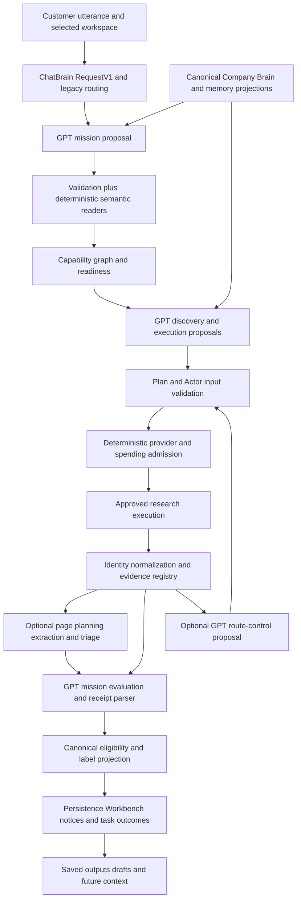
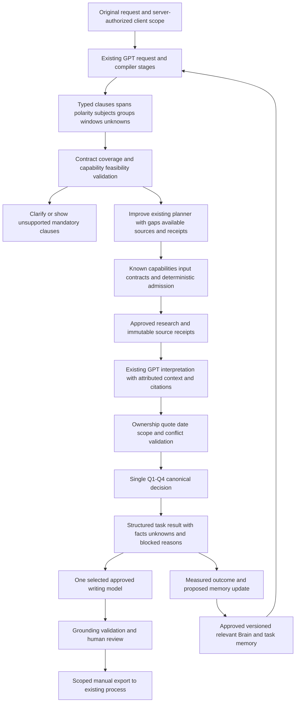

# Proposed architecture and small-PR roadmap

This is a proposal after Q1–Q4 acceptance, not an implemented replacement
engine. Retain the existing compiler, capability graph, planners, transports,
ledgers and canonical decision. The missing architectural property is a stable
interpretation contract across them, not another autonomous orchestration
framework.

## Actual current flow

The diagram shows branch capabilities, not a promise that every stage runs on
one mission. Minimal A7 disables several optional branches. The integration
baseline has known projection/qualification defects; open Q1/Q2 harden K and its
inputs. Persisted records and SQL execution are not exercised by this audit's
projections.

## Proposed incremental flow

The feedback arrow means an approved, versioned update. Model text cannot modify
Brain, identity, permissions or budget. Unsupported capability IDs and remote
destinations cannot pass V. A qualification label comes only from K. O is a
local review/download artifact, not confirmation that Apollo was updated or a
caller received it. New research is not implied by importing an existing record.

## Recommended PRs, ordered by dependency

| PR / priority                                                    | Exact existing/new file areas                                                                                                                                               | Change and dependency                                                                                                                                                                                                          | Required acceptance                                                                                                                                                                                                                                                                           |
| ---------------------------------------------------------------- | --------------------------------------------------------------------------------------------------------------------------------------------------------------------------- | ------------------------------------------------------------------------------------------------------------------------------------------------------------------------------------------------------------------------------ | --------------------------------------------------------------------------------------------------------------------------------------------------------------------------------------------------------------------------------------------------------------------------------------------- |
| R0 / high engineering correctness                                | `gptProvider.ts`, `modelFailureContract.ts`, `modelFailurePropagation.test.ts`; future shared adapter normalizer                                                            | Normalize incomplete/refusal/timeout state; explicit finish reason. Coordinate shared transport before edit. Independent of qualification semantics; preserve usage and retry policy                                           | T01 rejects `length` even when JSON parses; stop positive; refusal/content-filter/malformed response controls; no extra call, lost usage or optimistic qualification fallback                                                                                                                 |
| R1 / highest semantic value                                      | After Claude Q3/Q4: `gptMissionSchema.ts`, `leadMissionCompiler.ts`, `missionCriteria.ts`, `missionSignalDescriptor.ts`, RequestV1 projection                               | Improve existing compilation contract and prompt; one expression of every clause with span, necessity, exclusion/polarity, subject, boolean group, time and unresolved interpretation. No parallel parser/qualification engine | All known compiler cases + paraphrase/minimal-pair set preserve clauses. Reject/clarify missing or unsupported mandatory clauses. Exact size, HQ/presence, AND/OR, plans/events and per-signal windows round-trip through checkpoint without changes                                          |
| R2 / high precision                                              | `webEvidenceExtraction.ts`, `missionEvaluation.ts`, `groundedClaims.ts`, `groundedBatchEvaluation.ts` and existing Q-owned receipt adapters after agreement                 | Improve existing evidence prompts/outputs with speaker, company, quote context, event status/polarity, confidence rationale and alternative interpretation. Consume Q2 conflict/date/ownership rules, do not fork them         | Real negative quotations, quoted customer pain, employee/founder contrast, hypothetical expansion, ordinary/first hire, fabricated excerpt/foreign ID and unknown chronology controls. Separate parser/grounding/semantic metrics; final false-positive tests use the real canonical decision |
| R3 / medium after R1                                             | `gptDiscoveryPlanner.ts`, `gptExecutionPlanner.ts`, `gptRouteController.ts`, `webEvidencePlanner.ts`, registry-derived capability cards, `researchRouteControl.ts`          | Improve current planners with criterion-level gaps, previously purchased sources, refusal reasons and expected decision value. Consolidate overlapping planning calls only after trace equivalence                             | Source plan addresses each mandatory gap or says unsupported; no invented Actor/URL; no repeated purchase for same settled operation; unknown/blocked source stops or escalates to human; call/USD bounds and low-yield controls unchanged                                                    |
| R4 / essential Nosh dependency                                   | Existing P1 #124; planned P2 `WorkspaceContext.tsx`, `memoryReader.ts`, canonical Brain accessor and task snapshot adapter                                                  | Complete native scoped-write/RLS acceptance separately; fix unrelated draft retrieval; freeze approved context/source versions. No new generative call needed                                                                  | Two-client same-source-ID tests, revoke membership, switch/late response, foreign parent, retry/resume, stale source/Brain version. No mixed-client context under user or service role. No global key fallback                                                                                |
| R5 / high Nosh value                                             | Planned P4 model policy/registry/adapters, `aiProvider.ts` compatible accessor, `modelRequestBody.ts`, `modelCostModel.ts`, existing ledger; later brief contract/validator | Enforce task/workspace selected model and provider; normalize output/usage/error states. Start with one working selectable adapter; Claude separately accepted, Gemini disabled until tested                                   | Requested provider/model equals actual transport, allowed policy and persisted receipt. Unknown/unsupported choice and unavailable credential refuse. Same structured fixture across adapters, no silent fallback or budget reset on resume                                                   |
| R6 / high Nosh value after approved imports/context/model stages | Planned pilot call-brief endpoint and pure brief contract/validator, existing `workbench/openerModel.ts`, `memoryWriter.ts` read/reuse seams                                | One structured caller briefing from approved existing records and relevant source facts. Do not adapt Discovery into a second lead-generation funnel or call generic auto-send continuation                                    | Facts cite owned source IDs/excerpts, unknown pain remains unknown, no invented contact/title, client voice preserved, model choice recorded. Human review and CSV/manual handoff; no research on import, automatic send or qualified-count mutation                                          |
| R7 / later learning                                              | Existing task/evidence/sourceFeedback contracts plus a reviewed feedback proposal adapter                                                                                   | Capture outcomes and reviewer corrections with provenance; propose scoped memory/rule changes. Use real dispositions only after actual iGTM identity/access is confirmed                                                       | Input authenticity, duplicate/out-of-order event handling, explicit approval/version/expiry, replay and rollback. Prior generated text never becomes ground truth; no live webhook assumed                                                                                                    |

R0 is a deterministic fix, not “more intelligence.” R1/R2/R3 improve existing
calls; no default new call is proposed. R4/R5 are prerequisites for trustworthy
client-specific AI. R6 supplies Nosh's useful output. R7 is not needed for an
initial draft-only pilot. These are file areas and acceptance proposals, not
authorization to begin implementation or to edit Claude's active files.

## Recommendation contracts and measurement

**R1 — intent fidelity.** Today the model's free phrasing passes through
multiple semantic readers. GPT is useful for scope, tense, role meaning and
unusual clauses, but not for verifying its own completeness. Input: original
request, approved Brain constraints/preferences, executable outcome vocabulary,
prior resolved references. Output:
`{clauses:[{id,span,subject,polarity,necessity,predicate,window}],expression,
unresolved}`.
Code checks spans, unique IDs, expression membership, supported operators,
explicit scope and contradiction/unknown handling. Measure requirement
recall/precision against independently annotated requests, exact window/group
round-trip, unsupported-request refusal and unintended-provider rate. Q3
resolves current A7 blockers; richer wording coverage is broader product work.

Span/coverage validation proves structural traceability, not that the model has
understood every business implication. Ambiguous or unfamiliar mandatory clauses
need explicit UNKNOWN/clarification and human-reviewed semantic evaluation.

**R2 — semantic evidence.** Today exact quotations and IDs can still support an
incorrect interpretation. Input: one criterion plus authorized company identity,
dated source passages and surrounding context; no unrelated conversation
history. Output:
`{criterion_id,evidence_id,excerpt,subject,speaker,event_status,polarity,
verdict,reason,uncertainties}`.
Code verifies IDs, quote offsets, scope, provenance, dates and admissibility;
canonical decision enforces requirements/holds. Human- labelled contrastive
corpus measures entailment and false-positive qualification, not confidence or
parse rate. Relevant to A7 evidence safety and Nosh grounding; specific new
semantic schema is post-Q coordinated work.

**R3 — research strategy.** Today several planners see different summaries and
may optimize candidate yield rather than resolving the decisive missing fact.
GPT can propose a useful question/source sequence. Input: immutable criterion
contract, gaps, available capability IDs, known receipts, measured yield and
remaining admitted limits. Output: bounded existing plan steps with criterion
IDs, information needed, reason, expected stop condition and unsupported list.
Code checks availability/permissions/input schema/dependency
ordering/budget/operation reuse; no speculative numerical confidence buys an
Actor. Measure relevant-evidence yield per authorized dollar, avoidable calls,
time-to-decision and no regression in qualified precision. A7 gains no extra
stages; optional wider planning is future.

**R4 — context.** Today structured Brain helps, but broad recent drafts and
mutable latest context can contaminate a task. Relevance improves prompt
quality, while permissions/versioning require no GPT. Input: authorized task,
approved context version and explicitly associated memories. Output: bounded
context manifest with source/version IDs and missing context. Code owns scope,
expiry, version and selection. Measure wrong-client markers, irrelevant-context
rate, token reduction and reproducible resume. Necessary for Nosh; richer
generative memory is optional.

**R5/R6 — model-backed useful output.** Today model labels are disconnected from
execution and generic writing is not a full caller brief. Input: approved
existing lead, authorized context manifest, validated source facts, selected
approved model policy and output schema. Output: company/contact facts, cited
observations, explicit unknowns, seller relevance as inference, call opener,
discovery questions and reviewer notes. Deterministic policy/grounding/content
checks and human review remain. Measure reviewer correction rate, unsupported
factual claims, preparation time, usefulness rating and provider-policy
adherence. Necessary Nosh deliverable; not a prerequisite for A7 Discovery
qualification.

**R7 — controlled improvement.** Input: verified workflow outcome, exact
task/source/ context versions and reviewer correction. Output: proposed
rule/memory amendment, rationale and affected scope. Code deduplicates and
orders receipts, requires approval and versions every write. Measure reviewer
acceptance and downstream quality on a held-out evaluation set; never “learn”
from the model agreeing with itself. Future product work; no extra A7 call or
live call-disposition API assumed.
