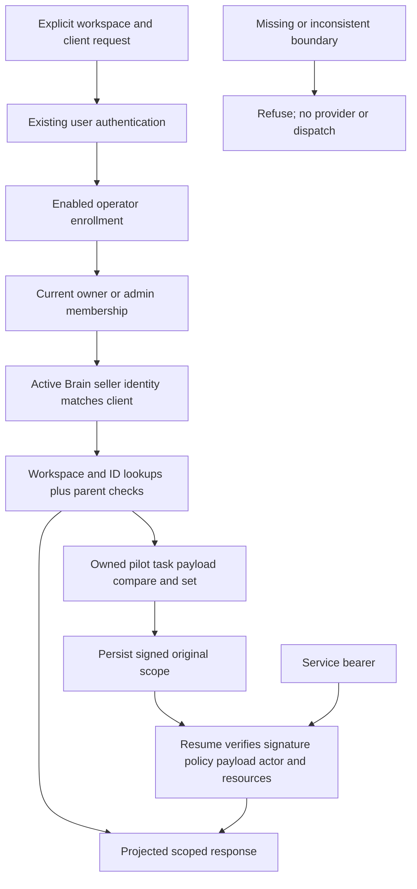

# P1 — server-enforced pilot scope

Implemented against `launch/hardening` at
`5d86703712205a04d059a39cf0d38a0621fc3ddb`. This is a disabled, additive server
boundary for the draft-only Outbound Outpost pilot. It is **not approval to
enable a customer pilot** and is not a platform-wide tenant-security
certification. P2–P8 remain unimplemented by this change. A7 is NO-GO.

## What changed

| File                                                  | Responsibility                                                                                                                     |
| ----------------------------------------------------- | ---------------------------------------------------------------------------------------------------------------------------------- |
| `supabase/functions/_shared/pilot/pilotPolicy.ts`     | Strict operator enrollment, one client binding per workspace, draft-only mode, bounded credential/destination metadata             |
| `supabase/functions/_shared/pilot/pilotScopeStore.ts` | Existing Supabase adapter with workspace-and-ID predicates, scoped membership/Brain reads and task-payload compare-and-set         |
| `supabase/functions/_shared/pilot/pilotScope.ts`      | Authorized context, seller identity validation, parent ownership checks, safe projections, signed task scope and resume validation |
| `supabase/functions/pilot-scope/index.ts`             | Authenticated, bounded, fail-closed endpoint; no business executor                                                                 |
| `tests/edge-functions/_helpers/pilotScopeFixture.ts`  | Synthetic two-client Auth/PostgREST fixtures; strict network boundary                                                              |
| `tests/edge-functions/pilotScope.test.ts`             | Adversarial isolation, task replay and persistence tests                                                                           |
| This document                                         | Contract, evidence, limitations and enablement gates                                                                               |

Existing `requestAuth.ts`, `workspaceAccessGuard.ts`, canonical Company Brain
and seller-identity helpers are reused without modification. No existing
production file, qualification consumer, worker, workflow, schema, migration or
frontend is changed. Claude's qualification implementation and PRs #113/#123 are
untouched.

## Boundary and operator enrollment

One client occupies one workspace. Agency users may administer both A and B;
authorization for both never permits combining their records in a single scoped
request. The server requires an explicit workspace UUID and opaque client
binding UUID. It never chooses a first membership, deduplicates by
email/domain/Apollo ID, uses a global cache, or accepts a request-supplied
authorization object.

Because this stage prohibits migrations, the planned durable policy table is
**not introduced**. Enrollment is a temporary server-only configuration adapter:

- `OUTPOST_PILOT_SCOPE_ENABLED` must equal `true`; absent means disabled.
- `OUTPOST_PILOT_SCOPE_POLICY` must parse as the strict version-1 manifest
  below.
- `OUTPOST_PILOT_SCOPE_SIGNING_KEY` must be a dedicated strong random secret
  (32–512 characters). It is required even for inspection. No key is provisioned
  or production environment changed by this PR.

Synthetic manifest shape (the UUIDs are examples only):

```json
{
  "version": 1,
  "workspaces": [{
    "workspace_id": "00000000-0000-4000-8000-000000000001",
    "client_binding_id": "00000000-0000-4000-8000-000000000011",
    "seller_domain": "client-a.example",
    "version": 1,
    "mode": "draft_only",
    "credentials": [],
    "destinations": []
  }]
}
```

The parser rejects duplicate workspaces/client bindings, unknown keys,
unsupported modes/providers/destination kinds and malformed IDs/domains.
Credential entries, when present, contain `id`, `provider` (`openai` or
`anthropic`), `purpose` (`call_brief`) and an opaque `reference`. Destination
entries contain `id` and `kind: manual_csv`. These are **authorization metadata
only**: no model adapter, secret resolver, export or delivery mechanism is
implemented. An accepted provider name does not establish that provider as
working. Raw credential references are never returned. There is no global-key
fallback.

Provision only a dedicated, clean client workspace. The server checks its active
Company Brain seller domain against the enrolled domain. It cannot infer who
owns arbitrary text pasted by an authorized administrator, clean up preexisting
mixed data, or prove one client from a domain alone. Reassigning an existing
workspace to a different client is prohibited operationally; policy changes
invalidate existing signed task bindings, but are not a substitute for clean
provisioning.

## Endpoint contract

`POST pilot-scope` accepts `action`, `workspace_id`, `client_binding_id` plus
only the action-specific fields below. Unknown fields, malformed JSON, bodies
over 16 KiB, invalid resource types and ambiguous scope are refused. Errors
expose sanitized reason codes; responses use `Cache-Control: no-store`.

| Action         | Extra fields                    | Behavior                                                                                                 |
| -------------- | ------------------------------- | -------------------------------------------------------------------------------------------------------- |
| `inspect`      | None                            | Current authorized scope and capability flags; all execution flags false                                 |
| `read_brain`   | None                            | Canonical active Brain from the enrolled workspace only                                                  |
| `read_records` | `resources: [{kind,id}]`        | Validate the entire scoped set and relational parents before returning projected data                    |
| `bind_task`    | `task_id`, `resources`          | Bind an existing explicitly marked pilot task owned by this user; no task creation or execution          |
| `resume_task`  | `task_id`, optional `resources` | Verify the stored original scope and return only the task and requested, originally authorized resources |

Every user action validates a real Auth user, current workspace membership and
owner/admin role before privileged records are loaded. An active Brain with a
nonconflicting canonical seller identity matching enrollment is mandatory.
Public preflight has no data effects. An owner/admin context rechecks membership
and Brain identity before reading records, retrieving credential/destination
metadata or binding a task.

Supported **existing record** kinds are account, contact, lead, memory
(`saved_outputs`), draft, research (`tool_calls`), task and their
plan/conversation/ signal/approval/agent parents. Each ID lookup includes
`workspace_id`. Every returned row is checked again. Cross-workspace
account/contact/task/plan and other recognized parent links are refused,
including dependencies. Traversal is bounded to avoid repeated/unbounded work.
Mixed sets return no partial content.

There are no imported-row tables yet. `import_record` and arbitrary table names
are rejected before record reads; P3 must add scoped import storage and tests.
No broad conversation-memory loader or workspace-wide draft fallback is used.
Task payloads and signatures are never returned, and task output/result is
omitted from ordinary unbound reads. Outputs are available only through a valid
task resume. These reads are not a call-brief prompt builder or evidence
validator.

## Task persistence, retry and service-role behavior

Only an existing task whose payload has `execution_mode: pilot_draft_only` can
be bound. Its creator must be the authenticated initiator. The server adds an
HMAC- SHA256 envelope under `tasks.payload.pilot_scope`, binding:

- Task ID, workspace ID, client binding and original initiator.
- Exact enrollment digest, unsigned payload digest, authorized resource set and
  draft-only mode.

The write compares task ID, workspace, creator and the complete old JSON
payload. An intervening edit refuses binding instead of overwriting it. A
successful write is verified from its returned row. Identical retries retain the
stored binding; changed resource sets cannot expand it. Failed persistence never
reports success.

Resume validates the signature, current policy, original task identity/creator,
unchanged input payload, current initiator membership and every original
resource. It cannot switch workspace, client, initiator or add a new resource. A
copied or forged envelope and changed/revoked policy or signing key cause
refusal. Signing key rotation therefore intentionally holds outstanding tasks
pending explicit operator review; there is no unsigned fallback.

A verified service-role bearer may **only resume a previously bound task**. It
cannot inspect arbitrary pilot scopes, read records, choose a new actor or mint
a binding. The signed original user is resolved and reauthorized. Existing
service- role workflows outside this endpoint keep their current behavior
unchanged.

P1 changes no task status, queue, checkpoint, approval, qualification, budget or
financial record. It does not wire a worker or provide provider retries. A task
must not be dispatched through a legacy executor merely because its payload is
marked pilot: those executors have not been converted to this boundary. Later
pilot entry points/workers must consume and recheck this context before effects.



## Offline verification receipts

The tests execute the real endpoint, authentication helper, guard, canonical
Brain/seller identity code and Supabase-js persistence adapter. Only Auth and
PostgREST transports are mocked. The fixture adds JSONB whole-payload equality
to the existing strict-network helper for the compare-and-set test. This is
**not a native PostgreSQL concurrency/RLS receipt**. Synthetic private A/B
markers and overlapping Apollo company/contact IDs, domains and emails are used;
actual table primary keys remain distinct, matching the existing global-ID
schema.

| Scenario                                                                | Offline result                          |
| ----------------------------------------------------------------------- | --------------------------------------- |
| Disabled/missing/ambiguous enrollment, unsupported scope or mode        | PASS: refused                           |
| Missing/anon/invalid user, nonmember, member/viewer, revoked membership | PASS: refused                           |
| A and B positive controls with overlapping external identities          | PASS: separate scoped content           |
| Dual-authorized admin submits A scope with B records                    | PASS: entire set refused                |
| Foreign parent/dependency, missing/inactive/mismatched Brain            | PASS: refused                           |
| Credential/destination from B or unsupported purpose/provider           | PASS: refused; no secret resolution     |
| Unbound task output, forged/copy/changed bindings, actor spoofing       | PASS: output withheld or resume refused |
| User/service retry with original authorized task                        | PASS: scope retained; no execution      |
| Membership/policy/key/input/source ownership changes on resume          | PASS: refused                           |
| Concurrent payload/creator changes and persistence failures             | PASS: no reported successful binding    |
| Imported records and future import/research/model/export/send actions   | PASS: unavailable; no execution         |
| Native RLS, composite constraints and real PostgREST CAS                | NOT TESTED; gate before enablement      |
| Browser workspace switching or live/queued worker execution             | NOT TESTED; P2 and later integration    |

Commands run from the isolated worktree, using a temporary Deno lockfile:

```sh
deno test --node-modules-dir=auto --lock=/tmp/p1-deno.lock --allow-read --allow-env tests/edge-functions/pilotScope.test.ts
# 56 passed, 0 failed

deno test --node-modules-dir=auto --lock=/tmp/p1-deno.lock --allow-read --allow-env \
  tests/edge-functions/_shared/companyBrainConsumption.test.ts \
  tests/edge-functions/_shared/companyBrainContext.test.ts \
  tests/edge-functions/_shared/memoryReader.test.ts \
  tests/edge-functions/_shared/workflowContinuation.test.ts \
  tests/edge-functions/approveAndContinueAuthorization.test.ts \
  tests/edge-functions/endpointSecuritySweep.test.ts \
  tests/edge-functions/continuationRouteAndLifecycle.test.ts
# 89 passed, 0 failed; includes existing service-role guard behavior

deno test --node-modules-dir=auto --lock=/tmp/p1-deno.lock --allow-read --allow-env --allow-run \
  tests/infra/ciPlan.test.ts tests/infra/ciWorkflow.test.ts tests/infra/deployTargeting.test.ts
# 48 passed, 0 failed; deploy wrapper verification only, no deploy
```

New files also pass Deno type-check, formatting, lint and focused ESLint. Tests
run without network permission; strict fixtures assert no provider transport. No
hosted database, customer record, paid operation or migration was used.

## Remaining risks and acceptance gates

1. **Keep enrollment disabled.** No native database/RLS/composite-parent or
   deployed end-to-end verification was performed. A later separately approved
   schema step must enforce server-owned policy/task writes and same-workspace
   parents, test direct authenticated SQL/API attacks and native
   CAS/concurrency, and establish how operator enrollment is made durable.
   Application predicates alone do not provide transactional integrity across
   membership, parent and payload reads.
2. **Legacy paths remain legacy.** Existing Brain editors, memory consumers,
   task executors and browser queries are not rerouted by this additive change.
   Their existing risks, including broad memory fallback, remain. Never
   represent P1 as fixing the entire platform or allow a legacy executor to
   bypass pilot scope.
3. **Stored body provenance is not proven by ownership.** A same-workspace text
   or JSON blob can already contain contaminated data; the boundary verifies
   known relational parents, not every arbitrary embedded reference or source
   claim. P3/P4 must create validated scoped records and explicit source/context
   snapshots; qualification remains Claude's responsibility.
4. **No frozen Brain/source/model snapshot yet.** Rechecking seller identity is
   not freezing task-generation context. Version/digest fences belong in the
   later brief lifecycle. A changed same-client Brain is not currently a resume
   error.
5. **No runnable client pilot yet.** UI selection, imports, task creation, model
   selection/adapters, brief generation, review/export and worker integration
   are intentionally unavailable. Each future handler must use this boundary and
   add adversarial lifecycle tests before its execution flag can become true.
6. **No outreach authority.** OO-01, OO-02 and OO-03 remain mandatory before any
   automated outreach or approved external dispatch. Draft-only processing does
   not waive those gates. A7 remains NO-GO.
