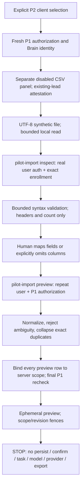

# P3 — disabled existing-lead CSV preview

Status: implementation for synthetic offline validation only; **not an enabled
pilot, an import, Apollo connectivity, a qualification decision, or live evidence**.
P1, P2 and P3 remain disabled. A7 remains NO-GO.

## Exact dependency and ownership boundary

Stack: #122 plan → #124 P1 (`2ffd6f6cfebba8279bcca87f75ad6d2406117a2d`)
→ #134 P2 (`990efdfcd098cd35f51bdeb830aab1b5411b1ea7`) → this PR.
The PR base is `codex/p2-client-context`, not `launch/hardening`. Latest fetched
integration during this work: `5d86703712205a04d059a39cf0d38a0621fc3ddb`.
Open PRs are not assumed merged or deployed. P1/P2 reviews and the native gates
below remain prerequisites to enabling any pilot switch.

No compiler, evaluator, canonical qualification, provider admission, CI policy,
model transport or Claude Q3/Q4 files change. #131 is untouched. This implements
the approved P3 *preview subset* of #122. The planned Lead Library entry and
confirm/store/schema are deferred: mounting inside P2's isolated `/outpost`
preparation route avoids connecting unproven legacy execution paths.

## Actual path / authorization



The API accepts only POST `inspect` and `preview`, an explicit `workspace_id`,
`client_binding_id`, `approved_existing_leads: true`, `csv`, and (preview only)
`mapping`. Extra fields, tasks, destinations, prompts, actor IDs and `confirm`
are refused. Auth uses the existing real `authenticateUser`; service/anon
bearers cannot preview. `loadPilotEnrollment` and `PilotAccess.forUser` reuse
P1's current owner/admin membership and canonical seller/Brain identity checks.
The final `access.recheck()` withholds the result after detected revocation.
No other workspace records, accounts, contacts, memory, tasks or credentials
are read. Brain content is used by P1 to validate identity but never returned.

Shared users may intentionally preview identical source IDs in A and B: the
server assigns different scoped row keys and receipt hashes. It never obtains
scope from CSV or a prior preview receipt. Client switching invalidates the
panel and pending response; A→B→A, logout, concurrent requests and StrictMode
cleanup/remount cannot revive old results. File, mappings and preview live only
in component memory, not React Query, local/session storage or database. All
responses are `Cache-Control: no-store`. No automated retries exist. Each manual
retry reauthenticates; preview fingerprints are **not authorization tokens**,
frozen Brain snapshots, approval records or future commit/idempotency keys.

Default-off, independent gates (none configured by this change):

- Existing `OUTPOST_PILOT_SCOPE_ENABLED` and validated operator manifest.
- Existing `OUTPOST_PILOT_CONTEXT_ENABLED` and browser
  `VITE_OUTPOST_PILOT_CONTEXT_ENABLED`.
- New `OUTPOST_PILOT_CSV_PREVIEW_ENABLED` and browser
  `VITE_OUTPOST_PILOT_CSV_PREVIEW_ENABLED`.

The endpoint contains no persistence method even if all flags were later set.
The UI attestation is operator intent, **not proof of source consent or client
ownership**. Arbitrary CSV text cannot prove which client an export belongs to.
For customer enablement, Nosh must approve an actual export/source list and its
client association; this change uses synthetic fixtures only. A real quotation,
company domain or Apollo ID is not evidence of an employer relationship or
buying intent. No qualification authority is added.

## CSV v1 contract (proposed for actual Apollo sample review)

UTF-8 only; optional leading BOM, LF or CRLF; comma delimiters; RFC-style quoted
commas/newlines/doubled quotes. All file rows selected, maximum **25 data records,
250,000 UTF-8 bytes, 40 columns, 2,048 UTF-16 code units per cell**. Maximum
128-code-unit header. JSON envelope also streaming-bounded at 1,600,000 bytes to
allow JSON escaping. No XLSX, ZIP, delimiter guessing, silent truncation,
partial-success batches, hidden pagination, native export or spreadsheet execution.

Duplicate/blank headers (trimmed, case-insensitive), ragged or blank records,
malformed quoting, bare CR, controls, bidi override/isolate controls, replacement
characters and lone surrogates reject the batch. Formula-like `= + - @` prefixes
(including leading whitespace) reject even in omitted cells. This conservative
rule can refuse legitimate text; review/correct the export rather than silently
rewriting it. Tabs/newlines can occur only in syntactically valid ignored cells;
normalized business fields are single-line. Ownership columns (workspace, client,
tenant, user, owner, task, credential, destination, binding, internal, including
common compact `WorkspaceId`/`ClientId` variants) reject even if mapped to omit.

Each header must have an exact mapping to one allowed field or explicit `null`
(omit). Duplicate target fields, unrecognized targets, extra/missing mapping keys
and mixed full-name / first-last-name representations reject. There is no
model inference or arbitrary mapping into database columns. Header aliases are
not assumed to match every Apollo export; an actual synthetic/redacted export
format must be agreed before enablement.

| Normalized field | Requirement / treatment |
| --- | --- |
| `company_name` | Required nonempty human source claim. Never merge on name. |
| `company_domain` | Required unless company LinkedIn provided. Public DNS homepage/domain; lowercased, remove `www.`. HTTP/HTTPS only, no IP/local host, port, credentials, query/fragment/path. No DNS or HTTP request. |
| `company_linkedin_url` | Alternative company anchor; exact linkedin.com `/company/slug`, canonical HTTPS. Not scraped or verified. |
| `first_name`, `last_name` OR `contact_name` | Optional, mutually exclusive representations. Company-only rows are provisional. |
| `contact_title` | Optional source text; no title heuristics or qualification. |
| `contact_email` | Optional syntactic address, lowercased; no contact lookup/verification. |
| `contact_linkedin_url` | Optional exact linkedin.com `/in/slug`; no collection. |
| `apollo_contact_id` | Optional opaque source string, never numeric-cast or treated as an internal ID; requires a contact name/email/profile. |
| `apollo_account_id` | Optional opaque source account identity, separate from contact ID. |
| `source_list_id` | Optional opaque list ID, preserved as source metadata, never client scope. |
| `source_updated_at` | Optional strict valid UTC `YYYY-MM-DDTHH:mm:ssZ`; preserve actual supplied time. Never substitute upload time or claim freshness. |

Normalized ordinary fields are bounded to 256 code units, profile URLs 512;
opaque source IDs are 1–128 ASCII letters/digits/`_.:-` (start alphanumeric).
Unknown columns can be explicitly omitted and are listed in `omitted_headers`;
values are not retained in the preview. Formula/control/ownership validation
still applies to omitted data. Missing Apollo IDs remain provisional and are
marked separately as missing contact/account write-back identity. Present IDs
are **not approval for write-back**; every external capability remains false.

Provenance: SHA-256 of exact decoded UTF-8 file bytes (BOM and line endings retained);
original trimmed header mapping; explicit omissions; input/duplicate counts;
canonical normalized row hash; all source **logical record ordinals** (header=1,
not physical line numbers for multiline CSV); server workspace/client/version/mode;
scoped actor-sensitive preview-row keys; actor/policy-sensitive preview hash.
No filename, raw notes, fabricated source timestamps or original full row is
stored. Preview rows all warn `source_claims_unverified` and
`employer_association_unverified`. Missing dates warn explicitly; supplied dates
warn `source_date_unverified_no_recency_claim`, whether old or future. The API
never reports these records as enriched, researched, qualified or approved.

Exact normalized duplicates collapse, retaining every ordinal. A source contact
ID/email/profile reused with any differing normalized record rejects the entire
batch. An account ID/domain/company LinkedIn anchor with inconsistent employer
identity also rejects. It never guesses whether to update, combine, replace or
match existing records. Missing IDs do not cause global or cross-client matching.
Employer domain versus unrelated LinkedIn cannot be semantically reconciled here:
that association stays unverified. Dedupe is deliberately conservative and only
within this preview; persistent uniqueness is deferred.

## P1/P2 remaining security gates — exact checks

These are enablement blockers, not preview scope creep. Source is repository
state, **not a receipt of deployed schema or security behavior**.

| Gate | Code evidence / unresolved issue | Required native proof |
| --- | --- | --- |
| Membership authority | Held baseline `20260816120000_baseline_schema.sql:10140` defines `members_self_insert` checking only `user_id=auth.uid()`; grants at 11967–11969. P1 trusts current membership/role in `pilotScope.ts:197`. Active `20260929120000_lock_down_definer_rpcs.sql` guards provisioning but does not itself remove this policy. | Inventory actual `pg_policies`, grants, helper/RPC owners/search_path and installed migrations. Attempt authenticated self-enrollment / role escalation into A/B, including unknown workspace; refuse without trusted invitation/admin path. Do not enable on an assumption that application auth repairs membership RLS. |
| Brain and memory RLS | Baseline Brain membership policies at 9647–9661; broad member update policies for drafts 10208, saved_outputs 10615, tasks 10659. P2 browser isolation does not rewrite those. | A-only/B-only/nonmember/shared admin/anon direct SELECT/INSERT/UPDATE/DELETE and authenticated PostgREST/RPC/view attacks on Brain, saved_outputs, drafts, tool_calls, tasks/results/bindings, accounts/contacts/leads, evidence/lineage and approvals. Distinguish authorized shared-user access from forbidden row reassignment. |
| Same-workspace ownership | Baseline contacts→account at 7229, lead→account/contact 7565/7573, draft→account/contact/lead 7773–7789, task→agent/plan 8092/8100 are single-ID FKs. | Composite parent identities and immutable workspace/client ownership for every reachable record. Cross-workspace parent insert/update must fail natively even for a user authorized in both. Server-owned client enrollment and binding fields cannot be user-written. |
| Atomicity/concurrency | P1 `pilotScopeStore.ts` reads membership/Brain/parents separately and uses task id/workspace/creator/payload CAS. P2/P3 final rechecks are not a transaction or lock. | Two real connections: competing binds; membership revoke/role change; Brain/client reassignment; parent move/delete; task creator/payload alteration between reads and CAS. Specify serializable/locked linearization semantics and rollback; zero partial release/commit under the chosen contract. |
| Direct API / legacy containment | P2 isolated page bypasses legacy first-workspace resolution; P3 never creates tasks. No `pilot_scope` / `pilot_draft_only` guard found in `run-agent` or worker source. Worker queue admission begins `worker/main.ts:210`. | Attempt pilot payload through every legacy creation, approval/continuation, retry/resume, scheduler, queue claim and run-agent entry using user and service paths. Pilot tasks must be refused or run only through a verified signed-scope adapter. No legacy worker should be started against seeded pilot rows during this preview work. |
| Durable enrollment/history | Operator manifest is temporary; no durable one-client/workspace immutable enrollment or source snapshot table exists. P1 checks known parents, not text contamination. | Clean dedicated workspaces with no reassignment/historical mixed-client content. Server enrollment ownership/version rules, approved credential/destination scope, revocation and trusted membership management. Separate security-reviewed migration. |
| Runtime/UI | Offline mocked handlers and pure-controller tests only. | Later separately authorized deployed JWT/gateway/routing, cross-tab auth change, browser lifecycle/realtime/cache and permissions tests. No claim of live verification here. |

P1 HMAC task binding and resume tests remain intact. P3 rejects `task_id` instead
of inventing a second binding: there are no imported records to attach to a task.
A later import/brief flow must extend the P1 supported-resource contract with
native scoped import snapshots and signed immutable references. It must not
reinterpret this ephemeral preview as a persisted task or resume checkpoint.

## Persistence is blocked pending separate approval

The current schema has no `pilot_import_batches` or `pilot_import_rows`. Existing
lead/account tables are not safe substitutes for import snapshots. See
[persistence proposal and native tests](p3-persistence-proposal.md) for the
proposed schema, atomic admission contract and exact adversarial test cases.
No migration file, confirm action, import store, database test bootstrap or
persistence endpoint is included or installed. The proposal is deliberately
inert documentation; native tests are specified, **NOT RUN / NOT VERIFIED**.

## Changed files

- `src/pages/OutpostWorkspace.tsx`: additive gated panel and current-selection fence.
- `src/components/leads/pilot/ExistingLeadImport.tsx`: synthetic file selection,
  attestation, explicit mapping, preview; no confirm/export.
- `src/lib/pilot/importPreview.ts`: strict decoding, scope validation, disposable
  request lifecycle; no cached leads.
- `supabase/functions/pilot-import/index.ts`: stamped endpoint wrapper.
- `_shared/pilot/pilotCsv.ts`: bounded CSV parser.
- `_shared/pilot/pilotImportContract.ts`: allowlist, normalization/dedupe/provenance.
- `_shared/pilot/pilotImport.ts`: default-off authorized inspect/preview handler.
- `tests/edge-functions/_shared/pilotCsv.test.ts`: syntax/identity/mapping adversaries.
- `tests/edge-functions/pilotImport.test.ts`: real handler with synthetic Auth/DB.
- `tests/frontend/pilotImportPreview.test.ts`: stale result/client/lifecycle guards.
- `tests/fixtures/pilot-csv/apollo-synthetic.csv`: duplicate synthetic Apollo-like rows.
- This report and `p3-persistence-proposal.md`.

## Reproduction and acceptance

```sh
npm ci --no-audit --no-fund
deno test --allow-read --allow-env tests/edge-functions/_shared/pilotCsv.test.ts tests/edge-functions/pilotImport.test.ts
deno test --allow-read tests/frontend/pilotImportPreview.test.ts
deno test --allow-read --allow-env tests/edge-functions/pilotScope.test.ts tests/edge-functions/pilotContext.test.ts tests/edge-functions/_shared/memoryReaderScope.test.ts tests/edge-functions/_shared/memoryReader.test.ts
deno test --allow-read tests/frontend/clientWorkspaceSelection.test.ts
deno check supabase/functions/pilot-import/index.ts
node scripts/ci/ratchet.mjs tsc
node scripts/ci/ratchet.mjs eslint
npm run build
```

New suites use no network permission. External transport is rejected by strict
fixtures. Table snapshots before/after successful, rejected, concurrent and retry
previews stay byte-for-byte equal. No hosted DB/migration, real lead, provider,
model, Apollo, dispatch, deployment, merge or A7 operation was performed.

Before proceeding past preview: review P1/P2/P3; confirm Nosh's exact Apollo
export and client attribution; approve separate native security/schema work;
prove all gates above and in the persistence proposal; approve actual import
persistence and a staged rollback/rollout. P4–P8, model execution and live Apollo
are separate work. OO-01/OO-02/OO-03 continue to gate automated outreach/external
dispatch. A green mocked preview suite does not waive any gate.

## Local verification receipt

- **176 typed backend tests passed**: 77 new P3 parser/contract/handler tests plus
  99 unchanged P1/P2 boundary/context/memory regressions.
- **24 typed frontend tests passed**: 11 new P3 tests and all 13 P2 tests.
- Production `pilot-import` endpoint type-checks; targeted Deno lint passes.
- Frontend type and lint ratchets and production build pass without new debt
  (existing large-chunk build advisory remains). GitHub fast-CI receipts are
  recorded on the draft PR; no native import database test is claimed.

P3's tests cover BOM/CRLF/quoted content, malformed/truncated/oversized files,
controls/formulas/ownership headers, unknown/duplicate mappings, malformed
URLs/emails/timestamps, conflicting contact/employer anchors, exact duplicates,
explicit omissions, absent IDs/dates, shared-user A/B scope, actor spoofing,
service/anon refusal, default-off gates, no writes, repeat/concurrent previews,
revocation/policy changes, final membership recheck, file hash integrity,
stale A→B→A/logout/newer responses and React StrictMode replay.
