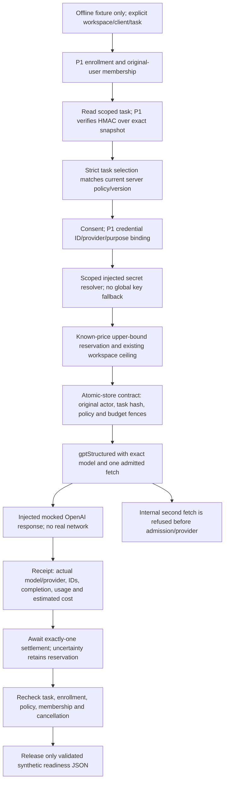

# P4 — enforced model-selection foundation, offline only

**Disabled implementation boundary. No live runner, endpoint, production model
policy loader, credential resolver or accounting writer exists in this PR.**
Only a fixed synthetic `ready:boolean` probe is implemented, with mandatory
injected dependencies and `mode: offline_fixture`. Any other mode refuses.
All registry/UI options stay disabled; the informational selector is unmounted.
No P5 research/context, P6 call-brief generation, settings writes or customer
execution is introduced. This is not a working customer-facing model dropdown.

## Dependencies and ownership

Stack: #122 plan → #124 P1 `2ffd6f6cfebba8279bcca87f75ad6d2406117a2d`
→ #134 P2 `990efdfcd098cd35f51bdeb830aab1b5411b1ea7`
→ #139 P3 `b04cef42bb512ee25fc2ef5dd45df4d9e93b4e80` → P4.
Base: `codex/p3-csv-preview`. Fetched `launch/hardening` remains
`5d86703712205a04d059a39cf0d38a0621fc3ddb` for this inspection.
Additional integration prerequisite: T01 #131 at
`7a99cd6f1548618d891d4637ab3f7d90d4dd40ab`, which is open, not presumed merged.

No edits to run-agent, aiProvider/TASK_MODELS, Discovery routing, shared model
transport, spending admission, qualification or Claude Q1–Q4. No existing
workflow's routing, permissions or retry behavior changes. Coordination:
[Claude ownership notice](https://github.com/kathmanducreatives-code/aiworforce-platfrom/pull/123#issuecomment-6312500686).

## Architecture inspected before implementation

| Existing area | Actual path / implication |
| --- | --- |
| Agent settings | `src/components/agents/AgentBuilderModal.tsx` writes `model: form.model`; badges/roster read that display value. This is not a signed task execution contract. |
| Generic execution | `run-agent/index.ts` selects agent `model` around 1236, but generic execution around 8512 calls `generateText({taskType:'agent_execution',...})`. That resolves `aiProvider.ts:138` TASK_MODELS, currently direct Anthropic for agent_execution. A model label does not override that task policy. |
| General adapters | `aiProvider.ts` `plannedAttempts` builds the task-specific vendor/model + declared fallback chain; `generateText` reads process-wide `ANTHROPIC_API_KEY`/`OPENAI_API_KEY`. Some task kinds have fallback. This path is not used by P4. |
| Discovery | `gptModelRouter.ts` routes existing stages; `gptProvider.ts:gptStructured` accepts explicit `req.model`, otherwise tier fallback. P4 supplies an exact allowlisted model, never an agent label, tier decision or another vendor. |
| Request body | `modelRequestBody.ts:buildChatCompletionsBody` builds existing OpenAI Chat Completions shapes. P4 reuses it indirectly through gptStructured; no new wire transport. |
| Credentials | gptStructured supports per-call `readEnv`; P4 supplies only the authorized key for `OPENAI_API_KEY`. No global env mutation, base URL override, shared-key fallback, logging or UI secret. |
| Retry | gptStructured can internally attempt twice after transient faults. P4's injected fetch guard admits only its first invocation, including admission failures; later internal invocations cannot reserve or dispatch. No wait, outer repair, automatic retry or fallback. |
| T01 | #131 accepts JSON completion only with explicit `stop`, preserving refusal/empty/malformed and settling telemetry once. P4 calls the existing transport and also validates the observed receipt completion/model/IDs/usage before accepting a value. It does not reparse content, repair or evaluate qualification. |
| Pricing | `modelCostModel.ts` supplies `readModelUsage`, `priceModelCall`, `MODEL_PRICES`. Counts are provider-reported; dollars remain event-priced estimates, never actual invoice charges. Partial input/output counts are insufficient for pilot settlement. The existing reader defaults absent cache detail to zero (conservative uncached pricing), not a claim of an invoice amount. |
| Spending | `modelSpendCeiling.ts` supplies `resolveCeiling`, `resolveSpendEnforcement`, `authorizeModelSpend`; P4 calls the real guard in enforce mode and also refuses unpriced history or insufficient prospective headroom. No settings/defaults are changed. |
| Ledger | `executionLedger.ts:recordModelCall/createLedgerWriter` is currently best effort and can swallow write failures. It cannot alone be an atomic financial admission guarantee. P4 specifies reserve/settle interfaces for a later strict adapter using existing ledger/cost contracts, not a second ledger implementation. |
| Native state | No durable pilot_workspace_policy, model-policy snapshot/atomic attempt-reservation store or client credential resolver is supplied by P1–P3. No live integration may be added by assuming they exist. |

## Implemented enforcement path



`pilotModelRegistry.ts` is an allowlist/presentation contract over the **existing
transport**, not a new Discovery planner/router. The sole proposed implemented
pair is OpenAI / `gpt-4.1-mini`, purpose `call_brief`, schema
`pilot_model_probe_v1`. Claude/Gemini have no pilot adapters, IDs, credentials or
fallback path. Every registry entry has `enabled:false` and a reason. Fixtures
supply an enabled **simulated server policy** only to test the backend contract;
there is no live mode or production implementation of those dependencies.

A signed task payload contains this exact selection object (IDs are synthetic):

```json
{
  "pilot_model": {
    "provider": "openai", "model": "gpt-4.1-mini",
    "credential_id": "00000000-0000-4000-8000-000000000801",
    "policy_version": 1, "task_kind": "call_brief",
    "schema": "pilot_model_probe_v1"
  }
}
```

P4 **reads** it; it does not create/update/bind tasks. Tests insert it into a
synthetic task before using the real P1 HMAC binding. Scope is exactly three
UUIDs; unknown fields, forged/changed payloads, another actor's task and
cross-workspace selection refuse. Only signed tasks currently in `ready` state may run the offline probe; cancelled, terminal, paused and unknown states refuse before admission. P1 verifies the exact captured task snapshot
via its existing `forTask` mechanism. Current task/enrollment/model policy and
membership are rechecked before dispatch and release. Native atomicity is still
a gate; separate application reads cannot prove transactional isolation.

Trusted `PilotModelPolicy` is a strict document: workspace/client/version,
execution/consent booleans, exact model/provider/credential ID, token limits and
model/provider/combined USD caps. Unknown fields and arbitrary model IDs refuse.
The selection must match every policy field; P1 also checks credential ID,
provider and purpose. A real server loader must read the versioned policy in
`pilot_workspace_policy`; it is intentionally not implemented as browser state,
a new settings table, global model router or an extra P1 manifest permission.

## Credential and transport integrity

The resolver receives only the authorized scope and trusted P1 credential
binding/reference. Its production implementation must validate the actual secret
ownership and provider account; correct reference metadata alone is not proof
that an operator stored the right account key. Missing/invalid/throwing resolvers
refuse safely, with no key in errors. Keys stay in per-call closures and the
captured synthetic authorization header; receipts omit keys, references and raw
prompts. Metadata echoing the key is discarded. A/B parallel tests use different
keys and task receipts without changing process environment.

Only `https://api.openai.com/v1/chat/completions`, selected model, bounded output
and the fixed no-tool probe are admitted. The selected ID is verified in the
actual request produced by gptStructured, not only in a setting. Receipt model
must equal that ID. **Dated snapshot/alias responses are currently refused**;
account validation must approve exact request/response identity pairs before
future enablement rather than silently normalizing a different model. Real
request-ID availability and account/model access are also unverified.

## Attempts, usage, cost and resume

P4 is narrower than the plan's possible one transient retry: **one admitted
attempt per signed task, no automatic safe retry yet**. The existing four-attempt
runtime limit is not enlarged. Store admission must consume the existing shared
budget/counter, never create another four-call allowance. No A7 path imports P4.
Hard ceilings stay **4 runtime attempts / $0.05 model / $0.20 provider / $0.25
combined**. Token policy is bounded to 8192 input / 512 output for the probe.
Fixture policy uses 4096 / 256, reserving $0.002048 at the repository's existing
historical prices. Prices/account availability are not live-verified; this is
not permission to bill or a current vendor pricing claim.

Reservation uses full uncached input/output caps and upward rounding, not a
post-call estimate or anticipated cache discount. Fixed prompt/schema bytes plus
conservative overhead must fit the input cap; this is not a tokenizer for future
arbitrary customer prompts. The real workspace guard refuses observe mode,
missing config, query failure, unpriced history and insufficient headroom.
Concurrent outstanding reservations still require the native transaction below.

`PilotTaskModelStore.reserve` must atomically persist a started attempt, authorize
the original user/task/policy and reserve budgets before provider dispatch. The
only implementation here is under `tests/.../pilotModelFixture.ts`. It is not a
local storage fallback. A rejected second transport invocation never reaches
reserve and is not counted as a paid attempt. Reconstructing the adapter or
retrying/resuming the same signed task cannot reset the store's consumed attempt.
Pending and settled attempts both block replay. Changing selection requires
invalidating/rebinding the original task through future approved lifecycle rules,
not inventing a new retry namespace.

A receipt records requested/actual provider and model, whether transport was
actually dispatched, HTTP status, OpenAI request/response IDs, finish reason,
input/cached/output tokens, estimated cost/source, latency and failure. Unknown
usage/model/cost remains null/unknown and holds reservation; no zero-cost claim.
Source HTTP failures survive the transport's refused internal retry. Refusal,
empty content, malformed JSON, incomplete/unexpected completion and schema
failure stay distinct. Failed completions still consume one usage receipt.
Transport `onModelCall` is not a second accounting sink; observation/settlement
is once per actual provider attempt, not once per internal guard rejection.

Settlement is awaited before release. Write failure withholds output and leaves
started reservation pending; resume cannot call the model again. Cancellation,
revocation, task/Brain identity/policy changes after a response withhold output
without refunding usage. A model-success receipt is not a successful task result
or qualification: release can still fail authorization afterward. A cancellation
after reservation but before dispatch records `transport_dispatched:false` and
no actual provider, preserving the conservative hold until native reconciliation.

## T01 compatibility / reproducible focused tests

The base branch has not incorporated #131. P4's receipt guard therefore refuses
non-stop completions even if that base transport parses them. This guard verifies
transport receipt integrity; it is not another JSON content parser, prompt repair
or semantic evaluator. Full #131 integration is still required for the shared
compiler/planner failure propagation contract; P4 does not patch those files.

Tests also run against **the actual #131 gptProvider** in a detached read-only
snapshot via a temporary Deno import map, without copying code, merging branches,
modifying #131 or calling a provider:

```sh
# From this P4 worktree. Create once; existing snapshot may be reused.
git worktree add --detach /tmp/agentory-p4-t01-compat 7a99cd6f1548618d891d4637ab3f7d90d4dd40ab
python3 - <<'PY'
import json, pathlib
base = pathlib.Path.cwd() / 'supabase/functions/_shared/gptProvider.ts'
other = pathlib.Path('/tmp/agentory-p4-t01-compat/supabase/functions/_shared/gptProvider.ts')
json.dump({'imports': {base.as_uri(): other.as_uri()}}, open('/tmp/p4-t01-import-map.json', 'w'))
PY
deno test --import-map=/tmp/p4-t01-import-map.json --allow-read --allow-env \
  tests/edge-functions/_shared/pilotTaskModelPolicy.test.ts \
  tests/edge-functions/_shared/pilotModelAdapter.test.ts \
  tests/edge-functions/_shared/pilotModelAccounting.test.ts
```

Normal focused commands:

```sh
npm ci --no-audit --no-fund
deno test --allow-read --allow-env tests/edge-functions/_shared/pilotTaskModelPolicy.test.ts tests/edge-functions/_shared/pilotModelAdapter.test.ts tests/edge-functions/_shared/pilotModelAccounting.test.ts
deno test --allow-read tests/frontend/pilotTaskModelSelection.test.ts
deno check supabase/functions/_shared/pilot/pilotModelAdapter.ts
node scripts/ci/ratchet.mjs tsc
node scripts/ci/ratchet.mjs eslint
npm run build
```

No test has network permission. Model responses and Auth/PostgREST are mocked;
real P1 authorization/HMAC, gptStructured, body building, cost interpretation and
workspace ceiling code execute. Provider transport requests are captured and
asserted; these are not live execution receipts or native concurrency proofs.

## Exact files and remaining enablement gates

New files only:

- `_shared/pilot/pilotTaskModelPolicy.ts`: strict selection/policy validation.
- `_shared/pilot/pilotModelRegistry.ts`: disabled allowlist and hard cap metadata.
- `_shared/pilot/pilotModelAdapter.ts`: offline-only signed-task probe using gptStructured.
- `_shared/pilot/pilotModelAccounting.ts`: existing usage/pricing and reservation math.
- `_shared/pilot/pilotTaskStore.ts`: atomic reserve/settle contract; no DB writer.
- `src/lib/pilot/taskModelOptions.ts`, `src/components/leads/pilot/TaskModelSelector.tsx`:
  disabled informational options, not mounted or saved.
- `tests/edge-functions/_helpers/pilotModelFixture.ts`: synthetic-only atomic-store model.
- `tests/edge-functions/_shared/pilotTaskModelPolicy.test.ts`,
  `pilotModelAdapter.test.ts`, `pilotModelAccounting.test.ts`.
- `tests/frontend/pilotTaskModelSelection.test.ts`.
- This report and `p4-native-accounting-requirements.md`.

Before any customer/model execution: approve native policy/accounting changes
and strict existing-ledger integration; close P1/P2/P3 membership/RLS/immutable
ownership/direct-API/concurrency/legacy-executor gates; validate scoped vault
ownership/account model availability, consent and exact model/snapshot pricing;
combine #131 with qualification stack and rerun compatibility tests; implement
an authenticated task-policy selection/snapshot lifecycle and the approved live
adapter under separate authorization. Native acceptance requirements are in
[p4-native-accounting-requirements.md](p4-native-accounting-requirements.md).
No migration/native model-policy test is provided or installed here: its schema
and transaction do not exist yet. `tests/db-contract/pilotModelPolicy.contract.test.ts`
is deferred rather than fabricated against mocks.

P1/P2/P3/P4 remain disabled. OO-01/OO-02/OO-03 still gate any external dispatch.
No hosted database/customer access, paid call, deploy, merge, send or A7 was used.
**A7 remains NO-GO.**

## Local verification receipt

- **78 new typed backend tests pass** against the base transport; the same 78
  pass against actual #131 via the import-map compatibility run.
- **176 unchanged P1–P3 backend regressions pass** (combined focused total 254).
- **26 typed frontend tests pass**, including 2 new P4 and all 24 P1–P3 UI cases.
- The new adapter type-checks; focused Deno lint, frontend type/lint ratchets and
  production build pass without new debt (existing chunk-size advisory remains).
- Fast GitHub CI receipt is recorded on the draft PR. Native model policy/RLS,
  transactional accounting, process-crash recovery and live OpenAI acceptance
  remain NOT TESTED; no passing mock is labeled live verification.
