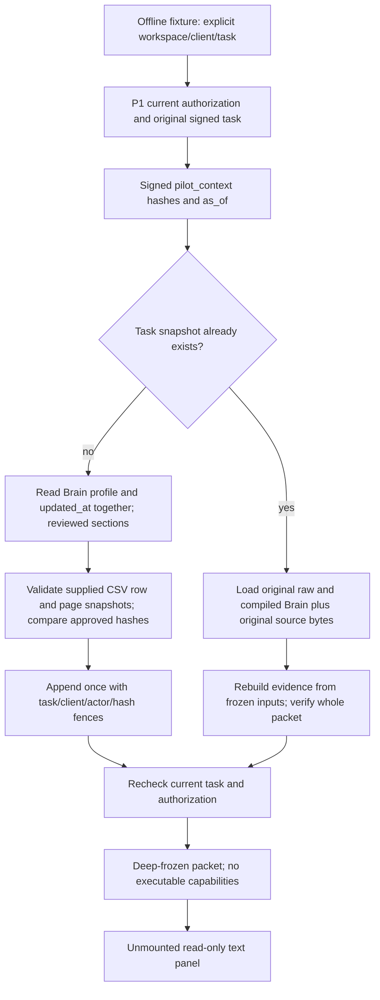

# P5 — frozen Company Brain and supplied-source packets

**Disabled offline foundation only.** No endpoint, production snapshot store,
Company Brain write, import persistence, model invocation, research executor,
fetch, send, scheduler or route is added. The evidence panel is unmounted.
Every execution dependency must be injected with `mode: offline_fixture`.
P1–P5 remain disabled. This is not native isolation or live verification.
A7 remains NO-GO; limits remain four runtime model attempts, $0.05 model,
$0.20 provider, $0.25 combined. P5 consumes zero model/provider attempts.

## Stack, ownership and inspected versions

Base: #140 `codex/p4-task-model-policy` at
`a5630119df1abffb7d6e7cb7f7a3161aba1bb25e`.
Dependencies: #124 P1 → #134 P2 → #139 P3 → #140 P4 → P5.
Plan: #122 `pilot-plan/README.md` and `call-brief-contract.md`.
Fetched integration at inspection: `launch/hardening`
`8b0e2b6bdb20d6fe30542da39f0170d514d52746`.
GitHub reports qualification #141 and T01 #131 merged; they are not in this
pilot stack. P4's older status notes describe its inspection date, not today's
integration state. P5 does not merge/rebase either integration or alter the
compiler, evaluator, canonical eligibility, transport, budgets or live executor.

[Coordination with qualification integration](https://github.com/kathmanducreatives-code/aiworforce-platfrom/pull/141#issuecomment-6318052102).
E01 semantic support remains an evaluator follow-up. This packet supplies source
material and uncertainty, never another qualification judgment.

## Files and reuse

| New area | Responsibility / existing code reused |
| --- | --- |
| `_shared/pilot/pilotContextSnapshot.ts` | Offline coordinator; P1 `PilotAccess.forUser/forTask`, enrollment, HMAC binding, canonical digest. Freezes reviewed raw **and compiled** Brain. |
| `_shared/pilot/pilotEvidencePacket.ts` | Real P3 `previewCsv` and strict parser; original mapped cells, normalized row/hash, source ordinals/file hash, Apollo IDs. EvidenceItem source/method and Eligibility types reused read-only. |
| `_shared/pilot/pilotCompanyResearch.ts` | Supplied-source validator only; existing `resolveCompanyIdentity`. The filename does not imply implemented research. |
| `_shared/pilot/pilotSnapshotStore.ts` | Append-only store/fence interface; no production implementation. |
| `src/lib/pilot/sourcePacketView.ts` | Presentation-only scope checks and safe projection; not authorization or cryptographic verification. |
| `src/components/leads/pilot/SourceEvidencePanel.tsx` | Unmounted plain-text source/unknown/interpretation review; no links, HTML, Markdown or actions. |
| `tests/edge-functions/_helpers/pilotSnapshotFixture.ts` | Synthetic two-client Brain/CSV/page data; actual P1 signing/auth and scoped store over strict mocked PostgREST; in-memory append-only packet store. |
| `_shared/pilotContextSnapshot.test.ts`, `pilotEvidencePacket.test.ts`, `pilotCompanyResearch.test.ts` under `tests/edge-functions/` | Replay, authorization, contamination, attribution and temporal adversarial tests. |
| `tests/frontend/pilotSourcePacket.test.ts` | Safe text projection, mismatched scope rejection and no route/execution wiring. |

Existing pure helpers `buildCanonicalCompanyBrain`, `buildSellerContext`,
`resolveCanonicalSellerIdentity` and `SELLER_IDENTITY_FIELD_PATHS` are read-only
imports. Brain identity/activation is checked today for authorization; today's
Brain is never substituted into an existing packet. No memory/draft/task result
body is implicitly read into the snapshot. There is no `companyWebEvidence.ts`
in the inspected base. `cleanEvidenceText` is deliberately not used for exact
excerpts because rewriting/repeated-word cleaning could change source meaning.

## Contract and path



Before P1 binding, a **synthetic review fixture** computes `BrainReview` and
`ApprovedPacketInputs`. The task payload carries `pilot_context`:

```json
{
  "version": "pilot_context_v1",
  "brain_hash": "sha256-of-the-full-reviewed-Brain-artifact",
  "inputs_hash": "sha256-of-normalized-approved-packet-inputs",
  "approved_sections": ["company", "target_customer", "exclusions"],
  "as_of": "2026-10-21T00:00:00Z"
}
```

The example section list is illustrative: every recognized section present in
the actual Brain must be selected, so exclusions, mandatory rules, preferences,
positioning and voice cannot silently be omitted. Custom approved
`business_context`/`messaging_guidelines` remain raw alongside canonical views.
Unknown top-level field **values** are not copied; omitted field names are shown
for review. Unsupported custom schema needs an explicit reviewed extension
before enablement. Known credential/ownership keys in approved nested sections
are refused. Raw narratives cannot be proven free of historical contamination.

The full review artifact includes scope, source `updated_at`, approved sections,
raw approved profile, existing canonical Brain output and seller context. Its
hash pins derived output too. Existing compiler defaults are derived context,
not newly approved mandatory requirements; raw customer instructions remain
available. No new qualification interpretation is introduced.

P1 then signs the exact payload (including both hashes and original actor).
Snapshot creation requires that signature and current authorization. This is
an **offline approval contract**, not a shipped human review/approval service.
A trusted server review receipt and policy store are enablement gates.

A retry or resume rechecks current enrollment, original actor membership, active
seller identity, resource ownership, exact signed task payload and task status.
It uses the saved Brain and sources; it does not invoke the input loader or
recompile current Brain. Same-client content changes therefore leave the task's
packet unchanged. Changed seller, revoked access, cancelled task, changed inputs
before first capture, corrupt store return or unknown format fail closed.
Only `ready` draft tasks are supported; this is not a running-task checkpoint
integration. No service-role-only anonymous access is added; future verified
service execution must preserve P1's original-actor checks.

## Evidence semantics

| Material | What is established | What is NOT established |
| --- | --- | --- |
| Supplied Apollo CSV | Original mapped header/cell, selected logical row ordinals, full file SHA256, normalized row SHA256, supplied Apollo account/contact IDs | Authentic Apollo origin, ownership of employer/contact, permission from Apollo, durable imported row ID |
| Supplied page/document | Exact retained body and UTF-16 excerpt offsets; matching strong company domain/LinkedIn anchor; locator/URL; explicit timestamps | Authentic retrieval/HTTP receipt, independent company ownership, semantic support, truth, buying intent |
| Reviewed Brain | Approved scoped raw instructions and frozen derived context | Verified buyer facts, signed approval audit trail in native DB |
| Model interpretation | Unverified text with existing source IDs | Authority to turn quotations into supported business claims |
| Conflict annotation | Explicit unresolved reviewer annotation | Automated contradiction detection or resolution |

Every fact carries workspace/client/task/company key, source ID, exact location,
source provenance, collection and event dates (nullable), integrity class and
`semantic_support: not_evaluated`. Fact IDs include scope in their digest, so
identical Apollo IDs across clients cannot collide. CSV ignored-column values
never enter the packet; duplicate normalized rows preserve all original row
ordinals. P3 has no durable import records; `imported_row_id` must be null.

`verified_facts` is always empty; `canonical_decision` is null and
`qualification_evaluated` false. The current canonical qualification authority
is not called. A real quote saying “not looking for new tools” remains exactly
that text, even if an interpretation claims it proves demand. Exact text match
proves attribution **within supplied bytes**, not semantic support. No score,
eligibility upgrade, source `proven` status or model confidence is accepted.
A future trusted canonical adapter is needed before verified-fact promotion.

Sources need a common domain or company LinkedIn anchor; an opaque Apollo ID or
name match alone is insufficient. Any conflicting known anchor fails closed.
Seller sources, other-client sources, wrong-employer domains, unknown source
references, fabricated excerpts, duplicate spans and out-of-bounds offsets are
refused. Aliases/multiple identities require human resolution; no guesswork.
Only public HTTP(S) locators without credentials/query/fragment/custom ports
are accepted; IP/private/local locators and redirects are refused. **No URL is
fetched**, and these syntax checks are not future SSRF/DNS protections.

No timestamps are invented. Recently supplied old events stay old. Missing
collection/event time remains unknown. Expired `valid_until` and future events
are explicitly unknown flags. CSV `source_updated_at` is never an event date.
This is conservative annotation, not recency qualification or proof of current
active status. Prompt injection remains inert source text.

Bounds: 25 CSV rows (P3), 12 supplied sources, 16,000 characters/source,
8 quotes/source, 64 derived facts, 12 annotations/category, 120 KB inputs,
64 KB reviewed Brain and 256 KB complete packet. Hash/validation are local;
no additional tokens, purchases, retries or paid latency.

## Verification and limits

Focused typed commands (no `--allow-net`):

```sh
deno test --allow-read --allow-env tests/edge-functions/_shared/pilotContextSnapshot.test.ts tests/edge-functions/_shared/pilotEvidencePacket.test.ts tests/edge-functions/_shared/pilotCompanyResearch.test.ts
deno test --allow-read tests/frontend/pilotSourcePacket.test.ts
node scripts/ci/ratchet.mjs tsc
node scripts/ci/ratchet.mjs eslint
npm run build
```

New tests: **73 backend + 8 frontend**, all passing at initial focused receipt.
Coverage includes two signed client tasks sharing Apollo identities; changed or
omitted Brain instructions; current permissions and seller changes; signed
payload/resource/status tampering; source identity conflicts; fake excerpts and
unsupported truth promotion; stale/future/missing dates; raw source injection;
concurrent identical calls; lost commit acknowledgement; corrupt persisted
packet; store failures; replay without reloading changing inputs. The test store
is only an atomic fixture, **not native concurrency evidence**. Presentation
tests verify projection and inert JSX structure, not deployed browser isolation.
Regression: **330 typed backend tests** (P1–P5 plus the provider-seam guard)
and **21 selected frontend tests**, passing. Type ratchet: 23 findings against
baseline 23; lint: 1,279 against baseline 1,281 (pre-existing improvements, no
baseline edits). Production build passes with the existing bundle-size warning.
Targeted Deno format/lint pass. Full fast CI and final receipts are recorded on
the draft PR.

Remaining blockers: [native snapshot requirements](p5-native-snapshot-requirements.md),
P1 native RLS/direct API/ownership and legacy-executor containment, P2 cache and
browser isolation gates, P3 durable import ownership, P4 atomic accounting and
workspace credentials/model policy, trusted approval receipts and supplied-source
attestation. Historical data must be reviewed, not assumed clean. P6 caller
brief generation and all P1–P5 enablement require separate review/authorization.
