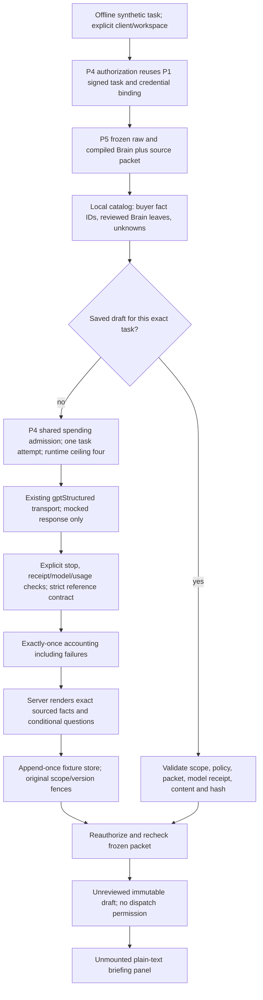

# P6 — AI-curated source-backed caller briefings (disabled, offline)

**Draft implementation only. P1–P6 remain disabled for customers; A7 NO-GO.**
One approved existing-lead row, one original signed task, one frozen P5 packet,
one P4-selected model attempt, one immutable unreviewed draft. No new prospecting,
research, customer import, external dispatch, call, email, scheduling or export.
There is no endpoint, mounted UI, production brief store or native migration.
The goal here is human call preparation, not qualification or a sales script.

## Dependencies and ownership

Stack: #122 plan → #124 P1 → #134 P2 → #139 P3 → #140 P4 → #142 P5 → P6.
Base: `codex/p5-frozen-context`, **`2eea47a3d3f5b99c987e930f89168d330d02af8a`**;
#142's CI gate is confirmed successful. Inspected `launch/hardening`:
`8b0e2b6bdb20d6fe30542da39f0170d514d52746`.
No integration merge/rebase or edits to Claude's compiler/evaluator/eligibility,
qualification projections, run-agent, existing GPT transport or budgets.
P6 coordination was posted on #141 before substantial implementation.

T01 #131 is merged on integration (head
`7a99cd6f1548618d891d4637ab3f7d90d4dd40ab`, merge
`1f22308172a7f7f89915fd4159a9ffd403aa9d2c`), but the pilot stack predates it.
P6 keeps P4's existing completion-receipt guard and tests with the **real #131
transport** through a read-only import map. No transport is copied or modified.
Combined integration/T01 acceptance remains required before enablement.

## Actual execution path



P4's `runPilotModelProbe` remains backwards compatible. It and P6 call the same
`runPilotModelTask` admission/credential/transport/settlement implementation.
`authorizePilotModelContext` extracts that existing authorization path so saved
drafts can be rechecked without purchasing another call. The model allowlist
adds a **schema**, not a model/provider or second router. OpenAI gpt-4.1-mini
remains the sole implemented offline adapter; Claude/Gemini remain unavailable,
and every UI/registry option remains disabled.

## Why the factual contract uses references

E01 established that a real quote can be cited in support of an unrelated or
opposite assertion. A model-provided sentence plus an existing fact ID is not
proof that the sentence follows from the fact. This implementation therefore
accepts **no free-form model factual prose**. It does not add a semantic
verification model or another qualification authority.

The model selects/ranks source facts, chooses relevant reviewed client context,
pairs buyer evidence with approved positioning as a hypothesis, and selects
conditional question kinds with explicit premises. The server renders original
fact values and citations verbatim. Full authorized source bodies accompany
excerpts in the prompt and human review view, so an exact but misleading partial
quote does not hide negating context. The frozen as-of time is explicit. An invented funding/hiring/technology/person
claim cannot enter through a model text field because no such field exists.
A reference to another workspace either fails membership or resolves only to the
local catalog; the model cannot supply replacement source text or metadata.

The tradeoff is deliberate: v1 is an AI-curated evidence briefing, not unrestricted
AI sales copy. Questions use controlled open/confirmatory wording with the actual
source quotation and relevant offer shown alongside. Semantic relevance and
selection quality still require human review and eventual approved live evals.
Strict structure alone does not establish intelligence or truth.

## Concise model contract

`call_brief_v1` has exactly these required fields, with no extra keys:

| Field | Bound / application enforcement |
| --- | --- |
| `schema_version` | Exactly `call_brief_v1`. |
| `company_overview` | 1–3 authorized local buyer fact IDs, including the supplied company name. Server retains original field/value/provenance. |
| `business_context` | 0–3 reviewed Brain leaf IDs. Seller/client context is not buyer truth. |
| `signal_evidence` | 0–2 exact source-excerpt IDs; never a supplied title or claimed verified intent. |
| `talking_points` | 0–2 buyer-fact + `positioning.*` Brain-leaf pairs; explicitly hypothetical fit. |
| `discovery_questions` | 1–3 reference-based questions: verify context, explore fit, clarify an already annotated conflict, or understand priorities. No free-form factual premise. |
| `missing_information` | 0–5 priority unknown IDs. **All remaining unknowns still appear** in the server draft. |

Question requirements: `verify_context` needs a buyer fact only;
`explore_fit` needs buyer fact + positioning leaf; `clarify_conflict` requires
an existing conflict-annotated source; `understand_priorities` needs a reviewed
client leaf only. No inferred employer/founder/authority/intent status.
Reference lists reject duplicates, excess items, missing IDs and unknown keys.
Provider strict JSON Schema and application validation share the content shape;
application code additionally enforces bounds and membership.

[Official OpenAI Structured Outputs documentation](https://developers.openai.com/api/docs/guides/structured-outputs?api-mode=chat)
was checked for the strict schema contract. This does not establish model account
access or prove semantic support. Refusal/termination/JSON validation remains
owned by the existing transport and P4 receipt validation.

## Immutable server artifact and human view

The model cannot set: workspace/client/task/original actor, task/policy hashes,
P5 packet/Brain/input hashes, prompt+schema digest, source lineage, model/usage
receipt, draft digest, qualification decision, review state or dispatch permission.

`CallBriefDraft` stores those fields, validated model choices and server content:

- Exact company/source facts with original P5 IDs, strong company key, source,
  CSV column/row or quote offsets, collection/event dates and uncertainty.
- Selected relevant business context **plus all approved client instructions**;
  the model cannot hide exclusions, ICP conditions or voice by not selecting them.
- `verified_facts: []`, `grounded_buying_signals: []` because P5 v1 has no trusted
  canonical verification adapter. Raw excerpts are explicitly for human review.
- Hypothetical talking points and conditional discovery questions, with both
  buyer premises and reviewed seller rationale attached.
- Every P5 unknown, plus explicit unverified current employment/buying-signal and
  funding/hiring/technology/problem cautions. No scrape-time-as-event-time shortcut.
- Declared CSV export lineage: original file/normalized hashes and row ordinals,
  supplied Apollo IDs; durable imported-row ID remains null.
- `review_status: unreviewed_draft`, `review_required: true`,
  `dispatch_allowed: false`, `qualification_decision: null`.

“Draft for review” is not “human approved.” P7 will own review/export of exact
versions; P6 implements neither. The unmounted panel renders JSX text, no HTML,
Markdown, source links/images, network requests or action buttons. Presentation
scope validation is defense in depth, not server authorization or hash proof.

[Recorded synthetic example](fixtures/p6-call-brief.synthetic.json) was generated
by the real P1/P4/P5/P6 code with mocked PostgREST and model responses. It shows
the negative quotation “We are not looking for new tools.” alongside the supplied
client offer and confirmatory questions; it never calls the prospect qualified
or asserts new-tool demand. It is explicitly **not a live receipt** or customer
record. The model selection/ranking was mocked; real usefulness is unverified.

## Retry, cancellation, storage and financial behavior

P4 keeps one attempted operation per signed task, including failed/pending
attempts. Existing four-runtime-attempt and $0.05 model / $0.20 provider / $0.25
combined ceilings remain unchanged. Workspace spending enforcement also remains
required. No new counter, model fallback, automatic repair, bulk fanout, wait loop
or regeneration is introduced. Probes and briefs share the same task admission.

Successful JSON requires explicit `stop`. Length/filter/tool/missing termination
fails; refusal, empty content and malformed JSON remain distinct. A valid JSON
object with invented factual prose or invalid references also fails. P4 records
actual requested/observed model/provider, usage and event-priced estimate once,
including failed calls. Unknown usage holds the reservation. Usage, receipt,
accounting settlement or source reauthorization failures withhold the draft.

A saved accepted draft reuses its original choices/content/receipt and frozen
packet. It rechecks current membership, original actor, task, enrollment, model
policy, credential binding and source resource ownership; it does not resolve a
secret or call a model again. Changed policy/scope or corrupted content is refused.
No mutable cache key or browser operation ID can create another attempt.

Lost acknowledgement **after output commit** resumes the original output.
Failed output persistence **before commit** consumes the model attempt and leaves
no releasable draft; retry does not buy a replacement. Native output/receipt
recovery and atomic persistence are required to recover that situation safely.
Post-operation TypeScript checks alone cannot close database races.

## Performance and budget

Zero paid calls in implementation/testing. One existing model call is permitted
only in the injected synthetic execution path; no second writer/evaluator call.
P4 retains max 8192 input / 512 output policy limits. Full approved raw Brain
leaves (at most 80), all packet facts and unknowns reach the prompt; compiled
Brain defaults and previous model interpretations are not elevated into facts.
Long context fails P4's conservative UTF-8 byte/token upper-bound check **before
admission**, rather than silently truncating rules/evidence. Response choice JSON
is bounded to 5KB; rendered artifact to 180KB.

Reservation still uses repository `reserveModelUsd` pricing at the full authorized
caps, not a new price table or invoice claim. The fixture reports 1700 input /
230 output tokens only as a mocked provider receipt. Actual token use, latency,
account availability, selection quality and adequacy of the 512-output cap remain
unverified live. Future native read transactions should replace redundant
round trips without weakening authorization. No new cost limit is proposed.

## Exact changed files

**Modified P4 pilot modules only:**

1. `supabase/functions/_shared/pilot/pilotModelAdapter.ts` — extract existing
   authorization; reusable fixed-task execution + validator; keep probe wrapper.
2. `supabase/functions/_shared/pilot/pilotModelRegistry.ts` — add brief schema to
   existing OpenAI adapter's contract allowlist; all enabled flags unchanged.
3. `supabase/functions/_shared/pilot/pilotTaskModelPolicy.ts` — allow the brief
   contract in the original signed model selection; same policy and token limits.
4. `supabase/functions/_shared/pilot/pilotTaskStore.ts` — clarify shared one-task
   attempt invariant in its comment; no storage/schema change.

**New:**

5. `supabase/functions/_shared/pilot/callBriefContract.ts`
6. `supabase/functions/_shared/pilot/callBriefPrompt.ts`
7. `supabase/functions/_shared/pilot/callBriefValidator.ts`
8. `supabase/functions/_shared/pilot/callBriefRunner.ts`
9. `supabase/functions/_shared/pilot/callBriefStore.ts`
10. `src/lib/pilot/callBriefView.ts`
11. `src/components/leads/pilot/CallBriefPanel.tsx`
12. `tests/edge-functions/_helpers/callBriefFixture.ts`
13. `tests/edge-functions/_shared/callBriefContract.test.ts`
14. `tests/edge-functions/_shared/callBriefValidator.test.ts`
15. `tests/edge-functions/_shared/callBriefRunner.test.ts`
16. `tests/frontend/pilotCallBrief.test.ts`
17. `docs/audits/agentory-outbound-outpost-readiness/p6-call-brief.md`
18. `docs/audits/agentory-outbound-outpost-readiness/p6-native-brief-requirements.md`
19. `docs/audits/agentory-outbound-outpost-readiness/fixtures/p6-call-brief.synthetic.json`

The planned live `pilot-call-brief/index.ts` and native contract/migration are
intentionally not supplied: their authorization and persistence gates are not
satisfied. No live execution path is modified.

## Reproduction and validation

```sh
deno test --allow-read --allow-env tests/edge-functions/_shared/callBriefContract.test.ts tests/edge-functions/_shared/callBriefValidator.test.ts tests/edge-functions/_shared/callBriefRunner.test.ts
deno test --allow-read tests/frontend/pilotCallBrief.test.ts
node scripts/ci/ratchet.mjs tsc
node scripts/ci/ratchet.mjs eslint
npm run build
```

Initial final focused receipts: **82 new typed backend + 9 frontend tests**;
**412 typed P1–P6/provider-seam regressions**, **43 frontend regressions**;
**161 typed P4/P6 tests against actual T01 #131 transport**. Type ratchet 23/23;
lint 1279/1281 (no new findings/baseline edits); targeted Deno fmt/lint and build
pass. Existing build bundle warning remains. Hosted fast CI receipts are posted
on the draft PR; no hosted database or provider is used by those offline suites.
Native contract CI does not certify the proposed brief/snapshot tables exist.

Adversarial coverage: forged prose with real citations, wrong-client sources,
reused external IDs, missing facts, false conflict/intent/founder promotion,
unsupported providers/models, stale/negative/CSV-only/conflicting evidence,
omitted/altered output sections, unsafe UI text, cancellation/revocation,
missing/excess usage, receipt/model mismatch, all terminal reasons, refused or
malformed content, timeout/429/500, concurrency, retry/resume, settlement and
storage failures, exact model selection and each spending admission boundary.

For actual T01 compatibility, create a **read-only detached** worktree at the
#131 head above and map this checkout's absolute `gptProvider.ts` file URI to
that worktree's `gptProvider.ts` in a Deno import-map `imports` object. Run the
three `callBrief*.test.ts` suites plus `pilotTaskModelPolicy.test.ts`,
`pilotModelAdapter.test.ts` and `pilotModelAccounting.test.ts` with
`--import-map=<map> --allow-read --allow-env`. No cherry-pick/merge, copied
transport or live provider permission is needed. Final integration must rerun
against its exact combined SHA.

## Remaining gates

See [native requirements](p6-native-brief-requirements.md). P1 native RLS/ownership,
direct API isolation and legacy executor containment; P2 browser/cache isolation;
P3 durable import ownership; P4 atomic spending/model policy/credentials; P5 trusted
review/source attestation and append-only storage remain prerequisites. This PR
does not turn historical arbitrary text into certified single-client data.
P7/P8 and separate operator authorization are still required for a customer pilot.
