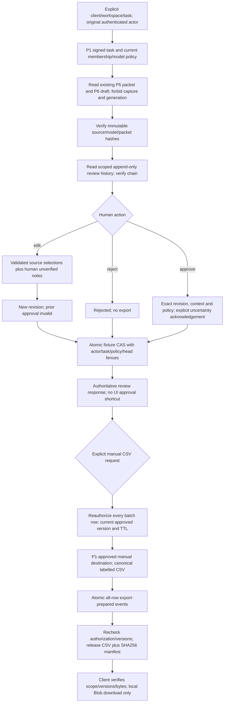

# P7 — human review and controlled manual CSV (disabled offline foundation)

**IMPLEMENTED OFFLINE / NOT LIVE VERIFIED. P1–P7 stay disabled; A7 NO-GO.**
P7 lets a synthetic authorized original task user inspect P6/source material,
edit a briefing, reject it, approve an exact version and prepare CSV bytes for
manual download. No calls, email, messages, connector write-back, remote upload,
provider/model call, new research or automatic dispatch is added.

There is no live endpoint, production event store, native migration, mounted
route or default service adapter. The UI defaults to disabled and is interactive
only with an explicitly injected offline fixture service. Native authorization,
transactional persistence and browser security still require separate approval.

## Stack and coordination

Base: #143, `codex/p6-call-brief`, **`3f5c9b0b374021727840b0f64be01e806bbcf282`**
(CI green). Stack: #122 plan → #124 P1 → #134 P2 → #139 P3 → #140 P4 → #142 P5
→ #143 P6 → P7. No merge/rebase, qualification/compiler/evaluator, shared GPT
transport, live executor or P5 implementation edit.

G09 was resolved **first and separately**, in audit-only branch commit
`06eaaada38ce80f8486df88398f35b3bf1f691d1`. Only
`tests/edge-functions/_shared/independentQualificationAudit.test.ts` changed.
All three independent audit suites pass 68/0 with `AUDIT_ASSERT_GAPS=1` against
isolated launch `8b0e2b6bdb20d6fe30542da39f0170d514d52746` and E01 #144
`9777a879ad0645e02354527f206c43623717a9fc`. That historical audit branch
predates Q1; these are runtime overlay receipts, not a claim its old product
baseline implements Q1. Claude's implementation is untouched. Receipt on #123.

## Actual path



P6 now exposes `readCallBriefForReview`. Its dependency type has no transport,
credential resolver, accounting writer or source-input loader. It refuses a
missing packet/draft; it cannot enter generation, first-time snapshot capture
or import. P4's existing authorization extraction accepts only the read-required
subset. `runCallBrief` and its generation/accounting behavior remain compatible.
P7 reuses P1 destination authorization, P5 frozen context and P6 choice validation
and deterministic rendering. It does not introduce another permission system,
model router, canonical qualification rule or dispatch approval.

## Review contract

The server derives revision zero from the original P6 choice and empty reviewer
notes. Every edit creates an immutable numbered revision whose hash includes
scope, original actor, original draft, packet/Brain/input/model/policy hashes,
parent revision, validated choice, notes and trusted edit time. Editing back to
identical text still creates a new revision; an old approval cannot revive.

Editing has two safe surfaces:

- Change P6's bounded, authorized evidence/context selections and question
  references through the existing P6 validator. Source text, identity,
  uncertainty and frozen packet facts remain immutable.
- Add/change reviewer text as **`human_supplied_unverified`**, with original
  actor/edit-time provenance and optional actual P5 fact IDs. A valid citation
  does not certify its meaning. The UI preserves existing note references when
  editing and also supports choosing supplied signal excerpts.

No arbitrary replacement factual prose, verified=true flag, source body/URL,
actor, timestamp or dispatch permission is accepted. All client instructions,
unknowns and source metadata remain in the rendered version. Notes are separate
from sourced facts and never become canonical evidence or qualified leads.
Rejection prevents export and requires a new explicit edit before approval.

Review requests carry an operation UUID, expected history head and exact revision
hash. The server authenticates through the P1/P6 task boundary, validates current
state and appends an event; browser approval state is not authorization.
Acknowledge-unverified=true is an explicit human action requirement, not a
permission grant. Only the original signed task actor with current P1 permission
is supported; delegated teammate review is not silently inferred from shared
workspace membership.

Approvals bind the current revision and all frozen source/model identities,
review policy/version, actor and server time. TTL is supplied by a trusted
review policy (1–86400 seconds; fixture uses one hour), never by the browser.
Changed revision, rejection, expired approval, policy change, task cancellation,
revoked membership or altered backing draft/packet refuses export. Server clock
rollback/future history also refuses. Same-client **current Brain content** changes
are not substituted into the already frozen task; original snapshot reuse is
intentional. Changing seller identity or authorization is still refused.

The event log verifies exact scope, actor, hashes, sequence, previous hash,
operation uniqueness, server time and reducer transitions, bounded to 64 events.
Pending/lost responses use the same operation identity. Identical concurrent
requests share the first durable event/time; differing requests or stale heads
conflict. The store interface requires a transactional all-or-nothing CAS and
current authorization. An in-memory fixture is not native concurrency evidence.

## Controlled CSV

Export accepts 1–5 unique task/version/approval references in **one explicitly
selected client/workspace**. No client CSV payload, approved flag, destination URL
or connector instruction is accepted. Every row is reread and authorized before
rendering. One unapproved, stale, rejected, foreign or conflicting row refuses
all bytes and all export events. Native all-row atomicity remains a gate.

CSV contains declared Apollo record IDs, task/client/workspace, original draft,
revision and packet/Brain/input hashes, approval provenance (actor/time/policy/
operation/hash), actual model/provider/attempt reference, supplied facts, signal
excerpts, hypothetical talking points, questions, every unknown, unverified human
notes with edit provenance, cautions, source references/full source snapshots,
original CSV lineage and reviewed client context.

Column labels and the row classification explicitly identify **unverified**
supplied/human material. Human approval authorizes manual use of this exact
version; it never proves the buyer claim. Verified fact/buying-signal lists remain
empty with P5 v1 and qualification stays null. No outreach approval is created.

Representation protections:

- RFC4180 quotes/doubled quotes and CRLF records, UTF-8, maximum 250KB total.
- Formula-leading cells (after whitespace/format characters and NFKC inspection)
  are prefixed with an apostrophe. The original authoritative strings are not
  normalized or stripped; escaped cells are disclosed in the manifest.
- Unsafe control, lone-surrogate and bidi-control data refuses the export rather
  than silently altering the evidence. Commas, quotes, multiline and Nepali text
  are tested. This is not permission for downstream tools to remove protection.
- All embedded JSON cells use existing canonical serialization, so event-object
  key reordering cannot change retry bytes or the file hash.

Manifest status is **`prepared_for_manual_download`**, not sent, uploaded, imported
or downloaded. It binds operation/user/scope/destination, row versions/approvals,
file SHA256, UTF-8 byte count, safe hash-derived filename and escaped-cell list;
`dispatch_allowed` and `remote_update_performed` are false. Approval and export
are separate explicit actions. Lost export acknowledgement can replay identical
bytes without appending duplicate events. Changed content/approval/TTL refuses
that replay. Already downloaded files cannot be recalled after later revocation.

The browser verifies the server artifact's scope, actor, versions, filename,
size and hash, then creates a local Blob only on an explicit click. It does not
construct an authoritative CSV from editable local state. There is no default
network implementation. Each controller is bound to one task/client, discards
stale async responses, clears state on disposal, and retries only on explicit
user action with the same request identity. Keyed UI instances prevent A's
review state appearing after a client switch. Native/deployed browser receipts
are not implied by unit tests.

[Actual synthetic CSV](fixtures/p7-reviewed-brief.synthetic.csv) and
[synthetic manifest](fixtures/p7-export.synthetic.json) were produced by the real
P1–P7 code with mocked external/model responses and an in-memory event store.
Independent Python `csv.DictReader` verified row structure, uncertainty labels,
approval provenance, UTF-8 and exact SHA256. No customer/provider/live evidence is
claimed. The format is a generic review CSV; Apollo re-import compatibility is
**unverified**, and this is not a P3 lead-import file or live Apollo update.

## Exact changed files

**Modified, pilot-owned only:**

1. `supabase/functions/_shared/pilot/pilotModelAdapter.ts` — read-only authorization dependency type; no transport/budget/retry change.
2. `supabase/functions/_shared/pilot/callBriefRunner.ts` — shared existing-draft reader; read path cannot capture/generate/resolve credentials/settle usage.

**New:**

3. `supabase/functions/_shared/pilot/pilotReviewPolicy.ts`
4. `supabase/functions/_shared/pilot/pilotReview.ts`
5. `supabase/functions/_shared/pilot/pilotExport.ts`
6. `supabase/functions/_shared/pilot/pilotExportStore.ts`
7. `src/lib/pilot/briefReviewController.ts`
8. `src/lib/pilot/reviewedBriefCsv.ts`
9. `src/components/leads/pilot/BriefReviewPanel.tsx`
10. `tests/edge-functions/_helpers/pilotReviewFixture.ts`
11. `tests/edge-functions/_shared/pilotReview.test.ts`
12. `tests/edge-functions/_shared/pilotExport.test.ts`
13. `tests/frontend/pilotReviewExport.test.ts`
14. `docs/audits/agentory-outbound-outpost-readiness/p7-review-export.md`
15. `docs/audits/agentory-outbound-outpost-readiness/p7-native-review-requirements.md`
16. `docs/audits/agentory-outbound-outpost-readiness/fixtures/p7-reviewed-brief.synthetic.csv`
17. `docs/audits/agentory-outbound-outpost-readiness/fixtures/p7-export.synthetic.json`

No live `pilot-review-export/index.ts`, migration or native table/RPC is supplied:
its security/persistence gates are unresolved. No qualification, shared GPT
transport, production secret or P5 code changes.

## Reproduction and validation

```sh
deno test --allow-read --allow-env tests/edge-functions/_shared/pilotReview.test.ts tests/edge-functions/_shared/pilotExport.test.ts
deno test --allow-read tests/frontend/pilotReviewExport.test.ts
node scripts/ci/ratchet.mjs tsc
node scripts/ci/ratchet.mjs eslint
npm run build
```

Focused receipts: **77 new typed backend tests + 22 frontend tests**. Regressions:
**489 typed P1–P7/provider-seam tests**, **65 frontend tests**; **238 typed P4/P6/P7
tests with actual T01 #131 transport** via a read-only import map. No copy/merge
of that transport; final combined integration still needs its own exact-SHA run.
Type/lint/build/hosted CI final receipts are posted on the draft PR, not assumed.

Coverage includes forged UI approval/actor/time/verified prose, wrong client and
shared-user access, overlapping external IDs, source/packet tampering, revoked
roles, stale heads/revisions, notes/edit/reject lifecycle, TTL/clock rollback,
concurrent identical/differing actions, lost acknowledgements, idempotency conflicts,
all-or-nothing two-task export, formula/Unicode/CSV attacks, delayed client responses,
byte/hash/version tampering and real controller-to-server execution. Review/export
adds zero research/provider/model attempts or financial settlements. Existing
spending caps and P6 failed-attempt/replay safeguards remain unchanged.

## Remaining P8 blockers

1. Native P1 RLS/direct-API/ownership constraints and legacy executor containment;
   native session/revocation/authorization-epoch proofs, not just current mocked membership.
2. P3 durable existing-lead/import ownership and trusted provenance; P4 workspace
   credentials/consent/model policy and atomic shared financial admission/recovery.
3. P5 append-only context persistence/source attestation and its **storage-order
   replay issue**. P7 refuses that path with zero model calls. Event/CSV canonical
   ordering here is not a fix to P5. See the separate [P5 finding](https://github.com/kathmanducreatives-code/aiworforce-platfrom/pull/142#issuecomment-6319364974).
4. P6 atomic accepted-output/usage settlement recovery and native immutable output
   ownership; current in-memory receipts are not durable infrastructure proof.
5. P7 native transactional event/operation/CAS store, trusted policy/JWT/clock,
   real RLS/grants/composite FKs and database concurrency/crash tests below.
6. Full combined P1–P7 offline acceptance, browser/session/client-switch checks,
   five-record interaction/batch UI, operator runbook and recovery/retention limits.
   Current UI supports one selected briefing; server supports bounded five-task files.
7. Actual model selection quality/grounding and target CSV handling (including
   Apollo field mapping and formula protection) need separate bounded authorization.
   Exact iGTM/Jungler products and CRM of record remain unverified; no dependency
   on their APIs is introduced.

P8 acceptance planning/testing is not automatic enablement. Any real data, hosted
migration, paid call, deployment or customer operation still needs separate
approval. OO-01/02/03 remain mandatory for later send/dispatch automation. This
PR authorizes none of those operations.
