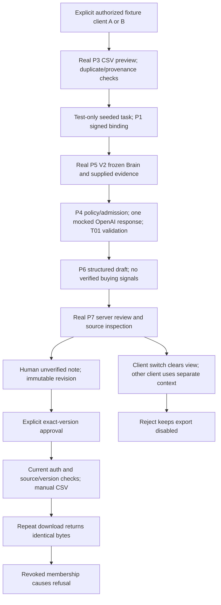

# P8 security and integrated acceptance

**Customer-pilot readiness: FAIL. Offline draft workflow: PASS within tested scope.**
P1–P8 remain disabled; A7 NO-GO. No real import, native migration, live model,
provider purchase, outreach, hosted write, deployment or merge was performed.

## Baselines and boundaries

- P8 stacks on P7 #146, `a8d66ac8192bd0db1105c63c0f735c79caf6ba0a`.
- Latest fetched launch: `8b0e2b6bdb20d6fe30542da39f0170d514d52746`.
- Company Brain #147 is **open draft**, head
  `c9c4859f33c6a346c6380cc1be345dce3f9b4d73`; not assumed merged/deployed.
- T01 #131 is merged to launch. Qualification #141/Q1–Q4 is on launch; no
  qualification/compiler/evaluator, Brain, shared transport, CI or legacy executor
  implementation was edited here. No second authorization/qualification/financial
  system is introduced. Coordination receipts are on #147 and #141.

Read-only import-map compatibility uses launch's shared implementation, P8's pilot
modules, and #147's shared Brain changes. This is not a merge or proof of the
future integrated head. Deployed schema/version/session state is **UNVERIFIED**.

## Eight-gate assessment

| Gate | Evidence and actual result | Verdict | Required next action |
| --- | --- | --- | --- |
| Native RLS and ownership | Baseline `company_brain_member_update` uses membership, not pilot owner role; `contacts_account_id_fkey` links ID only. P1 recursively validates parents in application code, but no pilot-native ownership migration exists. Hosted catalog/direct API not accessed. | FAIL for enablement; native execution NOT TESTED | Catalog/effective-policy review; approved composite constraints, role-aware writers, actual authenticated/anon/PostgREST tests |
| Legacy executor containment | `run-agent/index.ts:1132–1172` accepts verified service role or user membership. Resume reads at 1342–1357 validate workspace/V2 ownership, but no `pilot_scope`/`pilot_draft_only` enforcement exists. `orchestrate` and worker remain legacy entry points. This is missing pilot containment, not a claim service credentials alone are illegitimate. | FAIL | Coordinate one early enrolled-workspace/task refusal/dispatch guard across kickoff, worker, continuation and repair, preserving normal service jobs |
| Frozen/review/approval persistence | `PilotSnapshotStore`, `CallBriefStore`, `PilotExportStore` and `PilotTaskModelStore` are interfaces. Fixture Maps are atomic only in one JS process. No live/native implementation or scoped transaction exists. | FAIL | Review proposed SQL and transaction contract; separately approve database tests/application |
| Storage-order replay | P5 V1 depends on CSV mapping object insertion order for ordered facts; JSONB reordering caused `snapshot_stored_integrity_failure`. New signed V2 canonically sorts fact IDs; both ascending/reverse object-order roundtrips preserve packet hash, model aliases, approval and CSV. Arrays and source text stay authoritative. V1 is unchanged/fail-closed. | PASS offline V2; native roundtrip NOT TESTED | Native JSONB tests; no silent old-task migration; fresh signed approval for V2 |
| Budget/purchase/output recovery | Real P4/P6 tests cover settlement/output failures and lost acknowledgement: at most one attempt per signed task and no rebuy on uncertain state. Pre-output/settlement loss is safely held but cannot autonomously recover without durable accepted output. There is no provider research/purchase in this pilot. | PASS mock containment; FAIL durable recoverability | Atomic existing-ledger reservation/settlement/output acceptance, restarts/multi-connection/crash proofs |
| Concurrent clients/sessions | Parallel A/B workflows with same Apollo identity isolate output and refuse foreign task/shared-user delegation. Current membership revocation refuses export. P1 authenticates user/membership; no live session_id/epoch guarantee. | PASS mocks; FAIL native session assurance | Server JWT/live-session/revocation and compatible DB lock/epoch contract; real tab/session concurrency |
| Complete browser workflow | Actual P3 preview, signed seeded task, frozen V2, P4/P6 mocked model, P7 review/edit/approve/download and reject/revoke/client-switch exercised in Chrome. P3 persistence->task creation is deliberately absent. App route remains unmounted/default-disabled. | PASS synthetic harness; FAIL customer E2E | Approved durable import/task bridge, native interface, real session browser acceptance |
| Brain #147 / qualification | Read-only overlay tests pass with frozen original Brain, source review, T01 and canonical shared code. Qualified result remains null/not evaluated; no pilot export can create qualification. #147 still has role-blind writes, unfiltered login routing and semantic compiler follow-ups. | PASS tested compatibility; full integrated deployment UNVERIFIED | Exact combined-SHA regression + role/native/browser tests; coordinate owner fixes |

Line references are to the P7/P8 baseline, not to a deployed service. Native
failures above are missing security guarantees established by source/interfaces;
no hosted exploit or real customer access was attempted.

## Isolated fix: versioned replay

`pilotEvidencePacket.ts` now accepts explicit `canonical_v2` fact ordering.
`pilotContextSnapshot.ts` requires `pilot_context_v2` in the original P1-signed
payload to produce `pilot_context_packet_v2`. Its immutable hash binds that
choice. Packet replay recomputes from the original frozen Brain/evidence and
compares the complete packet; mismatched version, signature, source, facts,
array order or enrollment refuses. No recapture/repair/extra model attempt.

`callBriefPrompt.ts` and presentation-only `sourcePacketView.ts` recognize V2
without granting permission or converting source claims to verified facts.
Historical V1 code paths keep original order/hashes. Existing F1/F2 aliases and
export approvals are never reassigned by an automatic migration.

This correction is independent of #147's mutable Brain writer: subsequent Brain
updates do not affect a frozen task. Changing current seller identity or task
authorization still refuses. No normalization or qualification changes here.

## Recorded synthetic path



The test-only preview-to-seeded-task bridge is visibly labelled; it is not an
implemented native import. The browser harness does not invoke run-agent or a
live AI/provider. [Browser instructions](../../../../tests/pilot-browser/README.md)
contain reproducible steps.

### Browser execution receipt (2026-10-22, synthetic)

Chrome loopback harness: A edit→approve→download twice; B switch→reject.

```json
{
  "A": {
    "packet_version": "pilot_context_packet_v2",
    "packet_hash": "114dd4dbe866ebebdaff014983fd019965a6a938f828f0e6da9af33c7b03db4d",
    "model_attempts": 1, "model_receipts": 1, "source_loads": 1,
    "events": 3, "external_requests": 0, "durable_database": false,
    "download_bytes": 13996,
    "csv_sha256": "258adc34193e5fbe7af89613a83b2290b567b4480c9ef60cf4788ddcb7e571ac",
    "repeat_download_identical": true,
    "revoked_export": "refused"
  },
  "B": {
    "packet_hash": "76ee0dfefc06a3ef027d6c14be1cc0e36ef936881b2a23c75b8ec2d6fccb4dd8",
    "model_attempts": 1, "model_receipts": 1, "source_loads": 1,
    "events": 1, "external_requests": 0, "durable_database": false,
    "review_status": "rejected", "export_control": "disabled"
  }
}
```

Downloaded files were independently read as CSV: one row, matching SHA256/bytes
on both downloads. Only these generated synthetic downloads were inspected.
Screenshot: [B rejection and uncertainty labels](browser-rejected.synthetic.png).
No real session, hosted storage, token expiry or paid quality validation is implied.

## Validation and reproduction

New typed tests: `pilotP8Replay.test.ts` (17), `pilotP8Workflow.test.ts` (11),
`pilotP8Recovery.test.ts` (4): **32 passed, zero failed**. These call real modules;
only external/model/Auth/storage seams are synthetic. Reproduce from repo root:

```sh
deno test --allow-read --allow-env tests/edge-functions/_shared/pilotP8Replay.test.ts tests/edge-functions/_shared/pilotP8Workflow.test.ts tests/edge-functions/_shared/pilotP8Recovery.test.ts
```

The old replay defect is deterministically reproduced by capturing a V1 packet,
storing `JSON.parse(canonical(packet))`, then resuming: integrity refusal before
fresh context/model. The V2 contract tests fail on the original P7 implementation
(unsupported V2 approval), then pass here. Both V1 untouched replay and historical
reordered refusal are pinned. V2 tampered facts/source/order/version/signature
still refuse. This is a behavior change requiring a fresh V2 signed task, not an
in-place rescue of old V1 state.

Compatibility overlay: **194 typed tests passed** using actual launch shared
modules (including T01 and qualification) plus #147 shared Brain modules. Import
mapping is reproducible with `tests/pilot-browser/compat-map.mjs` using detached,
read-only worktrees at the exact SHAs above:

```sh
node tests/pilot-browser/compat-map.mjs /path/to/launch-worktree /path/to/brain147-worktree > /tmp/p8-compat-map.json
deno test --allow-read --allow-env --import-map=/tmp/p8-compat-map.json tests/edge-functions/_shared/pilotP8Replay.test.ts tests/edge-functions/_shared/pilotP8Workflow.test.ts tests/edge-functions/_shared/pilotP8Recovery.test.ts tests/edge-functions/_shared/pilotContextSnapshot.test.ts tests/edge-functions/_shared/callBriefRunner.test.ts tests/edge-functions/_shared/pilotReview.test.ts tests/edge-functions/_shared/pilotExport.test.ts
```

The future combined integration head still needs its own regression run.

Focused regression: **513 typed backend tests**, **65 frontend tests**, type
ratchet **23/23**, lint **1279/1281**, targeted Deno lint and build pass (existing
bundle-size warning). Full CI results are recorded in the P8 PR receipt once
available; not inferred from previous PRs. Native SQL and
session/PostgREST tests are **NOT RUN**, pending approval.

### Exact changed files

Production-path changes are limited to four disabled pilot modules:

- `supabase/functions/_shared/pilot/pilotEvidencePacket.ts`
- `supabase/functions/_shared/pilot/pilotContextSnapshot.ts`
- `supabase/functions/_shared/pilot/callBriefPrompt.ts`
- `src/lib/pilot/sourcePacketView.ts`

Test helpers and acceptance tests:

- `tests/edge-functions/_helpers/pilotSnapshotFixture.ts`
- `tests/edge-functions/_helpers/callBriefFixture.ts`
- `tests/edge-functions/_helpers/pilotReviewFixture.ts`
- `tests/edge-functions/_helpers/pilotP8Workflow.ts`
- `tests/edge-functions/_shared/pilotP8Replay.test.ts`
- `tests/edge-functions/_shared/pilotP8Workflow.test.ts`
- `tests/edge-functions/_shared/pilotP8Recovery.test.ts`

Unmounted, loopback-only browser harness:

- `tests/pilot-browser/index.html`
- `tests/pilot-browser/main.tsx`
- `tests/pilot-browser/server.ts`
- `tests/pilot-browser/vite.config.ts`
- `tests/pilot-browser/compat-map.mjs`
- `tests/pilot-browser/README.md`

Review-only evidence and proposals in this directory:

- `docs/audits/agentory-outbound-outpost-readiness/p8/README.md`
- `docs/audits/agentory-outbound-outpost-readiness/p8/native-approval-plan.md`
- `docs/audits/agentory-outbound-outpost-readiness/p8/proposed-storage.sql`
- `docs/audits/agentory-outbound-outpost-readiness/p8/proposed-empty-rollback.sql`
- `docs/audits/agentory-outbound-outpost-readiness/p8/browser-rejected.synthetic.png`

## Native approval package and prioritized next work

See [proposed SQL](proposed-storage.sql), [empty-only rollback SQL](proposed-empty-rollback.sql)
and [security/transaction/native test plan](native-approval-plan.md).
They are outside migration runners and apply nothing. The private scaffold
grants no application access and is intentionally insufficient for enablement.
No untested SECURITY DEFINER writer or alternate ledger is supplied.

1. **P0 security:** agree native client/task composite ownership, role-aware Brain
   policies, live session/epoch revocation and legacy-executor containment with
   Brain/worker owners. Validate existing data before adding constraints.
2. **P0 durability:** review storage/transaction SQL, approve disposable native
   tests first. Integrate existing admission/ledger with accepted-output recovery.
   Pending spend stays held; never fix missing output by resetting attempts.
3. **P1 integration:** approved P3 persistence and original signed task bridge,
   transactional P5–P7 adapter, real JWT/browser/client-switch/multi-tab tests.
4. **P1 pilot acceptance:** exact combined-SHA suite, bounded five-record flow,
   CSV destination compatibility, source-quality/human review checks, redacted
   logs and operational recovery/retention runbook. Model quality/live tests need
   separate bounded permission; no current call/budget increase.

OO-01/02/03 remain mandatory before future automated/external dispatch. No send
capability is added or required to demonstrate these synthetic drafts. Apollo
API, iGTM/Jungler identity, CRM-of-record and external workflows stay unverified.
No customer enablement is justified by this offline PASS.

## Supabase reference checks

Reviewed the [changelog](https://supabase.com/changelog) and current
[RLS guide](https://supabase.com/docs/guides/database/postgres/row-level-security)
and [session guide](https://supabase.com/docs/guides/auth/sessions) on 2026-10-22.
The private deny-by-default/grant separation and explicit live-session gate
follow those contracts. Recent default API-exposure changes make native schema
configuration inspection necessary; no hosted version or setting is assumed.
