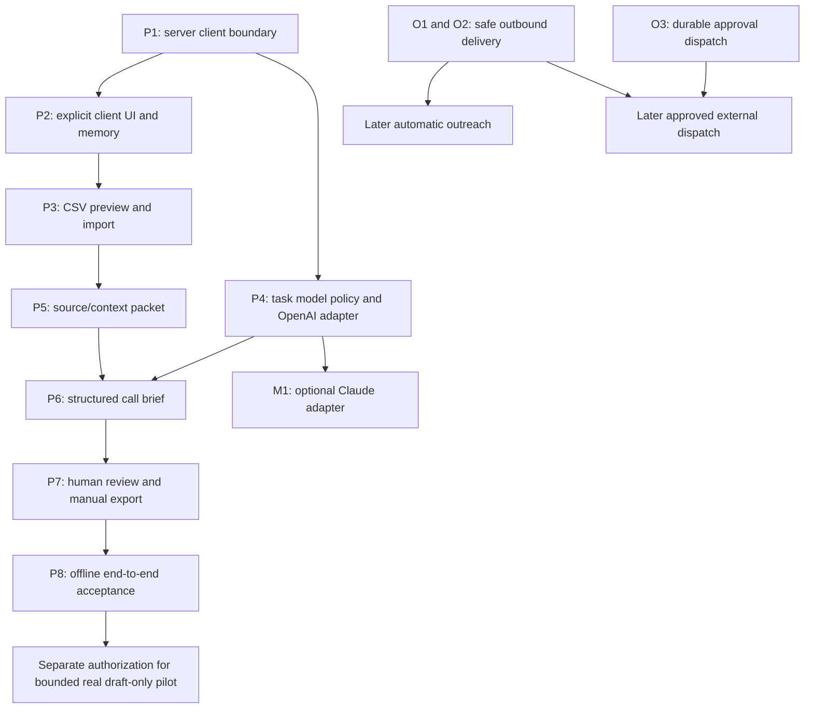

# Implementation plan: existing-lead caller preparation

**Plan only — no implementation, deployment or production changes.** Date: 2026-10-20. Baseline: `launch/hardening` `5d86703712205a04d059a39cf0d38a0621fc3ddb`; audit PR122. The repository state and active Claude branch were fetched before preparing this plan.

## Smallest useful pilot

One confirmed client workspace → preview/confirm a small approved Apollo-export CSV → retain source identity and provenance → assemble a structured call brief from approved company context and attributable facts → human review → local CSV/manual handoff to Nosh's current process.

No new prospecting, person discovery, contact-detail purchases, sequences, automatic outreach, call-disposition ingestion, API write-back or remote dispatch. Unknown buyer facts remain unknown. The brief is preparation for a human caller, not an assertion that a company is qualified. No requirement to wait for send automation to implement/test this draft-only flow.

Keep the initial persistence surface to five new tables (one scoped policy, two import tables, brief versions and artifact events) plus real existing task/accounting records. No separate CRM, task queue, connector-settings product or new financial ledger.

The client boundary is specified in [client-isolation.md](client-isolation.md). **One client per workspace**, explicit selection, server-authorized record ownership, immutable task/context/model snapshots, scoped credentials and manual-only output destinations. This is the first implementation dependency; a CSV importer or agent UI must not ship enabled ahead of it.

## Ownership and integration boundary with Claude

At this planning snapshot, Claude's **PR123** (`q1/single-qualification-authority`, head `702dcce8dc3691965a00b01015e272a7312138a0`) targets PR113's branch. Both are open, not presumed merged/deployed. PR123 changes canonical eligibility/evaluator/holds and several engine/projection call sites. Its new tests and code are not independently certified by this plan; the earlier audit's gaps are historical snapshot results, not assertions that Q1 failed to fix them.

Protected files for pilot PRs: `candidateEligibility.ts`, `qualificationHold.ts`, `missionCriteria.ts`, `missionEvaluation.ts`, `missionQualificationContext.ts`, `leadCapabilityEngine.ts`, `leadMissionCompiler.ts`, `groundedClaims.ts`, `evidenceGraph.ts`, canonical Workbench decision/projection files, `run-agent/index.ts` and Claude's qualification/database-contract fixtures. No qualification fork, modified verdict rule, imported PASS receipt or new `qualified` shortcut.

The pilot reuses pure context/research/drafting utilities through new adapters. Optional qualification integration later consumes Claude's decision/snapshot as an opaque read-only object with version/evidence linkage. Until that stable contract is agreed, store `qualification_decision: null`, show “not evaluated,” and exclude imported rows/briefs from qualified counts. No need to copy or rederive Q1 criteria snapshots.

Potential shared edits requiring coordination: WorkspaceContext/ChatWorkspaceContext, `memoryReader.ts`, a compatible version accessor for Brain, and generic model transport extraction in `aiProvider.ts` if Anthropic is added. None should change Discovery model routing, stage budgets or admission. Existing Q1 model/ledger modules can be imported unchanged; any required signature/constraint change needs owner review first. GitHub coordination records the boundary; it does not imply Claude's agreement before a reply.

The proposed import/evidence/brief/review shapes and state transitions are in [call-brief-contract.md](call-brief-contract.md).

## Proposed PR order

Each entry is a separate small reviewable draft PR based on the latest compatible integration. Schema-bearing changes remain disabled until their migrations and acceptance evidence are separately reviewed. Migration filenames are generated with the repository/Supabase workflow at implementation time; names below are symbolic purposes, not executable migration files created now.

P1–P8 are the initial pilot stack. M1 can run after P4 and is not required for an honestly labeled OpenAI-only first pilot. Gemini stays disabled; adding it needs its own adapter/acceptance PR. O1/O2/O3 are mandatory **automation gates**, separate from draft-only acceptance. No release/live test is included in these PRs.

### P1 — Server-owned client boundary and draft-only mode (M)

**Existing files to reference/reuse, not rewrite:** `supabase/functions/_shared/requestAuth.ts`, `workspaceAccessGuard.ts`, `getCompiledCompanyBrainForWorkspace.ts`, `approvalAuthorization.ts`.

**New exact files:**

- `supabase/functions/_shared/pilot/pilotScope.ts` — authenticate/authorize, compare full record set, derive server-only scope and sanitized errors.
- `supabase/functions/_shared/pilot/pilotPolicy.ts` — `draft_only`, permitted action registry, row/byte/page/attempt caps and disabled remote destinations.
- `supabase/functions/_shared/pilot/pilotCredentialBinding.ts` — workspace/provider/purpose binding validation and secret-reference resolver interface; no credential entry UI.
- `tests/edge-functions/_shared/pilotScope.test.ts`, `pilotPolicy.test.ts`, `pilotCredentialBinding.test.ts`.
- `tests/db-contract/pilotIsolation.contract.test.ts` — native tenant/role/grant/constraint tests; expand with each later child table.

**Schema review:** one new `pilot_workspace_policy` table with versioned server-owned model, opaque credential-binding and manual-destination descriptors. These are scoped policy entries, not three new administration subsystems. Manual CSV is the only destination kind; browser gets a sanitized capability DTO. Feature defaults off. Review existing workspace roles, task/status enums and financial task-link constraints before adding schema.

**Acceptance:** foreign/mixed scope, missing/revoked membership, disabled pilot, user-forged service scope, unauthorized credential/destination and unsupported mode all fail before providers or privileged writes. Native tests prove ownership constraints even for service-role writers, restricted RPC grants and per-role RLS. No migration installation or production enablement in this planning change.

### P2 — Explicit client selection and bounded memory (M)

**Existing exact files to change:** `src/contexts/WorkspaceContext.tsx`, `src/lib/orchestration.ts`, `src/contexts/ChatWorkspaceContext.tsx`, `src/hooks/useCompanyBrain.ts` (preserve scoped cache behavior), `src/components/Header.tsx` or `src/components/Sidebar.tsx` for a single selector mount, and `supabase/functions/_shared/memoryReader.ts` for the independently reviewed draft-association fix. Choose Header as the default mount; do not add competing selectors.

**New exact files:** `src/components/workspace/ClientWorkspaceSelector.tsx`, `src/lib/workspaceSelection.ts`, `tests/frontend/clientWorkspaceSelection.test.ts`, `tests/edge-functions/_shared/memoryReaderScope.test.ts`.

**Dependencies:** P1. Preserve existing single-workspace behavior while requiring explicit scope for multi-workspace pilot writes. Do not turn global first membership into an authoritative client selector. Do not give legacy user-scoped email/calendar routes a pilot permission merely because a workspace is selected.

**Acceptance:** A/B marker isolation; revoked membership; no Brain fallback; clear selected records/chat/preview on switch; stale A responses/realtime callbacks ignored after switching to B; per-tab selection and refresh/auth behavior; no non-associated drafts in fresh conversation memory. Existing memory/Brain/chat navigation regression suites remain green. OO-04/I02 becomes a required passing guard in its precise scope, without pretending a new client_id alone fixes legacy rows.

### P3 — Approved existing-lead CSV preview and import (M)

**Existing exact files:** `src/pages/LeadLibrary.tsx` (add an “Existing leads / call prep” subview within the existing workspace), `src/components/leads/library/Toolbar.tsx` (entry point only). Keep qualified lead counts/decisions unchanged.

**New exact files:**

- `src/components/leads/pilot/ExistingLeadImport.tsx` — file selection, mapping, row preview, warnings and explicit confirmation.
- `src/lib/pilot/importPreview.ts` — preview view model using the server-normalized result.
- `supabase/functions/pilot-import/index.ts` — `preview` and idempotent `confirm` actions; real user auth plus P1 scope.
- `supabase/functions/_shared/pilot/pilotCsv.ts`, `pilotImportContract.ts`, `pilotImportStore.ts` — bounded CSV parsing, field mapping, normalization/provenance and scoped commit.
- `tests/edge-functions/_shared/pilotCsv.test.ts`, `tests/edge-functions/pilotImport.test.ts`, `tests/db-contract/pilotImport.contract.test.ts`, `tests/frontend/pilotImportPreview.test.ts`.

**Schema:** `pilot_import_batches`, `pilot_import_rows` with workspace-scoped parent FKs, source row/file/normalized hashes, row status, explicit source IDs and timestamps. These are input/lineage snapshots, not another lead qualification pipeline. Read/link an existing internal account only on a strong same-workspace identity; do not merge by name or write qualified lead records to make legacy enrichment run.

**Suggested v1 caps, subject to approval before implementation:** 25 selected rows and 250KB per file; UTF-8 CSV, bounded field lengths, no XLSX/macros/archives or hidden pagination. Validate on server, not just browser. Import itself makes **zero** model/provider calls and never triggers research automatically.

**Accepted input mapping:** company name, known public website/domain or company LinkedIn URL; contact name/title/profile/email if provided; optional opaque source record ID/source account/list identifier; source update timestamps if actually present. Retain original header mappings and report omitted fields. Missing Apollo IDs may import as provisional client-scoped rows with generated immutable row IDs; they are never auto-write-back eligible. Multiple sources/identities with no unambiguous employer remain held.

**Acceptance:** quoted commas/newlines/BOM, duplicate headers, malformed rows, oversized/control-character/URL data, formula-like cell input, duplicate source IDs, missing identities, stale/missing dates, mixed-client mapping and repeat/concurrent confirm. Same file in A/B remains separate; same confirm key with changed payload conflicts. No source date fabricated from upload time, no model interpretation of CSV note instructions, no calls to Apollo/prospecting/people/email/sequence providers.

### P4 — Task-level policy and one working selectable model adapter (M)

**Existing modules reused unchanged where feasible:** `gptProvider.ts` (`gptStructured`), `modelRequestBody.ts`, `modelCostModel.ts`, `executionLedger.ts`, `modelSpendCeiling.ts`. Do not change `gptModelRouter.ts`, Discovery stage routing or `TASK_MODELS` defaults for unrelated tasks.

**New exact files:** `supabase/functions/_shared/pilot/pilotTaskStore.ts`, `pilotTaskModelPolicy.ts`, `pilotModelRegistry.ts`, `pilotModelAdapter.ts`, `pilotModelAccounting.ts`; `src/components/leads/pilot/TaskModelSelector.tsx`, `src/lib/pilot/taskModelOptions.ts`; `tests/edge-functions/_shared/pilotTaskModelPolicy.test.ts`, `pilotModelAdapter.test.ts`, `pilotModelAccounting.test.ts`, `tests/frontend/pilotTaskModelSelection.test.ts`, `tests/db-contract/pilotModelPolicy.contract.test.ts`.

**Schema:** extend the versioned policy document in `pilot_workspace_policy`; no additional settings table. Selected task policy/version is copied into P6 task snapshot. Registry entries identify exact allowed models, task/schema support, data-sharing consent, operator validation status, credential binding, token/attempt/USD caps and enabled state. Unsupported entries include a human-readable reason. UI stores an explicit selection; server enforces it and records requested vs actual. No automatic fallback to agent display labels or another provider.

**Initial adapter:** OpenAI via existing transport with **per-call** `readEnv`/dependency injection resolving the authorized credential. Never temporarily mutate process environment to switch client keys in a concurrent isolate. Exact model IDs are approved registry values, not arbitrary strings supplied by the browser or model. Registry entries default disabled until code tests and separately authorized account/deployed acceptance are complete. Existing environment-key presence is not that acceptance.

**Calls:** one normal generation; at most one predeclared safe transient retry if admitted by the task budget and existing transport rules. Count all attempts. No model repair loop, provider substitution, voting or automatic replay after uncertain timeouts. The wrapper must prove no internal retry exceeds the authorized task attempt cap; a rejected second call is not logged as a paid transport attempt. If the reusable transport cannot meet that contract without a shared signature change, coordinate that change rather than bypass limits.

**Acceptance:** selected OpenAI/model reaches the captured actual request, credential and task workspace; spoofed/disabled models, Gemini, cross-workspace policy, missing permission and stale policy all refuse with zero calls. Failure/refusal/truncation/malformed structured output, token/cost/attempt exhaustion, accounting failure and unknown price fail conservatively. Real request IDs and actual usage are stored against a valid scoped task linkage; no key/raw prompt appears in UI/logs. Offline tests do not enable live options.

### P5 — Source/context packet using existing research primitives (S/M)

**New exact files:** `supabase/functions/_shared/pilot/pilotContextSnapshot.ts`, `pilotEvidencePacket.ts`, `pilotCompanyResearch.ts`; `src/components/leads/pilot/SourceEvidencePanel.tsx`; `tests/edge-functions/_shared/pilotContextSnapshot.test.ts`, `pilotEvidencePacket.test.ts`, `pilotCompanyResearch.test.ts`.

**Read-only reuse:** canonical Brain compilation and seller identity/source-role utilities, `companyEnrichment.ts` text cleaning/extraction primitives, `workbench/sellerContext.ts`, and existing paid tool/admission boundaries where compatible. Do not loosen `leadActionRunner.runCompanyEnrichment` eligibility gates or pretend CSV-imported leads are proof-qualified to reuse it.

**Dependencies:** P1/P3. Context snapshot reads profile+updated_at together, gates active Brain, compiles the frozen raw profile with existing pure helpers and hashes the reviewed result. Keep this accessor separate from qualification consumers. No agency/global Brain fallback.

**v1 sources:** confirmed CSV facts and explicitly supplied/approved source snapshots; label each as supplied/unverified versus corroborated. URL presence alone is not retrieved evidence. Optional known-company website research is a **separately authorized** action on selected records, capped initially to one approved public URL per record; use existing guarded/budgeted provider tool only if identity, credentials and accounting fit. It remains off until allowed. No broad search, generated URLs, contact enrichment or auto-crawl during import.

**Acceptance:** fact ID/owner/source/field location/exact excerpt consistency, missing timestamps, old scrape vs event date, source/subject mismatch, conflicting domains/employers, seller-source contamination, wrong-client Brain and prompt injection in CSV/page text. Private/local/credential-bearing URLs and unauthorized redirects blocked; returned source identity checked. Reuse only same-workspace evidence, never cross-client caches. Missing evidence becomes explicit unknown, not a purchased fallback or inferred buying signal.

### P6 — Structured source-backed call brief (M)

**New exact files:** `supabase/functions/pilot-call-brief/index.ts`; `supabase/functions/_shared/pilot/callBriefContract.ts`, `callBriefPrompt.ts`, `callBriefValidator.ts`, `callBriefRunner.ts`, `callBriefStore.ts`; `src/components/leads/pilot/CallBriefPanel.tsx`; `tests/edge-functions/_shared/callBriefContract.test.ts`, `callBriefValidator.test.ts`, `callBriefRunner.test.ts`, `tests/edge-functions/pilotCallBrief.test.ts`, `tests/db-contract/pilotBriefLifecycle.contract.test.ts`.

**Read-only reuse:** seller identity/context and prohibited-claim/grounding utilities from existing drafting components, P4 model/accounting adapter and P5 packet. Do not add a call-brief branch to run-agent or invoke the generic planner. Existing opener output is not relabeled as a complete call brief.

**Schema:** `pilot_brief_versions` with workspace-scoped immutable snapshots, tied to real existing `tasks` through a compatible adapter. No new task queue or financial ledger. A valid task/status/agent and accounting linkage is finalized in P1/P4. One selected row per task; no unbounded bulk fanout. Initial interactive selection may prepare at most five records with explicit confirmation of the total cap; each remains a separately identified, bounded task. The server freezes the selected set and aggregate attempt/token/USD cap before starting it, including all possible transport retries; concurrent requests share that admission/operation identity. A retry cannot create a new operation merely by changing a browser request ID. Explicit regeneration requires a new approved snapshot/attempt and remaining aggregate budget.

**Acceptance:** all company/person factual claims cite actual packet facts; no founder/employment/intent/qualification inferred from the imported title. Questions/hypotheses are labeled and cite seller rationale where appropriate. Unknown/contradictory facts preserved; forbidden claims/resources/scheduling links rejected; contact mismatch/Brain conflict blocks. Strict parse, truncation, timeout, unsupported model, cancellation, uncertain operation and persistence failure never return “ready.” No schema repair call. Resume reuses accepted stored output and frozen policy/scope; uncertain generation does not automatically repurchase. Zero send/dispatch calls.

### P7 — Human review and download back to current process (S/M)

**New exact files:** `supabase/functions/pilot-review-export/index.ts`; `supabase/functions/_shared/pilot/pilotReview.ts`, `pilotExport.ts`, `pilotExportStore.ts`; `src/components/leads/pilot/BriefReviewPanel.tsx`, `src/lib/pilot/reviewedBriefCsv.ts`; `tests/edge-functions/pilotReviewExport.test.ts`, `tests/edge-functions/_shared/pilotReview.test.ts`, `pilotExport.test.ts`, `tests/frontend/pilotReviewExport.test.ts`, `tests/db-contract/pilotReviewVersion.contract.test.ts`.

**Schema:** one append-only `pilot_artifact_events` table for review and export-prepared events; review binds exact brief/content/source/context versions. Human edits create a new unreviewed version; edited factual claims need evidence references and validation or explicit human-supplied provenance. Do not allow the reviewer to remove source/uncertainty metadata from the canonical artifact.

**Dependencies:** P2/P6. Review is a **direct scoped state transition**, not `approve-and-continue`, a workflow dispatch or a Resend/tool approval. CSV bytes are downloaded locally. No remote-upload destination is enabled. Avoid globally changing existing Workbench CSV semantics; reuse formatting utilities only after adding formula/Unicode/control-character protections in the pilot exporter.

**Acceptance:** only explicitly reviewed exact versions exported; full batch rejects mixed/unreviewed/stale/foreign rows; no old approval for edited data; concurrent edits/reviews; revoked role; unsafe CSV formula cells, quotes/newlines, Unicode, correct header mapping, immutable source IDs and client scope. Export contains brief text, factual sources/unknowns, original source record ID, review/model/context/version and file hash. Manifest records prepared/download artifact, never “Apollo updated” or “sent.” No external fetch on review/download. Apollo re-import compatibility remains unverified pending sample/export mapping; provide a generic review CSV first.

### P8 — Offline draft-only pilot acceptance (S)

**New exact files:** `tests/db-contract/pilotDraftOnly.contract.test.ts`, `tests/frontend/pilotDraftOnlyJourney.test.ts`, `tests/fixtures/outpost-pilot/client-a.csv`, `client-b.csv`, `sources.json`, `model-responses.json`, and `docs/audits/agentory-outbound-outpost-readiness/pilot-acceptance.md`.

**Dependencies:** P1–P7. Synthetic account/contact/provider/model boundaries; real import/store/task/context/review/export code on disposable local DB. No new hosted setup, migration installation or live operation is part of this planning change. Any future local schema bootstrap requires its own permitted test setup under the no-install constraint; cannot mark native acceptance complete using only mocked queries.

**Acceptance:** A and B share source IDs/domain/email but distinct Brain/voice/keys/destinations; cross-client operations all fail. A approved import → source packet → selected-model transport → validated brief → correct stored version → human review → expected local CSV; actual model usage and task states agree. Failure controls include unsupported model, missing Brain, wrong identity, stale evidence, malformed model result, cancellation, expired auth, failed writes, late response after client switch and replay. Instrument operation counts and deny every unexpected external host/capability. No discovery/qualification upgrade, no Apollo API, no send/dispatch, no new credit/provider admission bypass. Required old audit cases stay visible rather than disabled globally.

## Optional model PRs

**M1 — Anthropic call-brief adapter (M):** after P4, add `supabase/functions/_shared/pilot/pilotAnthropicAdapter.ts` and `tests/edge-functions/_shared/pilotAnthropicAdapter.test.ts`. Prefer extracting a request-scoped transport from `aiProvider.ts` into a shared `anthropicTransport.ts` without changing existing task defaults, telemetry, budgets or behavior. Accept exact server policy model and request-scoped credential; current hardcoded generic Anthropic call cannot satisfy this by passing `preferredProvider`. Test actual request provider/model, schema/result parity, refusal/truncation/usage and concurrent A/B key isolation. Existing taskModelPolicy/modelFailure suites must remain unchanged in meaning. Enable Claude choice only after separately authorized sandbox/deployed receipts on that adapter; otherwise display disabled with a reason.

**M2 — Gemini:** explicitly **not in the first pilot stack**. UI may show a disabled option explaining “adapter and account validation pending.” A later separate PR would add provider transport/schema normalization/usage/permission and identical acceptance tests. A logo, stored `agents.model` or GOOGLE_API_KEY presence never enables it. Do not promise all three models for the first demo. The task selection feature is truthful when a supported enabled option is honored and unsupported choices are explicitly refused/disabled.

## Mandatory automation fixes, separate from the draft-only critical path

| PR | Exact existing/new scope | Required red-to-green tests | Gate |
|---|---|---|---|
| O1 — OO-01 atomic send operation | `supabase/functions/send-scheduled-emails/index.ts`; new `_shared/scheduledEmailDelivery.ts`; reuse existing operation/admission ledger; reviewed operation/claim schema only if needed | R01 concurrent send; duplicate request; lost lease; provider idempotency window/receipt behavior; one logical operation across retries | No automatic sends until passing plus separately authorized vendor/deployed acceptance |
| O2 — OO-02 uncertain acceptance and persistence | Same delivery module/handler, plus reconciliation receipt/state; separate follow-up PR after O1 | R02 vendor accepted + DB failure; lost response; status-write failure; no false “sent”; no replay before reconciliation | No automatic sends or approved external delivery until passing |
| O3 — OO-03 durable approval dispatch | `supabase/functions/approve-and-continue/index.ts`; new `_shared/approvalDispatch.ts`; existing task/queue identity and reviewed outbox/dispatch persistence | A01 downstream503; auth/role/CAS; accepted-but-lost-response; double click; crash after approval; replay once, no lost work | No pilot use of approved external dispatch/approve-and-continue until passing |

These fixes cannot be replaced with “try again,” setting sent before transport, a UI disabled button or blindly replaying an approved operation. Keep liability and receipt semantics. O3 may coordinate with Claude's task/lineage ownership; no changes to Q1 qualification code. P7 deliberately performs no external dispatch and therefore does not depend on O1–O3.

## Explicit release boundaries

1. **Offline implementation acceptance:** P1–P8 pass on isolated fixtures and native local contract tests; unsupported options disabled; flags default off. No claim of live readiness.
2. **Operator readiness:** review exact SHA/deployment and schema manifest, current health, client bindings, credential/account permissions, approved source file, model choice/price/budget, consent and manual destination. No automatic deployment or migration.
3. **Separately authorized bounded live draft-only pilot:** one client and approved existing sample; no new discovery, contacts or sends. Record source IDs, actual selected model, usage, fact citations, persisted/reviewed versions and manual export artifact. All live calls/hosted writes require separate authorization.
4. **Automation later:** O1–O3 and destination-specific integration/permission/reconciliation tests plus separate authorization. A7 remains independently NO-GO; this pilot is not a path around A7 or provider restrictions.

## What to implement first after design review

Start P1 as an offline, disabled-by-default scope/permission contract and schema proposal, then P2 with the concrete A/B boundary tests. CSV/UI/model work must not be used to defer those constraints. Run P4 policy/adapter work independently of P3 only after P1 interfaces stabilize. Agree the read-only canonical-decision seam with Claude; there is no need to touch or wait on qualification internals for factual, explicitly not-evaluated briefs.
