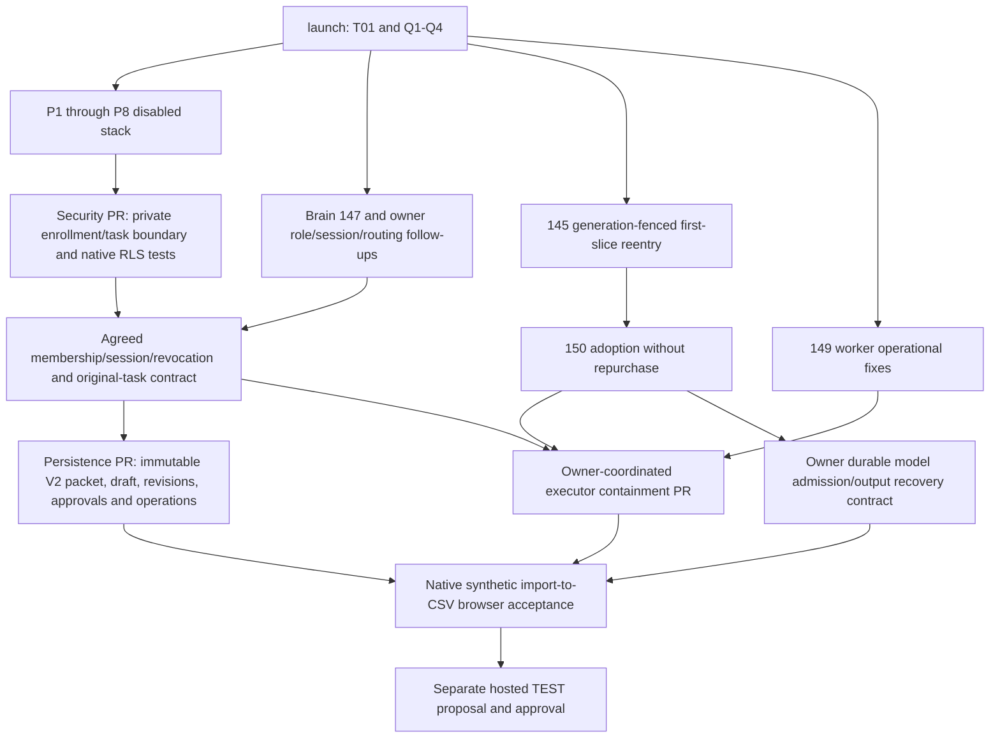

# Outbound Outpost production-readiness control sheet

**Phase 0 complete; customer readiness FAIL. P1–P8 disabled; A7 NO-GO.**
This workstream closes security/persistence gates, not new prospecting or send
features. The latest user request permits disposable local SQL; hosted SQL,
deployments, merges, paid calls and customer operations remain unauthorized.

## Pinned baseline and ownership (2026-10-22)

| Work | PR | Exact inspected head | State / dependency |
| --- | --- | --- | --- |
| P1 auth/signed binding | #124 | `2ffd6f6cfebba8279bcca87f75ad6d2406117a2d` | draft, base launch |
| P2 selection/memory/cache | #134 | `990efdfcd098cd35f51bdeb830aab1b5411b1ea7` | draft, on P1 |
| P3 preview | #139 | `b04cef42bb512ee25fc2ef5dd45df4d9e93b4e80` | draft, on P2; no durable import/task bridge |
| P4 model policy | #140 | `a5630119df1abffb7d6e7cb7f7a3161aba1bb25e` | draft, on P3; injected accounting interface only |
| P5 context/evidence | #142 | `2eea47a3d3f5b99c987e930f89168d330d02af8a` | draft, on P4 |
| P6 briefing | #143 | `3f5c9b0b374021727840b0f64be01e806bbcf282` | draft, on P5 |
| P7 review/CSV | #146 | `a8d66ac8192bd0db1105c63c0f735c79caf6ba0a` | draft, on P6 |
| P8 V2 replay/audit | #148 | `629c891af95a9c715493618ee373fef39c8781d3` | draft, on P7; this security branch starts here |
| launch | — | `8b0e2b6bdb20d6fe30542da39f0170d514d52746` | includes T01 #131 and Q1–Q4 #141 |
| E01 receipts | #144 | `385173fe5a269f1b617a3ed29b75f707c08a7a96` | backend owner; evaluator only |
| first-slice recovery | #145 | `37b3b1ac165111be8a45020a0359c0365f78dea5` | backend; run-agent, generation/fencing |
| Brain consistency | #147 | `2a6e1dcfac0ab93106c1439e3f06eaf33e6e04dd` | Brain owner; only audit typing changed since P8 tested head |
| worker operations | #149 | `c704f9286e934cfc26680a5607141ce35d357065` | backend; worker/core/planner/refusal |
| adopted purchase reuse | #150 | `be625f46a5e8c63759ccdfd6e7d8612bfdb8ae86` | **on #145**, not independent launch patch |

Reviewed every P1–P8 PR contract, pilot modules, P8 report, proposed storage and
empty rollback SQL, native acceptance plan and relevant PR bodies/diffs/comments.
Open PRs are not assumed merged, installed or deployed. Existing local Supabase
containers belong to another environment and must not be used or changed.

## Overlap and handoffs

- Backend owns `run-agent/index.ts`, worker/core/fencing, admission/credit/vendor
  recovery and qualification. #145/#150 and #147 both touch run-agent. Do not
  patch those files independently. #150 explicitly lacks model operation replay
  keys: caps hold, but a recovered slice can rerun planning. This is a dependency,
  not a pilot-specific ledger to invent.
- Brain owns canonical read/write/normalization, onboarding, `Auth.tsx` routing,
  shared memory/context and workspace permissions. #147 admits membership-only
  Brain writes and unfiltered login routing; role-aware/direct-API changes need
  that owner's contract. No competing Brain writer or user-role registry.
- Pilot owns disabled CSV/context/brief/review modules and new private storage
  proposals. Reuse P1 HMAC verification and `workspace_members` owner/admin roles;
  native constraints/policies supplement them, never replace them.
- T01 transport remains the one completion validator. Q1–Q4 remains the one
  qualification authority. CSV approval is neither verification nor dispatch.

## Dependency graph and safest implementation order

1. Prove a disabled private ownership/session boundary in a disposable local
   PostgreSQL+PostgREST stack. No public application writes or feature enablement.
2. Obtain the two owner contracts before shared authorization, executor or
   ledger edits. Native identity metadata alone cannot close these gates.
3. Implement persistence as a separate draft PR on the security contract. Atomic
   multi-task operations/revisions/exact approvals, V2 canonical bytes and source
   references; crash/restart tests use independent native connections.
4. Executor containment is a separate owner-coordinated PR, early on every direct,
   service, worker, kickoff, checkpoint/resume, scheduler and repair path.
5. Existing-ledger model operation keys and accepted-output recovery are backend
   dependencies; do not reset/recreate attempts to recover lost output.
6. Native browser integration follows durable import/task creation and all prior
   gates. Hosted TEST plan only after local end-to-end passes.

## Consolidated acceptance checklist

PASS requires the stated proof at the **exact combined SHA**. Unrun/unavailable
proofs count as FAIL for customer readiness, even if a narrower local test passes.

| ID | Phase / criterion | Type | Current evidence / verdict |
| --- | --- | --- | --- |
| B0 | reviewed stack, dependency/owner map, one-client invariant | docs | PASS phase 0 |
| S1 | one immutable client per workspace; private composite task/client ownership | migration + native tests | PASS native identity foundation; not enabled |
| S2 | anon/viewer/foreign/shared-member direct-API isolation; effective grants | migration + actual PostgREST | private PASS; **public task API FAIL**, native viewer probe HTTP 200/1 row |
| S3 | current owner/admin membership, live original session, expiry, deleted/revoked session and malformed claims | migration + auth integration | DB predicates PASS; GoTrue/browser/epoch integration still FAIL |
| S4 | immutable public task ownership or permanent invalidation after reassignment; native relational parents | migration + backend coordination | scoped native owner guard PASS; owner acceptance and broader artifact parents still gates |
| S5 | role-aware Brain writer/RLS and workspace-filtered login/context | migration + Brain application | FAIL; Brain-owner handoff |
| D1 | frozen Brain/source V2 JSONB roundtrip, insert-once, no recapture | migration + adapter | FAIL native; P8 offline PASS |
| D2 | atomic drafts/revisions/edits/approvals/revocation/operations, exact CSV versions | migration + adapter | FAIL native; P7 offline PASS |
| D3 | concurrent identical/different operations, two-task rollback, crash/lost ACK, no stale approval revival | native connections + process tests | FAIL not run |
| X1 | all legacy/direct/service/worker paths enforce original pilot scope before effects | backend application | FAIL; coordinate #145/#149/#150 |
| F1 | one existing ledger for model/provider attempts, uncertainty holds and accepted output | backend + transactional integration | FAIL pilot-native recovery; #150 is vendor adoption, not model replay |
| F2 | <=4 runtime attempts, $0.05 model/$0.20 provider/$0.25 total; review/export cost zero | existing admission + native race/crash tests | FAIL native combined; offline PASS |
| E1 | native import/task creation through reviewed CSV export, synthetic only | frontend + native backend | FAIL; P3 persists nothing today |
| E2 | two clients/different workspaces, shared user, session switch, revoked roles, tabs, concurrency | native + browser | FAIL native; offline PASS |
| I1 | Q1–Q4/T01/Brain/recovery exact combined integration and full CI/mutations | coordinated integration | FAIL combined; old P8 compatibility is narrower |
| H1 | approved hosted TEST, deployment order/rollback, synthetic acceptance | operations | FAIL not authorized; only after local gates |

Two clients in **one** workspace is a negative test: reject enrollment B for an
already-bound A workspace. It does not authorize replacing the initial one-client
boundary or allowing workspace-scoped Brain/memory to mix clients. Supporting
multiple clients inside one workspace is a separate architecture/ownership change.

## Migration / application split and approvals

Security identity/RLS and persistence require held migrations + disposable local
proofs. Existing public-table ownership constraints and Brain policies require
owner coordination and data preflight. Executor guards/adapters/cache/routing are
application changes; durable recovery usually needs both application and existing
ledger transaction work. Keep these in independently reviewable draft PRs.

Local disposable SQL and mocks are authorized by the current request. No hosted
migration, merge, deployment, paid call, real data, communication, or cross-owner
implementation without coordination. Schema proposals remain held; no active
migration runner picks them up. A native RLS pass is not production readiness.

Phase 1's exact proof scope, defect/root cause, remaining public-API bypass and
rollback are in [the native-security receipt](phase-1-native-security.md).
