# Six requested workflows: expected versus actual

No real customer data or live third-party workflows were accessed. “Actual” below means traced implementation plus explicitly named offline executions, not a fabricated integrated run. The source/target adapters are absent, so testing a proposed Apollo/iGTM transport would test invented application behavior. No workflow meets LIVE VERIFIED.

| Workflow | Expected path | Actual implemented path / missing links | E2E status | Realistic demonstration today |
|---|---|---|---|---|
| 1 Apollo enrichment | Saved Apollo lead → research → ICP → buyer intelligence → approved update | No Apollo import or write-back. Internal selected `lead_candidates` can enter `research_company`; qualification remains defective; no external ID/version or destination receipt | NOT IMPLEMENTED end to end; internal components reusable | Synthetic internal research demonstration only. No live Apollo demonstration established |
| 2 Caller preparation | Existing Apollo contact → correct Brain → Atlas research → Mirea/Mira call brief → caller | Brain/context, selected-row research and grounded opener components exist. No import adapter, dedicated structured call-brief action or iGTM caller handoff | PARTIALLY WORKING components; live UNVERIFIED | Best first pilot after bounded export/import + call-brief schema + approved data/model access. Today: offline component demonstration, clearly labeled |
| 3 Disposition follow-up | iGTM event → contact match → client context → chosen model → draft → approval → existing system | No event adapter/contact map/disposition history. Generic draft policy ignores user model; shared memory can mix clients; approval dispatch can fail irrecoverably; no destination connector | NOT IMPLEMENTED; component defects block dependence | Synthetic event specification and existing draft controls can be shown. Do not advertise live call-outcome automation |
| 4 Campaign reporting | Apollo + iGTM activity → reconciled metrics → intelligence → client report | Dashboard counts and recruiting placements exist; no source activity ingestion, campaign identity, metric definitions or external reconciliation | NOT IMPLEMENTED for Outpost | Static example report with synthetic facts only; no claimed real conversion/reply/call metrics |
| 5 Multi-client operations | A/B separate ICP, rules, credentials, models, reports | One Brain per workspace; first workspace auto-selected; no outbound client binding within workspace. I01 proves loader membership isolation at mocked DB boundary; I02 proves same-workspace draft exposure | BROKEN if modeled as multiple clients in one workspace; multi-workspace live isolation UNVERIFIED | Show two isolated synthetic workspace contexts. Do not demonstrate safe agency switching as completed product |
| 6 Model selection | Same task → selected approved provider → normalized output → usage/persisted policy | Builder persists model label; generic task uses TASK_MODELS/fixed Haiku. OpenAI preference still invokes mocked Anthropic. No Gemini text adapter; callback telemetry works for declared helper fallback; durable live persistence unverified | BROKEN selection; providers IMPLEMENTED / NOT LIVE VERIFIED | Show offline transport receipts honestly. No live selectable three-model demo |

## Workflow 1

Actual current path:

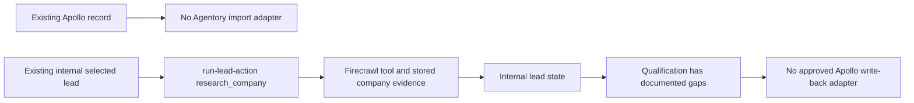

Proposed future flow — not implemented:

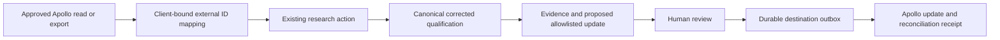

## Workflow 2

Actual current path:

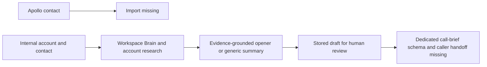

Proposed first pilot — not implemented as a complete workflow:

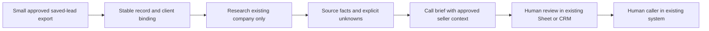

Avoid net-new discovery and contact purchases. An incomplete qualification result must remain UNKNOWN; a useful fact-only call brief need not claim the account is qualified. Separate approval for real data and any model/provider operation is still required.

## Workflow 3

Actual current path:

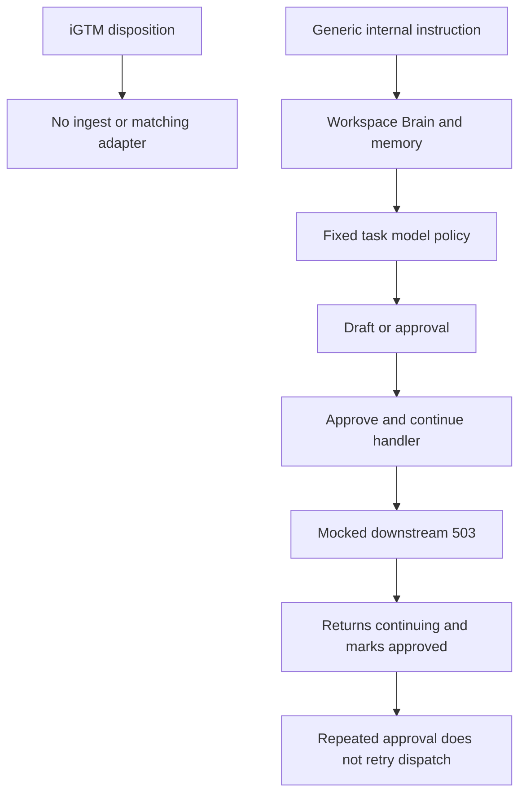

Proposed future flow — not implemented:

```mermaid
flowchart LR
  A[Signed event or approved export] --> B[Durable inbox and dedupe]
  B --> C[External contact and client matching]
  C --> D[Disposition ordering and suppression]
  D --> E[Approved model and context snapshot]
  E --> F[Grounded follow-up draft]
  F --> G[Human approval]
  G --> H[Durable outbox to existing system]
  H --> I[Remote receipt and reconciliation]
```

A01 executes the real approval handler with a synthetic auth/PostgREST network and a downstream 503. It proves false continuation and lack of retry through repeated approval, not failure of every possible background recovery path. No real iGTM event semantics have been tested.

## Workflow 4

Actual current path:

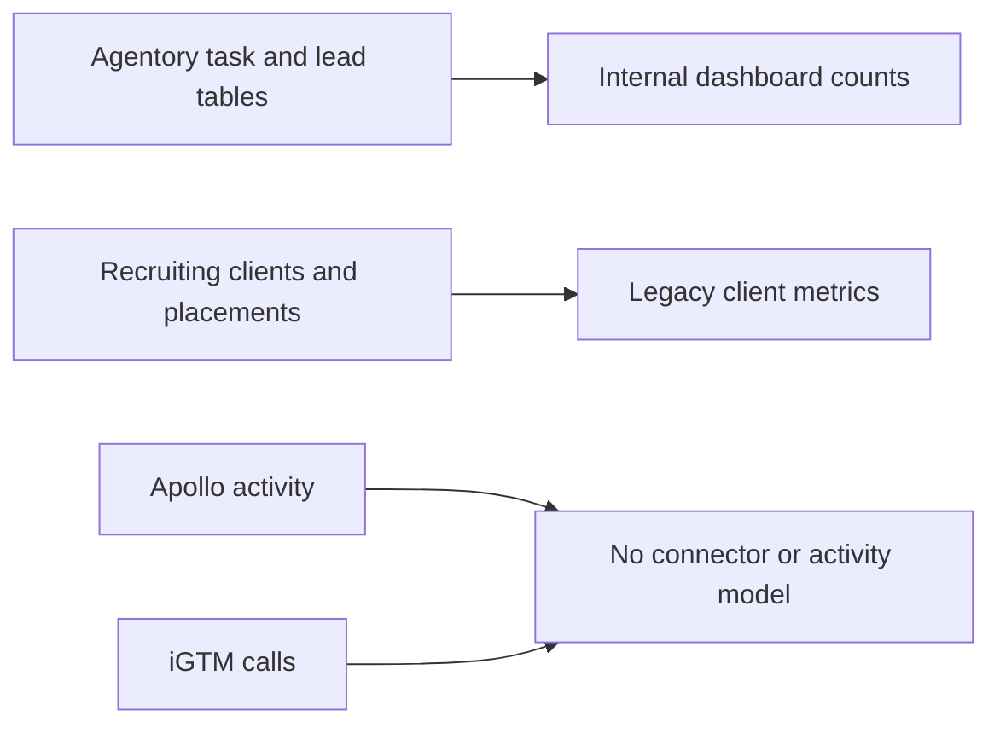

Proposed future flow — not implemented:

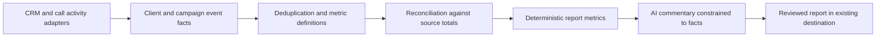

Use deterministic denominators and counts. Keep a reached-contact denominator distinct from attempted dials; reply events distinct from open pixels. Do not ask the model to invent missing activity totals.

## Workflow 5

Actual current path:

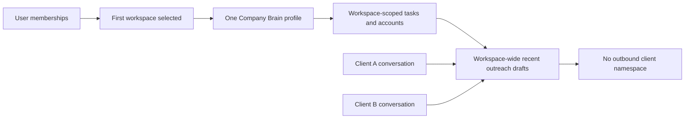

Proposed initial boundary — not implemented as usable agency switching:

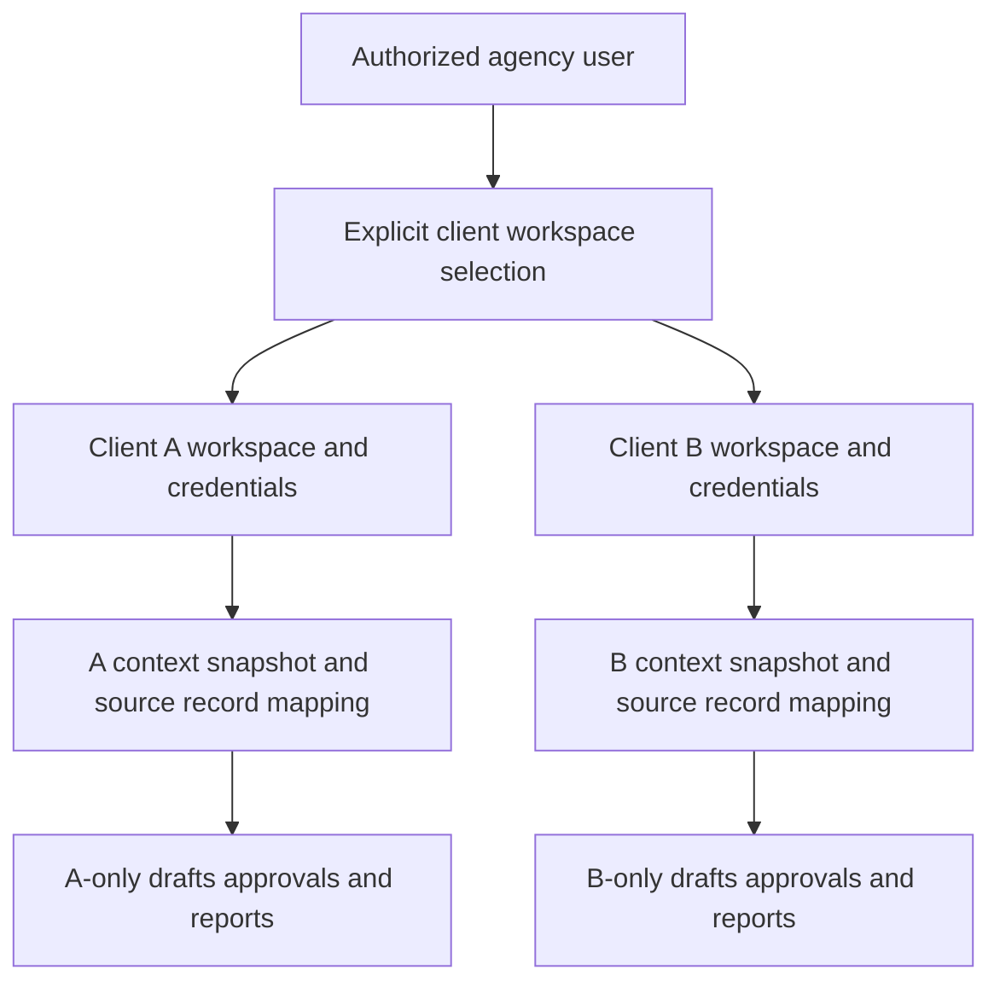

Workspace-per-client reuses current isolation rather than adding a second tenancy engine. Membership, explicit destination selection, connector credentials and job scopes still need end-to-end tests. Separate workspaces alone do not fix user-scoped legacy email/calendar data or absent workspace-selection UX.

## Workflow 6

Actual current path:

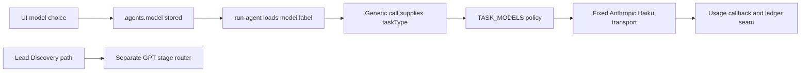

Proposed future flow — not implemented:

```mermaid
flowchart LR
  A[Permitted client task policy] --> B[Server model capability validation]
  B --> C[Budget and data-sharing authorization]
  C --> D[Task stores policy and context version]
  D --> E[Selected provider adapter]
  E --> F[Common typed result and evidence validator]
  F --> G[Actual model usage and request receipt]
  G --> H[Persisted output and approved handoff]
```

Official provider schema support does not establish application output equivalence. Test each adapter with identical evidence, refusals, truncation, outages and selected-provider assertions before separately authorized live comparisons.
