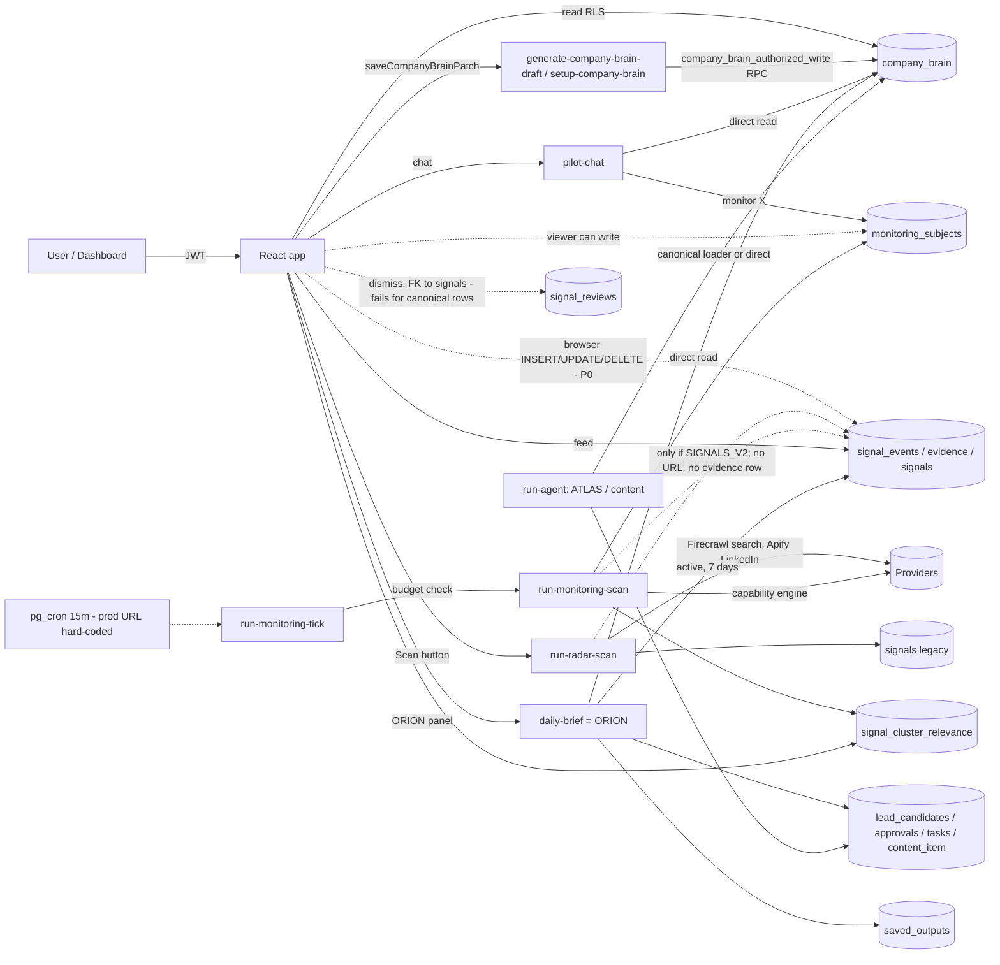
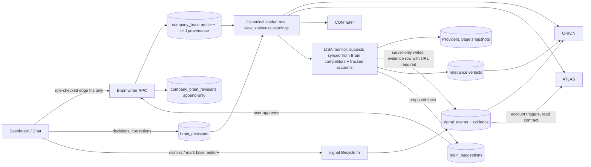

# Company Brain & LISA — Audit, Architecture Review, Completion Roadmap

Date: 2026-11-09 · Branch audited: `claude/agentory-audit-roadmap-64uq8n` @ `ee45898` (= `launch/hardening` HEAD)
Method: code-path tracing, migration/policy reading, 1,249 existing offline tests, 11 new local probes
(`scenarioProbes.test.ts`, fictional data, no network), and **catalog-only** reads of the TEST
project `tlvnfrxzjhsjgdofwehb` (function list, migration list, table row counts, `pg_policies`,
`pg_proc`, `pg_constraint`, `cron.job`). No row data was read anywhere. Production
(`ohsdatpvfdjdemstoiuj`) was not touched. No paid calls, no deploys, no migrations.

Status legend: **F** implemented + offline-tested · **U** implemented, not verified end-to-end ·
**P** partial · **M** missing · **B** broken (exists but cannot work as intended).

---

## 0. Five things you need to know first

1. **There is no LISA in the product.** The product registry (`src/config/agentRegistry.ts`) calls the
   signals agent **Lyra** ("AI Signal Scout", backend slug `scout`) and the content/message agent
   **Mira** (`penn`). Only the landing page (`src/components/landing/employees.ts:15-22`) says
   "LISA = signals, LYRA = content", and it does that by renaming the `mira` portrait. Your brief uses the
   landing-page names; the dashboard, chat and dock use the registry names. This must be decided before
   any LISA UI work.
2. **"LISA" is two disconnected signal stacks**, not one agent:
   - **Radar** — `run-radar-scan` (button on `/signals`): Firecrawl web search + Apify LinkedIn
     posts/comments/people → legacy `signals` table, dual-written to `signal_events` only when `SIGNALS_V2` is on.
   - **Monitoring** — `run-monitoring-scan` + `run-monitoring-tick` + pg_cron: `monitoring_subjects`
     → the shared lead capability engine → `signal_events` (only when `SIGNALS_V2` is on; otherwise
     every write is refused with `flag_disabled`, `signalsV2Writer.ts:401`).
   They use different "what to watch" configs (`company_brain.profile.signal_preferences` vs the
   `monitoring_subjects` table) and nothing syncs them.
3. **None of the Brain-write or LISA functions are deployed on TEST.** TEST has exactly three functions:
   `lead-pipeline`, `provider-connections`, `daily-brief`. `company_brain` has **0 rows** on TEST,
   `monitoring_subjects` 0, `signal_event_evidence` 0, `signal_reviews` 0, `signal_cluster_relevance` 0,
   `signal_events` 4. So the ORION V1 verification on TEST ran with **no Company Brain** and no LISA output.
   TEST is also missing the Brain write-hardening migrations (`20261023…`, `20261024…`): browser
   insert/update policies on `company_brain` still exist there and `company_brain_authorized_write` does not.
4. **The repo still says TEST = production.** `src/lib/env/projectEnvironment.ts` and
   `scripts/verify-deploy-target.mjs` map both `test` and `production` to `ohsdatpvfdjdemstoiuj`, and
   `docs/SUPABASE_TARGETING.md` warns that `npm run supabase:test` reaches production. The real TEST
   project is only referenced by the discovery-worker CI workflows.
5. **Any workspace member — including a viewer — can write signal evidence from the browser.**
   `signal_events`, `signal_event_evidence` and `signals` have member INSERT/UPDATE/DELETE RLS policies
   (baseline schema lines 10464-10587; confirmed live on TEST via `pg_policies`; no later migration removes
   them). ORION trusts these rows and adds +10 "verified by the data provider" when
   `verification_status = 'provider_verified'`. This is the same hole that was closed for
   `company_brain` in `20261023120000`, left open for signals. **P0.**

---

## Part 1 — Company Brain

### 1. Components (file → purpose → status → evidence)

| Component | Path | Status | Evidence |
|---|---|---|---|
| Storage | `public.company_brain` (one row per workspace; `profile jsonb` + legacy columns) | F | baseline schema; RLS select by membership |
| Browser write lock | `supabase/migrations/20261023120000_company_brain_server_writes_only.sql` | F in repo, **absent on TEST** | TEST `pg_policies` shows `member_insert`/`member_update` |
| Authorized writer RPC | `20261024120000_company_brain_authorized_writer.sql`, `_shared/brainWriter.ts` | F in repo, **absent on TEST** | TEST `pg_proc` has no `company_brain_authorized_write` |
| Write handlers | `generate-company-brain-draft` (update / save_draft / activate), `setup-company-brain` | U | only these two call `authorizedBrainWrite`; not deployed on TEST |
| Role rule | `_shared/brainRole.ts` (owner/admin/editor edit; owner/admin activate) | F | `brainRole.test.ts`, `brainRoleParity.test.ts` |
| Schema / normalizer | `src/lib/companyBrainSchema.ts`, `_shared/normalizeCompanyBrain.ts` (V2) | F | `normalizeCompanyBrain.test.ts` |
| Compiler / canonical loader | `_shared/companyBrainCompiler.ts`, `_shared/getCompiledCompanyBrainForWorkspace.ts` | F, **but bypassed** | only `intelligence/missionContext.ts` uses it; 13 other sites read `company_brain` directly (list below) |
| Origin-aware save / refresh diff | `_shared/companyBrainOriginSave.ts`, `companyBrainRefreshDiff.ts`, `companyBrainSourceRole.ts` | F | user edits authoritative; automated refresh fills empty fields only, else suggestion/conflict |
| Update projection | `_shared/companyBrainUpdate.ts` (recomputes legacy `icp.*` mirror and `signal_preferences`) | F | `companyBrainOneTruth.test.ts` |
| Prompt block | `_shared/companyBrainContext.ts` `renderCompanyBrainBlock` | F | used by `run-agent`, `daily-brief` |
| Content block | `_shared/contentBrainContext.ts` `renderContentBrain` | F | used by `run-agent` |
| Gate when missing | `_shared/companyBrainGate.ts` | F | `pilot-chat` imports `readinessGate`, `shouldGateForOnboarding` |
| "Memory" | `_shared/memoryReader.ts` | P | conversation-scoped leads/drafts/saved_outputs, **not** Brain knowledge |
| Frontend | `src/pages/CompanyBrainDashboard.tsx`, `OnboardingCompanyBrain.tsx`, `src/components/company-brain/*`, `src/hooks/useCompanyBrain.ts` | U | browser reads `company_brain`; writes via `saveCompanyBrainPatch` → edge function |
| Per-client Brains (agency) | `supabase/migrations-held/20261024160000_client_company_brain.sql` | Held, not applied | `migrations-held/README.md` |

Direct `company_brain` readers that bypass the canonical loader: `setup-company-brain:143,157`,
`run-radar-scan:246`, `run-agent:1741`, `run-monitoring-scan:169`, `pilot-chat:934,1930,3605,4325`,
`daily-brief:153`, `generate-company-brain-draft:219,456,494`, `_shared/executiveBriefContext.ts:190`,
`_shared/leadActionExecutor.ts:522`, `_shared/leadPipeline/brainContext.ts:85`, `orchestrate:868`.
All are workspace-scoped (no exposure found), but each re-derives its own view: the radar reads legacy
`icp.*` + `signal_preferences`, ORION reads `normalizeCompanyBrain` + legacy helpers, monitoring calls the
compiler directly. That is the drift risk the loader's own header forbids.

### 2. What the Brain knows

| Item | Status | Where / why |
|---|---|---|
| Name, website, industry, description | F | `company.*` |
| Products & services | P | only `positioning.offer`, `use_cases`, `pricing` free text; no product catalogue |
| ICP | F | `target_customer.*`, `buyer_personas`, `disqualifiers`, `qualification_rules` |
| Geography | F | `target_customer.geography` |
| Company size & segments | F | `company_size {min,max}`, compiled `segments` |
| Competitors | P | list of name strings; not linked to `monitoring_subjects`; ORION matches by exact name |
| USPs | U | `positioning.differentiators`, `proof_points` |
| Business objectives | P | `goals.*` stored; ORION reads one goal and **never uses it in ranking** (probe) |
| Brand voice & messaging | F | `brand_voice.*`, `positioning.avoid_positioning`, `do_not_say` |
| Existing customers / relationships | M | only `positive_examples` strings |
| Historical decisions & preferences | M | `approval_rules` / `workflow_preferences` are static settings, no decision log |
| Connected data sources | P | `integration_status` map; `workspace_sources` table (0 rows on TEST) |
| Agent-generated discoveries | M | no agent can write the Brain; the two writers are human-authorized only |
| Human corrections | F | `update` path, CAS on `updated_at`, role check, refresh conflicts |
| Persistent operational memory | P | conversation memory only (`memoryReader.ts`), capped at 6 KB |

### 3. Memory architecture — honest answers

| # | Question | Answer |
|---|---|---|
| 1-2 | What / where | One JSONB document per workspace in `company_brain.profile`. That is the whole Brain. |
| 3 | How updated | Whole-profile replace via `company_brain_authorized_write` (CAS / insert / upsert), from two edge functions, by owner/admin/editor. |
| 4 | How agents read | Each function reads the row itself (13 sites) and renders a prompt block; leads use the canonical loader. |
| 5 | Can agents add knowledge? | **No.** |
| 6 | Can users correct? | Yes, field edits; refreshes become reviewable suggestions. |
| 7 | Versioned? | **No.** `updated_at` is a CAS token; previous values are overwritten. Only `company_brain_research_runs` logs research inputs/outputs. |
| 8 | Sources & timestamps? | Brain-level `evidence.source_pages / linkedin_sources / confidence_notes` only. No per-field source, author or time. |
| 9 | Staleness? | **No** concept. |
| 10 | Conflicts? | Only at refresh time (diff marks `conflict`). Not persisted. |
| 11 | Workspace separation | Yes: RLS, membership checks in every handler, writer RPC locks session+membership. Probe A confirms ORION never mixes workspaces. |
| 12 | Memory types distinguished? | No. Profile vs conversation memory are separate systems; no fact/decision/preference types. |
| 13 | Decisions across sessions? | No (except lead verdicts in the ATLAS lead lineage). |
| 14 | Verified vs assumed? | Brain-wide `brain_confidence` (weak/partial/strong) and `is_draft`. Not per fact. |
| 15 | Keep stale/unsupported facts out? | Only "empty → don't fabricate" (`setup_required`, gates). Nothing ages out or is excluded for weak support. |

**Verdict:** Company Brain today is a well-guarded, single-document company profile with good write
authorization and honest empty-state behaviour. It is not shared memory: no history, no provenance per
fact, no agent contributions, no decisions.

### 4. Brain → agents

| Agent | Call path | Fields used | Tests | Gaps |
|---|---|---|---|---|
| ORION | `daily-brief/index.ts:153` → `executiveBriefContext.brainSnapshot` | company, description, ICP text, industries, competitors, missing fields | `executiveBrief*.test.ts`, `dailyBriefOrion.test.ts`, probes | goals ignored in ranking; competitor match exact name; industry match needs an `account_id` (monitoring events have none); never exercised on TEST with a Brain |
| ATLAS | `intelligence/missionContext.ts` → canonical loader; `leadPipeline/brainContext.ts` direct | full ICP, disqualifiers, qualification rules | many lead tests | owned by the ATLAS track; not audited deeper. No ATLAS → Brain write path. |
| Content (your "LYRA", product "Mira/Scribe") | `run-agent` → `renderContentBrain` | voice, proof, avoid, competitors-as-not-us, recent content | content tests | approved content does not feed ORION or the Brain |
| LISA radar | `run-radar-scan:246` → compiler + `readPrefs` | signal_preferences, competitors, roles, industries, geo | `radar*.test.ts` | own field mapping |
| LISA monitoring | `run-monitoring-scan:169` → compiler | ICP for `icp` subjects; relevance context (offer, ICP, roles, disqualifiers) | `monitoring*.test.ts`, `signalRelevanceJudge.test.ts` | Brain `competitors` never become monitoring subjects |

---

## Part 2 — LISA

### 5–6. Capability matrix → see Section B below. Key evidence

- **Sources.** Radar: Firecrawl `/v2/search` (hiring, LinkedIn-intent, competitor, workflow-trend queries)
  and Apify LinkedIn posts/comments/people adapters (`radarIntel/radarProviderAdapters.ts`). Monitoring:
  whatever the shared capability engine routes (Apify actors via `actorRegistry`), for five event kinds only:
  hiring, funding, expansion, product_launch, headcount_change (`canonicalSignalEvent.ts:51`).
- **Active discovery.** Yes in both stacks (radar on button press; monitoring on demand or cron).
- **Continuous.** `run-monitoring-tick` every 15 min via `20260825140000_monitoring_cron.sql`, which
  hard-codes the **production** URL. No cron on TEST; tick/scan not deployed on TEST. Production state not inspected.
- **Choosing accounts/competitors.** Only by chat ("monitor X" → `monitorSurface.executeMonitor`) or
  radar preferences in the Brain. No settings UI lists or edits `monitoring_subjects`.
- **Website/pricing/tech change detection.** **Missing.** No snapshot table, no diff. (`competitor_profiles`
  has pricing columns but is a legacy user-scoped table with 0 rows on TEST and no current writer.)
- **New vs repeated.** The canonical key is `subject_type|subject_key|signal_type`
  (`canonicalSignalEvent.ts:41`) and the writer uses `ignoreDuplicates`. A competitor's Series B after its
  Series A **gets the same key and is silently dropped**; the old row stays. (Probe D/dedupe.)
- **Source evidence.** Radar rows carry `source_url`. Monitoring events carry **no `source_url`**, are always
  `unverified`, accept `plausible` verdicts, and write **no** `signal_event_evidence` row — only engine
  `evidence_ids` inside JSON (probe B; `signal_event_evidence` = 0 on TEST).
- **Timestamps.** Good: `occurred_at` + `occurred_at_basis` (source_reported / unknown) + `observed_at`, enforced by CHECKs.
- **Contradictions.** Lifecycle values `contradicted/superseded/retracted/dismissed` exist in the CHECK but
  **no code ever sets them**.
- **Relevance.** `signalRelevanceJudge.ts` (model may only demote; table CHECK enforces it) stored in
  `signal_cluster_relevance` with `why_now`/`why_it_matters` and cited event ids. **ORION does not read this table.**
- **Dismiss / correct.** `signal_reviews.signal_id` has an FK to the legacy `signals(id)` (confirmed live on
  TEST). The feed passes `signal_events.id` for canonical rows (`signalEventProjection.ts:72`), so
  **saving or dismissing any canonical (monitoring) signal fails the FK**. Reviews are per-user and never
  change `lifecycle_status`, and ORION never reads them (probe D) — a dismissed false claim keeps appearing in the brief.
- **Cost control.** Tick: workspace budget (default 200 credits / 7 days of `monitoring_call`), tick passes
  `max_candidates: 3`, hard cap 25. Radar: scan budget + credit authorization per search. Gaps:
  (a) model spend (GPT discovery planner, per-company evaluation, relevance judge) is not in the budget;
  (b) the user path of `run-monitoring-scan` checks membership only — any member, any role, no budget
  check, up to 25 candidates per call; (c) `monitoring_subjects` is browser-writable by viewers, so a viewer
  can schedule unattended spend (bounded by the credit budget).
- **Notifications.** None. `signal_events` is in the realtime publication, so the open feed updates live.

### 7. Intended LISA workflow — what works today

| Step | Today |
|---|---|
| 1 Read Brain | Works (both stacks, own mappings) |
| 2 Decide accounts/competitors | Partial — manual chat subjects; Brain competitors ignored by monitoring |
| 3 Monitor sources | Works in code for 5 event kinds; never run on TEST |
| 4 Detect new/changed | Partial — first occurrence only; no page diffs |
| 5 Verify & dedupe | Partial — over-dedupes repeat events; monitoring always `unverified` |
| 6 Relevance & confidence | Works in code (model demote-only) |
| 7 Save evidence-backed signal | Partial — no URL/evidence row for monitoring events |
| 8 Dashboard | Works (feed + situations + relevance) |
| 9 Supply ORION / ATLAS | ORION reads raw active events (no relevance, no reviews); ATLAS: monitoring reuses lead evidence, not the reverse |
| 10 Update Brain via approval | Missing |

---

## Part 3 — Architecture

### Diagram A — actually implemented (solid = code path exists; `-.->` = exists but unverified on TEST or broken)



Not connected at all: `signal_reviews` → ORION, `signal_cluster_relevance` → ORION, any signal → Brain,
Brain competitors → `monitoring_subjects`, radar preferences ↔ monitoring subjects.

### Diagram B — recommended (not implemented)



### 9. Scenarios (local probes, fictional data — `scenarioProbes.test.ts`, 11/11 pass)

| Scenario | Result |
|---|---|
| **A** onboarding / isolation | **Passes in code.** ORION context for workspace A excludes B's Brain and signals; loader returns `forbidden` for non-members. Not verifiable on TEST: Brain functions not deployed, 0 Brain rows, and TEST still allows browser Brain writes. |
| **B** competitor funding | **Partially passes.** A monitoring competitor-funding event reaches ORION and gets "a competitor you track" — but only if the stored name exactly equals the Brain string ("Rivalco Inc." vs "Rivalco" fails). The event has no source URL, is `unverified`, may be only `plausible`, and a *later* funding round would be dropped as a duplicate. |
| **C** ICP change | **Passes for reads.** The Brain is compiled on every call, so the next radar scan, monitoring pass or ORION brief sees the new ICP. Caveats: existing signals and relevance verdicts judged against the old ICP are not re-judged; in-flight ATLAS missions are the ATLAS track's concern. |
| **D** incorrect intelligence | **Fails.** No lifecycle transition is ever written; dismissing a canonical signal fails the FK; reviews are per-user; ORION ignores reviews. A false claim stays in the brief until it ages out of the 7-day window. |
| **E** missing Brain | **Passes (honest).** Canonical Brain empty with `setup_required`; ORION marks the Brain unusable and says relevance is estimated; monitoring refuses an `icp` subject ("would watch every company"); chat gates. |

---

## Part 4 — Findings by priority

**P0**
1. `signal_events`, `signal_event_evidence`, `signals`: browser INSERT/UPDATE/DELETE for any member including viewers → forged "provider_verified" evidence reaches ORION; members can delete others' evidence. Cause: baseline member policies never hardened (live on TEST).
2. `monitoring_subjects`: browser INSERT/UPDATE/DELETE for viewers → unattended paid scans (bounded by the 200-credit/week default budget).
3. TEST is not a valid Brain test bed: Brain write hardening not applied (browser write hole open on TEST), and the repo maps "test" to the production ref. Anything "verified on TEST" about the Brain did not exercise the current write path.

**P1**
4. No LISA identity in the product (Lyra/Mira/Lisa naming conflict).
5. Repeated events dropped: dedupe key has no event instance.
6. Review/dismiss broken for canonical signals (FK → `signals`); no lifecycle transitions; ORION ignores reviews and relevance.
7. Monitoring events have no source URL / evidence row and are `unverified`.
8. `SIGNALS_V2` off → monitoring writes nothing; flag state on TEST/prod unknown.
9. Brain competitors not wired to monitoring; two configs for "what to watch".
10. `run-monitoring-scan` user path: no role check, no budget gate.
11. No Brain history; whole-document overwrite.
12. 13 direct Brain readers bypass the canonical loader.
13. Cron migration hard-codes the production URL; LISA functions never deployed to TEST.

**P2**
14. ORION ignores goals; exact-name competitor match; industry match requires `account_id`.
15. Model spend excluded from the monitoring budget.
16. No monitoring settings UI (subjects, cadence, budget).
17. No per-fact provenance, staleness or verified/assumed flag.
18. No notifications.
19. `plausible` verdicts become active signals with no confidence downgrade.

**P3**
20. Website/pricing/tech change detection; agent-proposed Brain facts; customer/relationship memory; per-client Brains (held migration); predictive signals.

---

## A. Company Brain completion matrix

| Capability | Status | Evidence | Missing work | Priority |
|---|---|---|---|---|
| Identity fields | F | `company.*`, normalizer tests | — | — |
| ICP / geo / size / segments | F | compiler + loader tests | — | — |
| Brand voice | F | `contentBrainContext.ts` | — | — |
| Human corrections | F | update path, CAS, refresh diff | — | — |
| Workspace isolation (reads) | F | RLS; loader membership; probe A | — | — |
| Role-checked writes | U | repo F; **TEST lacks migrations** | apply 2 migrations + deploy 2 fns to TEST | P0 |
| USPs | U | `positioning.*` | — | — |
| Products/services | P | free text only | structured offers list (optional) | P3 |
| Competitors | P | name strings | domains + sync to monitoring | P1 |
| Objectives | P | stored, unused in ranking | ORION ranking input | P2 |
| Connected sources | P | `integration_status` | — | P3 |
| Operational memory | P | conversation memory only | `brain_decisions` | P1 |
| Field provenance/timestamps | P | Brain-level evidence only | `_meta.field_sources` | P2 |
| Conflict handling | P | refresh-time only | persist suggestions/conflicts | P2 |
| Verified vs assumed | P | Brain-wide confidence | per-field flag | P2 |
| Single read path | P | 13 bypasses | route through loader | P1 |
| Versioning/history | M | none | `company_brain_revisions` in writer RPC | P1 |
| Decisions/preferences | M | none | `brain_decisions` + render in prompt | P1 |
| Staleness | M | none | per-section `confirmed_at` + warnings | P2 |
| Agent discoveries | M | no agent writer | `brain_suggestions` + approval | P2 |
| Customers/relationships | M | — | — | P3 |

## B. LISA completion matrix

| Capability | Status | Evidence | Missing work | Priority |
|---|---|---|---|---|
| Product identity "LISA" | M | registry has no LISA | naming decision + registry | P1 |
| Radar on-demand scan | U | `run-radar-scan`; not on TEST | TEST deploy | P1 |
| Scheduled monitoring | P | tick + cron; prod URL hard-coded; not on TEST | parametrize URL, deploy to TEST | P1 |
| Select competitors/accounts | P | chat only | settings UI + Brain sync | P1 |
| Funding / hiring / expansion / launch | U | 5 event kinds via capability engine | TEST run with recorded fixtures | P1 |
| Website / pricing change | M | — | page snapshots + diff | P2 (MVP-light) |
| Tech change | M | — | — | P3 |
| New vs repeated | P (over-dedupes) | key has no instance | instance-aware key; append evidence on duplicate | P1 |
| Source evidence | P | monitoring: no URL, no evidence row | write evidence with URL; require it | P1 |
| Timestamps | F | CHECK constraints | — | — |
| Contradictions | M | vocabulary only | lifecycle transitions | P1 |
| Workspace relevance + "why" | U | judge + table; 0 rows on TEST | feed to ORION | P1 |
| Dismiss / correct | B | FK → `signals` | new FK + server lifecycle fn | P1 |
| Suppress dismissed | P | per-user, legacy only | workspace-level suppression | P1 |
| Cost control | P | credit budget; model spend excluded; user path unbudgeted | include model $; role+budget on user path | P1 |
| Write authorization | B | browser-writable (P0) | server-only writes | P0 |
| Dashboard feed | U | `signalEventsFeed.ts` | — | — |
| Notifications | M | — | digest later | P3 |

## C. Cross-agent integration

| Connection | Implemented? | Tested? | Missing work |
|---|---|---|---|
| Brain → ORION | Yes (direct read) | Unit + probes; TEST only without a Brain | goals, competitor domains, canonical loader, TEST run with a Brain |
| Brain → ATLAS | Yes (canonical loader + direct) | Unit (extensive) | ATLAS track |
| Brain → content ("LYRA") | Yes (`renderContentBrain`) | Unit | approved content → future recommendations |
| Brain → LISA | Partly (ICP + radar prefs; competitors not monitored) | Unit | competitor/account sync |
| LISA → ORION | Partly (raw active events only) | Unit + probes | relevance, reviews, lifecycle, citations |
| LISA → ATLAS | Weak (monitoring reuses lead evidence; reverse not wired) | Unit for reuse | read contract for account triggers (coordinate with ATLAS) |
| LISA → Brain | No | — | suggestions + approval |

## E. Prioritised backlog (in order)

1. Server-only writes for `signal_events`, `signal_event_evidence`, `signals`, `monitoring_subjects` (migration mirroring `20261023…`; subject writes through an edge function with the `brainRole` rule). db-contract tests.
2. TEST parity: apply `20261023`/`20261024` to TEST; deploy the two Brain functions, `run-radar-scan`, `run-monitoring-scan`, `run-monitoring-tick` to TEST; set `SIGNALS_V2` on TEST; correct `CANONICAL_PROJECT_REFS.test` and `SUPABASE_TARGETING.md`.
3. Role + budget gate on the user path of `run-monitoring-scan`; count model spend in the budget.
4. Signal lifecycle: `signal_reviews.signal_event_id` (FK → `signal_events`), workspace-level server function `set_signal_lifecycle` (dismissed / incorrect→retracted / superseded) with an append-only transitions table; feed and ORION exclude non-active.
5. Event-instance dedupe for funding/launch/expansion (instance = funding round or source-date month + source fingerprint); duplicate observation appends an evidence row instead of being dropped.
6. Evidence: monitoring writes `signal_event_evidence` with `source_url`; no URL → not `active`; `plausible` → `confidence: low`.
7. LISA naming decision; update the registry.
8. Brain competitors (with domains) → proposed `monitoring_subjects`; a Signals settings panel for subjects, cadence and budget.
9. ORION: read `signal_cluster_relevance`, lifecycle, competitor match by `subject_key`/domain, goals as a ranking input, cite event id + URL per item.
10. Brain history (`company_brain_revisions` written inside the writer RPC) and `brain_decisions` (decision / preference / correction) rendered in the prompt block.
11. Route Brain readers through the canonical loader (non-ATLAS sites first).
12. Per-field provenance + staleness warnings.
13. LISA → Brain suggestions with approval (reuse refresh-diff UX).
14. Page snapshot + diff for pricing/homepage/changelog of tracked competitors.

## Part 5 — Roadmap

Estimates assume one engineer who knows this codebase, with ±30% uncertainty. The schema work is simple; the risk is
in TEST parity and in the coupling to the shared lead capability engine.

**Phase 1 — Brain foundations + P0 (≈10–14 days)**
- Files: new migrations (signal/subject write lock; `company_brain_revisions`; `brain_decisions`); `brainWriter.ts` + RPC (revision insert); `companyBrainContext.ts` (decisions block, staleness); `getCompiledCompanyBrainForWorkspace.ts`; non-ATLAS readers (`daily-brief`, `executiveBriefContext`, `run-radar-scan`, `run-monitoring-scan`, `pilot-chat`, `run-agent` content path); `projectEnvironment.ts`, `verify-deploy-target.mjs`; new `monitoring-subjects` edge handler.
- DB: 3 additive migrations. No data rewrite.
- Cost: none.
- Tests: db-contract lane (`tests/db-contract/bootstrap.sh`) for RLS (viewer cannot write signals or subjects; revision row per write); unit tests for loader parity; existing 1,249 tests stay green.
- Acceptance: a viewer JWT gets 401/403 on every signal/subject write; each Brain write leaves a revision; all non-ATLAS agents get the same compiled Brain; TEST has the hardened schema.
- Risks: frontend code that writes these tables directly (none found for signals; `monitorSurface` runs server-side).

**Phase 2 — LISA core pipeline (≈12–18 days, +5–7 for page diffs)**
- Files: `canonicalSignalEvent.ts` (instance key), `signalsV2Writer.ts` (append evidence on duplicate), `monitoringRunner.ts` (evidence + URL), new lifecycle function + migration, `signalReviews.ts` / `signalEventsFeed.ts`, a Signals settings UI, `monitoring_cron` parametrised per project, budget including model $.
- DB: `signal_reviews.signal_event_id`, `signal_event_transitions`, optional `monitored_pages` + `page_snapshots`.
- APIs: existing Apify/Firecrawl/OpenAI only. Page diffs: one Firecrawl scrape per page per cadence; the model runs only when the content hash changes.
- Cost: development on recorded fixtures costs nothing. Ongoing per workspace is bounded by the budget (default 200 credits/week). Daily scrapes of 10 pages ≈ 300 Firecrawl scrapes/month; check current provider pricing before enabling.
- Tests: fixture-driven monitoring end-to-end (`monitoringEndToEnd.test.ts` pattern); dedupe instance cases; lifecycle RLS in db-contract.
- Acceptance: Series A then Series B → two events; re-reporting A → one event with two evidence rows; every active monitoring event has ≥1 source URL; dismissing hides the event for the workspace and from ORION.
- Dependency: the capability engine is shared with ATLAS — changes stay in the monitoring port and the writer, not in the engine.

**Phase 3 — LISA ↔ Brain ↔ ORION (≈7–10 days)**
- Files: `executiveBriefContext.ts`, `executiveBrief.ts` (relevance, lifecycle, goals, citations), Brain competitor → subject proposal, `brain_suggestions` + approval via `generate-company-brain-draft` with origin `approved_refresh_suggestions`.
- Acceptance: the brief cites the event id + URL for every market item, explains which Brain facts raised its rank, and never shows retracted signals; an approved LISA suggestion appears in the Brain with a revision row.

**Phase 4 — Cross-agent acceptance on TEST (≈5–7 days)**
- Two fictional workspaces seeded on TEST; recorded provider responses; Playwright through dashboard and chat for scenarios A–E; then **one** capped live monitoring pass (`max_candidates: 3`), with your explicit approval because it costs money.
- Acceptance: all five scenarios pass on TEST; the full CI gate is green.

**Total:** roughly 34–49 engineer-days for the core, plus 5–7 days for page diffs.

### 13. Working loop
Change → focused `deno test` on the touched files (CI version 2.8.2) → db-contract lane for SQL →
`npm run dev` against TEST → fix → repeat. Push once per phase; CI stays the final gate.

## F. Readiness

**How the percentages are calculated:** each matrix row scores F = 1, U = 0.7, P = 0.35, M/B = 0, and the score is the mean across rows.

1. **Company Brain ≈ 45%** (matrix A, 21 rows: 5 F, 2 U, 9 P, 5 M → 9.55/21). The profile, authorization and honest fallbacks are solid; memory, history and provenance are missing.
2. **LISA ≈ 33%** (matrix B, 18 rows: 1 F, 4 U, 6 P, 7 M/B → 5.9/18). A lot of careful code exists, but it has never run on TEST, cannot be corrected, over-dedupes and has a P0 write hole.
3. **What works end-to-end (in code):** Brain onboarding/edit → chat, leads, content and ORION context; radar scan → feed; ORION brief (verified on TEST, but without a Brain or LISA data).
4. **Implemented but disconnected:** monitoring → ORION relevance; reviews → anything; Brain competitors → monitoring; LISA → Brain; the cron (production URL, not on TEST).
5. **Biggest architectural problems:** browser-writable evidence; two signal stacks with two configs; whole-document Brain with no history; 13 bypassing readers; TEST/production confusion.
6. **Build first:** backlog items 1–4.
7. **Possible locally:** everything except deploy/cron verification — migrations in the db-contract lane, fixture-driven monitoring, ORION ranking, UI against fixtures.
8. **Needs TEST:** RLS on the real schema, function deploys, cron + tick, `SIGNALS_V2`, the Playwright scenarios.
9. **Needs paid calls:** one capped live monitoring pass, radar searches, page scrapes, model relevance/evaluation.
10. **A truly working V1:** a viewer cannot forge or alter evidence; every Brain change is versioned and attributable; decisions persist; a user picks competitors and accounts in one place; LISA records each distinct event once, with a source URL and date; users can dismiss or retract a claim for the whole workspace; ORION ranks using Brain goals and LISA relevance, cites sources, and never shows a retracted claim — all shown on TEST through the normal dashboard and chat.

## Reproduce
```bash
deno test --allow-read --allow-env --no-check docs/audits/company-brain-lisa-2026-11/scenarioProbes.test.ts
```
