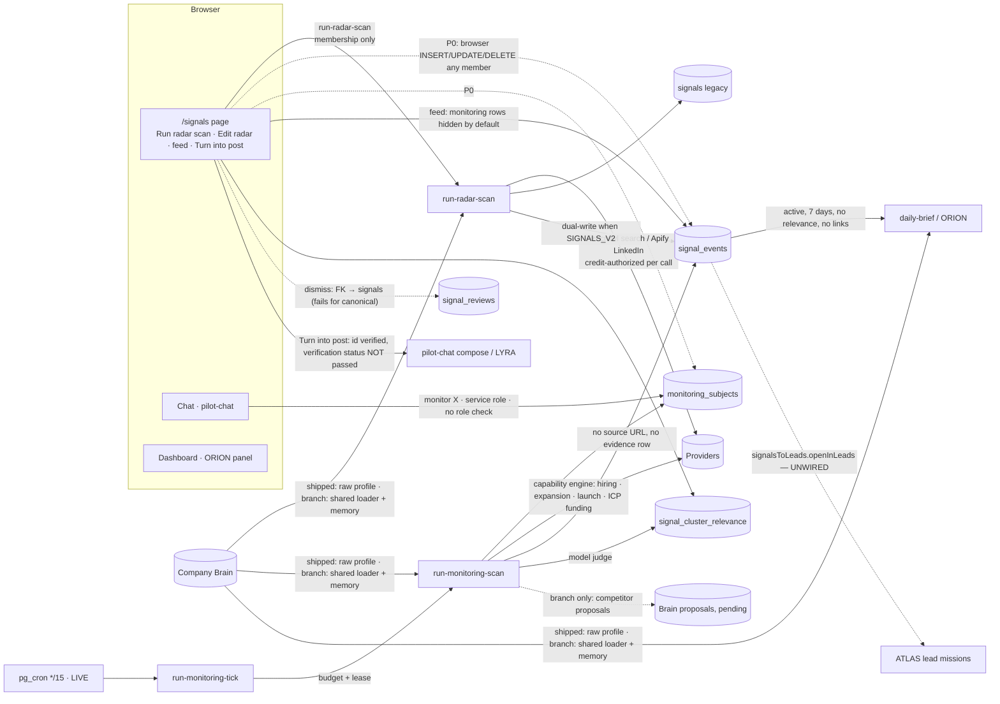

# LISA — complete product, architecture and capability audit

**Date:** 2026-11-10

**Branch audited:** `claude/agentory-audit-roadmap-64uq8n` @ `4644cb2c`. This is `launch/hardening` @ `b56c6570`, plus Company Brain V1 (`afa33cf6`), which is **unmerged, has no PR, and is not deployed**.

**Every finding is stated for two baselines:**
- **shipped**: `launch/hardening` and production;
- **branch**: what Company Brain V1 adds.

**Method:**
- Traced the code paths from the dashboard to the database.
- Ran the engine's own coverage probe for every signal category.
- Ran **9 offline probes** (`lisaProbes.test.ts`) and **12 database scenarios** (`lisaScenarios.contract.test.ts`) against real Postgres 17, PostgREST and supabase-js, using the real `run-monitoring-scan` and `run-monitoring-tick` handlers behind a gateway that refuses every non-loopback request.
- Read production *metadata and aggregates only* (`evidence-production-metadata.md`).

Nothing was deployed, scheduled, migrated or bought.

```bash
deno test --allow-read --allow-env --allow-run --no-check docs/audits/lisa-complete-audit-2026-11/lisaProbes.test.ts
```

```bash
PG_ADMIN_URL=… POSTGREST_BIN=… tests/db-contract/run.sh docs/audits/lisa-complete-audit-2026-11/lisaScenarios.contract.test.ts
```

Separately, the existing LISA unit suites (57 files, **647 tests**) all pass. They do not catch the defects below, because those defects live in grants, foreign keys, cross-module wiring and production configuration.

---

## A. Executive summary

**What LISA is supposed to do.** Watch the companies and markets that matter to a customer. Notice meaningful changes, keep the evidence, judge relevance against the Company Brain, and hand the results to ORION (attention), ATLAS (accounts) and LYRA (content).

**What it actually does today.**

1. **Radar scan (button on `/signals`).** Runs Firecrawl web searches and Apify LinkedIn actors, built from the Company Brain, for hiring, LinkedIn intent, competitor mentions, workflow trends and people. Results are stored in the legacy `signals` table, with a copy in `signal_events`. This is the part customers actually use; production holds 14 radar events and 21 legacy rows.
2. **Scheduled monitoring.** A 15-minute cron calls `run-monitoring-tick`, which calls `run-monitoring-scan` for watchlist entries (`monitoring_subjects`). That scan runs the shared lead capability engine for hiring, expansion, product launches and (ICP-wide only) funding. **It is live in production, but has produced zero signals in the last 30 days**: 5 ever, none with a source URL, no evidence rows, no spend and no model calls.
3. **Relevance.** A model judges each cluster of signals and stores a verdict ("why now / why it matters") that the Signals page shows. **ORION never reads it.**
4. **Hand-offs.**
   - LISA → LYRA works: "Turn into post" carries the signal into a draft, but does not say whether the signal is verified.
   - LISA → ATLAS exists only as an unused module.
   - LISA → Company Brain exists only on the unmerged branch.

**What works.** The radar scan end to end, with credit authorization per search. The canonical signal model, with timestamps, origin, subject and clusters. The scheduler's leasing and budget skip. A Brain-missing ICP watch is refused before any spend. Workspace isolation on reads. The "Turn into post" hand-off.

**What's broken.**
- **Any workspace member, including a viewer, can write signals and evidence directly from the browser.** They can forge a "provider-verified" funding round that ORION ranks higher, or retract real signals for the whole workspace (**live in production**).
- Viewers can add paid, unattended monitoring, and can run paid radar scans.
- Dismissing a monitoring signal fails, because of a foreign key to the wrong table.
- A competitor's second funding round is silently dropped as a duplicate.
- The Signals page **hides every monitoring signal by default**: they are classified "Legacy / Needs verification".

**What's missing.**
- For a *named* competitor, funding, pricing, website changes, acquisitions, leadership, partnerships, technology and announcements cannot be monitored.
- There is no watchlist UI, no frequency control, no scan history, no notifications and no cost view.
- Competitor discovery and contradiction handling don't exist.
- ATLAS collaboration isn't wired.

**Ready for real customers?** **No.** The radar is a usable on-demand tool for internal or pilot use once the P0 write hole is closed. Continuous competitor monitoring is not yet a product, and LISA as an "AI market-intelligence employee" is roughly a third built (see F).

---

## Identity and naming

The intended naming is **ORION = Executive, ATLAS = Leads, LYRA = Content, LISA = Signals**.

| Where | What it says today | Matches intended? |
|---|---|---|
| `src/config/agentRegistry.ts` (drives dashboard, dock, chat) | **Lyra** = "AI Signal Scout" (slug `scout`); **Mira** = messages (`penn`); **Orion** = executive, *and* legacy slug `scribe` (content generation) | ✗ signals is "Lyra"; content generation shows as Orion |
| `/signals` page (`src/pages/Signals.tsx`, `TodaysSignalBrief`, `ScoutCopilot`) | "monitored by **Lyra**", "Lyra added N signals"; eyebrow "Growth · Signals"; title "Company Brain Radar" | ✗ |
| Dashboard / workforce (`PilotBriefing.tsx`, `useWorkforceState.ts`, chat `EmptyState.tsx`, `AgentTypingIndicator.tsx`) | "Lyra found…", "Lyra · Checking signals" | ✗ |
| Landing `employees.ts` | **Lisa** = signals (re-labels the `mira` portrait); **Lyra** = content | ✓ |
| Landing `ProductLookalike.tsx` | "Lyra checks hiring signals" | ✗ (contradicts `employees.ts`) |
| Landing `TeamsAtWorkSection.tsx` | "Lyra drafted outreach" | ~ (outreach is Mira in product) |
| Backend slugs | `scout` (58 refs in functions), `signals_monitor` / "Signals Monitor" (monitoring ledger and activity), `hawk` (competitor inference) | internal; fine |
| Company Brain V1 (branch) | `lisa` = signals and `lyra` = content in proposals and agent views | ✓ intended, ✗ against the registry |
| Stored data | `tasks.agent_slug`, `activity_feed.agent_name`, `agents.slug` (`scout`, `scribe`, `penn`), `lead_execution_calls.execution_owner = 'monitoring'` | must not change |

**Recommendation (no renames done):**
1. Add a public id `lisa` to the registry with `legacySlugs: ['scout', 'signals_monitor']`.
2. Re-point public `lyra` to content, with `legacySlugs: ['scribe']`. Take `scribe` off Orion; Orion keeps the `daily-brief` surface.
3. Decide whether Mira (outreach messages) folds into Lyra or remains.
4. Change only display strings and the resolver. Backend slugs, task rows, ledger owners and function names stay as they are: the resolver already maps legacy slugs to public identities.
5. Add a registry test that pins slug → public identity, and replace hard-coded "Lyra" copy with `resolveAgent(...)`.

---

## B. Capability matrix

**Status key:**
- **F**: fully working (verified)
- **P**: partial
- **U**: implemented but unverified live
- **UI**: UI only
- **PL**: planned or vocabulary only
- **A**: absent

### Competitor discovery

| Capability | Status | Evidence | Missing work | Priority |
|---|---|---|---|---|
| Competitors from the company profile | P | User-entered Brain `competitors`. `competitorDiscovery.ts` only matches a **hard-coded list of 16 sales-tool vendors** (`competitorRegistry.ts`). Model inference runs only inside the chat "competitor engagement" flow (`run-agent:8937`, Hawk → Scout) and is never stored. | Inference from the Brain + website, stored as Brain proposals | P2 |
| Discover new competitors automatically | A | Nothing searches for new entrants. Branch: LISA only proposes competitors the team *already monitors* (`lisaBrainProposals.ts`). | Discovery job + proposals | P2 |
| Monitor known competitors | P | Only via chat "monitor X" → `monitoring_subjects`. Brain competitors are **not** synced to the watchlist. The radar "competitor" source is a web search on watchlist names. | Watchlist built from the Brain; UI | P1 |
| Direct vs indirect | A | Legacy `competitors.adjacent` is stored but unused | Classification | P3 |
| Compare by industry, size, geo, positioning | A | — | — | P3 |
| Recognise despite name or domain variants | P | Canonical `subject_key` slug. Branch: ORION matches normalised names and domains. | Entity resolution across radar and monitoring | P2 |
| Propose new competitors to the Brain | U (branch) | DB-verified: scenario 1, acceptance D | Merge; radar proposals | P1 |

### Competitor monitoring by signal (named competitor)

From the engine's own probe (`evidence-signal-collectability.txt`):

| Signal | Status | Evidence |
|---|---|---|
| Hiring | U | `hiring_verification` runs (Apify job actors); 0 production events in 30 days |
| Product launch | U | `product_launch_verification` runs; unverified live |
| Market / geographic expansion | U | `expansion_signal_verification` runs; unverified live |
| Funding | **A for a named competitor** | Only `funding_signal_discovery` across the ICP. Probe: "nothing that would prove funding is scheduled for a competitor subject". The radar's funding source exists for the ICP search. |
| Headcount change | PL | Type `employee_growth` exists; "no capability exists" |
| Website change, pricing change, acquisition, leadership change, partnership, new category, technology adoption, public announcements, regulatory | **A** | "No canonical signal type exists"; the schema CHECK refuses them (scenario 3) |

### Market intelligence

| Capability | Status | Evidence | Missing work | Priority |
|---|---|---|---|---|
| Industry trends | U | Radar `workflow_trend` (Firecrawl search) | Quality evaluation | P2 |
| Emerging companies / new entrants | P | ICP monitoring discovers funded / hiring / launching companies | Labelling as "new entrant"; dedupe against CRM | P2 |
| Buying intent | U | Radar LinkedIn intent posts and comments (Apify) | Live verification | P2 |
| Business expansion | U | ICP `expansion_signal_discovery` | — | P2 |
| Customer demand signals | A | — | — | P3 |

### Continuous monitoring

| Capability | Status | Evidence | Missing work | Priority |
|---|---|---|---|---|
| On-demand scan | P | Radar: yes (button). Monitoring: no UI or chat trigger (only the scheduler calls `run-monitoring-scan`). | "Scan now" for the watchlist | P1 |
| Scheduled / recurring | **U, live** | Cron `monitoring-tick` `*/15` active in production. Passes complete, but there are **0 events, 0 spend and 0 model calls in 30 days**. Cause not confirmed (log read denied). | Diagnose; health reporting | P1 |
| User-configurable frequency | PL | `cadence_minutes` column; chat deliberately can't set it; no UI | UI + role check | P2 |
| Multiple companies | F (data model) | `monitoring_subjects` per workspace | — | — |
| Auto-updating watchlist | A | — | Sync from the Brain | P1 |
| Monitoring history / status | P | `monitoring_runs` (engine state), `last_run_at`; **no UI** | History view | P2 |
| Retry / recovery | U | Claim lease (`claimed_at`, 30 min), pending provider runs adopted, never re-bought | — | P3 |
| Notifications | A | Realtime feed updates only | Weekly digest | P1 |
| Duplicate prevention | P (over-dedupes) | `subject\|key\|type`; Series B dropped (scenario 2) | Event instance in the key | P1 |
| Budget controls | P | Scheduler-only credit ceiling (scenario 9); model spend excluded; user path unbudgeted | See §11 | P1 |

### Intelligence quality

| Aspect | Status | Evidence |
|---|---|---|
| Source URLs | P | Radar rows yes; monitoring **never** (probe 5; production 0/5) |
| Evidence storage | A for monitoring | Only transient engine `evidence_ids`; production `signal_event_evidence` = 0 rows |
| Timestamps | F | `occurred_at`, `occurred_at_basis` (source_reported / unknown), `observed_at`, all CHECK-enforced |
| Confidence | P | Monitoring writes none; radar has scores |
| Verification status | P | Monitoring is always `unverified`; `plausible` verdicts are stored as active (probe 5) |
| Duplicates | P | See above |
| Conflicts / contradictions | PL | Lifecycle value `contradicted` exists; nothing sets it |
| Repeated funding rounds | **Defect** | Scenario 2 |
| False positives / incorrect claims / retractions | A (except the P0 hole) | No API; only a direct browser PATCH works (scenario 7) |
| Stale / expired | P | `freshness`, `expires_at`; ORION demotes "stale" |
| Relevance | U | `signalRelevanceJudge` (model, demote-only) → `signal_cluster_relevance`; shown on the Signals page; **ignored by ORION**; never invalidated on ICP change (scenario 8) |
| Prioritisation | P | Deterministic cluster priority; ORION has its own scoring |
| Shown to the user | **Defect** | Monitoring events are hidden by default ("Legacy / Needs verification", probe "feed") |

**User actions:**
- **Dismiss:** per user (`signal_reviews`). It **fails for canonical signals** because of the FK (scenario 6), and never reaches ORION on shipped code.
- **Correct / dispute / archive:** absent.
- **Retract:** only via the P0 hole.
- **Branch:** a dismissal also records a scoped Brain decision, which ORION honours (scenario 6).

---

## C. Architecture

### C1. Current (shipped + branch additions marked)



### C2. Target

```mermaid
flowchart LR
  CB[(Company Brain: goals · ICP · competitors · exclusions · decisions)] --> WL[Watchlist service<br/>Brain competitors + tracked accounts + ICP · role-checked]
  WL --> SCHED[Weekly scheduler · per-workspace credit + model budget]
  SCHED --> COLLECT[Collectors: hiring · funding (named) · launches · expansion · pricing/website diffs]
  COLLECT -->|server-only writes| SE[(signal_events + evidence with source URL)]
  SE --> VERIFY[Verify & dedupe by event instance · contradiction check]
  VERIFY --> REL[Relevance vs Brain goals/ICP · invalidated on Brain change]
  REL --> REVIEW[Workspace review: dismiss · dispute · retract — lifecycle + Brain decision]
  REVIEW --> ORION[ORION weekly: which companies, why now, next step — cites sources]
  REVIEW --> ATLAS[ATLAS: account handoff with identity match + holds + approval]
  REVIEW --> LYRA[LYRA: content angle labelled verified/unverified]
  VERIFY --> PROP[Brain proposals with evidence] -->|human approval| CB
```

### C3. The example trace

Company monitored → data retrieved → evidence analysed → signal detected → relevance → stored → ORION → user review → Company Brain.

| Step | File | Works? |
|---|---|---|
| Company monitored | `pilot-chat` "monitor X" → `_shared/monitorSurface.ts` → `monitoring_subjects` | ✓, chat only. No role check; no UI. |
| Scheduled | `migrations/20260825140000_monitoring_cron.sql` → `run-monitoring-tick` (`_shared/monitoringSchedule.ts`) | ✓ live in production |
| Data retrieved | `run-monitoring-scan` → `monitoringRunner.ts` → `leadCapabilityEngine.ts` (Apify via `toolRegistry`, model planner) | ? Production shows no spend or model calls in 30 days |
| Evidence analysed | `missionEvaluationBinding.ts` (model) → `parseMissionEvaluationStrict` | ? Needs a model key; unverified live |
| Signal detected | `canonicalSignalEvent.projectCanonicalEvents` (verified / plausible only) | ✓ offline; plausible kept active |
| Stored | `signalsV2Writer.writeSignalEventV2` (gated by `SIGNALS_V2`) | ✓, without URL or evidence; over-dedupes |
| Relevance | `signalRelevanceJudge.judgeCluster` → `signal_cluster_relevance` | ✓ code; 1 row in production |
| ORION receives | `executiveBriefContext.collectExecutiveContext` (`signal_events` active, 7 days) | ✓, but ignores relevance, has no source links, and scores forged rows as verified |
| User reviews | `src/lib/signalReviews.ts` → `signal_reviews` | ✗ for canonical signals (FK) |
| Company Brain updated | branch: `lisaBrainProposals.ts` → `company_brain_proposal_submit` → human review | branch only, DB-verified; not deployed |

### C4. Deployment boundaries

| Component | Shipped (`launch/hardening`) | In production | Branch only |
|---|---|---|---|
| Radar, monitoring scan, tick, cron | ✓ | ✓ (cron active) | — |
| Signal relevance judge | ✓ | ✓ | — |
| ORION memory influences, competitor-by-domain | — | — | ✓ |
| LISA reads the shared Brain loader; competitor proposals | — | — | ✓ |
| Brain memory tables, `company-brain-memory` function | — | — | ✓ (held migration) |
| TEST-target script fixes | — | — | ✓ |

---

## Company Brain integration (§5)

| Check | Code | Real-DB verified | Mocks only | Not verified |
|---|---|---|---|---|
| 1. Reads approved goals | branch: `lisaView.priorities` → relevance judge `priorities` | loader ✓ (acceptance A) | judge prompt (unit) | live judge call |
| 2. Understands the ICP | shipped: raw profile → compiler; branch: effective profile | ✓ (scenario 11, acceptance B) | | |
| 3. Reads approved competitors | branch only | ✓ (scenario 1, acceptance D) | | radar merge (code only) |
| 4. Respects exclusions | branch: relevance context + radar disqualifiers; ORION demotes | ✓ ORION demotes (scenario 12) | | **collection still stores excluded companies** (scenario 12) |
| 5. Proposes new knowledge | branch: competitor reconciliation only | ✓ (scenario 1) | | radar proposals absent; handler-level proposal after a real scan |
| 6. Proposals carry evidence | branch: monitoring-subject ref + event ids/URLs | ✓ | | events carry no URLs, so evidence is thin |
| 7. Human approve / correct / reject | branch | ✓ (memory contract + E2E) | | |
| 8. Approved knowledge reaches other agents | branch | ✓ (acceptance D, scenario 1) | | |
| 9. Rejected not treated as verified | branch | ✓ (`previously_rejected`) | | |
| 10. Retracted stops influencing | branch: Brain facts ✓; **signals: no retraction API** | ✓ for Brain facts | | signal retraction absent |
| 11. Stale / disputed excluded | branch | ✓ (acceptance H) | | |
| 12. Workspace boundaries | reads ✓; **writes: P0 hole** on signal tables | ✓ (scenario 7 shows the write hole) | | |

**Verdict.** On the shipped code, LISA reads the raw profile only, with **no memory integration**. On the branch the integration is largely implemented and DB-verified, but not merged, not deployed, and still missing radar proposals, a signal-retraction path and collection-time exclusion.

---

## Collaboration with the other agents (§6–9)

**ORION (shipped: partial; branch: better).**

ORION reads active `signal_events` from the last 7 days.

- Relevance verdicts: **not used** (probe).
- Goals in ranking: branch only.
- Source links: **absent**; evidence is the in-app route `/signals`.
- Dismissed signals: excluded only via a branch decision.
- Retracted signals: excluded if the lifecycle changes, but only possible through the P0 hole.
- "Why it matters": reasons array.
- Competitor activity: changes ranking ("a competitor you track"). Forged rows do too (scenario 7).

**ATLAS (absent in product).** `signalsToLeads.openInLeads` decides a safe hand-off (an identifier from the payload, never a reversed slug). **Nothing calls it.** The example, "manufacturer opens a US facility → ATLAS opportunity", cannot happen today. There is no identity matching to CRM accounts, no holds check and no approval step on that path. Monitoring deliberately never writes lead rows.

**LYRA (partial).** "Turn into post" (`SignalActionBar` → `pilot-chat` → `signalContentHandoff.resolveSignalHandoff`) verifies the signal belongs to the workspace and anchors the draft (`source_signal_id`). **It does not pass the signal's verification status**, so a "plausible" monitoring claim could be written as fact. Proposals from LISA to LYRA (trend → post idea): absent.

**Shared workflow (§9).** LISA finds → Brain checks → ORION prioritises → ATLAS researches → LYRA drafts → human approves.

| Step | Exists today? |
|---|---|
| LISA finds | Radar ✓, monitoring live but empty |
| Brain checks | Branch only |
| ORION prioritises | ✓, without relevance |
| ATLAS researches | ✗ |
| LYRA drafts | Manual click only |
| Human approves | Content approvals ✓ |

LISA is today an **isolated feature with one manual hand-off** (content), not a participant in a shared workflow.

---

## D. Security, reliability and cost findings

### Previous findings re-verified

| Earlier finding | Status | Evidence |
|---|---|---|
| Browser-writable signals and evidence | **Still present (production)** | Production grants and policies; scenario 7 forged a provider-verified signal and retracted another as a viewer |
| Viewers scheduling paid monitoring | **Still present**, now via two routes (REST and chat) | Scenario 10; `pilot-chat` has no role checks |
| Inconsistent watchlists | **Still present** | Brain competitors ≠ `monitoring_subjects` ≠ `signal_preferences` |
| Signal-review FK | **Still present (production)** | FK → `signals`; scenario 6 |
| False signals remain active | **Still present** | No lifecycle API; branch decision covers ORION only |
| Funding deduplication | **Still present** | Scenario 2 (real writer) |
| Monitoring without source URLs | **Still present** | Production 0/5; probe 5; scenario 4 |
| ORION ignores relevance | **Still present** | Probe "ORION DEFECT" |
| TEST targeting | **Fixed but not merged** | Branch: `supabase-target`, `verify-deploy-target`, `deploy-lead-intelligence`; `launch/hardening` still maps test → production |

### Ranked findings

| # | Pri | Finding | Cause |
|---|---|---|---|
| 1 | **P0** | Any member (viewer included) can INSERT/UPDATE/DELETE `signal_events`, `signal_event_evidence` and `signals`: forge "provider-verified" intelligence that ORION boosts, or retract real signals for everyone | Baseline member policies and grants never hardened (cf. `company_brain` fix 20261023) |
| 2 | **P0** | Viewers can create watchlist entries (REST, and chat via the service role), including a 15-minute cadence, causing unattended paid scans | `monitoring_subjects` member policies; `pilot-chat` has no role gate |
| 3 | P1 | Viewers can run paid radar scans | `run-radar-scan` checks membership only; no UI gating |
| 4 | P1 | Production monitoring has produced nothing for 30 days (1 enabled subject; passes complete with no spend) | Unknown: logs not readable in this audit. Candidates: `SIGNALS_V2` unset (writes refused), the engine refusing before spend, the subject's signals not collectable |
| 5 | P1 | Monitoring signals hidden by default on `/signals`; the Funding filter never matches them | `classifySignalQuality` treats rows without a saved verdict as legacy; filter matches `funding`, not `recent_funding` |
| 6 | P1 | Funding cannot be monitored for a named competitor; most competitor signal types don't exist | Capability graph; `CANONICAL_TYPE_FOR` has 5 types |
| 7 | P1 | Repeated events (Series A → B) dropped | Dedupe key without an event instance; `ignoreDuplicates` |
| 8 | P1 | No source URL or evidence for monitoring signals | Projection writes engine evidence ids only |
| 9 | P1 | Dismiss fails for canonical signals; reviews are per user; no retract / dispute API | FK → `signals`; no lifecycle endpoint |
| 10 | P1 | The user path of `run-monitoring-scan` ignores the budget; model spend is never budgeted | Budget only in the tick; budget sums `monitoring_call` credits |
| 11 | P1 | ORION ignores relevance and shows no source links | `executiveBriefContext` reads `signal_events` only |
| 12 | P1 | LYRA receives no verification status | `signalContentHandoff` omits it |
| 13 | P2 | Relevance verdicts not invalidated when the Brain changes | No invalidation path |
| 14 | P2 | No watchlist, frequency, history, cost or pause UI; no on-demand monitoring scan | Frontend never touches the monitoring tables |
| 15 | P2 | Brain competitors not synced to the watchlist | No sync |
| 16 | P2 | Exclusions don't stop collection or storage | Exclusions applied at ranking only |
| 17 | P2 | Naming inconsistencies (see the table above) | Registry vs landing vs branch |
| 18 | P2 | ATLAS hand-off unwired | `openInLeads` has no caller |
| 19 | P3 | Dead competitor UI (5 components) and `/growth-signals` / `/talent-intel` redirects | Leftovers |
| 20 | P3 | The review filter control is a no-op | `onReviewFilterChange={() => {}}` |

### §11 Budget and cost

| Question | Answer |
|---|---|
| Paid providers | Firecrawl (radar search), Apify (radar LinkedIn actors; monitoring capability actors), OpenAI (monitoring discovery planner, per-company evaluation, relevance judge; ORION polish) |
| Model costs counted? | Recorded in `lead_execution_calls` (USD), **not** counted against the monitoring budget |
| Enforced before execution? | Tick: yes (credit ceiling, default 200 per 7 days). Per provider call: credit authorization reserves before each call. User-path scan and radar: no workspace monitoring budget. |
| Retries double-spend? | Monitoring: pending provider runs are adopted, not re-bought (unit-tested). Radar: no retry of the spend. |
| Viewer triggers paid work? | **Yes**: radar button, watchlist via REST or chat, and the scan endpoint (membership only) |
| Scheduled jobs respect budgets? | Yes (scenario 9) |
| Concurrent requests? | Tick claims subjects with a lease (one scan per subject). The budget check is read-then-spend, not reserved, so concurrent user scans can exceed it. |
| Visible to users? | Credits ledger exists; **no LISA cost UI** |

### §12 Reliability

| Area | State |
|---|---|
| Idempotency | Canonical dedupe (over-aggressive) |
| Concurrent scans | Tick lease prevents overlap |
| Stalled scans | The lease expires after 30 minutes |
| Partial failures | Write failures are counted and logged; relevance failures don't fail the pass |
| Timeouts | Execution deadline in the engine; pending runs carried to the next pass |
| Malformed results | Strict evaluation parse |
| Missing evidence | Stored anyway |
| Attribution | Subject slug from the identifier; good |
| Authentication | JWT + membership; **no role checks** |
| Isolation | Reads fine; writes broken (P0) |
| Recovery | `monitoring_runs` state resume |

---

## Scenario results (§13)

| # | Scenario | Expected | Actual | Evidence | Result |
|---|---|---|---|---|---|
| 1 | New competitor discovered | Proposed to the Brain with evidence, untrusted until approved | Branch: pending proposal → approved → available to all agents. Shipped: no proposal path. | scenario 1 | **Pass (branch) / Fail (shipped)** |
| 2 | Multiple funding rounds | Two events | Series B dropped; old round kept | scenario 2, probe | **Fail** |
| 3 | Pricing change | Detected | No type; insert refused | scenario 3, probe | **Fail (absent)** |
| 4 | Duplicate announcement | One event, both sources kept | One event; no evidence rows | scenario 4 | **Partial** |
| 5 | Unsupported claim | Not stored, or stored as unverified and hidden | Unsupported dropped ✓; "plausible" stored active and unverified | probe 5 | **Partial** |
| 6 | Signal dismissed | Gone for the workspace and ORION | FK error; still active for teammates; branch decision hides it from ORION | scenario 6 | **Fail (shipped) / Partial (branch)** |
| 7 | Signal retracted | Authorized retraction, history kept | No API. A **viewer** can retract or forge via the browser. | scenario 7 | **Fail (P0)** |
| 8 | ICP changes | New criteria used; verdicts re-judged | Collection uses the new ICP ✓; old relevance verdict persists | scenario 8, probe | **Partial** |
| 9 | Budget exhausted | No paid work | Scheduler skips ✓; user path has no check | scenario 9 | **Partial** |
| 10 | Viewer requests monitoring | Refused | Viewer adds a watchlist entry and starts a scan | scenario 10 | **Fail (P0)** |
| 11 | Company Brain missing | Honest refusal, no spend | ICP watch refused before any call ✓; named competitors still watched | scenario 11 | **Pass** |
| 12 | Brain contains an exclusion | Excluded everywhere | Branch: ORION demotes with a reason ✓; collection still stores it | scenario 12 | **Partial (branch) / Fail (shipped)** |

---

## Product experience (§14)

**A customer's walkthrough today:**
1. Open **Signals**. The page says Lyra monitors a "Company Brain Radar".
2. Press **Run radar scan**. Credits are spent on web and LinkedIn searches.
3. A feed of hiring, LinkedIn and competitor-mention cards appears, filtered to "verified" by default.
4. **Edit radar** changes keywords, competitors and roles, saved into the Brain.
5. On a card: **Turn into post / comment**, **Save idea**, **Mark reviewed**, **Ignore**. Ignore is personal, and fails for monitoring cards.
6. To *watch* a company, the customer must know to type "monitor rivalco.com" in chat.

They then never see a confirmation of when it runs, can't change frequency, can't see its history or cost, and its findings are hidden behind "show unverified".

**Missing states:** watchlist empty or paused, scan running or failed, budget reached, monitoring disabled on this workspace, last checked / next check, cost so far.

**Confusing terms:** "Company Brain Radar" vs "Signals"; "Lyra" (should be LISA); "Legacy / Needs verification" on fresh monitoring results; two different "verified" meanings (provider-verified vs feed quality).

**Ideal journey:**
1. LISA proposes a watchlist from the Brain (competitors and target accounts); the customer approves it.
2. They choose weekly or daily, within a visible budget.
3. Each Monday, ORION's brief lists *which companies deserve attention, why now, what to do*, each with a source link.
4. From a signal the customer can dismiss it for the team, mark it wrong, open it in Leads (ATLAS) or turn it into a post (LYRA, labelled verified / unverified).
5. New competitors LISA finds arrive as one-click Brain proposals.

---

## E. Roadmap

Estimates assume one engineer who knows the codebase, with ±30% uncertainty.

**Phase 1 — Critical security and correctness (5–7 days).**
- Features:
  - Server-only writes for `signal_events`, `signal_event_evidence`, `signals` and `monitoring_subjects`, via a held migration mirroring `20261023`.
  - A role-checked watchlist endpoint, used by chat as well.
  - Role checks (editor and above) on `run-radar-scan`, `run-monitoring-scan` and the `pilot-chat` monitor intent.
  - Fix the review FK: `signal_reviews.signal_event_id` → `signal_events`.
  - A workspace-level lifecycle function (dismiss / dispute / retract) with history.
- Files: new migrations; `run-radar-scan`, `run-monitoring-scan`, `pilot-chat` (monitor branch), `_shared/monitorSurface.ts`, `src/lib/signalReviews.ts`, `useSignalReviews.ts`.
- Tests: db-contract RLS (viewer refused on every write), mutation proofs, scenarios 6, 7 and 10 flipped to pass.
- Done when: scenarios 6, 7 and 10 pass the *right* way; production grants match the migration.
- Dependencies: none.

**Phase 2 — Reliable monitoring and verified signals (10–14 days).**
- Features:
  - Diagnose and fix production's zero output (needs log access).
  - Event-instance dedupe (round / date / source fingerprint) with evidence appended on duplicates.
  - Require a source URL or evidence row before a signal becomes `active`; `plausible` → low confidence and hidden.
  - Named-competitor funding (news search capability).
  - Feed shows verified monitoring signals; filter vocabulary aligned.
  - Monitoring budget counts model USD; user path budgeted.
- Files: `canonicalSignalEvent.ts`, `signalsV2Writer.ts`, `monitoringRunner.ts`, capability graph, `signalFeedModel.ts`, `pages/Signals.tsx`, `monitoringSchedule.ts`.
- Tests: scenarios 2, 4, 5 and 9 flipped; recorded provider fixtures.
- Done when: a recorded-fixture pass yields source-backed signals that appear in the feed.

**Phase 3 — Company Brain and ORION (6–8 days).**
- Features:
  - Merge Company Brain V1.
  - Watchlist synced from Brain competitors (as proposals).
  - Collection-time exclusions.
  - Relevance invalidated on Brain change.
  - ORION reads relevance, cites source URLs, and excludes workspace-dismissed and retracted signals.
- Files: `executiveBriefContext.ts`, `executiveBrief.ts`, `run-monitoring-scan`, `companyBrainContextLoader.ts`.
- Done when: scenarios 8 and 12 pass fully; the ORION brief shows links and relevance.

**Phase 4 — ATLAS and LYRA (6–9 days).**
- Features:
  - Wire `openInLeads` to a "Research this company" action: identity match, holds check, approval gate, no spend without approval.
  - Pass verification status into LYRA compose and forbid asserting unverified claims.
  - LISA → LYRA content-angle proposals.
- Coordinate with the ATLAS track.
- Done when: a fictional "new US facility" signal produces an approval-gated ATLAS investigation, and a post draft that labels the claim.

**Phase 5 — Product experience and release (8–10 days).**
- Features:
  - Watchlist page: add, pause, frequency, last and next check, cost.
  - Scan history.
  - Weekly digest (in-app, then email).
  - Rename to LISA via the registry.
  - Mounted-browser E2E through the GoTrue lane.
  - Remove dead components.
- Done when: the ideal journey works signed in, with no provider calls in tests.

**Total: about 35–48 engineer-days.**

---

## F. Completion assessment (engineering estimates)

**Basis.** Each area is a short checklist from the matrices above. A verified-working item counts 1, implemented-but-unverified 0.6, partial 0.4, absent 0. The figure is the mean, rounded. **Shipped** means `launch/hardening`.

| Area | Shipped | With branch | Basis |
|---|---|---|---|
| 1. Competitor discovery | 10% | 20% | Only user-entered + hard-coded registry; branch adds reconciliation proposals |
| 2. Competitor monitoring | 20% | 20% | 3 of ~13 signal categories collectable for a named competitor; unverified live |
| 3. Market intelligence | 30% | 30% | Radar trends / intent / hiring + ICP discovery exist; no live verification |
| 4. Signal verification | 20% | 20% | Timestamps good; no URL / evidence / contradiction; over-dedupe |
| 5. Continuous monitoring | 35% | 35% | Scheduler live and safe; no UI, notifications or output |
| 6. Company Brain integration | 15% | 65% | Branch: 10 of 12 checks DB-verified, not deployed |
| 7. ORION integration | 35% | 50% | Reads signals; no relevance or links; branch adds goals, decisions, exclusions |
| 8. ATLAS integration | 5% | 5% | Decision module only |
| 9. LYRA integration | 40% | 40% | Working hand-off, missing verification label |
| 10. Dashboard experience | 35% | 35% | Radar UX solid; monitoring invisible |
| 11. Security & reliability | 25% | 30% | P0 write hole live; good leasing and recovery |
| **12. Overall LISA readiness** | **~25%** | **~32%** | Mean of the above, weighted toward 2, 4, 5 and 11 |

---

## G. Top 20 backlog (ordered)

1. Server-only writes for signal tables and the watchlist (P0).
2. Role checks on radar, the monitoring scan and the chat monitor intent (P0/P1).
3. Review FK fix plus a workspace lifecycle API (dismiss / dispute / retract).
4. Diagnose production monitoring's zero output (needs log access).
5. Event-instance dedupe with evidence appended.
6. Source URL / evidence required for active signals; `plausible` hidden.
7. Feed: show verified monitoring signals; align the filter vocabulary.
8. Monitoring budget covers model USD; user path budgeted.
9. Named-competitor funding collection.
10. Merge Company Brain V1 (after its own review).
11. Watchlist synced from Brain competitors (as proposals).
12. ORION: read relevance, cite source URLs, honour workspace lifecycle.
13. Relevance invalidation on Brain change.
14. Collection-time exclusions.
15. LYRA: pass verification status and forbid unverified claims as facts.
16. Watchlist UI (add / pause / frequency / cost / last and next check).
17. Weekly digest ("companies that deserve attention").
18. ATLAS "Research this company" hand-off (approval-gated).
19. Pricing / website change detection (snapshot diffs) for watched competitors.
20. Rename signals to LISA via the registry; delete dead competitor UI.

---

## H. Suggested MVP

**"Every week, Agentory tells customers which companies deserve attention, why now, and what to do next."**

- **Watchlist:** Brain competitors + up to 20 tracked accounts + the ICP. LISA proposes it; a person approves it.
- **Signals (4):** hiring, funding (named and ICP), expansion, product launch. Each needs **a source URL** and a source date. Dedupe by event instance.
- **Cadence:** one scheduled pass per workspace per week, with a hard credit + model USD cap (for example 50 credits per week), editor-controlled, and visible on the page.
- **Output:** ORION's Monday brief has a section with at most 5 companies. Each item gives:
  - **why now**: the signal and its date;
  - **why it matters**: Brain goals, ICP or competitor;
  - **what to do**: open in Leads, draft a post, or dismiss;
  - **the source link**.
- **Review:** team-wide dismiss / mark wrong, which feeds the Brain as a scoped decision.
- **Excluded from the MVP:** pricing and website diffs, notifications beyond the in-app brief, automatic competitor discovery, and ATLAS auto-investigation (manual button only).

The MVP depends on backlog items 1–8, 10–12 and 17.
