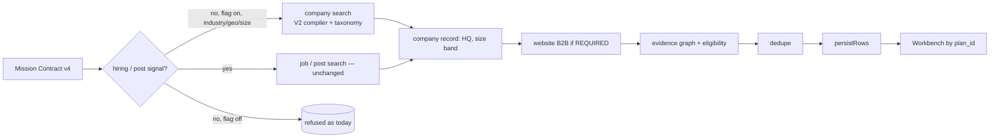

# Company-first discovery in V4 ATLAS: integration plan (for review)

**Status:** implemented and validated locally only, on branch `feat/atlas-v4-company-search` (stacked on #272). Nothing is deployed, no flag is set on TEST, and no paid call has been made.

## What changes (and what does not)

V2's proven company search moves **under** V4. There is no new engine and no new catalogue.

| Layer | Reused unchanged | Changed (small) |
|---|---|---|
| Interpretation | Mission Contract v4, coverage guard | `interpret.ts`: a request with nothing checkable now asks a question (the HTTP 500 fix) |
| Contract validation | — | `contract.ts`: an all-disclosed contract is a typed `empty_mission`. `lead-pipeline/index.ts`: `ContractInvalidError` → 422, not 500 |
| Planning | `strategy.ts` judge, limitations, review-only, ceilings, signed plan hash | New capability `apify.linkedin_company_search`; `chainFor` seeds it only with **no hiring or post signal** and the `companySearch` flag; one row = one company in sizing; plan-time compile with V2's compiler |
| Actor input | **V2 `compileHarvestCompanySearchInput`** (no concept `searchQuery`, no unbounded search, enum and limit checks) | `companySearchInput(spec)`: REQUIRED location / industry / size only |
| Vocabulary | **V2 `industryIdsForVertical`** + the generated LinkedIn taxonomy (434 codes); **V2 `companySizeBandsFor`** | 3 reviewed bridge entries: commercial contracting (48/413/435), industrial distribution (1187/49/1178), commercial field services (122/2247/453) |
| Allowlist | Ledgered invoker, `maxItems` ≤ 100, `maxTotalChargeUsd` = worst case, no retry | `PIPELINE_ACTORS` + `apify_linkedin_company_search` ($0.001 start + $0.002/short company, the V2 card, re-read from Apify 2026-11-20) |
| Normalisation | **V2 `normalizeLinkedInCompanyCandidate`** (candidate-only; industry "unsafe") | `discoverFirmographicCompanies` keeps **identity evidence only** |
| Verification | Company record (HQ, size band), website B2B check, evidence graph, eligibility | Consumer reader: "sells … to homeowners" (the business side already read "sells to") |
| Dedupe / persistence / Workbench | `collapseDuplicateLeads`, `persistRows`, `plan_id` | — |
| Flag | — | `LEAD_PIPELINE_COMPANY_SEARCH` (`service.ts`), **off by default** |

## Actor, schema, pricing and cost controls

| Item | Value |
|---|---|
| Actor | `harvestapi/linkedin-company-search`, pay-per-event, live build 0.0.21 (V2 card recorded 0.0.17; every field sent still exists) |
| Input sent | `{"scraperMode":"short","maxItems":N,"locations":[…],"industryIds":[…],"companySize":[…]}`. **Never** `searchQuery` |
| Price | $0.001 per run start + $0.002 per short-mode company (full mode $0.004, not used) |
| Worst case (5 companies) | Discovery 10 → $0.021; company record 10 → $0.04005; website (if B2B required) $0.01334. **Total $0.06105–$0.07439** of the $0.25 ceiling |
| Enforcement | Run-level `maxItems` + `maxTotalChargeUsd` (Apify-enforced for pay-per-event); ledger reserve then settle; signed plan; no retry |

## Safety properties (tested)

- **Off by default.** Without the flag, company-first requests are refused exactly as before.
- **A hiring signal always wins.** The hiring pilot gives identical plan and results with the flag on or off.
- **REQUIRED filters only.** A preferred size never narrows the search.
- **No silent broadening.** A REQUIRED industry with no reviewed code is refused by name.
- **No silent dropping.** Every REQUIRED requirement stays in the spec. Industry stays unverifiable, so these missions need explicit review-only approval, and their leads are "needs verification" on industry.
- **Candidates are re-proven.** HQ and size come from the company record; B2B comes from first-party pages when required.

## Open policy question (owner decision)

When a company's **own record** says "Software Development" and the request **requires** "manufacturing", V4 keeps it "needs verification": a taxonomy label never decides industry, in either direction. Rejecting on a contradicting record label would remove filter leaks (AppNest in the rehearsal), at the cost of occasionally rejecting a mislabelled real manufacturer.

## Local evidence

See the PR description and `npm run dev:atlas -- company-first-*`.

## Live schema and price check (2026-11-21, public Apify Store API, read-only)

| Actor (latest build) | Checked | Result |
|---|---|---|
| `harvestapi/linkedin-company-search` 0.0.21 | `scraperMode` short/full; `companySize` enum; `maxItems` ≤ 1000; 50 companies/page, ≤ 20 pages; price | Our 8 size bands equal the Actor's enum exactly. Short $0.002/company + $0.001/start (Free/Bronze tier; higher tiers are cheaper, so the plan's figure is an upper bound). The V4 invoker caps `maxItems` at 100 and sends `maxTotalChargeUsd` = worst case |
| `harvestapi/linkedin-job-search` 0.0.62 | `maxItems` semantics; `functionIds` list; price | `maxItems` is "per each job title and location input", so we split the total across queries. `sale`, `bd` and `mrkt` exist in the function list. $0.001/job + $0.001/start |
| `harvestapi/linkedin-company` 0.0.46 | price | $0.004/record + $0.00005/start, as `COMPANY_RECORD_ACTOR` |

Builds are not pinned yet: pinning the reviewed build is phase C.
