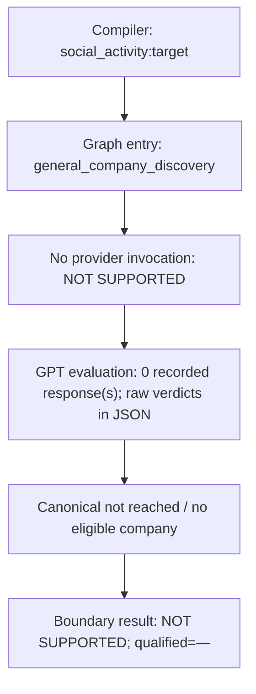
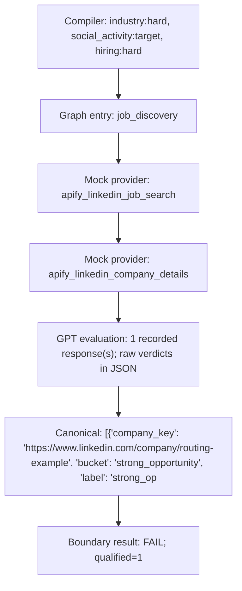
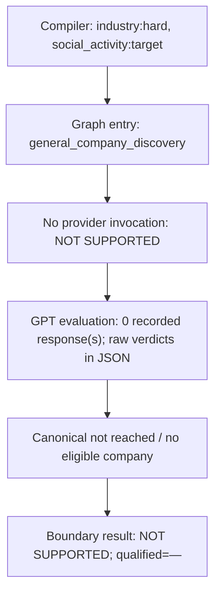
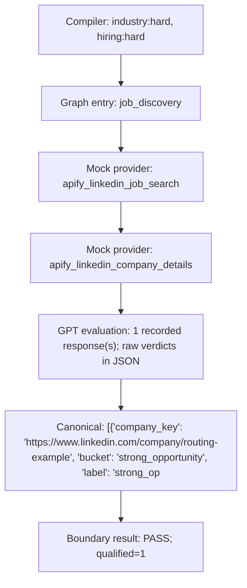

# Recorded execution paths

One diagram per scenario, on each pinned current snapshot. Nodes use actual selected entry and invoked mock Actors. Graph proposals that were refused never become execution nodes. Detailed criteria, model inputs/verdicts, evidence identities/source dates, compiled provider specs and customer reducers are in the matching JSONL record. No diagram represents a live provider run.

## L01

Find founders commenting on LinkedIn about problems with outbound sales in the last 30 days.

Founder outbound comments: no executable comment route; intent not evaluated.

### integration



### pr113


## L02

Find founders explicitly searching for a CRM in LinkedIn comments within the last 30 days.

CRM search comments: no executable comment route.

### integration


### pr113


## L03

Find founders discussing hiring agencies in LinkedIn comments within the last 30 days.

Hiring-agency discussions: no executable comment route.

### integration


### pr113


## L04

Find founders who must be looking for new sales tools in their LinkedIn comments.

Negative tool intent: fixture preserved only; semantic rejection not reached.

### integration


### pr113


## L05

Find companies whose founders must be asking for a CRM in LinkedIn comments.

Employee instead of founder: fixture preserved only; role verification not reached.

### integration


### pr113


## L06

Find founders who commented about outbound problems within the last 7 days.

2020 comment freshly scraped: original timestamp preserved by normalizer; mission recency not reached.

### integration


### pr113


## L07

Find founders commenting about outbound sales problems on LinkedIn.

Unavailable comment retrieval: unsupported before provider invocation; no fake provider success.

### integration


### pr113


## L08

Find 1 B2B software company whose founder must have commented about outbound problems, and which must be hiring Account Executives.

Mandatory founder comment plus hiring: 1 qualified with no social evidence.

### integration



### pr113


## L09

Find 1 B2B software company whose founder must be posting about CRM buying on LinkedIn.

Founder CRM posts: no executable verification route.

### integration



### pr113


## H01

Find 1 B2B software company hiring Account Executives within the last 30 days.

AE positive control: fresh matched employer qualifies.

### integration



### pr113


## H02

Find 1 B2B software company that must be hiring its first sales representative within the last 30 days.

First sales hire positive: explicit first-hire text qualifies.

### integration

```mermaid
flowchart TD
  n0["Compiler: industry:hard, hiring:hard"]
  n1["Graph entry: job_discovery"]
  n2["Mock provider: apify_linkedin_job_search"]
  n3["Mock provider: apify_linkedin_company_details"]
  n4["GPT evaluation: 1 recorded response(s); raw verdicts in JSON"]
  n5["Canonical: [{'company_key': 'https://www.linkedin.com/company/routing-example', 'bucket': 'strong_opportunity', 'label': 'strong_op"]
  n6["Boundary result: PASS; qualified=1"]
  n0 --> n1
  n1 --> n2
  n2 --> n3
  n3 --> n4
  n4 --> n5
  n5 --> n6
```

### pr113

```mermaid
flowchart TD
  n0["Compiler: industry:hard, hiring:hard"]
  n1["Graph entry: job_discovery"]
  n2["Mock provider: apify_linkedin_job_search"]
  n3["Mock provider: apify_linkedin_company_details"]
  n4["GPT evaluation: 1 recorded response(s); raw verdicts in JSON"]
  n5["Canonical: [{'company_key': 'https://www.linkedin.com/company/routing-example', 'bucket': 'strong_opportunity', 'label': 'strong_op"]
  n6["Boundary result: PASS; qualified=1"]
  n0 --> n1
  n1 --> n2
  n2 --> n3
  n3 --> n4
  n4 --> n5
  n5 --> n6
```

## H03

Find 1 B2B software company that must be hiring its first sales representative within the last 30 days.

First sales hire negative: ordinary job also qualifies; mandatory qualifier not checked.

### integration

```mermaid
flowchart TD
  n0["Compiler: industry:hard, hiring:hard"]
  n1["Graph entry: job_discovery"]
  n2["Mock provider: apify_linkedin_job_search"]
  n3["Mock provider: apify_linkedin_company_details"]
  n4["GPT evaluation: 1 recorded response(s); raw verdicts in JSON"]
  n5["Canonical: [{'company_key': 'https://www.linkedin.com/company/routing-example', 'bucket': 'strong_opportunity', 'label': 'strong_op"]
  n6["Boundary result: FAIL; qualified=1"]
  n0 --> n1
  n1 --> n2
  n2 --> n3
  n3 --> n4
  n4 --> n5
  n5 --> n6
```

### pr113

```mermaid
flowchart TD
  n0["Compiler: industry:hard, hiring:hard"]
  n1["Graph entry: job_discovery"]
  n2["Mock provider: apify_linkedin_job_search"]
  n3["Mock provider: apify_linkedin_company_details"]
  n4["GPT evaluation: 1 recorded response(s); raw verdicts in JSON"]
  n5["Canonical: [{'company_key': 'https://www.linkedin.com/company/routing-example', 'bucket': 'strong_opportunity', 'label': 'strong_op"]
  n6["Boundary result: FAIL; qualified=1"]
  n0 --> n1
  n1 --> n2
  n2 --> n3
  n3 --> n4
  n4 --> n5
  n5 --> n6
```

## H04

Find 1 B2B software company that must be rapidly expanding its sales team within the last 30 days.

Rapid sales-team growth compiled as physical expansion; compiler FAIL, runtime safely unsupported.

### integration

```mermaid
flowchart TD
  n0["Compiler: industry:hard, expansion:target"]
  n1["Graph entry: general_company_discovery"]
  n2["No provider invocation: NOT SUPPORTED"]
  n3["GPT evaluation: 0 recorded response(s); raw verdicts in JSON"]
  n4["Canonical not reached / no eligible company"]
  n5["Boundary result: NOT SUPPORTED; qualified=—"]
  n0 --> n1
  n1 --> n2
  n2 --> n3
  n3 --> n4
  n4 --> n5
```

### pr113

```mermaid
flowchart TD
  n0["Compiler: industry:hard, expansion:target"]
  n1["Graph entry: general_company_discovery"]
  n2["No provider invocation: NOT SUPPORTED"]
  n3["GPT evaluation: 0 recorded response(s); raw verdicts in JSON"]
  n4["Canonical not reached / no eligible company"]
  n5["Boundary result: NOT SUPPORTED; qualified=—"]
  n0 --> n1
  n1 --> n2
  n2 --> n3
  n3 --> n4
  n4 --> n5
```

## H05

Find 1 recruiting agency hiring its own Account Executives within the last 30 days.

Recruiting agency own staff: blanket agency filter discards employer before evaluation.

### integration

```mermaid
flowchart TD
  n0["Compiler: industry:hard, hiring:hard"]
  n1["Graph entry: job_discovery"]
  n2["Mock provider: apify_linkedin_job_search"]
  n3["GPT evaluation: 0 recorded response(s); raw verdicts in JSON"]
  n4["Canonical not reached / no eligible company"]
  n5["Boundary result: FAIL; qualified=0"]
  n0 --> n1
  n1 --> n2
  n2 --> n3
  n3 --> n4
  n4 --> n5
```

### pr113

```mermaid
flowchart TD
  n0["Compiler: industry:hard, hiring:hard"]
  n1["Graph entry: job_discovery"]
  n2["Mock provider: apify_linkedin_job_search"]
  n3["GPT evaluation: 0 recorded response(s); raw verdicts in JSON"]
  n4["Canonical not reached / no eligible company"]
  n5["Boundary result: FAIL; qualified=0"]
  n0 --> n1
  n1 --> n2
  n2 --> n3
  n3 --> n4
  n4 --> n5
```

## H06

Find 1 recruiting agency hiring its own Account Executives within the last 30 days.

Agency client posting: no qualification, but blanket filter masks client-specific attribution check.

### integration

```mermaid
flowchart TD
  n0["Compiler: industry:hard, hiring:hard"]
  n1["Graph entry: job_discovery"]
  n2["Mock provider: apify_linkedin_job_search"]
  n3["GPT evaluation: 0 recorded response(s); raw verdicts in JSON"]
  n4["Canonical not reached / no eligible company"]
  n5["Boundary result: PASS; qualified=0"]
  n0 --> n1
  n1 --> n2
  n2 --> n3
  n3 --> n4
  n4 --> n5
```

### pr113

```mermaid
flowchart TD
  n0["Compiler: industry:hard, hiring:hard"]
  n1["Graph entry: job_discovery"]
  n2["Mock provider: apify_linkedin_job_search"]
  n3["GPT evaluation: 0 recorded response(s); raw verdicts in JSON"]
  n4["Canonical not reached / no eligible company"]
  n5["Boundary result: PASS; qualified=0"]
  n0 --> n1
  n1 --> n2
  n2 --> n3
  n3 --> n4
  n4 --> n5
```

## H07

Find 1 B2B software company hiring Account Executives within the last 30 days.

Old job still LISTED: no qualification.

### integration

```mermaid
flowchart TD
  n0["Compiler: industry:hard, hiring:hard"]
  n1["Graph entry: job_discovery"]
  n2["Mock provider: apify_linkedin_job_search"]
  n3["Mock provider: apify_linkedin_company_details"]
  n4["GPT evaluation: 0 recorded response(s); raw verdicts in JSON"]
  n5["Canonical: [{'company_key': 'https://www.linkedin.com/company/routing-example', 'bucket': 'pending', 'label': None, 'hard_checks': "]
  n6["Boundary result: PASS; qualified=0"]
  n0 --> n1
  n1 --> n2
  n2 --> n3
  n3 --> n4
  n4 --> n5
  n5 --> n6
```

### pr113

```mermaid
flowchart TD
  n0["Compiler: industry:hard, hiring:hard"]
  n1["Graph entry: job_discovery"]
  n2["Mock provider: apify_linkedin_job_search"]
  n3["Mock provider: apify_linkedin_company_details"]
  n4["GPT evaluation: 0 recorded response(s); raw verdicts in JSON"]
  n5["Canonical: [{'company_key': 'https://www.linkedin.com/company/routing-example', 'bucket': 'pending', 'label': None, 'hard_checks': "]
  n6["Boundary result: PASS; qualified=0"]
  n0 --> n1
  n1 --> n2
  n2 --> n3
  n3 --> n4
  n4 --> n5
  n5 --> n6
```

## H08

Find 1 B2B software company hiring Account Executives within the last 30 days.

Closed job: no qualification.

### integration

```mermaid
flowchart TD
  n0["Compiler: industry:hard, hiring:hard"]
  n1["Graph entry: job_discovery"]
  n2["Mock provider: apify_linkedin_job_search"]
  n3["GPT evaluation: 0 recorded response(s); raw verdicts in JSON"]
  n4["Canonical not reached / no eligible company"]
  n5["Boundary result: PASS; qualified=0"]
  n0 --> n1
  n1 --> n2
  n2 --> n3
  n3 --> n4
  n4 --> n5
```

### pr113

```mermaid
flowchart TD
  n0["Compiler: industry:hard, hiring:hard"]
  n1["Graph entry: job_discovery"]
  n2["Mock provider: apify_linkedin_job_search"]
  n3["GPT evaluation: 0 recorded response(s); raw verdicts in JSON"]
  n4["Canonical not reached / no eligible company"]
  n5["Boundary result: PASS; qualified=0"]
  n0 --> n1
  n1 --> n2
  n2 --> n3
  n3 --> n4
  n4 --> n5
```

## H09

Find 1 B2B software company hiring Account Executives within the last 30 days.

Duplicate jobs: one qualified employer, no duplicate company result.

### integration

```mermaid
flowchart TD
  n0["Compiler: industry:hard, hiring:hard"]
  n1["Graph entry: job_discovery"]
  n2["Mock provider: apify_linkedin_job_search"]
  n3["Mock provider: apify_linkedin_company_details"]
  n4["GPT evaluation: 1 recorded response(s); raw verdicts in JSON"]
  n5["Canonical: [{'company_key': 'https://www.linkedin.com/company/routing-example', 'bucket': 'strong_opportunity', 'label': 'strong_op"]
  n6["Boundary result: PASS; qualified=1"]
  n0 --> n1
  n1 --> n2
  n2 --> n3
  n3 --> n4
  n4 --> n5
  n5 --> n6
```

### pr113

```mermaid
flowchart TD
  n0["Compiler: industry:hard, hiring:hard"]
  n1["Graph entry: job_discovery"]
  n2["Mock provider: apify_linkedin_job_search"]
  n3["Mock provider: apify_linkedin_company_details"]
  n4["GPT evaluation: 1 recorded response(s); raw verdicts in JSON"]
  n5["Canonical: [{'company_key': 'https://www.linkedin.com/company/routing-example', 'bucket': 'strong_opportunity', 'label': 'strong_op"]
  n6["Boundary result: PASS; qualified=1"]
  n0 --> n1
  n1 --> n2
  n2 --> n3
  n3 --> n4
  n4 --> n5
  n5 --> n6
```

## H10

Find 1 B2B software company hiring only Account Executives within the last 30 days. Do not broaden the role.

Only AE, no broadening; SDR posting: base qualifies, PR113 rejects.

### integration

```mermaid
flowchart TD
  n0["Compiler: industry:hard, hiring:hard"]
  n1["Graph entry: job_discovery"]
  n2["Mock provider: apify_linkedin_job_search"]
  n3["Mock provider: apify_linkedin_company_details"]
  n4["GPT evaluation: 1 recorded response(s); raw verdicts in JSON"]
  n5["Canonical: [{'company_key': 'https://www.linkedin.com/company/routing-example', 'bucket': 'strong_opportunity', 'label': 'strong_op"]
  n6["Boundary result: FAIL; qualified=1"]
  n0 --> n1
  n1 --> n2
  n2 --> n3
  n3 --> n4
  n4 --> n5
  n5 --> n6
```

### pr113

```mermaid
flowchart TD
  n0["Compiler: industry:hard, hiring:hard"]
  n1["Graph entry: job_discovery"]
  n2["Mock provider: apify_linkedin_job_search"]
  n3["Mock provider: apify_linkedin_company_details"]
  n4["GPT evaluation: 0 recorded response(s); raw verdicts in JSON"]
  n5["Canonical: [{'company_key': 'https://www.linkedin.com/company/routing-example', 'bucket': 'pending', 'label': None, 'hard_checks': "]
  n6["Boundary result: PASS; qualified=0"]
  n0 --> n1
  n1 --> n2
  n2 --> n3
  n3 --> n4
  n4 --> n5
  n5 --> n6
```

## C01

Find 1 B2B software company that must be hiring Account Executives AND whose founder must have discussed outbound problems on LinkedIn.

Hiring AND mandatory founder discussion: 1 qualified while social criterion UNKNOWN/target.

### integration

```mermaid
flowchart TD
  n0["Compiler: industry:hard, hiring:hard, social_activity:target"]
  n1["Graph entry: job_discovery"]
  n2["Mock provider: apify_linkedin_job_search"]
  n3["Mock provider: apify_linkedin_company_details"]
  n4["GPT evaluation: 1 recorded response(s); raw verdicts in JSON"]
  n5["Canonical: [{'company_key': 'https://www.linkedin.com/company/routing-example', 'bucket': 'strong_opportunity', 'label': 'strong_op"]
  n6["Boundary result: FAIL; qualified=1"]
  n0 --> n1
  n1 --> n2
  n2 --> n3
  n3 --> n4
  n4 --> n5
  n5 --> n6
```

### pr113

```mermaid
flowchart TD
  n0["Compiler: industry:hard, hiring:hard, social_activity:target"]
  n1["Graph entry: job_discovery"]
  n2["Mock provider: apify_linkedin_job_search"]
  n3["Mock provider: apify_linkedin_company_details"]
  n4["GPT evaluation: 1 recorded response(s); raw verdicts in JSON"]
  n5["Canonical: [{'company_key': 'https://www.linkedin.com/company/routing-example', 'bucket': 'strong_opportunity', 'label': 'strong_op"]
  n6["Boundary result: FAIL; qualified=1"]
  n0 --> n1
  n1 --> n2
  n2 --> n3
  n3 --> n4
  n4 --> n5
  n5 --> n6
```

## C02

Find 1 B2B software company hiring Account Executives OR having raised funding in the last 90 days.

Hiring OR funding: compiler loses cross-dimension OR; funding suppresses hiring discovery. q0 is not isolated proof of OR rejection (business proof also absent).

### integration

```mermaid
flowchart TD
  n0["Compiler: industry:hard, hiring:hard, funding:hard"]
  n1["Graph entry: general_company_discovery"]
  n2["Mock provider: apify_linkedin_company_search"]
  n3["Mock provider: apify_linkedin_company_details"]
  n4["Mock provider: apify_funding_atomus"]
  n5["Mock provider: apify_funding_pvalyou"]
  n6["GPT evaluation: 0 recorded response(s); raw verdicts in JSON"]
  n7["Canonical: [{'company_key': 'https://www.linkedin.com/company/routing-example', 'bucket': 'pending', 'label': None, 'hard_checks': "]
  n8["Boundary result: FAIL; qualified=0"]
  n0 --> n1
  n1 --> n2
  n2 --> n3
  n3 --> n4
  n4 --> n5
  n5 --> n6
  n6 --> n7
  n7 --> n8
```

### pr113

```mermaid
flowchart TD
  n0["Compiler: industry:hard, hiring:hard, funding:hard"]
  n1["Graph entry: general_company_discovery"]
  n2["Mock provider: apify_linkedin_company_search"]
  n3["Mock provider: apify_linkedin_company_details"]
  n4["Mock provider: apify_funding_atomus"]
  n5["Mock provider: apify_funding_pvalyou"]
  n6["GPT evaluation: 0 recorded response(s); raw verdicts in JSON"]
  n7["Canonical: [{'company_key': 'https://www.linkedin.com/company/routing-example', 'bucket': 'pending', 'label': None, 'hard_checks': "]
  n8["Boundary result: FAIL; qualified=0"]
  n0 --> n1
  n1 --> n2
  n2 --> n3
  n3 --> n4
  n4 --> n5
  n5 --> n6
  n6 --> n7
  n7 --> n8
```

## C03

Find 1 B2B software company that must have opened a new office AND recently adopted Salesforce.

Expansion AND technology adoption: unavailable executable chain, not simulated as working.

### integration

```mermaid
flowchart TD
  n0["Compiler: industry:hard, expansion:hard, technology:target"]
  n1["Graph entry: general_company_discovery"]
  n2["No provider invocation: NOT SUPPORTED"]
  n3["GPT evaluation: 0 recorded response(s); raw verdicts in JSON"]
  n4["Canonical not reached / no eligible company"]
  n5["Boundary result: NOT SUPPORTED; qualified=—"]
  n0 --> n1
  n1 --> n2
  n2 --> n3
  n3 --> n4
  n4 --> n5
```

### pr113

```mermaid
flowchart TD
  n0["Compiler: industry:hard, expansion:hard, technology:target"]
  n1["Graph entry: general_company_discovery"]
  n2["No provider invocation: NOT SUPPORTED"]
  n3["GPT evaluation: 0 recorded response(s); raw verdicts in JSON"]
  n4["Canonical not reached / no eligible company"]
  n5["Boundary result: NOT SUPPORTED; qualified=—"]
  n0 --> n1
  n1 --> n2
  n2 --> n3
  n3 --> n4
  n4 --> n5
```

## C04

Find 1 B2B software company hiring Account Executives in the last 7 days AND whose founder must have commented on outbound in the last 30 days.

Hiring 7d AND founder comment 30d: compiled windows 7d/90d; missing founder proof still qualifies.

### integration

```mermaid
flowchart TD
  n0["Compiler: industry:hard, hiring:hard, social_activity:target"]
  n1["Graph entry: job_discovery"]
  n2["Mock provider: apify_linkedin_job_search"]
  n3["Mock provider: apify_linkedin_company_details"]
  n4["GPT evaluation: 1 recorded response(s); raw verdicts in JSON"]
  n5["Canonical: [{'company_key': 'https://www.linkedin.com/company/routing-example', 'bucket': 'strong_opportunity', 'label': 'strong_op"]
  n6["Boundary result: FAIL; qualified=1"]
  n0 --> n1
  n1 --> n2
  n2 --> n3
  n3 --> n4
  n4 --> n5
  n5 --> n6
```

### pr113

```mermaid
flowchart TD
  n0["Compiler: industry:hard, hiring:hard, social_activity:target"]
  n1["Graph entry: job_discovery"]
  n2["Mock provider: apify_linkedin_job_search"]
  n3["Mock provider: apify_linkedin_company_details"]
  n4["GPT evaluation: 1 recorded response(s); raw verdicts in JSON"]
  n5["Canonical: [{'company_key': 'https://www.linkedin.com/company/routing-example', 'bucket': 'strong_opportunity', 'label': 'strong_op"]
  n6["Boundary result: FAIL; qualified=1"]
  n0 --> n1
  n1 --> n2
  n2 --> n3
  n3 --> n4
  n4 --> n5
  n5 --> n6
```

## C05

Find 1 US-headquartered B2B software company hiring Account Executives in the last 30 days.

Discovery US vs company-details Canada: no qualification.

### integration

```mermaid
flowchart TD
  n0["Compiler: industry:hard, geography:hard, hiring:hard"]
  n1["Graph entry: job_discovery"]
  n2["Mock provider: apify_linkedin_job_search"]
  n3["Mock provider: apify_linkedin_company_details"]
  n4["GPT evaluation: 1 recorded response(s); raw verdicts in JSON"]
  n5["Canonical: [{'company_key': 'https://www.linkedin.com/company/routing-example', 'bucket': 'ineligible', 'label': None, 'hard_checks"]
  n6["Boundary result: PASS; qualified=0"]
  n0 --> n1
  n1 --> n2
  n2 --> n3
  n3 --> n4
  n4 --> n5
  n5 --> n6
```

### pr113

```mermaid
flowchart TD
  n0["Compiler: industry:hard, geography:hard, hiring:hard"]
  n1["Graph entry: job_discovery"]
  n2["Mock provider: apify_linkedin_job_search"]
  n3["Mock provider: apify_linkedin_company_details"]
  n4["GPT evaluation: 1 recorded response(s); raw verdicts in JSON"]
  n5["Canonical: [{'company_key': 'https://www.linkedin.com/company/routing-example', 'bucket': 'ineligible', 'label': None, 'hard_checks"]
  n6["Boundary result: PASS; qualified=0"]
  n0 --> n1
  n1 --> n2
  n2 --> n3
  n3 --> n4
  n4 --> n5
  n5 --> n6
```

## C06

Find 1 B2B software company that must be hiring Account Executives within the last 30 days.

ICP matches but no mandatory buying signal: no qualification.

### integration

```mermaid
flowchart TD
  n0["Compiler: industry:hard, hiring:hard"]
  n1["Graph entry: job_discovery"]
  n2["Mock provider: apify_linkedin_job_search"]
  n3["GPT evaluation: 0 recorded response(s); raw verdicts in JSON"]
  n4["Canonical not reached / no eligible company"]
  n5["Boundary result: PASS; qualified=0"]
  n0 --> n1
  n1 --> n2
  n2 --> n3
  n3 --> n4
  n4 --> n5
```

### pr113

```mermaid
flowchart TD
  n0["Compiler: industry:hard, hiring:hard"]
  n1["Graph entry: job_discovery"]
  n2["Mock provider: apify_linkedin_job_search"]
  n3["GPT evaluation: 0 recorded response(s); raw verdicts in JSON"]
  n4["Canonical not reached / no eligible company"]
  n5["Boundary result: PASS; qualified=0"]
  n0 --> n1
  n1 --> n2
  n2 --> n3
  n3 --> n4
  n4 --> n5
```

## C07

Find 1 B2B software company hiring Account Executives in the last 7 days AND having raised venture funding in the last 90 days.

Hiring 7d AND venture funding 90d: distinct windows preserved; absent funding prevents qualification.

### integration

```mermaid
flowchart TD
  n0["Compiler: industry:hard, hiring:hard, funding:hard"]
  n1["Graph entry: general_company_discovery"]
  n2["Mock provider: apify_linkedin_company_search"]
  n3["Mock provider: apify_linkedin_company_details"]
  n4["Mock provider: apify_funding_atomus"]
  n5["Mock provider: apify_funding_pvalyou"]
  n6["GPT evaluation: 0 recorded response(s); raw verdicts in JSON"]
  n7["Canonical: [{'company_key': 'https://www.linkedin.com/company/routing-example', 'bucket': 'pending', 'label': None, 'hard_checks': "]
  n8["Boundary result: PASS; qualified=0"]
  n0 --> n1
  n1 --> n2
  n2 --> n3
  n3 --> n4
  n4 --> n5
  n5 --> n6
  n6 --> n7
  n7 --> n8
```

### pr113

```mermaid
flowchart TD
  n0["Compiler: industry:hard, hiring:hard, funding:hard"]
  n1["Graph entry: general_company_discovery"]
  n2["Mock provider: apify_linkedin_company_search"]
  n3["Mock provider: apify_linkedin_company_details"]
  n4["Mock provider: apify_funding_atomus"]
  n5["Mock provider: apify_funding_pvalyou"]
  n6["GPT evaluation: 0 recorded response(s); raw verdicts in JSON"]
  n7["Canonical: [{'company_key': 'https://www.linkedin.com/company/routing-example', 'bucket': 'pending', 'label': None, 'hard_checks': "]
  n8["Boundary result: PASS; qualified=0"]
  n0 --> n1
  n1 --> n2
  n2 --> n3
  n3 --> n4
  n4 --> n5
  n5 --> n6
  n6 --> n7
  n7 --> n8
```

## R01

Find 1 B2B software company hiring Account Executives.

Wrong Actor for job capability: validator blocks; zero provider calls.

### integration

```mermaid
flowchart TD
  n0["Compiler: industry:hard, hiring:hard"]
  n1["Graph entry: job_discovery"]
  n2["No provider invocation: BLOCKED"]
  n3["GPT evaluation: 0 recorded response(s); raw verdicts in JSON"]
  n4["Canonical not reached / no eligible company"]
  n5["Boundary result: BLOCKED; qualified=0"]
  n0 --> n1
  n1 --> n2
  n2 --> n3
  n3 --> n4
  n4 --> n5
```

### pr113

```mermaid
flowchart TD
  n0["Compiler: industry:hard, hiring:hard"]
  n1["Graph entry: job_discovery"]
  n2["No provider invocation: BLOCKED"]
  n3["GPT evaluation: 0 recorded response(s); raw verdicts in JSON"]
  n4["Canonical not reached / no eligible company"]
  n5["Boundary result: BLOCKED; qualified=0"]
  n0 --> n1
  n1 --> n2
  n2 --> n3
  n3 --> n4
  n4 --> n5
```

## R02

Find 1 B2B software company hiring Account Executives.

Invented comment capability: validator blocks; zero provider calls.

### integration

```mermaid
flowchart TD
  n0["Compiler: industry:hard, hiring:hard"]
  n1["Graph entry: job_discovery"]
  n2["No provider invocation: BLOCKED"]
  n3["GPT evaluation: 0 recorded response(s); raw verdicts in JSON"]
  n4["Canonical not reached / no eligible company"]
  n5["Boundary result: BLOCKED; qualified=0"]
  n0 --> n1
  n1 --> n2
  n2 --> n3
  n3 --> n4
  n4 --> n5
```

### pr113

```mermaid
flowchart TD
  n0["Compiler: industry:hard, hiring:hard"]
  n1["Graph entry: job_discovery"]
  n2["No provider invocation: BLOCKED"]
  n3["GPT evaluation: 0 recorded response(s); raw verdicts in JSON"]
  n4["Canonical not reached / no eligible company"]
  n5["Boundary result: BLOCKED; qualified=0"]
  n0 --> n1
  n1 --> n2
  n2 --> n3
  n3 --> n4
  n4 --> n5
```

## R03

Find 1 B2B software company hiring Account Executives.

Overconfident evaluator cites invented evidence ID: base qualifies, PR113 rejects.

### integration

```mermaid
flowchart TD
  n0["Compiler: industry:hard, hiring:hard"]
  n1["Graph entry: job_discovery"]
  n2["Mock provider: apify_linkedin_job_search"]
  n3["Mock provider: apify_linkedin_company_details"]
  n4["GPT evaluation: 1 recorded response(s); raw verdicts in JSON"]
  n5["Canonical: [{'company_key': 'https://www.linkedin.com/company/routing-example', 'bucket': 'strong_opportunity', 'label': 'strong_op"]
  n6["Boundary result: FAIL; qualified=1"]
  n0 --> n1
  n1 --> n2
  n2 --> n3
  n3 --> n4
  n4 --> n5
  n5 --> n6
```

### pr113

```mermaid
flowchart TD
  n0["Compiler: industry:hard, hiring:hard"]
  n1["Graph entry: job_discovery"]
  n2["Mock provider: apify_linkedin_job_search"]
  n3["Mock provider: apify_linkedin_company_details"]
  n4["GPT evaluation: 1 recorded response(s); raw verdicts in JSON"]
  n5["Canonical: [{'company_key': 'https://www.linkedin.com/company/routing-example', 'bucket': 'pending', 'label': None, 'hard_checks': "]
  n6["Boundary result: PASS; qualified=0"]
  n0 --> n1
  n1 --> n2
  n2 --> n3
  n3 --> n4
  n4 --> n5
  n5 --> n6
```

## R04

Find 1 B2B software company hiring Account Executives.

Empty company details: base qualifies, PR113 rejects.

### integration

```mermaid
flowchart TD
  n0["Compiler: industry:hard, hiring:hard"]
  n1["Graph entry: job_discovery"]
  n2["Mock provider: apify_linkedin_job_search"]
  n3["Mock provider: apify_linkedin_company_details"]
  n4["GPT evaluation: 1 recorded response(s); raw verdicts in JSON"]
  n5["Canonical: [{'company_key': 'https://www.linkedin.com/company/routing-example', 'bucket': 'strong_opportunity', 'label': 'strong_op"]
  n6["Boundary result: FAIL; qualified=1"]
  n0 --> n1
  n1 --> n2
  n2 --> n3
  n3 --> n4
  n4 --> n5
  n5 --> n6
```

### pr113

```mermaid
flowchart TD
  n0["Compiler: industry:hard, hiring:hard"]
  n1["Graph entry: job_discovery"]
  n2["Mock provider: apify_linkedin_job_search"]
  n3["Mock provider: apify_linkedin_company_details"]
  n4["GPT evaluation: 1 recorded response(s); raw verdicts in JSON"]
  n5["Canonical: [{'company_key': 'https://www.linkedin.com/company/routing-example', 'bucket': 'pending', 'label': None, 'hard_checks': "]
  n6["Boundary result: PASS; qualified=0"]
  n0 --> n1
  n1 --> n2
  n2 --> n3
  n3 --> n4
  n4 --> n5
  n5 --> n6
```

## R05

Find 1 B2B software company hiring Account Executives.

Job identifies foreign employer: upstream ownership guard prevents qualification.

### integration

```mermaid
flowchart TD
  n0["Compiler: industry:hard, hiring:hard"]
  n1["Graph entry: job_discovery"]
  n2["Mock provider: apify_linkedin_job_search"]
  n3["Mock provider: apify_linkedin_company_details"]
  n4["GPT evaluation: 0 recorded response(s); raw verdicts in JSON"]
  n5["Canonical: [{'company_key': 'https://www.linkedin.com/company/routing-example', 'bucket': 'pending', 'label': None, 'hard_checks': "]
  n6["Boundary result: PASS; qualified=0"]
  n0 --> n1
  n1 --> n2
  n2 --> n3
  n3 --> n4
  n4 --> n5
  n5 --> n6
```

### pr113

```mermaid
flowchart TD
  n0["Compiler: industry:hard, hiring:hard"]
  n1["Graph entry: job_discovery"]
  n2["Mock provider: apify_linkedin_job_search"]
  n3["Mock provider: apify_linkedin_company_details"]
  n4["GPT evaluation: 0 recorded response(s); raw verdicts in JSON"]
  n5["Canonical: [{'company_key': 'https://www.linkedin.com/company/routing-example', 'bucket': 'pending', 'label': None, 'hard_checks': "]
  n6["Boundary result: PASS; qualified=0"]
  n0 --> n1
  n1 --> n2
  n2 --> n3
  n3 --> n4
  n4 --> n5
  n5 --> n6
```

## R06

Find 1 B2B software company hiring Account Executives.

Job provider throws TimeoutError: no qualification or fallback purchase.

### integration

```mermaid
flowchart TD
  n0["Compiler: industry:hard, hiring:hard"]
  n1["Graph entry: job_discovery"]
  n2["Mock provider: apify_linkedin_job_search"]
  n3["GPT evaluation: 0 recorded response(s); raw verdicts in JSON"]
  n4["Canonical not reached / no eligible company"]
  n5["Boundary result: PASS; qualified=0"]
  n0 --> n1
  n1 --> n2
  n2 --> n3
  n3 --> n4
  n4 --> n5
```

### pr113

```mermaid
flowchart TD
  n0["Compiler: industry:hard, hiring:hard"]
  n1["Graph entry: job_discovery"]
  n2["Mock provider: apify_linkedin_job_search"]
  n3["GPT evaluation: 0 recorded response(s); raw verdicts in JSON"]
  n4["Canonical not reached / no eligible company"]
  n5["Boundary result: PASS; qualified=0"]
  n0 --> n1
  n1 --> n2
  n2 --> n3
  n3 --> n4
  n4 --> n5
```

## R07

Find 1 B2B software company hiring Account Executives.

Real readiness policy marks job Actor unavailable: blocked before calls.

### integration

```mermaid
flowchart TD
  n0["Compiler: industry:hard, hiring:hard"]
  n1["Graph entry: general_company_discovery"]
  n2["No provider invocation: BLOCKED"]
  n3["GPT evaluation: 0 recorded response(s); raw verdicts in JSON"]
  n4["Canonical not reached / no eligible company"]
  n5["Boundary result: BLOCKED; qualified=—"]
  n0 --> n1
  n1 --> n2
  n2 --> n3
  n3 --> n4
  n4 --> n5
```

### pr113

```mermaid
flowchart TD
  n0["Compiler: industry:hard, hiring:hard"]
  n1["Graph entry: general_company_discovery"]
  n2["No provider invocation: BLOCKED"]
  n3["GPT evaluation: 0 recorded response(s); raw verdicts in JSON"]
  n4["Canonical not reached / no eligible company"]
  n5["Boundary result: BLOCKED; qualified=—"]
  n0 --> n1
  n1 --> n2
  n2 --> n3
  n3 --> n4
  n4 --> n5
```

## R08

Find 1 B2B software company hiring Account Executives.

Evaluation binding times out after optimistic batch: base qualifies, PR113 rejects.

### integration

```mermaid
flowchart TD
  n0["Compiler: industry:hard, hiring:hard"]
  n1["Graph entry: job_discovery"]
  n2["Mock provider: apify_linkedin_job_search"]
  n3["Mock provider: apify_linkedin_company_details"]
  n4["GPT evaluation: 1 recorded response(s); raw verdicts in JSON"]
  n5["Canonical: [{'company_key': 'https://www.linkedin.com/company/routing-example', 'bucket': 'strong_opportunity', 'label': 'strong_op"]
  n6["Boundary result: FAIL; qualified=1"]
  n0 --> n1
  n1 --> n2
  n2 --> n3
  n3 --> n4
  n4 --> n5
  n5 --> n6
```

### pr113

```mermaid
flowchart TD
  n0["Compiler: industry:hard, hiring:hard"]
  n1["Graph entry: job_discovery"]
  n2["Mock provider: apify_linkedin_job_search"]
  n3["Mock provider: apify_linkedin_company_details"]
  n4["GPT evaluation: 1 recorded response(s); raw verdicts in JSON"]
  n5["Canonical: [{'company_key': 'https://www.linkedin.com/company/routing-example', 'bucket': 'pending', 'label': None, 'hard_checks': "]
  n6["Boundary result: PASS; qualified=0"]
  n0 --> n1
  n1 --> n2
  n2 --> n3
  n3 --> n4
  n4 --> n5
  n5 --> n6
```

## R09

Find 1 B2B software company hiring Account Executives.

Aggregate model FAIL with per-criterion PASS: both qualify (known prior finding).

### integration

```mermaid
flowchart TD
  n0["Compiler: industry:hard, hiring:hard"]
  n1["Graph entry: job_discovery"]
  n2["Mock provider: apify_linkedin_job_search"]
  n3["Mock provider: apify_linkedin_company_details"]
  n4["GPT evaluation: 1 recorded response(s); raw verdicts in JSON"]
  n5["Canonical: [{'company_key': 'https://www.linkedin.com/company/routing-example', 'bucket': 'strong_opportunity', 'label': 'strong_op"]
  n6["Boundary result: FAIL; qualified=1"]
  n0 --> n1
  n1 --> n2
  n2 --> n3
  n3 --> n4
  n4 --> n5
  n5 --> n6
```

### pr113

```mermaid
flowchart TD
  n0["Compiler: industry:hard, hiring:hard"]
  n1["Graph entry: job_discovery"]
  n2["Mock provider: apify_linkedin_job_search"]
  n3["Mock provider: apify_linkedin_company_details"]
  n4["GPT evaluation: 1 recorded response(s); raw verdicts in JSON"]
  n5["Canonical: [{'company_key': 'https://www.linkedin.com/company/routing-example', 'bucket': 'strong_opportunity', 'label': 'strong_op"]
  n6["Boundary result: FAIL; qualified=1"]
  n0 --> n1
  n1 --> n2
  n2 --> n3
  n3 --> n4
  n4 --> n5
  n5 --> n6
```

## R11

Find 1 B2B software company hiring Account Executives.

Company-details response only foreign strong identity: base qualifies, PR113 rejects.

### integration

```mermaid
flowchart TD
  n0["Compiler: industry:hard, hiring:hard"]
  n1["Graph entry: job_discovery"]
  n2["Mock provider: apify_linkedin_job_search"]
  n3["Mock provider: apify_linkedin_company_details"]
  n4["GPT evaluation: 1 recorded response(s); raw verdicts in JSON"]
  n5["Canonical: [{'company_key': 'https://www.linkedin.com/company/routing-example', 'bucket': 'strong_opportunity', 'label': 'strong_op"]
  n6["Boundary result: FAIL; qualified=1"]
  n0 --> n1
  n1 --> n2
  n2 --> n3
  n3 --> n4
  n4 --> n5
  n5 --> n6
```

### pr113

```mermaid
flowchart TD
  n0["Compiler: industry:hard, hiring:hard"]
  n1["Graph entry: job_discovery"]
  n2["Mock provider: apify_linkedin_job_search"]
  n3["Mock provider: apify_linkedin_company_details"]
  n4["GPT evaluation: 1 recorded response(s); raw verdicts in JSON"]
  n5["Canonical: [{'company_key': 'https://www.linkedin.com/company/routing-example', 'bucket': 'pending', 'label': None, 'hard_checks': "]
  n6["Boundary result: PASS; qualified=0"]
  n0 --> n1
  n1 --> n2
  n2 --> n3
  n3 --> n4
  n4 --> n5
  n5 --> n6
```

## R12

Find 1 B2B software company hiring Account Executives.

Several company identities, including exact LinkedIn match: exact employer selected, qualifies.

### integration

```mermaid
flowchart TD
  n0["Compiler: industry:hard, hiring:hard"]
  n1["Graph entry: job_discovery"]
  n2["Mock provider: apify_linkedin_job_search"]
  n3["Mock provider: apify_linkedin_company_details"]
  n4["GPT evaluation: 1 recorded response(s); raw verdicts in JSON"]
  n5["Canonical: [{'company_key': 'https://www.linkedin.com/company/routing-example', 'bucket': 'strong_opportunity', 'label': 'strong_op"]
  n6["Boundary result: PASS; qualified=1"]
  n0 --> n1
  n1 --> n2
  n2 --> n3
  n3 --> n4
  n4 --> n5
  n5 --> n6
```

### pr113

```mermaid
flowchart TD
  n0["Compiler: industry:hard, hiring:hard"]
  n1["Graph entry: job_discovery"]
  n2["Mock provider: apify_linkedin_job_search"]
  n3["Mock provider: apify_linkedin_company_details"]
  n4["GPT evaluation: 1 recorded response(s); raw verdicts in JSON"]
  n5["Canonical: [{'company_key': 'https://www.linkedin.com/company/routing-example', 'bucket': 'strong_opportunity', 'label': 'strong_op"]
  n6["Boundary result: PASS; qualified=1"]
  n0 --> n1
  n1 --> n2
  n2 --> n3
  n3 --> n4
  n4 --> n5
  n5 --> n6
```

## F01

Find 1 B2B software company with a recent funding announcement within the last 90 days.

No funding round returned: no qualification; fallback profile search plus guarded claim verifier pair.

### integration

```mermaid
flowchart TD
  n0["Compiler: industry:hard, funding:hard"]
  n1["Graph entry: general_company_discovery"]
  n2["Mock provider: apify_linkedin_company_search"]
  n3["Mock provider: apify_linkedin_company_details"]
  n4["Mock provider: apify_funding_atomus"]
  n5["Mock provider: apify_funding_pvalyou"]
  n6["GPT evaluation: 0 recorded response(s); raw verdicts in JSON"]
  n7["Canonical: [{'company_key': 'https://www.linkedin.com/company/routing-example', 'bucket': 'pending', 'label': None, 'hard_checks': "]
  n8["Boundary result: PASS; qualified=0"]
  n0 --> n1
  n1 --> n2
  n2 --> n3
  n3 --> n4
  n4 --> n5
  n5 --> n6
  n6 --> n7
  n7 --> n8
```

### pr113

```mermaid
flowchart TD
  n0["Compiler: industry:hard, funding:hard"]
  n1["Graph entry: general_company_discovery"]
  n2["Mock provider: apify_linkedin_company_search"]
  n3["Mock provider: apify_linkedin_company_details"]
  n4["Mock provider: apify_funding_atomus"]
  n5["Mock provider: apify_funding_pvalyou"]
  n6["GPT evaluation: 0 recorded response(s); raw verdicts in JSON"]
  n7["Canonical: [{'company_key': 'https://www.linkedin.com/company/routing-example', 'bucket': 'pending', 'label': None, 'hard_checks': "]
  n8["Boundary result: PASS; qualified=0"]
  n0 --> n1
  n1 --> n2
  n2 --> n3
  n3 --> n4
  n4 --> n5
  n5 --> n6
  n6 --> n7
  n7 --> n8
```

## F02

Find 1 B2B software company with a recent funding announcement within the last 90 days.

Positive matched recent funding: real funding criterion PASS; full mission NOT TESTED because website/business-proof phase not executed.

### integration

```mermaid
flowchart TD
  n0["Compiler: industry:hard, funding:hard"]
  n1["Graph entry: general_company_discovery"]
  n2["Mock provider: apify_linkedin_company_search"]
  n3["Mock provider: apify_linkedin_company_details"]
  n4["Mock provider: apify_funding_atomus"]
  n5["GPT evaluation: 0 recorded response(s); raw verdicts in JSON"]
  n6["Canonical: [{'company_key': 'https://www.linkedin.com/company/routing-example', 'bucket': 'pending', 'label': None, 'hard_checks': "]
  n7["Boundary result: NOT TESTED; qualified=0"]
  n0 --> n1
  n1 --> n2
  n2 --> n3
  n3 --> n4
  n4 --> n5
  n5 --> n6
  n6 --> n7
```

### pr113

```mermaid
flowchart TD
  n0["Compiler: industry:hard, funding:hard"]
  n1["Graph entry: general_company_discovery"]
  n2["Mock provider: apify_linkedin_company_search"]
  n3["Mock provider: apify_linkedin_company_details"]
  n4["Mock provider: apify_funding_atomus"]
  n5["GPT evaluation: 0 recorded response(s); raw verdicts in JSON"]
  n6["Canonical: [{'company_key': 'https://www.linkedin.com/company/routing-example', 'bucket': 'pending', 'label': None, 'hard_checks': "]
  n7["Boundary result: NOT TESTED; qualified=0"]
  n0 --> n1
  n1 --> n2
  n2 --> n3
  n3 --> n4
  n4 --> n5
  n5 --> n6
  n6 --> n7
```

## R10

Find 1 B2B software company hiring Account Executives.

AbortError before details plus checkpoint resume: no repeat provider calls on completed engine snapshot; full queue recovery NOT TESTED.

### integration

```mermaid
flowchart TD
  n0["Compiler: industry:hard, hiring:hard"]
  n1["Graph entry: job_discovery"]
  n2["Mock provider: apify_linkedin_job_search"]
  n3["Mock provider: apify_linkedin_company_details"]
  n4["GPT evaluation: 1 recorded response(s); raw verdicts in JSON"]
  n5["Canonical: [{'company_key': 'https://www.linkedin.com/company/routing-example', 'bucket': 'strong_opportunity', 'label': 'strong_op"]
  n6["Boundary result: NOT TESTED; qualified=1"]
  n0 --> n1
  n1 --> n2
  n2 --> n3
  n3 --> n4
  n4 --> n5
  n5 --> n6
```

### pr113

```mermaid
flowchart TD
  n0["Compiler: industry:hard, hiring:hard"]
  n1["Graph entry: job_discovery"]
  n2["Mock provider: apify_linkedin_job_search"]
  n3["Mock provider: apify_linkedin_company_details"]
  n4["GPT evaluation: 1 recorded response(s); raw verdicts in JSON"]
  n5["Canonical: [{'company_key': 'https://www.linkedin.com/company/routing-example', 'bucket': 'pending', 'label': None, 'hard_checks': "]
  n6["Boundary result: NOT TESTED; qualified=0"]
  n0 --> n1
  n1 --> n2
  n2 --> n3
  n3 --> n4
  n4 --> n5
  n5 --> n6
```
