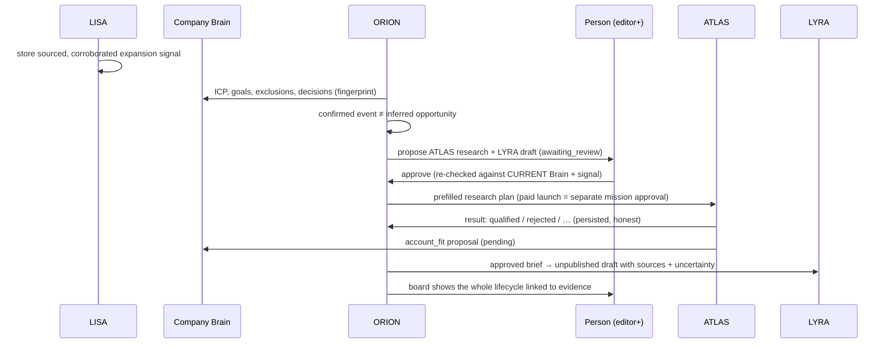

# Phase 5 — Multi-agent collaboration (LISA · ORION · ATLAS · LYRA · Company Brain)

Status: **implemented and tested in isolation; disabled everywhere.** Nothing is
deployed, scheduled or applied to a hosted database.

- Endpoint `agent-collaboration` answers `409` unless **both** `AGENT_COLLAB_ENABLED=true`
  and `LISA_V2_ENABLED=true`. LISA V2 stays off until the signal-table security fix lands.
- Database: held migration `supabase/migrations-held/20261112120000_agent_collaboration.sql`
  (applied only by `tests/db-contract/bootstrap.sh`).
- UI: `/dev/collaboration`, routed **only in DEV builds**, on fictional data (`npm run dev:collab`),
  with a "simulated" banner. The production bundle contains neither the route nor its data (checked).

## 1. Architecture

### Before (what existed)

```mermaid
flowchart LR
  LISA[LISA monitoring / radar] -->|signal_events| FEED[Signals feed]
  LISA -. "openInLeads (unwired)" .-> ATLAS
  FEED -->|"Turn into post" (Pilot chat)| LYRA[LYRA / Scribe content_item]
  ORION[ORION executive brief] -->|reads| FEED
  BRAIN[(Company Brain V1)] --> ORION & LYRA & LISA
  BRAIN -. "atlasBrainContract (opt-in, unused)" .-> ATLAS[ATLAS lead missions]
  APPROVALS[(approvals — member-writable via RLS)]
```

### After (this phase)

```mermaid
flowchart LR
  LISA -->|AgentSignal: counted verification, lifecycle, relevance| ORION
  BRAIN[(Company Brain V1 loader)] -->|orionView / atlasView / lyraView| ORION
  ORION -->|assessForOrion → recommend| LEDGER[(agent_handoffs — server-only ledger)]
  LEDGER -->|human approve/reject/cancel\nrole re-checked in-transaction| LEDGER
  LEDGER -->|approved atlas_research → prefilled plan| ATLAS
  ATLAS -->|atlas_report (service key) → result contract| LEDGER
  LEDGER -->|approved lyra_content → ONE draft, atomically| LYRA[content_item draft]
  ATLAS -->|account_fit proposal| PROPOSALS[(Brain proposals — pending)]
  LISA -->|competitor proposal| PROPOSALS
  PROPOSALS -->|person approves| BRAIN
  LEDGER --> BOARD[ORION board: what / why / evidence / agent / action / approval / done]
```

### Opportunity → action



## 2. The contract (`supabase/functions/_shared/collab/`)

| Module | What it does |
|---|---|
| `contract.ts` | `Handoff`: source/target agent, workspace, company identity, signal & lead ids, Brain fingerprint, kind, evidence refs, verification (confirmed vs inferred), reason, `requires_approval`, idempotency key, payload, parent. Status vocabulary + allowed transitions (pinned to the SQL). |
| `lisaToOrion.ts` | ORION reads LISA's `AgentSignal`; applies LISA's own `isElevatable`, then Brain exclusions, dismissed-signal decisions and approved "not a fit" facts. Recommends ATLAS / LYRA / advice. |
| `orionToAtlas.ts` | The `AtlasResearchRequest` (ATLAS's own `atlasView` contract, guardrails, prefilled mission) + `atlasPreflight`. |
| `atlasToOrion.ts` | The result contract (7 endings), `normalizeAtlasResult`, `handoffStatusFor`, `orionReads`, `atlasResultFromMission` adapter. |
| `lisaToLyra.ts` | `LyraContentBrief` (sources, confirmed/uncertain claims, tone, restrictions, audience, angle) and a deterministic draft. |
| `brainFeedback.ts` | Agent → Brain proposals via the existing V1 proposal RPC (ATLAS `account_fit`, LISA competitors). |
| `board.ts` | ORION's coordination view; flags stale Brain context. |
| `store.ts` | RPC wrappers; nothing writes a table directly. |

Lifecycle: `proposed → awaiting_review → approved → queued → running → completed | partially_completed | failed | blocked`;
`rejected` / `cancelled` from review; `failed → queued` retry (≤ 3 attempts).

### Why a new ledger and not `approvals`

`public.approvals` has a `FOR ALL` member policy, so **any member, including a viewer, can set
`status='approved'` from the browser**. That is a pre-existing finding, reported here and **not**
fixed in this phase. Collaboration approvals gate paid research, so they live in
`agent_handoffs`, which no client role can write (shown by contract test S20). Execution still uses each agent's existing
workflow: the ATLAS mission (its own approval and budget) and LYRA's `content_item` drafts.

## 3. Integration matrix

| Connection | Status | Evidence | Remaining work |
|---|---|---|---|
| LISA → ORION | **Implemented and tested** (real DB, real handler). ORION's executive brief also reads LISA verification and links (Phase 4). | contract WORKFLOW, S01–S05; unit LISA→ORION | Live LISA collection is disabled (security). |
| ORION → ATLAS | **Implemented and tested up to a prefilled, approved plan.** The Leads page does not yet read the plan (`atlas_plan`). | WORKFLOW, S06–S09, S19, S23 | ATLAS track: Leads reads `atlas_plan`, launches it as a normal approved mission. |
| ATLAS → ORION | **Contract and endpoint tested with recorded, synthetic results.** The ATLAS mission engine does not call `atlas_report` yet. | S10–S13, S22, S07b | ATLAS track: call `atlas_report` (via `atlasResultFromMission`) at mission end. |
| LISA → LYRA | **Implemented and tested** (brief, approval, atomic unpublished draft). Draft text is a deterministic outline, not model-written. | WORKFLOW, S14–S16 | Optional: hand the brief to Scribe generation; publishing stays human. |
| Agents → Company Brain | **Implemented and tested**: ATLAS `account_fit` and LISA competitor proposals are pending until a person approves them. | S10, S17, S18, S18b; LISA contract 15–16 | LYRA proposes nothing automatically (by design). |
| Company Brain → Agents | **ORION, LISA, LYRA: tested.** ATLAS: `loadMissionContextWithMemory` is implemented and pinned compatible but **not called** on the mission path. | unit "ATLAS mission context with memory"; S19 | ATLAS track switches one call site (see §5). |
| Dashboard | **Simulated**: DEV-only preview on fictional data. `CollaborationBoardView` is ready for live data (`onDecide`). | browser screenshots, frontend tests | A live page once the endpoint can be enabled. |

## 4. Tests (this phase)

| Lane | Result | Real or mocked |
|---|---|---|
| DB contract `agentCollaboration` | 25 / 25 | Real Postgres 17 + PostgREST + supabase-js + real handler, Brain loader, memory/proposal RPCs and LISA writer. Mocked: search hits (recorded) and the ATLAS outcome (synthetic). |
| Unit `collab.test.ts` | 12 / 12 | Pure modules; fixtures. |
| Frontend `collaborationPreview.test.ts` | 3 / 3 | Static. |
| Mutation proofs (collaboration) | 7 / 7 killed | Real DB. |
| Browser | Preview rendered in Chromium; 5 steps checked, 0 page errors | Vite dev server with a localhost placeholder Supabase URL; no backend was called. |

Scenario map: 1→S01, 2→S02, 3→S03, 4→S04, 5→S05, 6→S06, 7→S07, 8→S08, 9→S09, 10→S10, 11→S11,
12→S12, 13→S13, 14–16→S14/15/16, 17–18→S17/S18/S18b, 19→S19, 20→S20, 21→S21, 22→S22, 23→S23, 24→S24.

## 5. Findings and fixes along the way

1. **The ATLAS planner never sees the Brain** (pre-existing, *not changed*). `leadPlanOrchestration.ts`
   calls `loadMissionContext(admin, ws)` with neither `userId` nor `skipMembershipCheck`, so the loader
   returns `forbidden`, and the planner silently plans with no ICP context. Changing membership semantics on
   the ATLAS track's path is that track's decision. The orchestration input carries **no user id**
   today, so activation needs either (preferred) threading the requesting user's id into the input
   and calling `loadMissionContextWithMemory(input.admin, input.workspaceId, { userId })`, or
   `skipMembershipCheck: true` only where the caller has already authorized the request.
2. **Default disqualifiers excluded the customer's own market** (fixed for radar/LISA). With no
   stated disqualifiers, the compiler merges `DEFAULT_DISQUALIFIERS` (including "manufacturing" and
   "logistics") into `disqualifiers.industries`. A manufacturing-targeting workspace therefore had its
   market excluded from radar scoring and query planning. `brainIndustryExclusions.ts` applies
   the existing `resolveIndustryExclusions` precedence in `radarIntelligenceProfile`, `icpSignalScorer` and
   `radarScanPlanner`. The merged list itself is unchanged, so ATLAS behavior does not change.
3. **`approvals` is member-writable** (pre-existing; see above). Deferred to the security phase.
4. The DB contract lane caught a LYRA draft built against an outdated `content_item` schema
   (`content_v1` now requires LinkedIn formats and `source_type`). Fixed before commit.

## 6. Remaining gaps

- **Security (release blockers):** browser-writable `signal_events` / `signal_event_evidence` /
  `monitoring_subjects` (LISA P0) and `approvals`. Both stay off until remediated.
- ATLAS call sites (plan intake in Leads, result hook, memory-aware context) belong to the ATLAS track.
- No live page uses the board yet (DEV preview only).
- The LYRA draft is a deterministic outline; model-written drafts are not wired in.
- No live provider verification (no paid calls in this phase).
- The browser lane with real GoTrue (`run-with-gotrue.sh`) was not run for this phase.

## 7. Running it

```bash
npm run dev:collab             # the journey, offline; --write regenerates the preview data
deno test --allow-read --allow-env tests/edge-functions/_shared/collab/
tests/db-contract/run.sh tests/db-contract/agentCollaboration.contract.test.ts
```
