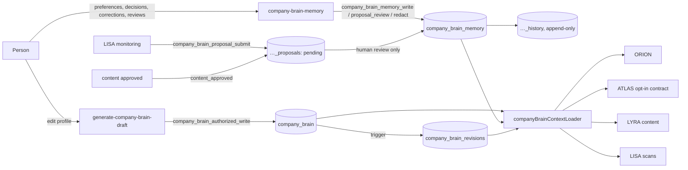

# Company Brain V1: shared memory

**Status:** this is implemented on branch `claude/agentory-audit-roadmap-64uq8n` and passes its tests locally. It is **not deployed** anywhere. The migration is held (`supabase/migrations-held/20261110120000_company_brain_memory.sql`), and the TEST plan is in [V1_TEST_DEPLOYMENT.md](V1_TEST_DEPLOYMENT.md).

## What it adds to the profile

The Company Brain is still the company profile (`company_brain.profile`), edited from the Company Brain page. V1 adds five things around it:

| Need | Where it lives |
|---|---|
| History of the profile | `company_brain_revisions`. A trigger on `company_brain` appends one row per *material* change (an identical rewrite adds nothing). Each row records the full snapshot, the sections that changed, the actor and the time. Existing Brains are back-filled as revision 1. |
| Facts, preferences (including exclusions), decisions | `company_brain_memory`. Each row holds an item's current value, version, provenance, verification status, confidence and lifecycle. |
| Every prior version of an item | `company_brain_memory_history`. It is append-only and can be changed only by a privacy redaction. |
| Agent-proposed knowledge | `company_brain_memory_proposals`. A proposal stays **pending** until an editor, admin or owner approves, corrects or rejects it. |
| Retry safety | `company_brain_memory_requests`. This is the idempotency ledger: a retried request replays the first outcome. |

Nobody writes these tables directly: not `anon`, not `authenticated`, not even `service_role`. Every write goes through a `SECURITY DEFINER` function, and each function does all of the following in one transaction:

1. Locks the caller's live auth session and their membership row.
2. Re-checks the current role, using the same rule as `_shared/brainRole.ts`.
3. Then writes.

The lock order is session → membership → memory row, the same as the existing Brain writer.

## Honesty rules (enforced by CHECK constraints)

- A model inference or agent suggestion can never be `corroborated` or `provider_reported`. After a person approves it, it is `user_confirmed`, and its `source_type` still says what it originally was.
- `corroborated` requires a source URL or reference.
- An item that came from an agent must carry its proposal and the person who approved it.
- There is at most one active item per (workspace, kind, key, scope, scope_ref).
- A decision stays scoped. Rejecting a lead is recorded as scope `lead` plus that lead's id. Only `icp_changed`, `strategy_selected`, `brand_preference`, `exclusion_added` and `correction` may be workspace-wide. Exclusions exist only as explicit `preference` items in category `exclusions`.

**What agents may use.** Staleness and expiry are computed when memory is read, so no cron job is needed. An agent may use an item only if it is active, unexpired, not redacted, and either entered by a person or approved by one. Stale and disputed items appear in the UI under "Needs review" and are never served to agents.

## One read path: `companyBrainContextLoader.ts`

```
membership check (or a caller that already authorized)
  → company_brain row + memory + recent revisions + count of pending proposals
  → EFFECTIVE PROFILE = profile + approved memory, combined with these rules:
       • exclusions only narrow (merged into target_customer.disqualifiers)
       • approved competitors are added; a newer retraction removes the name
       • an ICP or content preference replaces the profile value only when it
         is newer than the last change to that profile section
         (whichever a person changed most recently wins)
  → the existing canonical compiler → SharedBrainContext
```

The loader gives each agent its own view (`companyBrainAgentViews.ts`), plus a size-bounded `renderBrainMemoryBlock` that drops the lowest-priority lines first and says so.

- If no Brain exists, the status is `missing` and nothing is invented.
- If the memory tables are absent (the held migration is not applied), the loader uses the profile alone and adds a `memory_unavailable` warning.

## How each agent uses it

| Agent | Code path | What it uses |
|---|---|---|
| **ORION** | `daily-brief` → `executiveBriefContext.collectExecutiveContext` → loader | Leaves out leads and signals a person rejected or dismissed. Ranks items that match an exclusion 30 points lower and gives the reason. Ranks items related to a stated goal 8 points higher. Matches competitors by normalised name and by domain. `brief.brain.influences` explains each effect. The model-wording step uses the same context. |
| **ATLAS** | Opt-in: `atlasBrainContract.getCompiledCompanyBrainWithMemory` (contract `atlas-brain-v1`) | The same `CanonicalCompanyBrain`, built from the effective profile, plus industries, size, geography, exclusions, rejected lead and account refs, and `icp_changed_at`. **ATLAS's current call path is unchanged.** With no memory, the opt-in result is identical to today's (pinned by a test). See [ATLAS_BRAIN_CONTRACT.md](ATLAS_BRAIN_CONTRACT.md). |
| **LYRA** (content; `run-agent` scribe branch) | Loader → effective profile into `renderContentBrain`, plus a memory block | Tone, restrictions, approved products and facts (the only extra claims content may make), and competitors marked as not us. The lead branches of `run-agent` still read `brain` exactly as before. |
| **LISA** | `run-monitoring-scan` and `run-radar-scan` → loader | Exclusions, approved competitors and newer ICP preferences. The relevance judge receives priorities and competitors (emitted only when present). After a successful pass, LISA **proposes** monitored competitors that the Brain doesn't list, with event evidence. |

Two places record decisions into memory:

- **Dismissing a signal** in the app records a `signal_dismissed` decision scoped to that signal. This happens only for editors and above, and is best-effort; viewers' dismissals stay personal.
- **Approving content** can create a low-confidence LYRA proposal (the approved angle) through `content_approved`. The server derives it from the stored, approved row.

## Writes from the browser

All browser writes go through `supabase/functions/company-brain-memory`. The actions are:

- `context`
- `write` (set / correct / decide / retract / dispute / mark_stale / reactivate)
- `review_proposal`
- `redact` (owner or admin only)
- `content_approved`

The request parser refuses any provenance or approval field coming from the client.

## The UI

The Company Brain page has a **Company memory** panel (agency Brain only) with these tabs:

- Needs review: proposals with evidence and contradiction warnings, plus stale and disputed items
- Preferences
- Decisions
- Facts, plus archived items
- History: memory and profile revisions, before → after, who, and why
- How agents use it: the exact memory block each agent receives

Viewers can read everything but cannot change anything. Every write carries an idempotency key.

## Data flow



## Performance

- The loader runs four indexed queries in parallel, each with a limit: memory ≤ 500, revisions ≤ 50, proposals ≤ 100. ORION passes tighter limits (200 / 20 / 50) under its own `BRIEF_LIMITS`.
- All memory indexes start with `(workspace_id, …)`, and active-item uniqueness is a partial index.
- The fold step is pure and linear in the number of items. Nothing is cached, so the next run always reads approved changes. `fingerprint` changes whenever the profile or any item changes, so it is safe to use as a cache key later.
