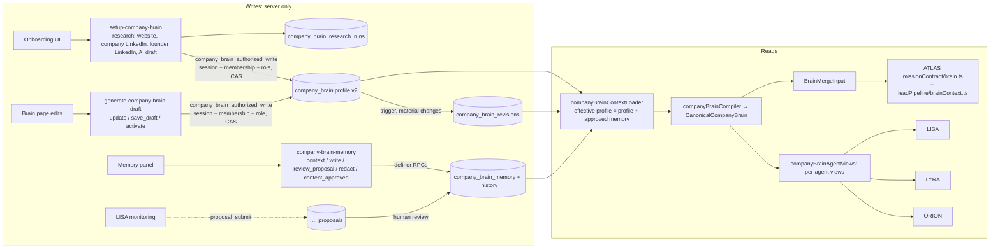

# Company Brain V2: audit and implementation roadmap

**Status:** read-only audit, 2026-11-21. Nothing was changed in any environment.

**Method:**
- the repository at `launch/hardening` `ffd3f4be` plus the R1.2 merge;
- production (`ohsdatpvfdjdemstoiuj`), read through counts, column names and field presence only (no profile values were read or recorded);
- the earlier audits it builds on: `docs/audits/company-brain-lisa-2026-11/AUDIT.md` (2026-11-09), `docs/company-brain-consumption-audit.md`, `docs/plans/company-brain/V1_ARCHITECTURE.md`.

**Scope boundary:** the ATLAS V5 discovery engine and the Apify AI-discovery integration are owned by another session. This document only records ATLAS's *read contract* on the Brain (§9) and how V2 keeps it stable.

## 0. Summary

1. **The plumbing is good; the content is thin.**
   - Writes are server-only and role-checked.
   - There is one canonical compiler and one context loader.
   - V1 memory (facts, preferences, decisions, proposals, history, revisions) is **deployed to production but has never been used**: 0 memory items, 0 proposals, 0 history, and 2 back-fill revisions.
2. **The live Brain is half empty.**
   - **Complete:** ICP (6/6 legacy fields; 5 of 8 `target_customer` fields).
   - **Empty:** goals (0/5), positioning (0/7), brand voice (0/5), competitors (0), qualification rules (0/3), GTM (0/6), and evidence (0/3).
   - The agents reason over a profile that has no goals, no positioning, no competitors and no evidence.
3. **Most V1-aware readers are not deployed.**
   - In production, only `pilot-chat` (R1.2), `daily-brief` and the three Brain functions (`setup-company-brain`, `generate-company-brain-draft`, `company-brain-memory`; builds from 11-13 or later) contain the V1 loader.
   - `run-agent` (content and leads, built 10-13), `run-radar-scan` (LISA manual scans, built **08-30**) and `run-monitoring-scan` (10-11) predate it: they read `company_brain.profile` directly and see no memory.
4. **The ICP exists three times inside the profile** (`target_customer` v2, the legacy `icp` mirror and `signal_preferences`), and twice more outside it (the five empty `icp_*` tables; the legacy `company_brain` text columns). The compiler reconciles the profile copies; nothing reconciles the rest.
5. **The Brain does not record where any profile fact came from.**
   - `profile.evidence` is empty.
   - Research runs (9 rows) stopped on 2026-08-16.
   - Revisions record who changed which section, but not why or from what source.
   - Per-fact provenance exists only in V1 memory, which is empty.

## 1. Architecture as implemented

**Repository and production differ.** Everything above exists in the repository. In production:
- the write side and the V1 tables are live;
- the V1 read side is live only in `pilot-chat`, `daily-brief` and `company-brain-memory`.

## 2. Database schema (production)

| Table | Purpose | Rows | Browser access | Notes |
|---|---|---|---|---|
| `company_brain` | One profile per workspace (`profile jsonb` v2, plus legacy text columns `company_name`, `what_we_do`, `who_we_sell_to`, `voice_and_tone`, `do_not_say`, `examples`) | 2 (3 workspaces) | read only (member select) | The legacy columns are empty on the live v2 Brain |
| `company_brain_revisions` | Full snapshot per material change: `changed_sections`, actor, permission; redaction fields | 2 (back-fill) | read only | No `reason` or `source` per revision |
| `company_brain_memory` | Facts, preferences, decisions: version, source, verification, confidence, lifecycle, approval, scope, expiry | 0 | read only | Honesty rules enforced by CHECK constraints |
| `company_brain_memory_history` | Append-only item history | 0 | read only | |
| `company_brain_memory_proposals` | Agent-proposed knowledge, pending human review | 0 | read only | |
| `company_brain_memory_requests` | Idempotency ledger | 0 | none | |
| `company_brain_research_runs` | Onboarding research inputs and outputs | 9 (all 2026-08-16) | read; **write grants without write policies** | RLS blocks writes, but the grants are unnecessary |
| `icp_drafts`, `icp_lookalike_*`, `icp_saved_searches`, `icp_search_results` | Legacy ICP tool | 0 each | — | Routes `/icp*` now redirect to `/leads` |
| `competitor_companies`, `competitor_profiles`, `competitor_job_postings`, `competitor_intel_signals` | Legacy competitor intel | 0 each | — | The Brain's own `competitors` list is also empty |
| `clients`, `client_placements`, `client_active_positions` | Agency client objects | 0 each | — | The per-client Brain stack (held, PRs #174–#187) is not applied |
| `workspace_sources` | Connected sources | 0 | — | |

## 3. Onboarding and business profile

**Flow:**
1. `/onboarding/company-brain`: guided scenes (company, founder, research, decision review, activate).
2. `setup-company-brain` researches the website, company LinkedIn and founder LinkedIn (Apify actors shared with the ATLAS catalog), then produces an AI draft with quality checks (`companyBrainResearch/*`).
3. `generate-company-brain-draft` saves the draft, applies edits and activates the Brain.
4. Readiness gating (`companyBrainReadiness`, `companyBrainGate`, `docs/launch/brain-readiness-v2.md`) holds agent work back while the Brain is not ready.

| Area | Implemented | Live state | Gap |
|---|---|---|---|
| Company basics | `company.*` (8 fields) | 4/8: category, location, stage and team size are empty | The R1.1 audit found a contradictory size label (`COMPANY_BRAIN_CORRECTIONS.md`) |
| Founder | `founder.*` (7) | 2/7 | |
| Website and LinkedIn research | `companyBrainResearch/*` | Last run 2026-08-16 | No refresh cadence; `companyBrainRefreshDiff` exists but nothing schedules it |
| Draft → review → activate | Yes; origin-aware saves (user edits win) | Activated, `brain_confidence = partial` | |
| Completeness and readiness | `companyBrainCompleteness`, `missing_fields`, `setup_status` | `missing_fields` is `[]` although 6 sections are empty | **The readiness signal under-reports emptiness** |

## 4. ICP definitions and qualification criteria

| Representation | Where | Live state | Consumer |
|---|---|---|---|
| `target_customer` (v2: industries, geography, company_size, business_models, funding_stage, must_have, nice_to_have, disqualifiers) | profile | 5/8 | Compiler → all agents; ATLAS via `BrainMergeInput` |
| `icp` (legacy mirror: buyer_roles, company_size, disqualifiers, geography, industries, pain_points) | profile | 6/6 | Recomputed by `companyBrainUpdate`; read by the old radar build |
| `signal_preferences` | profile | 5/5 | Old radar build |
| `buyer_personas` | profile | 3 | Compiler |
| `qualification_rules` (reject_if, manual_review_if, required_evidence) | profile | **0/3** | ATLAS qualification (when present) |
| `icp_*` tables | DB | 0 | none (UI retired) |

The ATLAS V4 contract (`missionContract/brain.ts`) states the authority model precisely:
- the user's request wins;
- the Brain's numeric size policy is hard only for a dimension the user left open;
- industries, stages and locations are preferences that rank, and never reject;
- explicit exclusions block approval as a question.

**V2 must not change this. It is the ATLAS session's contract.**

## 5. Goals and positioning

- `goals.*` (0/5), `gtm.*` (0/6), `positioning.*` (0/7), `brand_voice.*` (0/5), `content_angles` (0) and `competitors` (0) are **all empty** in the live Brain.
- ORION (R1.2) ranks by goals and matches competitors by name and domain, but there is nothing to match.
- LYRA (content) has no voice, proof points or avoid list in production (and runs the pre-V1 build).

## 6. Persistent memory (V1)

| Capability | Code | Production |
|---|---|---|
| Revisions trigger | migration (applied 11-13) | live; 2 rows |
| Facts, preferences, decisions with honesty CHECKs | `company_brain_memory*`, definer RPCs | live; **0 rows** |
| Browser API | `company-brain-memory` (deployed 11-13) | live; unused |
| Memory panel (Needs review / Preferences / Decisions / Facts / History / How agents use it) | `src/components/company-brain/memory/BrainMemoryPanel.tsx` | shipped with the frontend; nothing to show yet |
| Decision capture: dismissing a signal | app → `write decide signal_dismissed` | wired; no dismissals recorded |
| Decision capture: approving content | `content_approved` → LYRA proposal | wired in the repo; `run-agent` in production is pre-V1 |
| Decision capture: rejecting a lead | API supports `lead_rejected` | **no UI or ATLAS caller** (ATLAS-owned) |
| LISA competitor proposals | `lisaBrainProposals.ts` | monitoring is contained and its build is pre-V1, so it never runs |
| Staleness, expiry, "Still true", redaction | read-time computation and RPCs | live; unused |

## 7. Evidence management

- **Profile level:** `evidence.{source_pages, linkedin_sources, confidence_notes}` are empty. There is no per-field source, author or time. `brain_confidence` covers the whole Brain.
- **Research:** `company_brain_research_runs` (input, output, evidence, provider). There are 9 runs; the last was 08-16. Nothing links a profile field to the run that produced it.
- **Memory level:** `source_type`, `source_ref`, `source_url`, `verification_status`, `confidence` and `observed_at`, with CHECKs (for example, `corroborated` requires a source). This is complete, but unused.
- **Signals and leads** keep their own evidence: `signal_event_evidence` (LISA) and the lead lineage (ATLAS). The Brain never cites them.

## 8. Agent access to shared intelligence (repository versus production)

| Agent | Read path in the repo | Production build | Uses V1 memory in production? |
|---|---|---|---|
| ORION (pilot-chat, daily-brief) | `chatBrainContext` / `executiveBriefContext` → loader | 2026-11-20 / 11-13 | **yes** |
| ATLAS (lead pipeline, missions) | `missionContract/brain.ts`, `leadPipeline/brainContext.ts` (direct), opt-in `atlas-brain-v1` | ATLAS-owned | no (opt-in not taken) |
| LYRA (run-agent scribe) | loader → `renderContentBrain` + memory block | **2026-10-13 (pre-V1)** | no |
| LISA radar (manual scans) | loader | **2026-08-30 (pre-V1)** | no |
| LISA monitoring | loader | 2026-10-11 (pre-V1); contained | no |
| `orchestrate`, `leadActionExecutor`, `run-lead-action` | direct reads | 10-04 / 10-11 | no |

## 9. Persistence and workspace security

- **Brain tables:** RLS is on, browser access is select-only, every write goes through `SECURITY DEFINER` functions that lock session → membership → row, and role rules are enforced by `brainRole`. This is good.
- **Hygiene:** `company_brain_research_runs` gives the browser write grants it can't use (no policies). Revoke them.
- **Conversations:** owner-only RLS lets the browser rewrite `workspace_id`. The fix is prepared in R1.2.1 (held trigger `20261121120000_conversation_workspace_guard`).
- **Isolation of reads:** every reader is workspace-scoped (tests: `companyBrainOneTruth`, ORION contract tests, the R1.1 and R1.2 contract lanes).
- **Agency (per-client) Brains:** designed and held (PR stack #174–#187: canonical clients, grants, one Brain per client). Not applied; 0 client rows.

## 10. Implemented versus incomplete

| Capability | State |
|---|---|
| Server-only, role-checked Brain writes with CAS | **Done** (production) |
| Draft → activate onboarding with research | **Done**; research not refreshed since August |
| Canonical compiler and loader, per-agent views | **Done** in the repo; production readers partly pre-V1 |
| Revisions | **Done** (production) |
| Facts, preferences, decisions, proposals with honesty rules | **Done**, deployed, **unused** |
| Memory UI | **Done**, nothing to show |
| Goals, positioning, voice, competitors, qualification rules | **Fields exist; content missing** |
| Per-field provenance on the profile | **Missing** |
| Readiness that reflects empty sections | **Wrong** (`missing_fields` is empty) |
| One ICP representation | **Partial** (compiler reconciles three copies; legacy tables and columns remain) |
| Lead-rejection decisions | **Missing** (ATLAS-side caller) |
| Agent contributions (proposals) | Wired for LISA (contained) and LYRA (pre-V1 build) only |
| Research refresh with diff and review | Diff code exists; nothing schedules it |
| Per-client Brains | Held design |

## 11. Company Brain V2 roadmap

Ordered by value and risk. Each milestone is a separate branch and PR, validated on TEST before any production approval. **No milestone changes ATLAS's `BrainMergeInput` contract.** Where a milestone touches what ATLAS reads, a contract test pins today's output first.

### B2.0: Truthful readiness and guided completion (P0; no schema change)
- **What:** compute `missing_fields` and readiness from the compiled Brain, so that empty goals, positioning, voice, competitors and qualification rules show as missing. Add a "Complete your Brain" checklist on the Brain page that walks the empty sections. Use research (website, LinkedIn) only to **suggest** values that a person accepts; nothing is written automatically.
- **Reuse:** `companyBrainCompleteness`, `companyBrainReadiness`, `companyBrainResearch/*`, `companyBrainRefreshDiff` (suggestion/conflict semantics), `generate-company-brain-draft` `update`, origin-aware save.
- **Depends on:** nothing.
- **Acceptance:**
  - On the live shape, readiness lists exactly the 6 empty sections.
  - A suggested value is never saved without an explicit accept.
  - User-entered values always win over research (existing origin rules, tests).
  - No change to `BrainMergeInput` for any fixture (golden test).

### B2.1: One ICP, one source of truth (P0; contract-pinned)
- **What:**
  - Declare `target_customer` (v2) authoritative.
  - Make the legacy `icp` and `signal_preferences` read-only projections generated only by `companyBrainUpdate`, and never edited directly.
  - Add a consistency check that flags drift.
  - Fill `qualification_rules` through B2.0.
- **Reuse:** `companyBrainUpdate` projection, `companyBrainCompiler`, `companyBrainOneTruth.test.ts`.
- **Depends on:** a golden test of `BrainMergeInput` and the compiled Brain on the live shape (fictional values). The ATLAS session is told before the merge.
- **Acceptance:**
  - Any edit to `target_customer` updates both projections in the same write.
  - A direct edit to a projection is refused.
  - `BrainMergeInput` is byte-identical for all existing fixtures.

### B2.2: Per-section provenance and evidence (P1; additive migration)
- **What:**
  - Record, for each section changed, its source (`user`, `research:<run id>`, `memory:<item id>`), the actor and a reason.
  - Add `source` and `reason` to revisions, and store them in `company_brain_revisions` (additive columns), written by the existing trigger from a session-local setting that the writer RPC sets.
  - Link accepted research suggestions to their `company_brain_research_runs` row.
  - Show "where this came from" on each Brain section.
- **Reuse:** the revisions trigger, `company_brain_authorized_write`, research runs.
- **Depends on:** B2.0. Migration coordination (§12).
- **Acceptance:**
  - Every revision since V2 has a source.
  - The UI shows the source and time per section.
  - The contract lane proves a browser cannot forge the source.

### B2.3: Activate memory (P1)
- **What:** turn the deployed, unused V1 memory into everyday behaviour:
  - "Add a preference", "Record a decision" and "This is wrong" (correction) entry points on the Brain page;
  - ORION offers to record a decision it heard, as a proposal that a person approves;
  - the review queue appears on the dashboard when proposals are pending.
- **Reuse:** all of V1 (`company-brain-memory`, `BrainMemoryPanel`, the honesty CHECKs, staleness and expiry).
- **Depends on:** B2.0. The lead-rejection caller stays with ATLAS; V2 only documents the API (`decide` / `lead_rejected` / scope `lead`).
- **Acceptance:**
  - A preference set in the UI changes the effective profile that ORION receives within the same request cycle (contract test).
  - Proposals never become memory without approval.
  - Stale and disputed items are never served to agents (existing tests, plus an end-to-end test on TEST).

### B2.4: Every agent reads the same Brain (P1; deploys)
- **What:** deploy the V1-aware readers already in the repository, each in its own release with its own approval: `run-agent` (LYRA) first, then `run-radar-scan` and `run-monitoring-scan` within LISA V2. Add the `brain_context_version` and `fingerprint` to each agent's logged context, so the Brain an answer used can be audited.
- **Reuse:** `companyBrainAgentViews`, `renderBrainMemoryBlock`, loader `fingerprint`.
- **Depends on:** the LISA V2 and LYRA V2 tracks (their own releases). Manual LISA scans stay available, and scheduled monitoring stays contained unless separately approved.
- **Acceptance:**
  - Every Brain-consuming production function logs one context version and fingerprint.
  - For the same Brain, all agents report the same fingerprint (contract test plus a TEST check).

### B2.5: Research refresh with review (P2)
- **What:** an owner-triggered refresh (no schedule) that re-runs research and shows a diff as suggestions and conflicts. Nothing changes until accepted.
- **Reuse:** `companyBrainRefreshDiff`, `companyBrainSourceRole`, research modules.
- **Paid calls:** Apify LinkedIn actors cost about $0.005 per call. Every refresh needs an explicit confirmation and shows its cost; it never runs unattended.
- **Acceptance:**
  - A refresh with no changes writes nothing.
  - A conflict never overwrites a user value.
  - The cost is shown before running.

### B2.6: Security and hygiene (P1; small migrations)
- **What:**
  - Revoke the unused browser write grants on `company_brain_research_runs`.
  - Apply the R1.2.1 conversation guard, once approved.
  - Add a redaction runbook covering profile, revisions, memory and history.
  - Run a per-table RLS regression in the contract lane.
- **Acceptance:** the contract lane proves no browser role can write any `company_brain*` table, and the revoke changes nothing observable for the app.

### B2.7: Retire legacy structures (P2; after B2.1, and only with approval)
- **What:** mark the five `icp_*` tables, the four `competitor_*` tables, the legacy `company_brain` text columns and `workspace_sources` as deprecated. Then remove them in a held migration, with a backup export, after a full code search shows no reader.
- **Depends on:** B2.1 and a search across all active branches, including ATLAS's.
- **Acceptance:** every table is empty or exported before removal, no code reference remains, and a rollback file exists.

### B2.8: Per-client Brains for agencies (decision needed)
- **What:** decide on the held stack (#174 contract; #176/#178 schema and integration; #186/#190–#193 membership and task pins). It is large and security-sensitive.
- **Recommendation:** re-validate it only after B2.0–B2.4, because its value depends on a Brain that agents actually use.

**Sequence:** B2.0 → B2.1 → (B2.2 ∥ B2.3 ∥ B2.6) → B2.4 (with LYRA V2 and LISA V2) → B2.5 → B2.7 → decision on B2.8. That leads into LISA V2, ORION V2, LYRA V2 and agent collaboration, all of which consume B2.3 and B2.4.

## 12. Coordination with the ATLAS V5 session

| Shared item | Owner | Rule |
|---|---|---|
| `BrainMergeInput` (`leadMission.ts`), `missionContract/brain.ts` | ATLAS | Brain V2 must keep producing an identical `BrainMergeInput`. A golden test lands in B2.1 *before* any compiler change. |
| `companyBrainCompiler` / `CanonicalCompanyBrain` | Shared | Additive changes only; any field change is announced in the PR description and in `ATLAS_BRAIN_CONTRACT.md`. |
| `company_brain` rows on TEST | ATLAS forbids them | V2 TEST validation uses a separate fictional workspace, with no Brain row in the ATLAS test workspace. |
| Migrations | Both | New files go in `supabase/migrations-held/` with a rollback; timestamps are taken at branch time; each session's open PRs are checked for migration files before merging (none were open on 2026-11-21). |
| Apify actors for research | ATLAS catalogue | V2 reuses the actor keys and pricing from the shared catalogue, and adds no new actors without coordination. |
| TEST deploy workflow | Shared | `deploy-test-functions.yml` deploys only `lead-pipeline` and `provider-connections`. Its `SUPABASE_ACCESS_TOKEN` currently returns HTTP 401 (runs on 11-20 and 11-21 failed in the read-only snapshot, before any deploy). The owner must renew it. |
