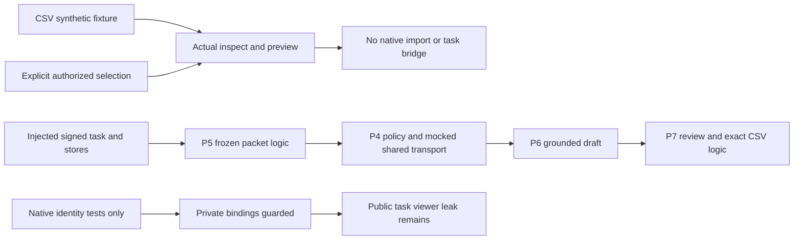
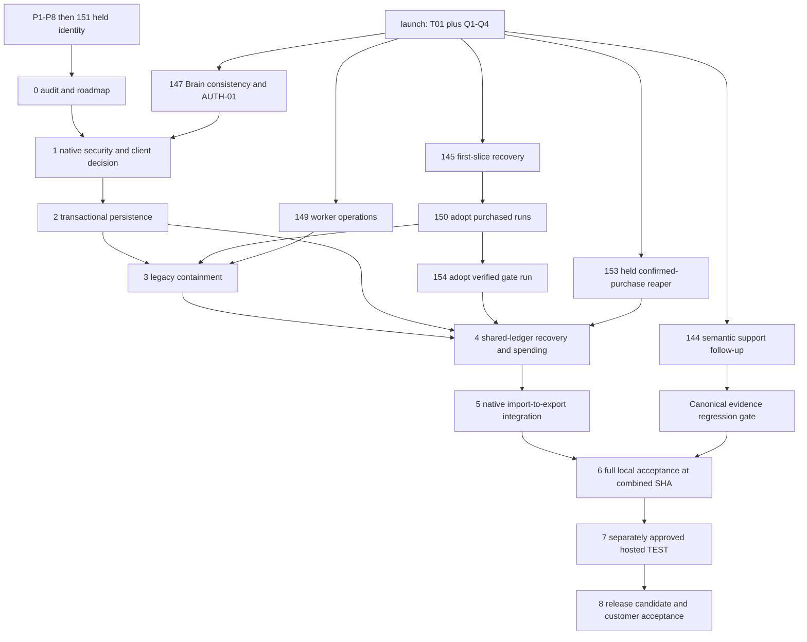

# Nosh pilot: implementation and production-readiness master plan

**Phase 0 complete; Phase 1 authorized, AUTH-06/OWN-01 independently verified; integrated security FAIL.**

Audit date: 2026-10-23 (Asia/Kathmandu); GitHub state refreshed at
2026-10-22T18:38Z. P1–P8 remain disabled. A7 remains NO-GO.
This document and [PROGRESS.md](PROGRESS.md) are the authoritative continuation
plan. Historical P1–P8 documents describe implementation slices, not completion
of the production-readiness phases below. In particular, #151 is a **partial
Phase 1 foundation**, not completed native security.

## 1. Authority, scope and continuation protocol

The approved product is caller preparation for **existing, explicitly approved
leads**, followed by human review and manual CSV handoff. It is not a prospecting
engine, a second CRM, automatic outreach or an Apollo API integration. Apollo is
Nosh's apparent central lead system; its status as CRM of record is unconfirmed.
The exact iGTM and Jungler products remain unconfirmed. Their APIs are not a
critical-path dependency.

“Proceed with the next phase” authorizes the unfinished next phase in the tracker,
including safe isolated implementation, disposable local SQL/testing, regression
fixes, draft PRs and owner coordination. It does **not** authorize merging,
deploying, hosted SQL/data writes, paid calls, customer records, credential/billing
changes, outreach or feature activation. Phase 7 can prepare a hosted execution
package under that phrase; actually executing it needs separate, specific approval.
A blocked phase stays blocked; do not skip to the next number to manufacture
progress. Work independently on safe unblocked tasks within the approved phase.

At every resume:

1. Read both files; locate the last phase receipt and outstanding approvals.
2. Fetch origin and inspect relevant PR heads, bases, comments, CI and successors.
   Never assume an open PR is merged/deployed or an owner has accepted a handoff.
3. Compare to the pinned inventory below. Record changed contracts and refresh
   dependencies before editing. Preserve dirty/unrelated worktrees.
4. Create/reuse an isolated `codex/` phase branch. Do not alter Claude branches.
5. Implement only the approved phase; update tests instead of weakening gates.
6. Run focused checks first, then required native, frontend and CI checks. Record
   exact SHA, commands, counts, failures and receipts. A mock is not native proof.
7. Review diffs for permissions, accounting and unrelated changes; open a draft PR.
   Update PROGRESS with PASS/PARTIAL/BLOCKED and remaining evidence gaps.
8. Stop at the phase boundary. Report PR/head, validation, risks, dependencies,
   next objective and specific missing approvals. Wait for user continuation.

All implementation phases keep features disabled until separately authorized
activation. “Complete” requires all acceptance criteria, not merely a PR or green
CI. Unrun mandatory tests are blockers. No second qualification, model routing,
execution, permission or financial authority may be introduced.

## 2. Pinned repository and PR inventory

Repository: `kathmanducreatives-code/aiworforce-platfrom`.
Integration baseline: `launch/hardening` at
`8b0e2b6bdb20d6fe30542da39f0170d514d52746`.
This documentation branch starts at #151; it does not integrate other branches.
The approved P1–P8 design is [PR #122](https://github.com/kathmanducreatives-code/aiworforce-platfrom/pull/122),
`docs/audits/agentory-outbound-outpost-readiness/pilot-plan/README.md` on that PR.
That historical plan is not in the pilot implementation ancestry; read it from
#122 rather than assuming its absence here means the plan never existed.

| Work | PR | Exact inspected head | Actual state / base |
| --- | --- | --- | --- |
| Design/audit | #122 | `bc960c3e1ea629760a01f1da78d90c928f6dcbdd` | open draft / launch |
| P1 scope and HMAC binding | #124 | `2ffd6f6cfebba8279bcca87f75ad6d2406117a2d` | open draft / launch |
| P2 client context/cache | #134 | `990efdfcd098cd35f51bdeb830aab1b5411b1ea7` | open draft / P1 |
| P3 CSV preview | #139 | `b04cef42bb512ee25fc2ef5dd45df4d9e93b4e80` | open draft / P2 |
| P4 model policy | #140 | `a5630119df1abffb7d6e7cb7f7a3161aba1bb25e` | open draft / P3 |
| P5 frozen packet | #142 | `2eea47a3d3f5b99c987e930f89168d330d02af8a` | open draft / P4 |
| P6 briefing | #143 | `3f5c9b0b374021727840b0f64be01e806bbcf282` | open draft / P5 |
| P7 review/export | #146 | `a8d66ac8192bd0db1105c63c0f735c79caf6ba0a` | open draft / P6 |
| P8 V2 replay/offline acceptance | #148 | `629c891af95a9c715493618ee373fef39c8781d3` | open draft / P7 |
| Held native identity | #151 | `001fa9db9a1a07266dfc700b0d7a21fbc322c7df` | open draft / P8 |
| T01 completion validation | #131 | `7a99cd6f1548618d891d4637ab3f7d90d4dd40ab` | merged into launch |
| Q1–Q4 integration | #141 | `cb22648126a017ed4c2108fdd17a2b3a6c3185ac` | merged into launch; #113/#123/#125 predecessors |
| E01 quote stance | #144 | `385173fe5a269f1b617a3ed29b75f707c08a7a96` | open draft / launch; backend |
| First-slice recovery | #145 | `37b3b1ac165111be8a45020a0359c0365f78dea5` | open draft / launch; backend |
| Company Brain consistency | #147 | `2a6e1dcfac0ab93106c1439e3f06eaf33e6e04dd` | open draft / launch; Brain |
| Worker operational fixes | #149 | `c704f9286e934cfc26680a5607141ce35d357065` | open draft / launch; backend |
| Adopt purchased run | #150 | `be625f46a5e8c63759ccdfd6e7d8612bfdb8ae86` | open draft / **#145**, not standalone |
| Confirmed-purchase credit reaper | #153 | `c742af5db3aabd497d5ee3dcb621b2afb1fd0bbd` | open draft / launch; held billing, backend approval required |
| Adopt verified gate run | #154 | `551d84bf788a9195d7e3fd01914945bc130e0392` | open draft / **#150**; backend |

No open PR in this table is established as deployed. #147's newer head changes
audit typing relative to P8's tested `c9c4859f`; this is not combined deployment
proof. #145/#150 and #147 overlap `run-agent/index.ts`. Pilot branches predate
the merged qualification/transport baseline: read-only compatibility tests do not
replace a reviewed combined integration commit.

### Available proof and its limits

- [P8 report](../../audits/agentory-outbound-outpost-readiness/p8/README.md):
  disabled offline flow, V2 fix, synthetic browser receipt; not native end-to-end.
- [Native security receipt](../../audits/agentory-outbound-outpost-readiness/production-readiness/phase-1-native-security.md):
  42 native identity tests passed; removing ownership guard causes two target
  failures. Real Postgres/PostgREST, synthetic JWT/session fixtures; no GoTrue.
- #151 [native CI run](https://github.com/kathmanducreatives-code/aiworforce-platfrom/actions/runs/39796963782)
  passed the identity foundation and caught the ownership mutation; its separate
  public-task readiness probe deliberately failed nonblocking. This is not a pilot pass.
- #151 [PR CI](https://github.com/kathmanducreatives-code/aiworforce-platfrom/actions/runs/39796963761)
  **FAILED**. Edge tests 9,194/0 and frontend/build passed, but infrastructure
  tests 186 passed/1 failed: `tests/infra/rlsCoversEveryTable.test.ts` misparses
  `create table outpost_private.clients` as table `outpost_private`. The same
  scanner fails the [manual Level 3 run](https://github.com/kathmanducreatives-code/aiworforce-platfrom/actions/runs/39797152548).
  The three database-contract shards and eight mutation jobs have successful
  contract steps; this does not make the aggregate gate green. Track CI-01.
- Prior local receipts at #151: 9,194 edge, 722 frontend, type/lint ratchets and
  build passed. None is a new Phase 0 runtime test or hosted receipt.
- No hosted target version, target catalog, real user session or customer result
  is established by this audit. LIVE VERIFIED is not claimed.

## 3. Actual execution path and missing bridges

All pilot backend modules below live under `supabase/functions/_shared/pilot/`.
Paths are exact existing files unless explicitly marked **proposed**.
Owner-only files introduced on #145/#147 are inspected from those PR heads,
not assumed present in the pilot branch.

| Stage | Implemented path | Missing or unsafe native boundary |
| --- | --- | --- |
| Select client | `src/pages/OutpostWorkspace.tsx`, `src/lib/workspaceSelection.ts`, `pilotContext.ts`, `pilot-context/index.ts` | default off; server owner/admin check exists; underlying public RLS/Brain/session contract incomplete; choice list rejects duplicate workspace |
| Authorize/bind | `pilotScope.ts`, `pilotPolicy.ts`, `pilotScopeStore.ts`, `pilot-scope/index.ts` | P1 HMAC over task payload/resources/policy; read/query CAS is not native registration transaction; #151 tables not connected to trusted writer |
| Existing CSV | `pilotImport.ts`, `pilotCsv.ts`, `pilotImportContract.ts`, `pilot-import/index.ts`, `src/lib/pilot/importPreview.ts`, `src/components/leads/pilot/ExistingLeadImport.tsx` | inspect/preview only; no durable imported rows, confirm operation or task creation |
| Client context | `pilotContextSnapshot.ts`, `pilotEvidencePacket.ts`, `pilotCompanyResearch.ts`, `pilotSnapshotStore.ts` | insert-once interface only; no native frozen packet writer/read adapter; canonical bytes must survive JSONB |
| Selected model | `pilotTaskModelPolicy.ts`, `pilotModelRegistry.ts`, `pilotModelAdapter.ts`, `pilotModelAccounting.ts`, `pilotTaskStore.ts` | real shared transport invoked in mocked tests; policy/credential/admission/settle dependencies injected; no native ledger adapter or production secret resolver |
| Call brief | `callBriefRunner.ts`, `callBriefPrompt.ts`, `callBriefContract.ts`, `callBriefValidator.ts`, `callBriefStore.ts` | source-ID choices deterministically rendered; store interface only; settle-before-output-write crash can lose accepted output; no permission to regenerate |
| Review | `pilotReview.ts`, `pilotReviewPolicy.ts`, `pilotExportStore.ts`, `src/lib/pilot/briefReviewController.ts`, `src/components/leads/pilot/BriefReviewPanel.tsx` | backend validators exist; append/CAS transactions injected; panel unmounted/default off; UI approval not authorization |
| Manual export | `pilotExport.ts`, `src/lib/pilot/reviewedBriefCsv.ts` | exact revision/approval/policy/packet hashes, expiry checks and formula-safe CSV; no native operation transaction/revocation proof; no remote update |
| Legacy execution | `supabase/functions/run-agent/index.ts`, `orchestrate/index.ts`, `worker/main.ts`, `worker/leadMissionRunner.ts` | membership/service authorization is not P1 task/model/packet authority; pilot-bound routes can reach public artifacts outside private policy |

There is no deployed/native review-export handler in this stack; the #122
proposed `pilot-review-export` endpoint was not shipped by the offline P7 slice.
Phase 5 must supply a guarded adapter to the existing review/export functions.
The disconnected fixture input `F` is test scaffolding, not an application
workflow. Phase 5 must remove that bridge from acceptance. No approved caller
brief constitutes qualification. Until a read-only canonical decision contract is
needed/agreed, show “not evaluated” and do not increment qualified counts.

P1's exact existing resource map in `pilotScopeStore.ts` is: account→`accounts`,
contact→`contacts`, lead→`lead_candidates`, memory→`saved_outputs`,
draft→`outreach_drafts`, research→`tool_calls`, task→`tasks`, plan→`task_plans`,
conversation→`conversations`, signal→`signals`, approval→`approvals`,
agent→`agents`, evidence→`lead_evidence`, lineage→`lead_lineages`.
`public.messages` is an additional conversation child to inventory. Phase 1
must trace these parents and every alternative public reader, not only new private
tables. Client IDs imported from CSV cannot confer ownership.

### Invariants that must survive every phase

- Same authenticated workspace/client, original task/actor/session, policy version,
  credential scope, approved input hash and frozen packet throughout execution.
- P1 signs/verifies scope; native FKs/RLS/transactions enforce storage constraints.
  Native SQL does not become a second HMAC verifier. Client-supplied scope is a request.
- Current membership/session checks on every sensitive operation and transaction;
  documented linearization with revoke/demotion. UI flags/cache never grant access.
- Four runtime model attempts maximum; **$0.05 model / $0.20 provider / $0.25 combined**.
  P4's stricter one attempt per signed task remains; no new namespace, regenerated
  task, changed selection or restart resets a consumed attempt or liability.
- Explicit selected OpenAI model must reach the actual shared transport/receipt.
  Claude/Gemini unavailable until separately verified. No deployment-wide key fallback.
- T01 rejects length/filter/tool/missing termination even if JSON parses; failed
  calls account usage once. No automatic repair/rebuy for terminal completion failures.
- Quote existence is not semantic support. Provenance/identity/time validation is
  deterministic; unsupported/contradictory claims remain labeled or withheld.
  Q1–Q4 remains the sole qualification authority; E01 stays backend-owned.
- Frozen V2 packet reused on retry. Canonical TS hashes, not `jsonb::text`; V1 is
  neither silently recaptured nor converted. Model reads never mutate Brain.
- Human edits are unverified annotations, not facts. Exact-version approval,
  current authorization, trusted time and no revocation are required at export.
- Review/download cost zero and have no execution capability. No sends, remote
  destinations, contact enrichment, discovery or live provider activity in this pilot.

## 4. Required decisions and owner contracts

### DEC-01 — client tenancy model (release-blocking)

The user selected the target during Phase 1 approval: **one agency workspace
containing multiple isolated client accounts, each with separate Company Brain**.
DEC-01 product direction is resolved. Its shared schema/API contract (AUTH-01)
remains blocked pending Company Brain/backend agreement; no request to repeat the
choice is necessary.

Existing P1/#151 still enforces one client/workspace. Removing its unique key alone
would mix workspace-scoped Brain, memory, roles and other records. It must stay
disabled and fail closed until the coordinated client domain is implemented.
Current second-client rejection proves only the historical boundary and cannot
satisfy required positive multi-client acceptance.

The proposed coordinated contract is
[CLIENT_CONTRACT.md](../../audits/agentory-outbound-outpost-readiness/production-readiness/phase-1/CLIENT_CONTRACT.md).
It requires one canonical client parent, client-scoped use of existing roles,
canonical Brain/version selection without agency/default fallback, native child
ownership, client credentials/destinations, original task/session and explicit
revocation fencing. Company Brain Claude owns its shared writer/reader/schema;
Backend Claude owns task lifecycle/execution/ledger contracts. Codex must not
independently introduce a competing registry/ACL/Brain implementation.

No shared DDL or owner file changes before that contract. Native same-workspace
positive tests remain BLOCKED; the requirement is retained through Phases 1/2/6.

### Owner interfaces and handoffs

| Contract | Owner / exact area | Required answer / acceptance |
| --- | --- | --- |
| AUTH-01 | Brain Claude: #147, `companyBrainUpdate.ts`, `companyBrainContext.ts`, `normalizeCompanyBrain.ts`, `src/hooks/useCompanyBrain.ts`, `src/pages/Auth.tsx`, workspace role/onboarding paths | effective role matrix; role-aware Brain writes; filtered login/context; original session refresh/revoke; client model; compatible authorization locks/epoch; nonpilot regression |
| EXEC-01 | Backend Claude: #145/#149/#150, `run-agent/index.ts`, `orchestrate/index.ts`, `worker/main.ts`, `leadMissionRunner.ts` | detect pilot scope before effects, reuse signed binding and frozen policy, original actor/session, lifecycle version separated from immutable inputs, no default service bypass |
| FIN-01 | Backend Claude: `executionLedger.ts`, `creditAuthorization.ts`, `modelSpendCeiling.ts`, `runBudget.ts`, recovery modules | durable logical model operation identity, atomic reserve/settle/output recovery; no new pilot ledger; crash/uncertain purchase semantics and exact caps |
| QUAL-01 | Backend Claude: merged Q1–Q4, open #144 | read-only decision version/evidence seam if used; no caller-brief shortcut to qualified; semantic support stays evaluator-owned |

Handoffs already exist on [#147](https://github.com/kathmanducreatives-code/aiworforce-platfrom/pull/147#issuecomment-6343156124)
and [#150](https://github.com/kathmanducreatives-code/aiworforce-platfrom/pull/150#issuecomment-6343156764)
for the native public-task leak, plus the initial owner/ledger contracts. Only
outgoing coordination was found at this audit; no owner approval is assumed.
Send concise updated contract/test links through those discussions when publishing
this plan. Track replies in PROGRESS; continue independent work inside approved scope.

Roles are existing roles, not a new registry. Current P1 allows owner/admin only.
Phase 1 must test editors/viewers as denied pilot operations unless an explicitly
agreed role contract grants a capability. Even a permitted client operator cannot
read another original actor's task by shared membership alone. The precise human
review/delegation contract must be decided before introducing collaborative access.

## 5. Blocker register: owner, phase and falsifiable release gate

Severity P0 blocks any customer enablement; P1 blocks dependable completion or
integration. All rows are mandatory unless explicitly scoped to future automation.

| ID | Severity / defect or gap | Owner / phase | Required proof (not just code) |
| --- | --- | --- | --- |
| DEC-01 | P0 multi-client target selected, shared implementation contract unresolved | Brain/backend + Codex / 1 | user target recorded; agreed client contract plus positive same-workspace native/browser isolation |
| SEC-01 | P0 viewer reads pilot payload via public.tasks | Codex + Brain/backend / 1 | existing `public-task-audit.ts` returns zero rows; direct writes/views/RPCs also denied; authorized/nonpilot controls pass |
| SEC-02 | P0 broad membership Brain/context/memory/public artifact access | Brain + Codex / 1 | catalog plus API/Edge role matrix for every parent/child path and session; no sibling path bypass |
| SEC-03 | P0 actual session/revocation and privilege assumptions unproven | Brain/backend + Codex / 1 | local GoTrue login/logout/refresh/expiry/demotion/multi-tab; compatible revoke transaction ordering |
| SEC-04 | P0 task registration/lifecycle and immutable parent coverage incomplete | backend + Codex / 1–2 | trusted signed registration, relational ownership; A→B→A never revives; normal lifecycle updates survive only agreed version rules |
| SEC-05 | P0 arbitrary foreign-workspace self-enrollment enables cross-workspace task reads | Brain owner + Codex / 1 | native self-insert owner refused; legitimate workspace creation/invitation and nonpilot controls pass |
| CI-01 | P1 schema-qualified RLS source scanner regression | Codex, coordinate CI owner / 1 | schema-aware parser adversaries; private and public missing-RLS mutants caught; no allow-list/skip; #151 combined CI green |
| OWN-01 | P1 raw contact can reference an unreadable account in a different workspace; P1 ancestry still refuses | Backend + Codex native ownership coordination / 1 | native raw insert denied and no row; legitimate same-workspace/account-less/deletion controls; P1 refusal and zero new bindings retained |
| DATA-01 | P0 no durable import or atomic creation of bound tasks | Codex / 2, wire 5 | native duplicate/conflict/concurrent/restart tests; exact input/client/source and all-or-nothing confirm |
| DATA-02 | P0 snapshots/drafts/reviews/approvals are interfaces only | Codex / 2 | real insert-once/CAS/batch/crash tests; full lineage; no half-approval/export |
| REPLAY-01 | P0 V2 replay not proven in native storage; V1 incompatible states | Codex / 2 | JSONB roundtrip, reordered source rows, Unicode/numbers, exact reuse; no recapture or model retry |
| EXEC-01 | P0 service/direct/worker legacy routes bypass pilot contract | backend + Codex / 3 | route-by-route spies plus native state: reject before memory/model/purchase/write; valid nonpilot service path retained |
| FIN-01 | P0 no durable pilot binding to shared accounting/output recovery | backend + Codex / 4 | concurrent last-budget admissions, crash boundaries, accepted-output adoption, one charge, uncertain liability held |
| FIN-02 | P1 #150 reentry can rerun model planning | backend / 4 | stable model operation key reused on resume; no repeat call or budget namespace reset |
| MODEL-01 | P0 credential ownership and actual model choice not natively enforced | Codex + backend / 2,4–5 | scoped resolver + ledger attempt; wrong client/provider/key/alias refused; no global fallback; failed usage once |
| UI-01 | P1 unmounted review panel/no complete native journey | Codex / 5 | real browser/auth/API/database flow, response races, exact manual CSV after commit |
| EVID-01 | P1 source labels do not prove claim meaning | Codex brief + backend #144 / 5–6 | fabricated/negated/contradictory/stale/wrong-entity controls; no unknown claim exported as fact; qualification remains canonical |
| INT-01 | P1 pilot stack not combined with current shared branches | respective owners / 6 | exact combined SHA with green required CI, compatibility, native/browser/recovery and mutation receipts |
| OPS-01 | P0 no hosted TEST or release/rollback proof | Codex + operator / 7–8 | separately approved synthetic TEST receipts; reversible operation; exact deployment/version/config manifest |
| QUALITY-01 | P1 no real-model/Nosh usefulness acceptance | user + Codex / 8 | separately approved bounded draft-only quality evaluation; actual chosen model/cost/provenance and human acceptance |
| AUTO-01 | future automation OO-01/02/03 unresolved | delivery/backend owners / outside pilot | atomic send, uncertain acceptance reconciliation, durable approval dispatch; mandatory before any future external dispatch |

## 6. Dependency graph and integration order

**Execution order:** phases 0→1→2→3→4→5→6→7→8, with user continuation at
each boundary. Prepare FIN-01/EXEC-01 contracts during Phase 1/2 so shared owners
can work independently; do not dispatch unapproved phase implementation here.
Codex can own native test fixtures, pilot storage adapters and UI integration;
shared role/Brain, executor and ledger changes require coordinated owner delivery.
No phase after Phase 0 is wholly independent of those security contracts.

**Review/integration order (proposal, no merge authorization):**

1. Pin current launch with merged #131/#141; review #144 separately with its owner.
2. Integrate owner-approved #145 **before #150 before #154**; #149 can be reviewed independently.
   #153 is code-independent held billing SQL; separate billing approval remains
   required. Neither #153 nor #154 fixes the model-planning replay key on its own.
   Resolve #147 vs #145/#150 `run-agent` changes in an isolated integration branch
   with both owners; require combined regressions, not last-writer-wins.
3. Restack/reconcile pilot #124→#134→#139→#140→#142→#143→#146→#148→#151
   against the reviewed baseline, preserving each feature and default-off state.
   Restacking/merges into owner branches are not authorized by this plan. Future
   phase branches may use isolated integration candidates; actual PR rebases/merges
   require explicit scope/owner agreement. Document exact resulting SHAs.
4. Review Phase 1 security then Phase 2 persistence then coordinated Phase 3/4
   patches, Phase 5 application wiring, Phase 6 acceptance, Phase 7 TEST pack,
   Phase 8 release pack. Split schema, backend, UI and owner fixes into small
   dependent draft PRs; never squash away evidence of remaining security gates.
5. Local disposable migration order: existing baseline/test bootstrap → reviewed
   shared schema changes → finalized #151 identity security → Phase 1 public
   policy/session changes → Phase 2 persistence constraints/RPCs → reviewed shared
   ledger extensions from Phase 4. Phase 3 must remain deny-by-default until these
   contracts exist. No grants/activation before all prerequisites are installed.
6. Hosted merge, schema, deploy and activation orders become an exact immutable
   manifest only at Phase 7/8, after reviewing target drift. Do not blindly run the
   held baseline, old P3 proposal or P8 sketch against an existing project.

## 7. Phase specifications

### Phase 0 — architecture and readiness audit

1. **Objective/value:** replace disconnected implementation claims with a resumable
   plan and truthful customer-readiness gates.
2. **Outstanding problems:** inconsistent historical phase numbering; missing
   implementation/owner/native dependencies; new same-workspace requirement;
   now-confirmed red CI scanner regression.
3. **Files/APIs/DB:** this `MASTER_PLAN.md`, `PROGRESS.md`; read-only inventory of
   all modules/PRs in sections 2–5. No runtime or schema edits.
4. **Ordered tasks:** refresh PRs/CI/comments; reconstruct actual flow; audit held
   SQL and interfaces; map each blocker to owner/phase/test; publish docs draft;
   record first next task and continuation protocol.
5. **Security/compatibility:** preserve all branches, disabled flags and owner
   boundaries; classify synthetic/native/live evidence separately.
6. **Acceptance:** every known blocker in section 5 has owner, phase and proof;
   each phase has all twelve planning fields; next phase is explicit; client
   tenancy conflict remains visible pending decision.
7. **Tests:** documentation scope/link/path checks, phase/blocker/requirement
   coverage and `git diff --check`; inspect existing CI receipts, do not claim
   reexecution or rerun full CI to validate prose.
8. **Migration/rollback:** none; documentation commit can be reverted without
   changing security behavior or historical receipts.
9. **Claude dependencies:** read-only ownership review; publish precise contract
   handoffs, no acceptance inferred from silence.
10. **Done:** reviewable docs PR, truthful progress/status and evidence audit.
11. **Deliverables:** these two files, pinned PR/CI matrix, graph and phase receipt.
12. **Approval boundary:** Phase 0 authorized now; stop after publishing. Phase 1
    implementation waits for user continuation and applicable owner coordination.

### Phase 1 — complete native database security

1. **Objective/value:** protect client information through actual public/private
   APIs, Edge handlers and sessions; retain intended legitimate/nonpilot access.
2. **Outstanding:** SEC-01..05, CI-01, DEC-01; missing native GoTrue proof,
   membership-only Brain policies, session/lifecycle contract, private trusted
   registration and incomplete public child ownership. #151 alone is insufficient.
3. **Exact areas:** `tests/outpost-native/{run.sh,fixture.ts,identity.test.ts,public-task-audit.ts}`;
   `tests/infra/rlsCoversEveryTable.test.ts`; `.github/workflows/outpost-native-security.yml`;
   held `supabase/migrations-held/20261022140824_outpost_native_identity_security.sql`;
   `pilotScope.ts`, `pilotScopeStore.ts`, `pilotContext.ts`, `pilotHttp.ts`;
   `supabase/functions/{pilot-scope,pilot-context,pilot-import}/index.ts`;
   existing `requestAuth.ts`, `workspaceAccessGuard.ts`; owner areas AUTH-01/EXEC-01.
   DB: `public.tasks`, `workspace_members`, `company_brain`, accounts/contacts,
   `saved_outputs`, `outreach_drafts`, `tool_calls`, `messages`, `conversations`,
   `lead_candidates`, `lead_evidence`, `lead_lineages`, `task_plans`, `signals`,
   `approvals`, `agents` and their native parents;
   `auth.sessions`, `outpost_private.clients/task_bindings` and their helpers/grants.
   Proposed test `tests/outpost-native/session-security.test.ts` (not yet present).
4. **Ordered implementation:**
   - Start with SEC-01: preserve failing native viewer probe as reproduction;
     inventory **all** effective SELECT/ALL policies, grants, views, RPCs and
     service-backed readers of bound pilot tasks. Agree scoped policy/Edge contract
     with Brain/backend; do not replace workspace permissions independently.
   - Finalize DEC-01's shared client contract and role/delegation/session/lifecycle decisions. Until then
     retain one-client constraint and default-deny; do not pretend that finishes
     same-workspace acceptance.
   - Correct CI-01 with schema-qualified object parsing and parser adversaries;
     preserve missing-RLS/anonymous access detection and empty allow-list.
   - Implement owner-agreed restrictive public-task/artifact policies and early
     Edge guards; test every permissive alternative. Authorize native registration
     only through verified P1 signed scope plus locked native parents; never grant
     browser/service-role blanket INSERT as the registration adapter.
   - Inventory/backfill feasibility for relational ownership keys; refuse ambiguous
     existing rows rather than assigning a default client. Keep pilot history
     immutable while distinguishing lifecycle versions from immutable task inputs.
   - Add real disposable GoTrue sessions and explicit revocation ordering tests;
     extend grants/default privileges/SECURITY DEFINER/retention checks. Promote the
     public API probe to required acceptance after fix; no continue-on-error pass.
5. **Security/compatibility:** authorization within transaction, restrictive policy
   composition (permissive RLS policies OR), fixed search_path/minimal EXECUTE,
   strict secret boundaries, nonpilot/service controls. A valid service key never
   substitutes for the original pilot authority. Owner BYPASSRLS limits explicit.
6. **Acceptance:** per-role direct reads/writes/approvals/exports/Edge refusals;
   zero viewer pilot payloads; owner/admin authorized controls; original session
   revocation visible; forged IDs and A→B→A restoration denied; DEC-01's selected
   tenancy contract passes native tests; no regression to legitimate workflows.
7. **Tests:** real PostgreSQL+PostgREST+GoTrue disposable stack; anon/owner/admin/
   editor/viewer/revoked/foreign/shared actor matrix; direct table/view/RPC/Edge;
   two connections and revoke race; JWT/signature/session/refresh/logout/expiry;
   missing/foreign composite parents, RLS/grants mutation proofs; frontend stale
   cache/session tests; full applicable CI including scanner and native gate.
8. **Migration/rollback:** new held, reviewed migration(s), not hosted installation.
   Preflight policy/catalog/data/locks and target Auth columns. Empty rollback
   pattern in `production-readiness/native-security-rollback.sql`; public policy
   reversal must restore exact prior definitions only with pilot disabled. Populated
   identity history retained; no destructive DROP/CASCADE or ambiguous backfill.
9. **Claude dependencies:** AUTH-01 and immutable task/registration EXEC-01;
   accepted handoff/owner patch before shared files. Native fixture/scanner work
   can proceed independently after phase authorization.
10. **Done:** all Phase 1 acceptance passes at pinned candidate SHA; owner contracts
    resolved; remaining later-phase gates explicit; no protected-data API bypass.
11. **Deliverables:** small security/scanner draft PR(s), held SQL/rollback, native
    API/session receipts and full role-route matrix; update tracker.
12. **Approval boundary:** only after “Proceed…”; local disposable SQL allowed;
    no hosted install, merge, customer enablement or shared-owner overwrite.

### Phase 2 — transactional persistence and data integrity

1. **Objective/value:** make imports, frozen context, briefs and approvals durable
   without half-written versions or loss of ownership/provenance.
2. **Outstanding:** DATA-01/02, REPLAY-01, SEC-04 lifecycle; P3 no import; stores
   are interfaces; P4 policy has no native versioned store; P8 SQL is scaffold only.
3. **Exact areas:** `pilotImport{,Contract}.ts`, `pilotScope{,Store}.ts`,
   `pilotContextSnapshot.ts`, `pilotEvidencePacket.ts`, `pilotSnapshotStore.ts`,
   `pilotTaskStore.ts`, `callBriefStore.ts`, `pilotExportStore.ts`, `pilotReview.ts`,
   `pilotExport.ts`; `tests/outpost-native/` and existing `_shared/pilot*` tests.
   Proposed adapter `supabase/functions/_shared/pilot/pilotPersistenceStore.ts`
   and `tests/outpost-native/persistence.test.ts`. DB: extend agreed
   `outpost_private` identity schema with versioned policy, import_batches,
   import_rows, snapshots, briefs, review events/operations and immutable approval/
   revocation/export records (exact final relation mapping reviewed before DDL).
   Model execution records reference existing `public.lead_execution_calls` /
   `lead_model_calls` projections; no pilot ledger. Public tasks remain existing tasks.
4. **Ordered implementation:** finalize schema/transaction design after Phase 1;
   consolidate old P3 `pilot_private` and P8 `outpost_private` proposals into one
   reviewed schema; implement authenticated import confirmation with global
   idempotency/input hashes and composite parents; atomic approved task creation
   and verified binding; implement snapshot insert-once/V2 canonical replay;
   durable policy/credential descriptors; brief/review revision chain/CAS plus
   atomic batch operations, rejection/revocation and export receipts; scoped read
   adapters. Model reserve/settle financial semantics remain FIN-01/Phase 4, with
   interfaces/fences agreed now so snapshots/revisions never invent spend authority.
5. **Security/compatibility:** recheck membership/session/policy under compatible
   locks at commit; deterministic lock order for batches; no direct client writes;
   source identities not just Apollo IDs; no mutable context backfill on resume.
   Separate immutable signed inputs from allowed task bookkeeping under EXEC-01.
6. **Acceptance:** exact retry returns original receipt; conflicting same operation
   refuses; no duplicate tasks/imports; packet hashes survive real JSONB; original
   Brain reused after update; every revision/event/source/receipt references same
   client/task; multi-task failure commits nothing; server time/expiry/revocation
   governs export. No lost approval or revived stale approval after crash.
7. **Tests:** native two-process/connection insert-once, duplicate/conflict and
   parallel CAS; kill before commit/after commit before ACK; parent tamper;
   cross-client shared external IDs; V2 key/array ordering, Unicode/numeric forms;
   V1 mismatch safely held; concurrent edit/approve/reject/revoke/export; batched
   last row invalid rollback; RLS/RPC/grants, empty/populated rollback and regression.
8. **Migration/rollback:** held migrations generated during implementation with
   exact FK/constraint/index/RPC privileges; use finalized Phase 1 schema, do not
   install old sketches. Preflight duplicates/ownership; bounded locks/validation
   strategy. Disable/revoke writer on rollback; retain populated append-only
   history and pending accounting; forward repair, never restore stale approval.
9. **Claude dependencies:** Brain snapshot version/current client contract;
   backend task lifecycle/registration and FIN-01 receipt IDs. No shared ledger
   implementation until coordinated Phase 4.
10. **Done:** actual adapters and transaction receipts, not Maps; all data integrity
    tests pass; model dispatch remains disabled/held until Phase 3/4 gates.
11. **Deliverables:** separate schema/RPC and adapter draft PRs, exact relational
    diagram, migration/reversal/preflight pack, native crash/concurrency evidence.
12. **Approval boundary:** phase approval for local implementation only. No hosted
    migrations/real imports. Unavailable owner contracts block completion.

### Phase 3 — legacy executor containment

1. **Objective/value:** ensure the pilot cannot take a less-protected route through
   existing Agentory executors, while preserving legitimate nonpilot/service jobs.
2. **Outstanding:** EXEC-01; private RLS cannot constrain privileged public-table
   reads/execution; membership/service checks lack task/model/packet authority.
3. **Exact areas:** owner-controlled `supabase/functions/run-agent/index.ts`,
   `supabase/functions/orchestrate/index.ts`, `worker/main.ts`,
   `worker/leadMissionRunner.ts`,
   `supabase/functions/_shared/leadMissionWorkerCore.ts`,
   `supabase/functions/_shared/firstSliceReentry.ts` (introduced on #145);
   inventory actual scheduler/cron/repair/kickoff/resume callers before closure;
   `pilotScope.ts`, `pilotPolicy.ts`, Phase 2 adapters. Proposed tests
   `tests/outpost-native/executor-containment.test.ts`; preserve owner kill/resume
   and task/lineage contracts. DB: existing tasks/queue/checkpoint/lease parents.
4. **Ordered implementation:** agree owner route inventory/guard interface; build
   failing pilot direct/service/reentry tests; owner integrates early recognition
   before context/memory/admission/model/provider/write; route only verified signed
   pilot work through existing execution architecture or refuse; bind immutable
   packet/model/context and generation fence; handle cancellation/revocation/resume;
   verify nonpilot positive controls and owner PR compatibility.
5. **Security/compatibility:** no separate pilot executor/queue; no user-asserted
   service flags; fail closed for missing/corrupt/reassigned binding. Context guard
   must precede loading foreign Brain/memory, not just precede model dispatch.
6. **Acceptance:** every supported path either uses same original authorized
   contract or returns explicit refusal before effects. Checkpoints cannot replace
   workspace/client/model/packet/actor; ordinary service workloads retain behavior.
7. **Tests:** direct JWT/service, orchestration, worker claim/kickoff/continuation,
   first-slice and checkpoint resume, scheduler/repair; spies on memory, ledger,
   model/providers/writes; cancellation/revocation/malformed binding before and
   after queue claim; generation loss fences output; native nonpilot controls;
   #145/#149/#150 and Q1–Q4 regression suites.
8. **Migration/rollback:** preferably application-only using prior storage. Any
   missing lifecycle constraints become reviewed held schema delta. Rollback
   disables pilot routes first; do not fall back to unguarded legacy execution.
9. **Claude dependencies:** backend owns guard placement/shared files and
   #145/#149/#150 integration; Brain owns normalized context access. Handoff
   includes route list, pre-effect contract and red-to-green tests.
10. **Done:** owner-reviewed patch and required entrypoint matrix all pass at
    combined SHA; unknown/new entrypoint fails closed for pilot scope.
11. **Deliverables:** coordinated narrow draft PR(s), route/effect matrix,
    nonpilot compatibility and native authorization receipts.
12. **Approval boundary:** phase approval does not grant ownership of Claude
    branches. Safe tests/pilot adapter work may continue while owner delivery waits.

### Phase 4 — durable recovery and spending integrity

1. **Objective/value:** prevent duplicate purchases, lost accepted output and
   understated liability on retries/crashes; guarantee existing caps end to end.
2. **Outstanding:** FIN-01/02, MODEL-01; P4 fixture admission not native; best-effort
   model ledger writes not transaction proof; settle→brief write gap; #150 vendor
   adoption does not solve repeated model planning.
3. **Exact areas:** existing `_shared/{executionLedger,creditAuthorization,
   modelSpendCeiling,runBudget,missionSpendCap,verifierPurchaseRecovery}.ts`,
   backend worker/recovery files from Phase 3; pilot `pilotModelAccounting.ts`,
   `pilotTaskStore.ts`, `pilotModelAdapter.ts`, `callBriefRunner.ts`, Phase 2 stores.
   DB: `lead_execution_calls`, `lead_model_calls` view, existing credit balance/
   transaction/reservation RPC contracts (`credits_reserve`, `credits_finalize`);
   inspect exact installed/proposed schema before extending. Proposed native tests
   `tests/outpost-native/accounting-recovery.test.ts`; no pilot financial tables.
4. **Ordered implementation:** owner defines stable logical model operation key
   bound to original task/input/packet/policy, independent of slice retry; implement
   atomic shared admission including pending holds and attempts; persist intent
   before dispatch; verify scoped credentials; persist actual provider/model/usage
   and terminal status exactly once; atomic accepted-output settlement or durable
   recovery receipt; recover accepted output rather than call again; uncertain
   dispatch remains held; reconcile provider adoption/credits with existing worker;
   exercise every crash/cancel/restart boundary and last-budget race.
5. **Security/compatibility:** one ledger, no new replay namespace; request-scoped
   secrets only; no fallback; shared limits plus stricter task cap; no model calls
   from review/export; T01 terminal failures do not buy repairs; zero speculative
   refunds after possible billing; actual usage overruns recorded and block admission.
6. **Acceptance:** <=4 runtime attempts, <=$0.05 model/$0.20 provider/$0.25 combined
   admission including pending liability; at most one P4 attempt per signed task;
   exactly one terminal usage projection; resume reuses receipt/output or holds;
   repeated planning does not dispatch again; approval/export spend remains zero.
7. **Tests:** concurrent last-dollar/attempt admissions across clients/tasks/workers;
   crash reserve→dispatch→headers→body→parse→settle→output→ACK; success/refusal/
   stop/length/filter/tool/missing termination/malformed/empty/timeout/429/5xx;
   missing/partial usage held; cancel before/after dispatch; duplicate settlement,
   restart/adoption, lost lease; wrong credential/provider/model/response alias;
   unknown purchase no rebuy; native ledger/RPC and owner recovery regression.
8. **Migration/rollback:** owner-reviewed extensions to existing ledger only if
   required; idempotency uniqueness and receipt parent constraints. Preflight
   existing pending/duplicate keys; reconcile before enabling. Disable new admission
   on rollback, preserve liabilities/receipts; never drop/reset counters or replay
   to “recover.” Exact held SQL/reversal reviewed before installation.
9. **Claude dependencies:** FIN-01 belongs to backend, including planning replay
   key and adopted purchases. Codex implements pilot adapter to agreed shared
   interface and native adversaries, not a competing accounting system.
10. **Done:** crash/concurrency matrix passes using native durable state and
    process restarts; financial invariants visible in receipts; no hidden retry.
11. **Deliverables:** shared-owner recovery PR + pilot adapter PR as needed,
    durable operation state diagram, ledger reconciliation and failure receipts.
12. **Approval boundary:** mocked transports only; no paid calls, credential
    installation or A7 dispatch. Unproven shared recovery is a blocker, not an
    excuse to use a Map/native pilot ledger.

### Phase 5 — native import-to-export integration

1. **Objective/value:** give a human caller one coherent existing-lead preparation
   workflow instead of separate modules and manual task IDs.
2. **Outstanding:** UI-01, EVID-01, native bridge/wiring; current review panel is
   unmounted and CSV preview creates no tasks. External APIs remain out of scope.
3. **Exact areas:** `src/pages/OutpostWorkspace.tsx`, `src/lib/workspaceSelection.ts`,
   `src/components/workspace/ClientWorkspaceSelector.tsx`,
   `src/components/leads/pilot/{ExistingLeadImport,BriefReviewPanel}.tsx`,
   `src/lib/pilot/{importPreview,taskModelOptions,briefReviewController,callBriefView,sourcePacketView,reviewedBriefCsv}.ts`;
   `pilotImport.ts`, `pilotContext.ts`, Phase 2 store, `callBriefRunner.ts`,
   `pilotModelAdapter.ts`, `pilotReview.ts`, `pilotExport.ts`; existing pilot Edge
   handlers. Proposed single guarded handler `supabase/functions/pilot-workflow/index.ts`
   and shared `pilotWorkflow.ts` only if existing handlers cannot express actions;
   this is an application adapter to existing execution, not another executor.
4. **Ordered implementation:** wire explicit authorized selection; approved-source
   preview and native confirm/task creation; freeze exact approved Brain/evidence;
   select permitted OpenAI policy; invoke existing contained execution with mocked
   provider; expose saved draft/source review; edit/reject/approve exact revision;
   prepare CSV only after atomic commit/current authorization; revoke and retry;
   remove injected native-store bypass from acceptance. Preserve default-off gates.
5. **Security/compatibility:** every action derives actor/session and reauthorizes
   server-side; source file/client approval is not inferred from arbitrary CSV;
   invalidate pending responses/cache on switch/logout; no factual upgrade from
   human notes, unknown funding/hiring/problems or mere quotation; no inline
   model/regeneration dependency on review/download. No Apollo API/write-back.
6. **Acceptance:** synthetic approved CSV→real native rows/task/binding→frozen V2→
   selected mocked shared transport→saved grounded draft→human exact approval→
   committed manifest/formula-safe CSV. Same request replay returns original;
   revoked/stale/changed revision cannot export; no foreign context in UI/logs/CSV.
7. **Tests:** actual browser+local Auth/Edge/PostgREST/DB, not direct injected
   controllers as the full proof; positive/negative A/B leads with shared source
   IDs; modified mappings/ownership/unknown assertions; late results/A→B→A/tabs;
   stale source/contradictions/quote misleading support; request/DB crash; no network
   outside local mocked routes; actual backend model/provider captured and costs.
8. **Migration/rollback:** expected wiring only after Phase 2/4. If schema gap
   emerges, document and close via reviewed held delta first. Rollback UI/routes
   to disabled state and retain data/approvals; never route to legacy execution.
9. **Claude dependencies:** Phase 1–4 signed/normalized/execution/ledger contracts;
   E01/Q1–Q4 read-only compatibility. No changes to qualification to make demo pass.
10. **Done:** full native local journey reproducible without fixture injection of
    task/snapshot/approval records; truthful manual-export status and no live calls.
11. **Deliverables:** small guarded UI/API wiring drafts, browser screenshots/
    request traces, source/approval/CSV manifests, audit-safe logs, updated runbook.
12. **Approval boundary:** synthetic/disposable local only. No real customer CSV,
    live model credentials, enabled hosted route or external dispatch.

### Phase 6 — comprehensive local security/reliability acceptance

1. **Objective/value:** certify the combined system rather than accumulating
   isolated green module tests; expose cross-phase bypasses and recovery failures.
2. **Outstanding:** INT-01 and any unresolved Phase 1–5 proof; combined baseline
   remains unverified, especially native sessions/persistence/executor/ledger/UI.
3. **Exact areas:** `tests/outpost-native/`, `tests/edge-functions/`,
   `tests/frontend/`, `tests/db-contract/`, `tests/security/`, existing CI workflow
   and `.github/workflows/outpost-native-security.yml`; proposed browser suite
   `tests/outpost-browser/` and auditable synthetic fixtures. CI owner coordinates
   required-gate integration; do not replace existing contract/mutation gates.
4. **Ordered implementation:** pin combined candidate and migration manifests;
   bootstrap fresh local actual stack; run role/security and positive native
   lifecycle; inject concurrency/crashes/model failures; run browser acceptance;
   run full relevant CI and targeted mutation proofs; triage regressions to owners;
   repeat only changed/affected proof then final combined gate; archive receipts.
5. **Security/compatibility:** block all nonlocal provider egress; no customer data
   or paid keys; test actual grants/catalog/HTTP effects and host boundaries, not
   source presence. Record synthetic Auth versus actual GoTrue distinctions.
6. **Acceptance:** every mandatory row in section 8 passes at exact same SHA/schema;
   no P0/P1 isolation, financial or data-integrity defect; no skipped/muted failing
   case; same-workspace scenario fulfilled or explicit user scope revision on record.
7. **Tests:** complete section 8 matrix plus existing Q1–Q4/E01/T01 and Brain/
   worker regressions; lint/type/build, native DB and mutations; cross-browser tab
   revocation, concurrency/process death; schema forward/rollback/reapply. Native
   positive controls required so denial cannot pass by disabling everything.
8. **Migration/rollback:** fresh install and upgrade from reviewed previous schema
   with synthetic data, interrupted migration and rollback lock timeouts; populated
   immutable history retained. No change to shared baseline just to satisfy tests.
9. **Claude dependencies:** owner-approved combined #147/#144/#145/#149/#150 or
   accepted successors, shared safety contracts and fixes for exposed regressions.
10. **Done:** reproducible immutable receipt bundle with all mandatory local gates
    PASS and reviewed unresolved nonblocking limitations; customer live readiness
    still unproven until later phases.
11. **Deliverables:** acceptance draft PR, exact CI URLs/tallies/native/browser
    receipts, candidate SHA/schema hashes, known-risk register and TEST prerequisites.
12. **Approval boundary:** phase approval allows local proof and draft fixes within
    ownership; no hosted TEST execution or merge; stop and request next phase.

### Phase 7 — controlled hosted TEST validation

1. **Objective/value:** validate target integration/configuration drift under
   isolated synthetic conditions, without production/customer exposure.
2. **Outstanding:** OPS-01; target identity/version/catalog/access/permissions not
   established; no hosted action authorized by continuation alone.
3. **Exact areas:** proposed `docs/plans/nosh-pilot-production-readiness/hosted-test/`
   preflight, migration manifest, env manifest, deployment plan, rollback and
   receipts; existing `scripts/supabase-target.mjs`, `scripts/verify-deploy-target.mjs`,
   `scripts/deploy/` safety mechanisms; precise Phase 1/2/4 held SQL and Phase 5
   build/Edge/worker artifacts. DB objects are those verified in Phases 1–6.
4. **Ordered implementation:** prepare immutable target/SHA/artifact/schema/config
   pack; read-only approved preflight; review preflight mismatch/backups and budgets;
   request specific permission for named TEST project, SQL, deployments, synthetic
   writes/cleanup, expected effects, rollback and timebox; execute **only** granted
   actions; keep providers mocked/egress denied; run hosted native/browser/security
   acceptance; reconcile and clean synthetic state; record deployment receipts.
5. **Security/compatibility:** confirm TEST differs from production with repository
   target tooling; no prod keys, copied customer data or paid provider credentials;
   private schema unexposed; minimal writer; P1–P8 remain customer-disabled. Any
   TEST-only internal test gate needs explicit activation scope and cannot imply
   customer activation. Preserve unresolved liability/history during cleanup.
6. **Acceptance:** exact approved TEST demonstrates complete synthetic flow, roles,
   revocation/expiry, transactions and mocked model selection/recovery; real
   target catalog/grants/function versions match manifest; rollback exercised and
   reconciliation clean. Preparation alone means PARTIAL/BLOCKED, not complete.
7. **Tests:** approved target preflight, deny production target, hosted Auth/API/
   DB/browser and two-client isolation; crash/retry, unsupported model, T01, cost
   zero review/export, network receipts, telemetry redaction and rollback checks.
8. **Migration/rollback:** existing target history/diff → compatible approved shared
   prerequisites → finalized identity/public security → persistence → shared ledger
   extensions; deny routes throughout; deploy dependent backend before UI exposure.
   Exact filenames/checksums/transaction boundaries before approval. On failure,
   disable routes/revoke writer/admission, retain history/holds, restore compatible
   application; no blind baseline/sketch install or destructive data cleanup.
9. **Claude dependencies:** owners review release contracts/deployed compatible
   worker/Brain/qualification versions and target-specific preflight regressions.
10. **Done:** approved synthetic TEST execution and reliable receipts, no mandatory
    open gate; missing action approval leaves phase explicitly BLOCKED.
11. **Deliverables:** reviewable hosted pack before action, approval record, exact
    deployed versions, validation/rollback/cleanup receipts after action.
12. **Approval boundary:** hosted deployment/migration/write/TEST activation each
    specifically authorized. No production changes, real imports, paid calls or
    customer activation. “Proceed” alone authorizes the preparation portion only.

### Phase 8 — release candidate and controlled customer-pilot readiness

1. **Objective/value:** produce an operable, honest and bounded customer pilot
   with clear rollback/incident response and evidence of caller usefulness.
2. **Outstanding:** QUALITY-01, final owner compatibility, Nosh source/client/model/
   account/consent/destination approval, operator monitoring and release actions.
3. **Exact areas:** proposed `docs/plans/nosh-pilot-production-readiness/release/`
   checklist/runbook/approval/quality receipts; exact reviewed app/Edge/worker
   artifacts and Phase 7 schema manifests; existing policy flags in `pilotPolicy.ts`,
   context/import gates and corresponding `VITE_OUTPOST_*` build flags. No new
   execution/dispatch product or automatic outreach integration.
4. **Ordered implementation:** review combined release SHA/PR merge order and all
   migration/deploy receipts; confirm Nosh client model/source approval and model
   account/data-sharing policy; prepare activation/stop/rollback runbook; request
   separate bounded real-model quality test approval (data, exact calls/costs,
   model, context and destination); execute only if approved; human-score evidence
   grounding/usefulness; fix scoped failures and rerun affected gates; issue final
   verdict and propose explicit controlled activation. No automatic release.
5. **Security/compatibility:** Company Brain #147/successors, onboarding/roles,
   merged Q1–Q4, T01 and worker/ledger contracts at same SHA; selectable unsupported
   models remain disabled. No expanded attempts/costs. OO-01/02/03 remain mandatory
   before future automated outreach or approved external dispatch, but do not block
   this draft-only manual CSV pilot when those paths remain inaccessible.
6. **Acceptance:** all mandatory technical/local/TEST gates pass; separately
   approved model quality/Nosh checklist satisfied; exact client/source/model and
   manual destination verified; monitoring/rollback staffed and exercised; no
   unresolved critical security/accounting/integration issue. PASS only with full
   evidence; CONDITIONAL explicitly names noncritical conditions and authorizes
   nothing; FAIL for any mandatory gate unmet. No live proof inferred from mocks.
7. **Tests:** release SHA compatibility and configuration drift; bounded actual
   model normalization/grounding/usage test only after approval; Nosh caller review
   of source-backed briefs/unknowns/questions/CSV; safe stop, revoke, alert and
   incident reconciliation drills; no send route accessible.
8. **Migration/rollback:** exact merge/migration/deploy/feature activation sequence
   frozen after TEST. Schema backward compatibility and populated rollback plan;
   disable access/admission first, reconcile held spend, retain audit history,
   restore compatible binaries without resurrecting approval or retrying calls.
9. **Claude dependencies:** final owner signoff on shared security/Brain/execution/
   ledger/qualification compatibility; no independent production merge or deployment.
10. **Done:** evidence-backed PASS/CONDITIONAL/FAIL release assessment, accepted
    limitations, runbook/onboarding and required user authorizations recorded.
    A prepared release candidate is not an enabled or production-verified pilot.
11. **Deliverables:** release manifest, final readiness report, Nosh acceptance,
    operator/incident runbook, activation/rollback proposal and evidence bundle.
12. **Approval boundary:** separate approval for merges, target migrations/deploys,
    any paid call/real data and feature activation. A7 remains independently NO-GO;
    this project does not authorize it at any stage.

## 8. Mandatory acceptance ledger

Each future receipt must name test, exact code/schema SHA, command, real-vs-mocked
boundaries, expected/actual result, timestamp and artifact/CI URL. Do not replace
native or browser rows with module tests. Current statuses live in PROGRESS.

| Gate | Positive control | Adversarial/failure proof | Phase |
| --- | --- | --- | --- |
| Tenancy | approved operator selects own client | two clients one workspace per DEC-01; separate workspaces; shared IDs/users; foreign/ambiguous enrollment | 1,6 |
| Roles/grants | owner/admin intended pilot and nonpilot access | editor/viewer/nonmember/revoked direct table/view/RPC/Edge; forged roles/service claims | 1,6 |
| Sessions | actual GoTrue authorized session | logout, refresh/revoke, stale JWT/tab, original session replaced, expiry during request; no silent rebind | 1,6 |
| Immutable task | native signed registration, allowed lifecycle version update | workspace/actor/client A→B→A, task payload mutation, cancelled task, wrong parent, bind race | 1–3,6 |
| Brain/memory | correct approved version only | foreign client/old memory, raw prompt fallback, login default workspace, cache late response | 1–2,5–6 |
| CSV import | approved small source and exact mappings | malformed UTF8/CSV, unsafe mapping/formula, mixed owner, duplicate/conflicting Apollo IDs, parallel confirm/restart | 2,5–6 |
| Frozen evidence | authorized source/company/time/input linkage | wrong company/client/employer, missing/stale timestamps, quote exists but negates claim, contradictory funding, V1/V2 JSONB/order tamper | 2,5–6 |
| Models | exact enabled OpenAI request/response model | Claude/Gemini/unknown alias, wrong/missing credential, silent global/provider fallback, client-key races | 4–6 |
| Completion/usage | explicit stop + valid output; usage once | length/filter/tool/missing termination, refusal/empty/malformed/partial JSON, timeout/cancel; no repair retry | 4–6 |
| Spending | admitted mocked run and settled receipt | concurrent last dollar/attempt, unpriced usage, unknown purchase, process death/reentry; <=4/.05/.20/.25 | 4,6 |
| Durability | saved original packet/output reused after restart | death before/after every commit/ACK, repeat settle, late response/generation loss; no repurchase | 2,4,6 |
| Brief grounding | factual choices backed by exact authorized facts | fabricated facts, irrelevant quote, unsupported problem/title/tech/funding/hiring, contradiction; no qualification promotion | 5–6,8 |
| Review/export | exact latest approved revision + manifest | edit/reject/revoke/TTL/concurrent approve, forged UI approval, batch stale row, changed op/body, duplicate download, CSV injection; no spend | 2,5–6 |
| Entry containment | legitimate nonpilot service and contained pilot | direct/run-agent/orchestrate/worker/kickoff/checkpoint/resume/scheduler/repair before any effect | 3,6 |
| Compatibility | same SHA passes full relevant CI | targeted security/ownership/accounting mutation proofs; schema upgrade/empty+populated rollback; shared owner regression | 6–8 |
| Hosted/runtime | approved synthetic TEST exact deployed SHA | wrong target/project/config, privileged exposure, rollback and monitoring failure; zero unapproved external operations | 7–8 |

## 9. Migration, release and operational controls

Historical P3 proposal uses `pilot_private`; P8 proposes six `outpost_private`
tables; #151 actually supplies a held two-table identity migration. They are
**alternatives at different maturity levels**, not three migrations to apply in
sequence. Keep #151 identity as the starting reviewed foundation, finalize the
client-model decision and extend that single domain; reconcile/drop obsolete
proposals in documentation when new reviewed DDL supersedes them.

Before each schema PR: inventory real baseline tables/types/FKs/policies/grants/
functions and PUBLIC/default privileges; list immutable and lifecycle columns;
show exact lock order, data preflight and compatibility period; create held SQL
with same-file RLS and deny grants; provide forward, empty rollback and populated
containment/repair procedures; prove with independent native connections. Local
runner must own a fresh labeled loopback-only database, reject arbitrary hosted
URLs, and clean only its own resources. Do not use existing user Supabase stacks.

Hosted plan must name **environment variable names, not secret values**. Existing
names include `OUTPOST_PILOT_SCOPE_ENABLED`, `OUTPOST_PILOT_SCOPE_POLICY`,
`OUTPOST_PILOT_SCOPE_SIGNING_KEY`, `OUTPOST_PILOT_CONTEXT_ENABLED`,
`OUTPOST_PILOT_CSV_PREVIEW_ENABLED`, `VITE_OUTPOST_PILOT_CONTEXT_ENABLED`,
`VITE_OUTPOST_PILOT_CSV_PREVIEW_ENABLED`; inventory all additional model/review/
execution switches at the release SHA. `MODEL_SPEND_ENFORCEMENT` and credit/run
limits must be verified against the shared admission policy; key presence or a
frontend flag is not enablement. Do not copy a deployment-wide `OPENAI_API_KEY`
into a client resolver as fallback. No secrets in logs, CSV, browser or receipts.

Release runbook must include: ownership/oncall, synthetic health probe, admission
failures and pending liabilities, late/duplicate model receipts, auth/export
refusals, stale packet/approval metrics, exact version audit, egress-denial alerts,
incident stop (disable entry/admission), scoped revoke, reconciliation without
rebuy, recovery/retention and post-incident review. CSV logs report “prepared for
manual download,” never “sent,” “Apollo updated” or “called.”

## 10. Exact next implementation task and completion gate

Phase 1 has now been approved; after owner contract delivery resume **Phase 1**,
not Phase 2. Create an isolated successor of the reviewed #151 foundation.

First task: **SEC-01 public-task exposure**. Use the existing native
`OUTPOST_NATIVE_PUBLIC_AUDIT=1 tests/outpost-native/run.sh` reproduction; enumerate
`tasks_workspace_member_access` plus every effective public task/artifact policy
and service reader; agree a narrow pilot-bound deny/read/owner/session contract
with #147/#150 owners; implement the smallest coordinated policy/Edge correction
and prove viewer zero rows with owner/admin/nonpilot positive controls. Promote
that probe to a required gate. Do not independently edit shared Brain/run-agent.
CI-01 parser correction and native permission inventory are safe parallel work
within that phase while owner contracts/DEC-01 wait; no test exclusions allowed.

Phase 1 cannot be called complete until DEC-01's shared client contract and AUTH-01/EXEC-01 are resolved,
real session/direct API proofs pass and all required CI is green. Every later
phase remains unapproved. The next receipt must clearly distinguish completed
local work, owner-blocked work and forbidden external actions.

## Phase 1 access correction update (2026-10-23)

Successor `codex/nosh-phase1-access-fixes` is stacked on #155; full implementation,
native receipts, remaining owner handoffs and held rollback are documented in
[ACCESS_FIXES.md](../../audits/agentory-outbound-outpost-readiness/production-readiness/phase-1/ACCESS_FIXES.md).
SEC-01's owned public task read/write correction and actual original-session API
adapter now pass native controls; enrolled Brain app-role writes are frozen.
This replaces the immediate owned implementation backlog, not the complete
Phase 1 acceptance definition. SEC-02/03/04/DEC-01 still need shared canonical
client/Brain roles, full route coverage and registration/lifecycle/concurrency.

SEC-05 owner #159 now exists with exact local integration proof and owner-reported
production catalog receipt. No duplicate membership implementation or hosted
application by Codex. Verify the target's catalog/history before any future release;
manual installation is not inferred from a GitHub deployment or missing migration
history. The integrated surface probe still FAILS on nonpilot viewer Brain PATCH,
which is an AUTH-01 owner delivery. One agency workspace/multiple isolated client
accounts remains the target; no fallback/default client or uniqueness removal.

No phase scope changed: Phase 2 remains unapproved, P1–P8 disabled, A7 NO-GO.

## Phase 1 native task / owner integration update (2026-10-23)

Successor `codex/nosh-phase1-task-lifecycle` on #166 adds a disabled, unserved
transaction adapter, not a second authorization/qualification/execution engine.
Existing P1 signs an already-existing task with its original Auth session and
verifies the exact image while native task/member/session/resource locks are held.
Register/replay and terminal cancellation are the only lifecycle operations;
app-role claims, output/checkpoint changes, ownership/payload restoration and
marker transitions into running states are denied. Native lost-response, abort,
concurrency, real refresh/logout/new-login and mutation tests are required CI.
Details/rollback: [TASK_SECURITY.md](../../audits/agentory-outbound-outpost-readiness/production-readiness/phase-1/TASK_SECURITY.md).

The earlier nonpilot Brain viewer defect now passes with exact Brain #169
`60be0471` + workspace #170 `cc83eb7e` + #159 SQL + owned guards in a disposable
source/database composition. No owner branch merged/edited, no deployed version
inferred. #169 intentionally denies all browser Brain writes; approved server
and provisioning controls pass, while enrolled pilot Brain remains frozen.
Actual post-model native authorization rechecks still need owner integration proof.

DEC-01 direction is fixed. A1–A6 contract agreed and A7 amended with Brain Claude:
`client_accounts` canonical parent; explicit role∧client grant for every role;
separate versioned `client_company_brain`; one intent-aware API; no agency fallback.
Terminal grant generation/revision and consistent final-transaction live session/
member/client/grant locking await exact owner confirmation/delivery. See current
[CLIENT_CONTRACT.md](../../audits/agentory-outbound-outpost-readiness/production-readiness/phase-1/CLIENT_CONTRACT.md).
Do not implement parallel shared DDL or remove one-client uniqueness alone.

Remaining Phase 1 implementation order:
1. Receive Brain canonical client/grant/version API and A7 generation/lock contract.
2. Implement owned pilot binding/descendant successor only against that contract;
   prove two clients within one agency workspace including overlapping external IDs.
3. Receive Backend pre-effect route guards and executable lifecycle contract;
   prove service/legacy paths refuse before foreign context/model/purchase effects.
4. Run complete role/session/revoke/regrant/alternative-route native matrix and
   legitimate invitation/nonpilot controls at the exact combined candidate.
5. Mark Phase 1 PASS only after all mandatory tests pass; then stop for Phase 2 approval.

No Phase 2 work, model budget change, hosted migration, deployment, paid execution,
customer access or activation. P1–P8 remain disabled and A7 NO-GO.

## Phase 1 AUTH-06: actual Brain handler revocation gap (2026-10-24)

Do not infer complete writer authorization from #169's correct browser-table DML
restriction. The independent successor on #171 calls #169's unmodified actual
setup/save_basics and generate/update handlers using real disposable Auth/REST/SQL.
Membership DELETE, viewer demotion or real logout commits after the initial check,
yet both handlers commit the edit: six deterministic security failures,17 passing
controls, zero external attempts. Report/test contract:
[BRAIN_HANDLER_AUTH.md](../../audits/agentory-outbound-outpost-readiness/production-readiness/phase-1/BRAIN_HANDLER_AUTH.md).

Brain Claude must supply the canonical native writer's final-transaction live
session/current role checks, consistent revoke locking and client grant-generation
checks when that schema arrives. Preserve content CAS and legitimate writer
controls. Codex owns this reproduction only; no shared handler/schema edits.
Add AUTH-06 to Phase1 acceptance: same23 tests must become23/0 on the delivered
candidate, then extend to model/activation timing and native concurrency. A second
Edge check followed by a service PATCH cannot establish this atomic boundary.
All previous client/descendant/legacy containment gates remain. Phase2 stays
unapproved, P1–P8 off and A7 NO-GO.

## Phase 1 native prerequisite / parent check continuation (2026-10-24)

Current #169 remains60be0471 with no AUTH-06 fix. #171 and #172 remain unchanged
at0d7cd077 and2ffc6b5f; both full/native CI pass, but #172's actual authorization
substep remains17 pass/6 fail. Read completed CI evidence, do not re-investigate
those unchanged Brain cases. No owner canonical client/grant/Brain delivery or
final A7 generation/lock acknowledgment was found. Phase1 is still FAIL.

Independent `codex/nosh-phase1-client-contract-gates` adds metadata-only READ ONLY
native prerequisites and registry-complete ownership evidence. Canonical three
tables absent, pilot canonical FK absent,15 resources inventoried,0 direct
canonical FKs. Structural/indirect evidence never substitutes for native two-client
behavior. Seven checker adversaries and full infra203/0 pass.

New OWN-01 native trace: a user who cannot read B's prospect account can create
contact A pointing to B (201, actual SQL mismatch). Original P1 prepare rejects404
and creates no signature/binding, while a legitimate parent passes. Coordinate
the shared native ownership successor, not a parallel registry or qualification
rewrite. No shared schema change before owner contract/overlap agreement.

Full receipts, exact commands, scope limits and owner next actions:
[CLIENT_BOUNDARY_GATES.md](../../audits/agentory-outbound-outpost-readiness/production-readiness/phase-1/CLIENT_BOUNDARY_GATES.md).
Phase2 unstarted, P1–P8 disabled, A7 NO-GO; no hosted/paid/customer effects.

## Phase 1 acceptance preparation on #173 (2026-10-24)

Owner refresh still shows #16960be0471 and #150be625f46; no new implementation
or final A7 contract is delivered. Existing #171/#172 preserved. Do not repeatedly
re-investigate unchanged AUTH-06/OWN-01. Owner-specific delivery checklists request
exact SHAs, native migration requirements, API/lock contracts and acceptance:
[Brain](https://github.com/kathmanducreatives-code/aiworforce-platfrom/pull/169#issuecomment-6385018708),
[Backend](https://github.com/kathmanducreatives-code/aiworforce-platfrom/pull/150#issuecomment-6385018852).

Independent test tooling on existing #173 now records protected external attempts,
blocks unknown/nonlocal/other-port HTTP, prohibits redirects, records swallowed
errors, aborts pending HTTP and denies late requests. No application permission,
model/provider routing or ledger authority is added. Eight conformance tests pass;
infra211/0; actual native Auth/REST/P1 path observes5 allowed local requests and
zero external/late/invalid attempts. OWN-01 remains rawFAIL/P1-denialPASS.

The complete per-invariant native execution matrix and incoming-patch order are
[INTEGRATION_ACCEPTANCE.md](../../audits/agentory-outbound-outpost-readiness/production-readiness/phase-1/INTEGRATION_ACCEPTANCE.md).
It distinguishes entry-time denial from authorization lost in flight, preserves
already-started authorized accounting, requires positive controls and both revoke/
write linearizations, and keeps same-workspace/client/grant/legacy tests BLOCKED
until actual owner APIs arrive. These are planned tests, not synthetic successes.
Phase1 FAIL; Phase2 unstarted; all pilot flags off; A7 NO-GO. No shared schema or
implementation changes, new PR, hosted effects, paid calls, customer operations,
merge or deploy.

## Current Phase1 integration receipt — 2026-10-25 (#185)

This section supersedes earlier current-status descriptions of AUTH-06/OWN-01;
historical reproductions remain unchanged. [Independent integrated evidence](../../audits/agentory-outbound-outpost-readiness/production-readiness/phase-1/INTEGRATED_VERIFICATION_2026-10-25.md)
pins169/174/176/178/183 and175/177/179/180/181/184, validates original17223/0
and original173 raw-parent/P1 PASS, and retains the two new native execution
failures and the cross-principal cache proof. Phase1 remainsFAIL.

Owner boundaries and completion gates:

- **Backend:** EXEC-PLAN parent-plan authorization/native integrity; EXEC-REVOKE
  authorization at effects after revocation; O3 membership writers/last-owner
  concurrency; immutable task client/grant/revision/original-session pins and
  resume consumption; parent/child same-client descendant constraints.177's
  workspace-only keys are verified and do not replace these client constraints.
- **Company Brain:** fix178's cache/session boundary, test actual mounted login
  changes and late responses. Keep AUTH-06 + versioned autosave;178's8fbfb6f3
  resolution and183 preservation passed real-GoTrue19/0. Contract176 mechanisms
  passed15/0 native; they remain held and switched off.
- **Codex:** preserve independent failing probes; consume finalized shared
  task/client contracts in the held private-client composite bridge, reconcile
  global lock order and prove same-workspace A/B/replay/session isolation.
  The existing one-client private enrollment is not a multi-client proof.

O3 A/O4 A accepted: Backend writers with Brain triggers; original live session
plus all immutable pins, no service substitution or silent re-pin. Atomic
registration must revalidate a GET pin snapshot. Member policy needs concurrent
last-owner tests. Client-id FKs plus workspace-only parent FKs cannot alone
prevent same-workspace cross-client parent links.

Current candidate excludes107's duplicate20261019120000 held recovery. An
independent version-uniqueness check prevents accidental integration of both
files.181 fixes the phase-clock fallback without changing live clock input;
its regression tests and full combined edge9401/0 pass.

Phase1PASS requires every security and shared integration gate to pass on one
exact candidate. Phase2 needs separate approval afterward. A7 remainsNO-GO
under its additional independent qualification, reliability, target and spending
acceptance requirements. No deployment/migration/paid-call authority is implied.

### Incoming Brain follow-up and full CI receipt (2026-10-25)

178 advanced toaeeba016 during verification. Its versioned first-save correction
was independently reproduced red on the old handler (0/1), then verified with
real-GoTrue24/0 on local assembly221da7ab. The patch preserves AUTH-06 and CAS;
original23 and pilot security are rerun. The earlier full CI40178721665 is
SUCCESS on914a3a71:16 jobs,22 contract files,98/98 mutation proofs. It does not
authorize customer use or claim coverage of later source changes. The final
verification commit and CI are linked from185. All execution/cache/shared client
integration blockers above remain, so Phase1FAIL and Phase2 unstarted.
